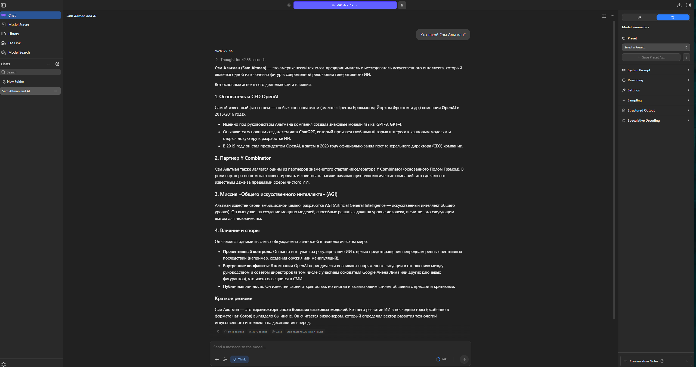
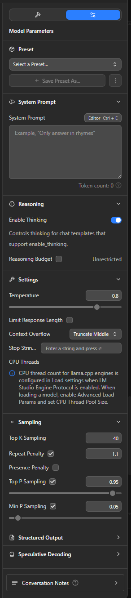
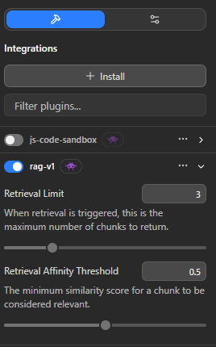
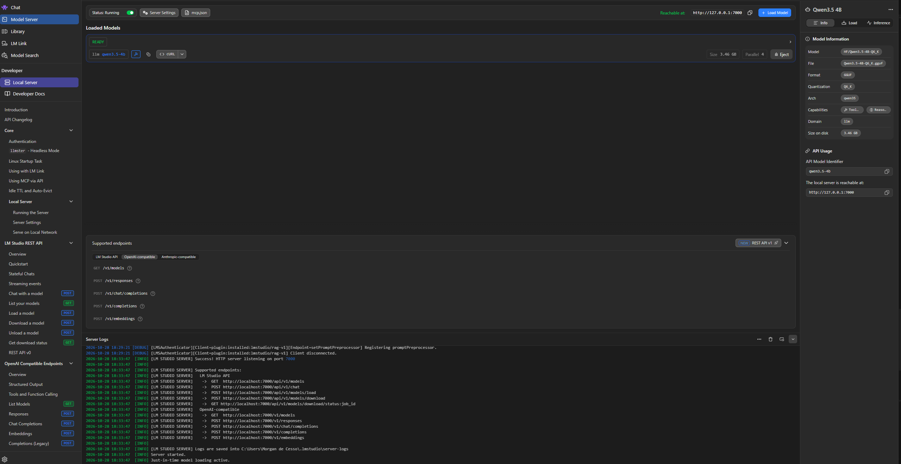
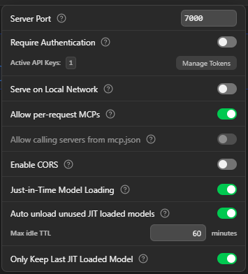
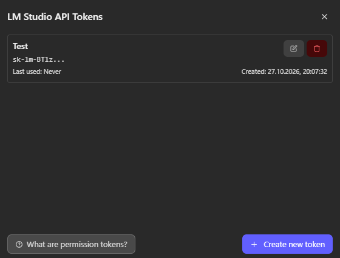
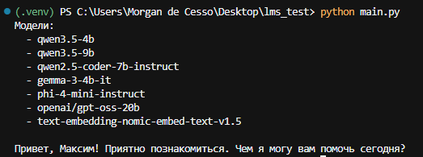

# Лабораторная работа №1. Эксплуатация локальной языковой модели

Цель: ознакомление с средствами эксплуатации языковых моделей на личных ПК/серверах.

---

## План

1. Выбор модели на Hugging Face
2. Возможности LM Studio
3. Задание

---

## 1. Выбор модели на Hugging Face

На [Hugging Face](https://huggingface.co/) можно найти множество моделей для различных задач. В рамках курса мы будем работать именно с языковыми моделями, однако знайте, что на данном сайте можно найти практически любые модели нейронных сетей:

* text-to-image 
* image-to-image 
* image-to-text 
* text-to-video

и т.д.

Наша задача - найти модель, которая будет хорошо работать на нашем компьютере. 
На выбор модели сильно влияют характеристики ПК, на котором она будет использоваться. Важнее всего смотреть на:

* Модель GPU и количество VRAM
* Модель CPU
* Объем ОЗУ
* Свободное место на диске

В названиях моделей часто встречаются обозначения `1.5B`, `3B`, `7B`, `8B`. Буква `B` означает миллиард параметров. Например, `7B` - приблизительно 7 миллиардов параметров.

Для хранения каждого параметра требуется память. Грубая оценка объёма только весов:

$$
M_{\text{весов}} \approx \frac{N \cdot b}{8},
$$

где:

* $N$ — количество параметров;
* $b$ — число бит на параметр;
* $M_{\text{весов}}$ — объём памяти в байтах.

Например, для модели `7B` при `16` битах:

$$
7 \cdot 10^{9} \cdot 16 / 8 = 14 \cdot 10^{9} \text{ байт} \approx 14 \text{ ГБ}.
$$

Квантование уменьшает точность представления весов и сокращает потребление памяти. 

| Размер модели | 16 бит | 8 бит | 4 бита |
|---|---:|---:|---:|
| 1.5B | 3 ГБ | 1,5 ГБ | 0,75 ГБ |
| 3B | 6 ГБ | 3 ГБ | 1,5 ГБ |
| 7B | 14 ГБ | 7 ГБ | 3,5 ГБ |
| 8B | 16 ГБ | 8 ГБ | 4 ГБ |

Реальные файлы и потребление памяти будут отличаться, т.к. квантование требует дополнительных данных, а отдельные части модели могут храниться с другой точностью.

Для первого запуска выбирайте модель с заметным запасом по памяти и устанавливайте контекст 2048 токена. Максимальный контекст из карточки модели использовать сразу не стоит.

Ниже ориентир для первого запуска:

| Конфигурация                             | С чего начать                                  |
| ---------------------------------------- | ---------------------------------------------- |
| 8 ГБ RAM, без подходящей дискретной GPU  | Модель 0.5-1.5B, Q4; скорость зависит от CPU   |
| 16 ГБ RAM, без подходящей дискретной GPU | Модель 1.5-3B, Q4                              |
| 16 ГБ RAM и 4 ГБ VRAM                    | Модель 1.5-3B, Q4                              |
| 16 ГБ RAM и 6-8 ГБ VRAM                  | Сначала 3B Q4, затем можно попробовать 7-8B Q4 |
| 16 ГБ RAM и 8 ГБ VRAM                    | Сначала 3B Q4, затем можно попробовать 7-8B Q4 |
| 32 ГБ RAM и 12-16 ГБ VRAM                | 7-8B Q4/Q5                                     |

Теперь к расширению файла, который будем качать с HF. Зачастую вы будете использовать два типа файлов: `.gguf` и `.safetensors`.

`.gguf` зачастую используется для запуска модели в LM Studio, `.safetensors` - для запуска модели в vLLM.

Я все дальнейшие тесты в LM Studio буду проводить на модели `Qwen3.5-4B-Q6_K`. [Ссылка прилагается](https://huggingface.co/lmstudio-community/Qwen3.5-4B-GGUF).

## 2. Возможности LM Studio

В рамках данной лабораторной работы будем использовать именно LM Studio. Для первого запуска модели и последующих экспериментов она подойдет идеально за счёт удобства интерфейса и своей доступности.
Использовать данную утилиту вы можете в роли двух персон: юзера и разработчика.



Как пользователь вы можете относительно просто запускать языковые модели на компе, чатиться с моделями, при должной настройке даже решать различные таски. 

 

Также, если вы пользователь, погружённый в тему, в целом-то вы можете настроить мдель прям под себя в соответствующем окне.

 

И даже работать с инструментами.

У разработчика же инструментарий поинтереснее. Вкладка `Model Server` - ваш главный друг, там вы будете смотреть логи, конфигурировать свой локальный сервер, фиксировать имеющиеся у вас эндпойнты.

Выглядит это следующим образом:



Предлагаю протестировать это дело. Первым делом включите аутентификацию (Require Authentication) и создайте себе персональный токен. Для этого зайдите в `Server Settings` и кликните на `Manage Tokens`.



Здесь создайте себе новый токен и ОБЯЗАТЕЛЬНО скопируйте его.



Теперь запустим сервер и напишем следующий код:

```python
from openai import OpenAI

client = OpenAI(
    base_url="http://localhost:7000/v1",
    api_key="sk-lm-BT1zfJuj:BVE6C9ywRup04Hidv4qu",
)

MODEL = "qwen3.5-4b"

models = client.models.list()
print("Модели:")
for model in models.data:
    print(f"  - {model.id}")

response = client.responses.create(
    model=MODEL,
    input="Я Максим",
)
print("\n")
print(response.output_text)
```

Он выведет нам список моделей, которые есть у нас на сервере, а также ответ модели на наш вопрос.

Вывод будет следующим:



Модель отвечает, что говорит о том, что локальный сервер работает исправно. Но нет предела совершенству. Меняйте гиперпараметры, редактируйте пресет, подключайте инструменты, одним словом - экспериментируйте, ведь именно для этого и задумывалась эта утилита! :)

## 3. Задание

1. Выбрать 2 оптимальные модели на Hugging Face для запуска в LM Studio.
2. Поочередно протестировать работоспособность моделей на локальном сервере в LM Studio.
3. Подготовить набор из пяти запросов для проверки моделей:

* объяснение понятия из программирования;
* написание небольшой функции на Python;
* поиск ошибки в готовом коде;
* извлечение информации из предоставленного текста с ответом в JSON;
* вопрос по предоставленному тексту, ответа на который в тексте нет. В инструкции указать: «Если информации недостаточно, сообщи об этом».

4. Выполнить одинаковые запросы к обеим моделям через локальный API. Для каждой модели зафиксировать название, число параметров, вариант квантования и настройки запуска. По возможности использовать одинаковые настройки.
5. Для одной модели исследовать влияние температуры. Выбрать один запрос и выполнить его по три раза при температуре `0.2` и `1.0`, сохранив остальные параметры. Сравнить разнообразие ответов, соблюдение инструкции и количество ошибок.
6. Сравнить модели по результатам эксперимента. Зафиксировать время получения полного ответа, корректность результата и соблюдение требуемого формата.
7. Сделать вывод о том, какая модель лучше подходит для данного компьютера и проверенных задач. Описать, какие ограничения обнаружены.

## А в какую папку класть скачанные модели?

В LM Studio в главном окне настроек есть пунктик `Models Directory`. Модели складируются в указанной там папке по иерархии:

```
- models
    - company/organization
        - model_name
            - model.gguf
```