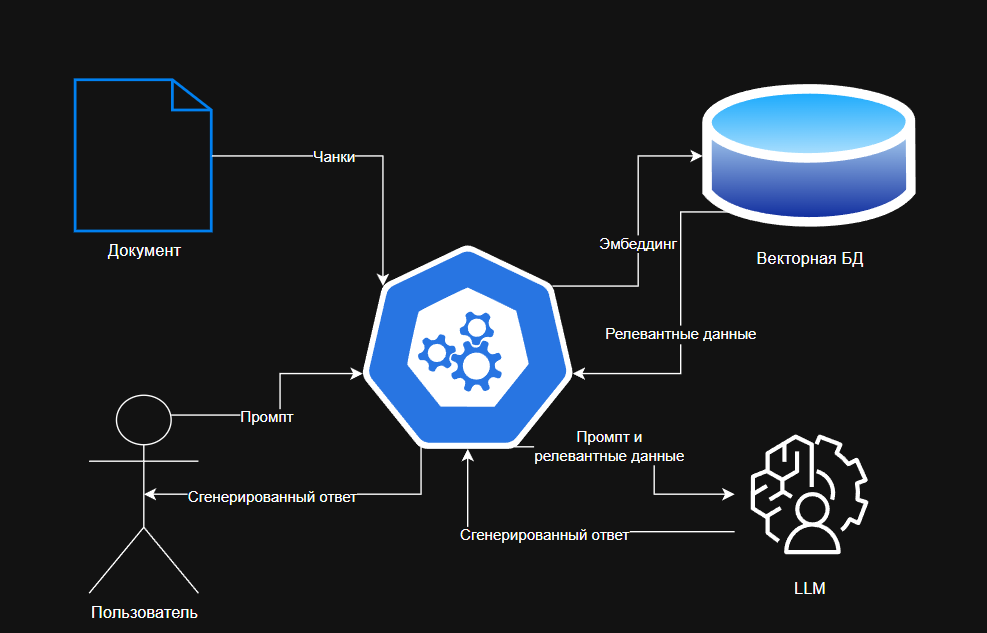

# Лабораторная работа №3. Интеграция RAG в рабочий процесс языковой модели

Цель: ознакомление с вариациями алгоритма RAG.

---

## План

1. Что такое RAG?
2. Классический RAG
3. CRAG
4. Text-To-SQL RAG
5. Мультимодальный RAG

---

## 1. Что такое RAG?

При работе с языковыми моделями главная проблема - актуальность данных, предоставляемых моделью пользователю. В специализированных системах (ИИ-консультант, ИИ-продавец и пр.) важно поддерживать релевантность данных, поступающих пользователю. К сожалению, модель в её первоначальной вариации (в вашем случае - с HuggingFace) не обладает данными о списке товаров предприятия, используемом на нём ПО, специфичных инструкциях. При попытке спросить модель о подобной информации есть шанс спровоцировать галлюцинацию со стороны языковой модели.

Для решения данной проблемы в 2020 году был предложен метод RAG (Retrieval Augmented Generation). Его суть заключается в том, что перед передачей пользовательского промпта языковой модели производится поиск релевантных фрагментов данных (как правило, в специализированных базах данных). Полученные данные передаются вместе с промптом пользователя языковой модели, что кратно повышает качество и актуальность генерируемого ответа.

Различных подходов к реализации данного метода достаточно много. В ходе этой работы рассмотрим четыре:

- Классический вариант;
- CRAG;
- Text-To-SQL RAG;
- Мультимодальный RAG.

## 2. Классический RAG

Классический вариант RAG предполагает использование векторной базы данных как места для хранения данных, повышающих актуальность и точность ответа языковой модели. Представить алгоритм можно в виде такой схемы:

Программно реализуем это с помощью ЯП Python, используем стандарт API OpenAI, векторную БД Qdrant. В качестве моделей локально развернём Qwen3.5 4B и bge-m3.
