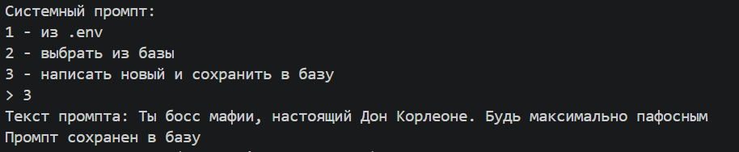
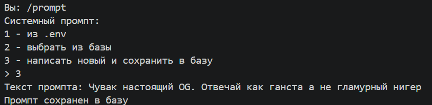
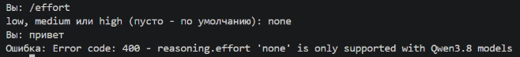
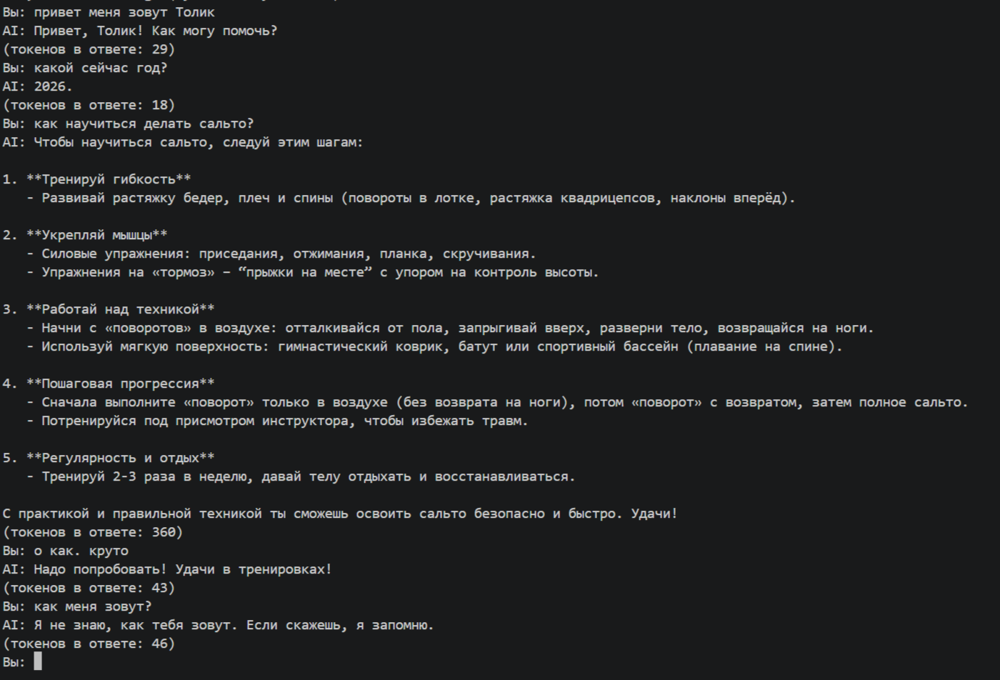

# Отчёт по лабораторной работе №0

Знакомство с OpenAI API. Написание простого чат-бота

Выполнил: Агаметов А. М. ИЭ-23


## Какой API использован

OpenAI платный, поэтому взят Groq из таблицы бесплатных API. Ключ создаётся в консоли console.groq.com в разделе API Keys. Groq совместим с библиотекой openai и поддерживает Responses API, поэтому код из методички почти не меняется:

- при создании клиента указан `base_url="https://api.groq.com/openai/v1"`
- вместо `gpt-6-luna` используется модель `openai/gpt-oss-20b`

`gpt-oss-20b` – открытая модель от OpenAI, а Groq – сервис, который запускает её на своих серверах и даёт к ней доступ через API. Адрес и модель вынесены в `.env`, поэтому для перехода на другой провайдер достаточно поменять эти строки.


## 1. Настройка окружения

```bash
python -m venv venv
venv\Scripts\activate
pip install openai python-dotenv
pip freeze > requirements.txt
```

`openai` – клиент API, `python-dotenv` – чтение настроек из файла `.env`. `pip freeze` сохранил в `requirements.txt` все установленные пакеты вместе с зависимостями (httpx2, pydantic и т.д.).

Ключ, адрес, модель и системный промпт лежат в `.env`:

```
API_KEY=<ключ Groq>
BASE_URL=https://api.groq.com/openai/v1
MODEL=openai/gpt-oss-20b
SYSTEM_PROMPT=Ты полезный ассистент. Отвечай по-русски, кратко и по делу.
```

`.env` добавлен в `.gitignore`, чтобы ключ не попал в репозиторий. Туда же добавлены `venv/` и `prompts.db`. Для примера в репозитории лежит `.env.example` без ключа.


## 2–3. Запрос к API и главный цикл

```python
load_dotenv()
api_key = os.getenv("API_KEY")
base_url = os.getenv("BASE_URL", "https://api.groq.com/openai/v1")
model = os.getenv("MODEL", "openai/gpt-oss-20b")
client = OpenAI(api_key=api_key, base_url=base_url)
```

`load_dotenv()` загружает переменные из `.env`, `os.getenv` достаёт ключ, адрес и модель. Второй аргумент `os.getenv` – значение по умолчанию, если переменной нет. В главном цикле программа читает вопрос, отправляет его в `client.responses.create()` и печатает `response.output_text` – текст ответа модели. На `exit` программа завершается.


## 4. Troubleshooting

Все ошибки библиотеки openai наследуются от класса `OpenAIError`, поэтому запрос обёрнут в один `try/except OpenAIError`. При неверном ключе, лимите запросов или неподдерживаемом параметре программа печатает ошибку и продолжает работать.


## 5. Задания

### Задание 1. Системный промпт и хотсвап

Системный промпт передаётся в API параметром `instructions`:

```python
params = {
    "model": model,
    "instructions": system_prompt,
    "input": messages,
}
```

При запуске и по команде `/prompt` можно выбрать:

1. промпт из `.env`
2. промпт из базы
3. новый промпт – он сохраняется в базу

База – SQLite. Таблица `prompts` с полями `id` и `text`:

```python
db = sqlite3.connect("prompts.db")
db.execute("CREATE TABLE IF NOT EXISTS prompts (id INTEGER PRIMARY KEY AUTOINCREMENT, text TEXT NOT NULL)")
```

Хотсвап: команда `/prompt` меняет переменную `system_prompt`, и следующий вопрос уже уходит с новым промптом. Промпт передаётся отдельно от истории, поэтому перезапускать программу не нужно, а история диалога сохраняется.





### Задание 2. reasoning.effort и temperature

Команды `/effort` и `/temp` задают параметры. Если значение не задано, параметр не передаётся и модель использует своё значение по умолчанию:

```python
if effort:
    params["reasoning"] = {"effort": effort}
if temperature is not None:
    params["temperature"] = temperature
```

Для `temperature` проверка `is not None`, потому что `0` в Python считается ложью и без неё `temperature 0` не передавалась бы.

**reasoning.effort** – сколько модель рассуждает перед ответом. Вопрос: «Сколько раз за сутки часовая и минутная стрелки совпадают? Дай число и короткое объяснение». Правильный ответ – 22, стрелки совпадают каждые 12/11 ч ≈ 1 ч 5 мин 27 с.

| effort | токенов в ответе | ответ | интервал в объяснении |
|---|---|---|---|
| low | 162 | 22 | ≈ 1 ч 5 мин |
| medium | 362 | 22 | 65 мин 5 с |
| high | 383 | 22 | 1 ч 5 мин 27 с |

Все уровни дали правильное число, но с ростом effort модель рассуждает дольше и тратит больше токенов (в них входят токены рассуждения), а детали становятся точнее: верный интервал только на high.

`effort: none` Groq для этой модели не принимает:



**temperature** – насколько случайно модель выбирает следующий токен. Вопрос: «Придумай название для кофейни рядом с университетом. Напиши только название», по три попытки:

| temperature | 1 | 2 | 3 |
|---|---|---|---|
| 0 | Кофейный Кафедра | Кофейный Кафедра | Кофейный Кафедра |
| 0.7 | Университетская Кофейня "Литературный Зерно" | Универсальный Вкус | КофеУниверсал |
| 1.5 | Молодёжь + Кофе | БибликоФонтан. | Caffeine & Cognition |

На 0 все ответы одинаковые – модель всегда берёт самый вероятный токен. На 0.7 ответы разные, но по теме. На 1.5 появляются неожиданные варианты, английский и лишняя точка – модель хуже держит формат.


### Задание 3. История диалога

Модель сама ничего не помнит, каждый запрос для неё новый. Поэтому переписка хранится в списке `history`, и с каждым вопросом он отправляется целиком:

```python
messages = history + [{"role": "user", "content": question}]
...
history.append({"role": "user", "content": question})
history.append({"role": "assistant", "content": answer})
history = history[-6:]
```

`history[-6:]` оставляет 6 последних сообщений – 3 от пользователя и 3 от ассистента. Вопрос и ответ добавляются только после успешного ответа, поэтому при ошибке в истории не остаётся вопроса без ответа. Команда `/history` показывает историю, `/clear` очищает её.

Проверка: имя названо в первом сообщении, бот его помнит. После трёх новых вопросов первое сообщение вытесняется из истории, и бот имя забывает.



Ограничение нужно, потому что история отправляется с каждым запросом: без него запросы росли бы и упёрлись бы в лимиты и размер контекста модели.


## Вывод

Освоена работа с Responses API через библиотеку openai с бесплатным провайдером Groq. Сделан чат-бот, в котором:

- системный промпт берётся из `.env` или из базы SQLite и меняется во время диалога
- можно задать `reasoning.effort` и `temperature`: effort влияет на объём рассуждения и точность, temperature – на разнообразие ответов
- бот помнит 6 последних сообщений
