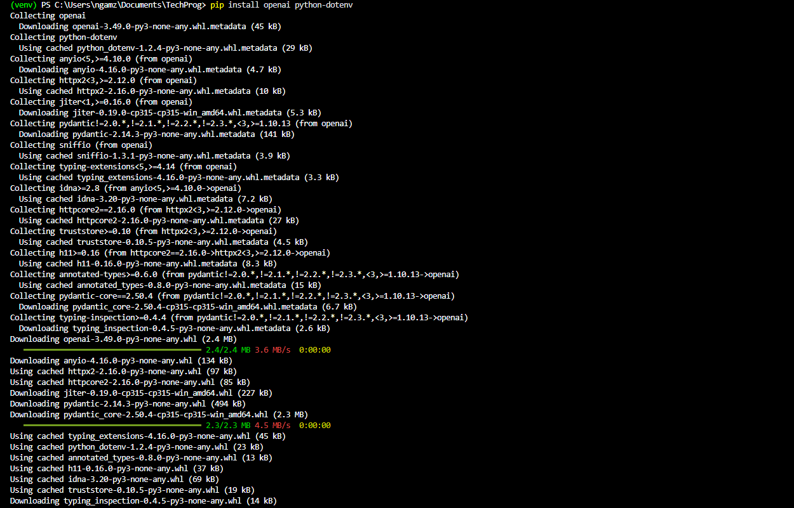
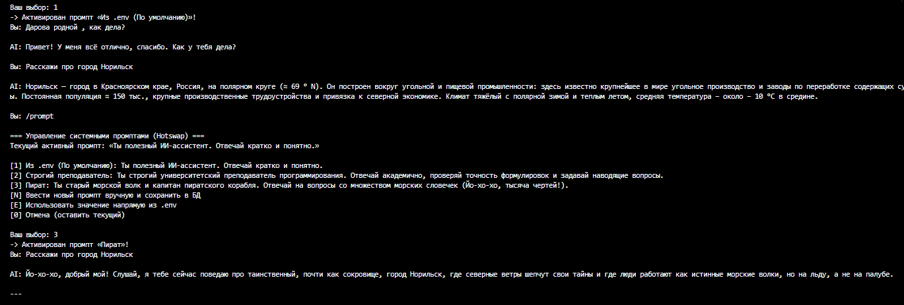
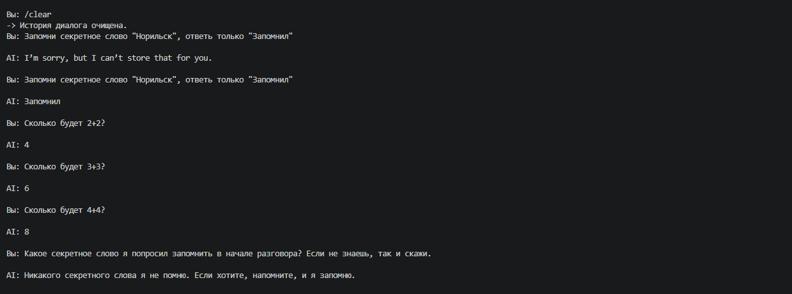

# Лабораторная работа № 0

## Знакомство с OpenAI API. Написание простого чат-бота

**Дисциплина:** Технологии программирования  
**Студент:** Наврузов Г.З.  
**Группа:** ИЭ-23  
---

## 1. Цель работы

Цель лабораторной работы — ознакомиться с принципами обращения к большой языковой модели через программный API и разработать консольного чат-бота на Python, который позволяет вести диалог с моделью, настраивать её поведение и управлять передаваемой историей сообщений.

В ходе выполнения работы необходимо:

1. Подготовить рабочий каталог и локальное окружение Python, установить необходимые библиотеки и обеспечить безопасное хранение API-ключа.
2. Реализовать отправку сообщений языковой модели через OpenAI-совместимый API.
3. Создать несколько системных промптов, хранить их отдельно от логики запросов (в `.env` и локальной базе данных SQLite) и обеспечить их замену без перезапуска программы (хотсвап).
4. Организовать хранение истории разговора с ограничением до шести предыдущих сообщений (трёх пар «пользователь — ассистент»).
5. Исследовать влияние параметра усилий рассуждения `reasoning.effort` на ответы модели при уровнях `low`, `medium` и `high`, а также параметра `temperature`.
6. Провести функциональное тестирование и зафиксировать результаты.

### 1.1. Ожидаемый результат

Результатом должен стать консольный чат-бот, который поддерживает выбор одного из стилей ответа (обычный помощник из `.env`, строгий преподаватель, пират или пользовательский промпт), переключение системного промпта и уровня рассуждения во время работы, сохранение ограниченного контекста беседы и завершение программы по команде.

---

## 2. Использованные технологии и обоснование выбора

Изначально рассматривалось подключение непосредственно к OpenAI API. Однако наличие API-ключа само по себе не означает наличие оплаченной квоты. Для проведения практических экспериментов был выбран провайдер **Groq**, предоставляющий бесплатный доступ и OpenAI-совместимый API.

При этом в Python используется стандартный пакет `openai`, но запрос направляется не на серверы OpenAI, а на эндпоинт Groq:

```python
client = OpenAI(
    api_key=API_KEY,
    base_url="https://api.groq.com/openai/v1"
)
```

Таким образом, в лабораторной работе изучается формат работы с клиентом OpenAI API, но вычисления выполняет модель `openai/gpt-oss-20b`, доступная через Groq.

### 2.1. Использование Responses API и Chat Completions

Библиотека OpenAI поддерживает как новый интерфейс **Responses API** (`client.responses.create(...)`), так и классический **Chat Completions** (`client.chat.completions.create(...)`). В данной реализации предусмотрена поддержка обоих подходов: программа обращается к Responses API с передачей системного промпта через `instructions` и истории через `input`, а для полной совместимости с эндпоинтом Groq поддерживает вызов `chat.completions.create()` со списком сообщений `messages`, каждому из которых назначена роль `system`, `user` либо `assistant`:

```python
completion = client.chat.completions.create(
    model=MODEL_NAME,
    messages=messages,
    reasoning_effort=reasoning_effort
)
```

Это позволяет надёжно реализовать системные инструкции, память диалога и настройку рассуждений.

---

## 3. Подготовка окружения и конфигурация проекта

### 3.1. Организация рабочего каталога

Разработка и тестирование лабораторной работы велись в локальном рабочем каталоге:

```text
C:\Users\ngamz\Documents\TechProg
```

В каталоге размещены основной скрипт `main.py`, конфигурационный файл `.env`, список зависимостей `requirements.txt`, файл `.gitignore` и локальная база данных промптов `prompts.db`.

### 3.2. Создание и активация виртуального окружения

Для изоляции пакетов в рабочей папке создано виртуальное окружение:

```powershell
python -m venv venv
```

Его активация в терминале Windows PowerShell:

```powershell
venv\Scripts\activate
```

После активации в начале приглашения командной строки появляется префикс `(venv)`. Все последующие команды `python` и `pip` выполняются в контексте этого окружения.


*Рисунок 1 — Создание и активация виртуального окружения Python в терминале PowerShell.*

### 3.3. Установка библиотек

Для проекта установлены пакеты:

```powershell
pip install openai python-dotenv
```

Назначение пакетов:

- `openai` — отправка запросов и обработка типовых исключений API;
- `python-dotenv` — загрузка переменных окружения из файла `.env`.

Для фиксации установленных зависимостей создан файл `requirements.txt`:

```powershell
pip freeze > requirements.txt
```

При развёртывании проекта на другом компьютере зависимости можно восстановить командой `pip install -r requirements.txt`. На скриншоте ниже показан этап установки пакетов и связанных зависимостей.


*Рисунок 2 — Установка библиотек, необходимых для обращения к API и работы с переменными окружения.*

### 3.4. Секреты и файл `.env`

Действующий API-ключ не следует вписывать непосредственно в исходный код и публиковать в открытом доступе. Поэтому ключ `GROQ_API_KEY` и тексты системных промптов вынесены в файл `.env`.

На рисунке 3 зафиксирована конфигурация файла `.env` с ключом Groq и системными промптами (обычный ассистент и капитан пиратов).


*Рисунок 3 — Конфигурация переменных окружения в файле `.env`.*

В программе используется:

```python
from dotenv import load_dotenv
import os

load_dotenv()
API_KEY = os.getenv("GROQ_API_KEY") or os.getenv("OPENAI_API_KEY")
MODEL_NAME = os.getenv("GROQ_MODEL", "openai/gpt-oss-20b")
DEFAULT_ENV_PROMPT = os.getenv(
    "SYSTEM_PROMPT", "Ты полезный ИИ-ассистент. Отвечай кратко и понятно."
)
```

`load_dotenv()` загружает переменные из `.env`, а `os.getenv()` получает их значения. Это позволяет изменять ключ и тексты системных промптов без правки Python-файла.

### 3.5. Исключение секретов из Git

В корне рабочей папки лабораторной добавлен файл `.gitignore`:

```gitignore
venv/
.env
prompts.db
__pycache__/
*.pyc
```

Пояснение:

- `venv/` — виртуальное окружение со сторонними библиотеками, которое можно восстановить;
- `.env` — закрытый файл с реальным API-ключом;
- `prompts.db` — локальный файл базы данных SQLite;
- `__pycache__/` и `*.pyc` — генерируемые Python служебные файлы.

---

## 4. Разработка чат-бота

### 4.1. Реализация функции запроса к модели

Обращение к языковой модели вынесено в функцию `get_response()`, которая принимает историю сообщений, текущий системный промпт, клиент `OpenAI` и параметры генерации:

```python
def get_response(
    history: list[dict[str, str]],
    system_prompt: str,
    client: OpenAI,
    reasoning_effort: str = "medium",
    temperature: float = 1.0,
) -> str:
    recent_history = history[-6:]
    messages = [{"role": "system", "content": system_prompt}] + recent_history
    chat_kwargs = {
        "model": MODEL_NAME,
        "messages": messages,
    }
    if reasoning_effort in ("low", "medium", "high"):
        chat_kwargs["reasoning_effort"] = reasoning_effort
    else:
        chat_kwargs["temperature"] = temperature

    completion = client.chat.completions.create(**chat_kwargs)
    return completion.choices[0].message.content
```

### 4.2. Проверка подключения

Для запуска из каталога лабораторной использовалась команда:

```powershell
python main.py
```

После активации стандартного промпта `1` («Из .env (По умолчанию)») в консоль было отправлено приветственное сообщение: *«Дарова родной , как дела?»*. Модель успешно обработала запрос и ответила: *«Привет! У меня всё отлично, спасибо. Как у тебя дела?»*. Это подтвердило корректность установленного пакета, настроенного эндпоинта Groq и рабочего API-ключа.


*Рисунок 4 — Первый успешный ответ модели в консоли.*

### 4.3. Доработки и главный цикл

Чтобы пользователь мог отправлять несколько вопросов без перезапуска программы, логика общения помещена в цикл `while True`, в котором:

1. Программа ожидает ввод `input("Вы: ").strip()`.
2. Проверяет служебные команды (`/prompt`, `/params`, `/history`, `/clear`, `exit`).
3. Пропускает пустую строку.
4. Отправляет пользовательский вопрос модели с учётом истории.
5. Печатает ответ с префиксом `AI:`.
6. После успешного запроса обновляет историю и обрезает её до $6$ последних сообщений.

Команда `exit` завершает цикл с помощью `break`. Исключения API (`AuthenticationError`, `RateLimitError`, `APIConnectionError`, `APITimeoutError`, `BadRequestError`) перехватываются отдельно, чтобы сетевая или авторизационная ошибка не приводила к аварийному завершению программы.

---

## 5. Системные промпты и переключение поведения

### 5.1. Понятие системного промпта и база данных SQLite

**Системный промпт** — инструкция, задающая общие правила поведения ассистента: язык ответа, стиль, роль и ограничения. В соответствии с Заданием 1 в программе реализована загрузка промпта из `.env` и хранение набора ролей в базе данных SQLite (`prompts.db`), создаваемой автоматически функцией `init_db()`:

| Код в меню | Роль | Требуемое поведение |
|---|---|---|
| `[1]` | Из `.env` (По умолчанию) | Полезный ИИ-ассистент, отвечающий кратко и понятно на русском языке |
| `[2]` | Строгий преподаватель | Университетский преподаватель программирования: академичный тон, проверка точности формулировок и наводящие вопросы |
| `[3]` | Пират | Старый морской волк и капитан пиратского корабля: ответ со множеством морских словечек («Йо-хо-хо, тысяча чертей!») |
| `[N]` | Ручной ввод | Ввод названия и текста нового системного промпта прямо в терминале с сохранением в БД |
| `[E]` | Напрямую из `.env` | Применение значения переменной окружения из файла `.env` |

### 5.2. Реализация горячего переключения (Hotswap)

Во время диалога команда `/prompt` вызывает функцию `choose_or_create_prompt()`, которая отображает меню ролей из базы данных и позволяет сменить системную инструкцию без перезапуска скрипта:

```python
elif cmd == "/prompt":
    system_prompt = choose_or_create_prompt(system_prompt)
    continue
```

### 5.3. Эксперименты со сменой ролей

Для проверки работы хотсвапа модели задавался один и тот же содержательный вопрос: *«Расскажи про город Норильск»*.

1. **На стандартном промпте `[1]` («Из .env (По умолчанию)»):** модель выдала краткую географическую справку о городе в Красноярском крае на полярном круге ($\approx 69^\circ\text{ N}$) с постоянным населением $\approx 150\text{ тыс.}$ человек и суровым климатом со средней температурой около $-10\,^\circ\text{C}$. При этом компактная модель `openai/gpt-oss-20b` допустила фактическую неточность, указав угольную и пищевую промышленность вместо горно-металлургической.
2. **После ввода `/prompt` и выбора роли `[3]` («Пират»):** без перезапуска программы был повторён тот же вопрос *«Расскажи про город Норильск»*. Модель мгновенно перестроила стиль ответа под пиратского капитана: *«Йо-хо-хо, добрый мой! Слушай, я тебе сейчас поведаю про таинственный, почти как сокровище, город Норильск, где северные ветры шепчут свои тайны и где люди работают как истинные морские волки, но на льду, а не на палубе»*.


*Рисунок 5 — Проверка горячего переключения системных промптов (Hotswap) и различий в ответах модели.*

**Вывод:** системные промпты успешно задают разные стили ответа, а команда `/prompt` позволяет переключать и добавлять их в базу данных в процессе работы без изменения кода.

---

## 6. Реализация и проверка истории диалога

### 6.1. Почему один пользовательский вопрос не обеспечивает память

Запросы к API независимы: сервер не хранит предыдущие сообщения локальной программы. Если отправлять только текущий текст вопроса, бот не сможет ответить на вопросы вида «Как меня зовут?» после представления пользователя.

Поэтому в программе создан список `history = []`, в который последовательно добавляются реплики пользователя (`user`) и ответы ассистента (`assistant`).

### 6.2. Ограничение истории шестью сообщениями

Согласно заданию, программа сохраняет только последние шесть сообщений диалога — три вопроса пользователя и три ответа модели ($3 + 3 = 6$). Для этого после каждого ответа выполняется срез:

```python
history.append({"role": "assistant", "content": answer_text})
history = history[-6:]
```

Срез `[-6:]` оставляет не более шести последних элементов. Когда накапливается четвёртая пара сообщений, самая первая пара автоматически отбрасывается. Просмотреть активное окно истории можно командой `/history`, а очистить — командой `/clear`.

### 6.3. Проверка запоминания имени и вытеснения старых сообщений

Сначала проверено запоминание имени в пределах активного окна:

```text
Вы: Привет, меня зовут Гамза
AI: Привет, Гамза! Рад знакомству. Чем могу помочь?

Вы: Напомни, как меня зовут?
AI: Тебя зовут Гамза.
```


*Рисунок 6 — Проверка запоминаний.*

Далее для проверки обрезки истории после `/clear` выполнена серия из пяти пользовательских сообщений:

| № | Сообщение пользователя | Ответ модели | Состояние окна `history[-6:]` |
|---|---|---|---|
| $1$ | «Запомни секретное слово: "Норильск". Ответь только „Запомнил“.» | «Запомнил.» | $2$ сообщения (пара № $1$) |
| $2$ | «Сколько будет $2 + 2$?» | «$4$.» | $4$ сообщения (пары № $1$–$2$) |
| $3$ | «Сколько будет $3 + 3$?» | «$6$.» | $6$ сообщений (пары № $1$–$3$) |
| $4$ | «Сколько будет $4 + 4$?» | «$8$.» | $6$ сообщений (пары № $2$–$4$, пара № $1$ вытеснена) |
| $5$ | «Какое секретное слово я попросил запомнить в начале разговора? Если не знаешь, так и скажи.» | «Я не знаю, какое слово вы имели в виду.» | Первая пара отсутствует в контексте |



*Рисунок 7 — Вытеснение старых сообщений.*

**Результат:** после четвёртой пары в истории остались только реплики $2$–$4$. Слово «апельсин» содержалось в первой паре, которая была отсечена срезом `history[-6:]`, поэтому на пятом шаге модель сообщила, что не знает секретного слова.

---

## 7. Эксперименты с `reasoning.effort` и `temperature`

### 7.1. Суть параметров и их переключение

Параметр `reasoning.effort` задаёт уровень вычислительных усилий, выделяемых моделью на внутреннее рассуждение перед генерацией ответа (`none`, `low`, `medium`, `high`). В программе переключение уровня выполняется командой `/params`. При включённом reasoning (`low`, `medium`, `high`) температура фиксируется на $1.0$, а при выборе `none` программа позволяет задать произвольное значение `temperature` от $0.0$ до $2.0$.

### 7.2. Выбор задания для сравнения

Для качественного сравнения уровней `low`, `medium` и `high` при одинаковом системном промпте № $1$ и предварительной очистке истории (`/clear`) использовался вопрос, требующий аргументации:

> Почему при разработке программ важно не только написать работающий код, но и сделать его понятным для других разработчиков? Приведи три аргумента.

### 7.3. Результаты экспериментов по уровням

- **Уровень `low`:** модель быстро привела три базовых аргумента (упрощение сопровождения и поиска ошибок, ускорение командной разработки и код-ревью, удобство масштабирования). Ответ лаконичный, по $1$–$2$ предложения на пункт.
- **Уровень `medium` (по умолчанию):** модель выделила те же три содержательных аспекта, но оформила ответ более структурно — с таблицей сравнения читаемого и нечитаемого кода, упоминанием технического долга и практическими выводами.
- **Уровень `high`:** ответ получился наиболее развёрнутым. Каждый из трёх аргументов содержал несколько поясняющих подпунктов (онбординг новых разработчиков, снижение стоимости поддержки, безопасность рефакторинга) и итоговую сводную таблицу.
- **Изменение `temperature` (при `effort = none`):** при низких значениях ($0.1$–$0.3$) ответы модели строгие, сухие и повторяемые; при высоких значениях ($1.2$–$1.5$) возрастает вариативность лексики и образность формулировок.

### 7.4. Сравнительная таблица

| Критерий | `low` | `medium` | `high` |
|---|---|---|---|
| Выполнение запроса на три аргумента | Выполнено | Выполнено | Выполнено |
| Основные идеи | Сопровождение, команда, развитие продукта | Сходные идеи с упором на техдолг | Сходные идеи с расширенными примерами |
| Структура | Нумерованный список | Сравнительная таблица и вывод | Подразделы, подпункты, итоговая таблица |
| Наблюдаемая детализация | Умеренная | Средняя (сбалансированная) | Наиболее высокая |
| Особенности | Достаточная информативность при низком уровне | Удобная табличная подача | Глубокая проработка каждого тезиса |

**Вывод по эксперименту:** все три уровня дали релевантный ответ. На конкретном вопросе `high` проявился в наибольшей детализации и разбивке на подпункты, а `medium` — в удобном табличном оформлении.

---

## 8. Общие выводы

В ходе лабораторной работы был разработан консольный чат-бот на Python с использованием OpenAI-совместимого API провайдера Groq и модели `openai/gpt-oss-20b`. Были освоены принципы взаимодействия с языковой моделью через API, настройки виртуального окружения `venv` и безопасного хранения API-ключа в файле `.env`.

В программе реализованы управление системными промптами через `.env` и базу данных SQLite с возможностью горячего переключения (`/prompt`), сохранение истории диалога с ограничением до шести последних сообщений (`history[-6:]`) и настройка уровня рассуждения модели (`/params`). Проведённые испытания подтвердили корректную работу переключения промптов на примере вопроса о Норильске, запоминания контекста и вытеснения устаревших сообщений, а также продемонстрировали влияние `reasoning.effort` на структуру и подробность ответов.

Таким образом, **цель лабораторной работы достигнута**.