Министерство науки и высшего образования Российской Федерации

Федеральное государственное бюджетное образовательное учреждение высшего образования

«Заполярный государственный университет им. Н. М. Федоровского» (ЗГУ им. Н. М. Федоровского)

Факультет «Электроэнергетики, экономики и управления»

Кафедра «Информационные системы и технологии»

Дисциплина «Технологии программирования»

Отчет к лабораторной работе 1

Тема: «Эксплуатация локальной языковой модели»

Студент: Бородин А. С.

Группа: ИС-23

## Содержание

1. Цель и постановка задачи
2. Подготовка окружения
3. Выбор моделей
4. Локальный сервер
5. Проверка работоспособности
6. Пять одинаковых запросов
7. Влияние параметра temperature
8. Сравнение моделей
9. Вывод

## 1. Цель и постановка задачи

Цель работы — запустить языковые модели на своём компьютере и сравнить их ответы через локальный сервер LM Studio.

Поставленные задачи:

1. Выбрать две модели на Hugging Face в формате, пригодном для LM Studio.
2. По очереди проверить, что обе отвечают на локальном сервере.
3. Подготовить пять запросов: объяснение понятия из программирования, небольшая функция на Python, поиск ошибки в готовом коде, извлечение сведений из текста в JSON и вопрос, ответа на который в тексте нет. В последнем запросе должна быть фраза «Если информации недостаточно, сообщи об этом».
4. Отправить одни и те же запросы обеим моделям и зафиксировать название, число параметров, квантование и настройки запуска.
5. Для одной модели трижды повторить один запрос при temperature 0.2 и трижды при 1.0.
6. Сравнить время полного ответа, правильность и соблюдение формата.
7. Сделать вывод, какая модель лучше подходит этому компьютеру и этим задачам, и какие ограничения обнаружены.

## 2. Подготовка окружения

Работа велась в каталоге `Laba2` на MacBook Pro 14 2024 года. Процессор Apple M4, оперативная память 16 ГБ. У этого компьютера память общая: отдельной видеопамяти сверх этих 16 ГБ нет.

Установлена LM Studio 0.4.26. Модели лежат в каталоге моделей программы, в иерархии из методички: организация, имя модели, файл `.gguf`.

Для запросов из терминала создано виртуальное окружение `venv`. Установлены библиотеки `openai` и `python-dotenv`, список записан в `requirements.txt`.

Рисунок 1. Установка библиотек.

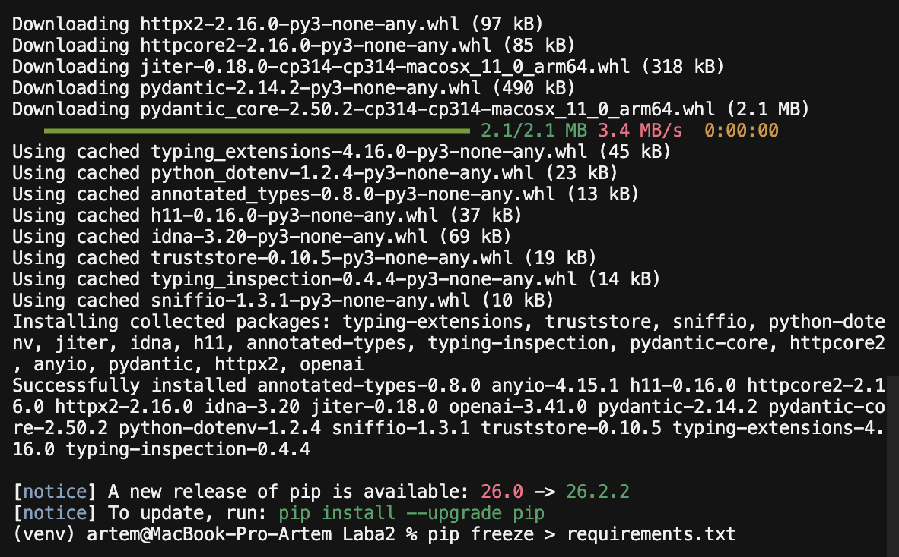

Токен локального сервера записан в `.env`. В программу он подставляется оттуда. Сам токен в отчёт и на снимки не выносился.

Библиотека `openai` здесь используется только как клиент. Адрес запросов — `http://localhost:1234/v1`, то есть сервер на этом же компьютере. К платным моделям OpenAI программа не обращается.

## 3. Выбор моделей

В методичке для 16 ГБ оперативной памяти без отдельной видеокарты указан первый запуск моделей размером 1,5–3 миллиарда параметров в квантовании Q4. Контекст для первого запуска — 2048 токенов, а не максимальный контекст из карточки модели.

Взяты две модели организации `lmstudio-community`, обе в формате GGUF и в квантовании Q4_K_M:

| Модель | Параметров | Квантование | Файл |
| --- | --- | --- | --- |
| Qwen2.5-3B-Instruct | 3B | Q4_K_M | около 1,9 ГБ |
| Llama-3.2-3B-Instruct | 3,2B | Q4_K_M | около 2,0 ГБ |

Обе помечены как Instruct: они рассчитаны на ответы по инструкции. Настройки запуска одинаковые. В память загружалась одна модель, контекст 2048.

Рисунок 2. Qwen2.5 3B Instruct загружена с контекстом 2048.

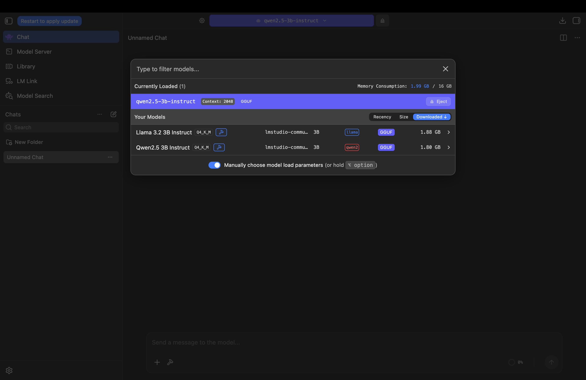

На рисунке 2 видны обе выбранные модели. Загружена Qwen, формат GGUF, квантование Q4_K_M. Занято 1,99 ГБ из 16 ГБ.

Рисунок 3. Llama 3.2 3B Instruct загружена с контекстом 2048.

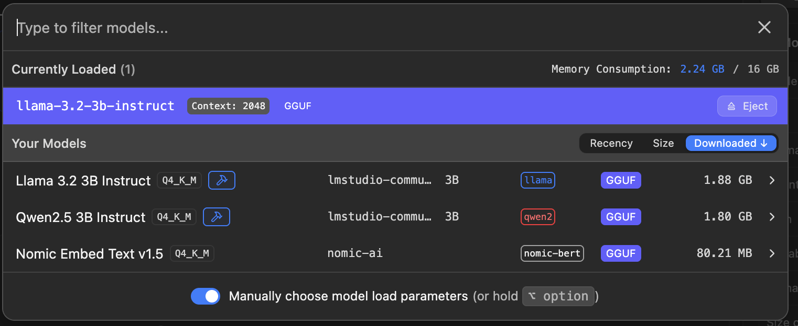

У Llama занято 2,24 ГБ из 16 ГБ. Строка Nomic Embed Text на этом снимке — служебная модель LM Studio для эмбеддингов. В опытах она не использовалась.

## 4. Локальный сервер

Запросы из Python идут на вкладку Model Server. Включена аутентификация Require Authentication, создан собственный токен. Порт сервера — 1234. Доступ по локальной сети не включался: сервер принимает запросы только с этого компьютера.

Рисунок 4. Порт 1234 и включённая аутентификация.

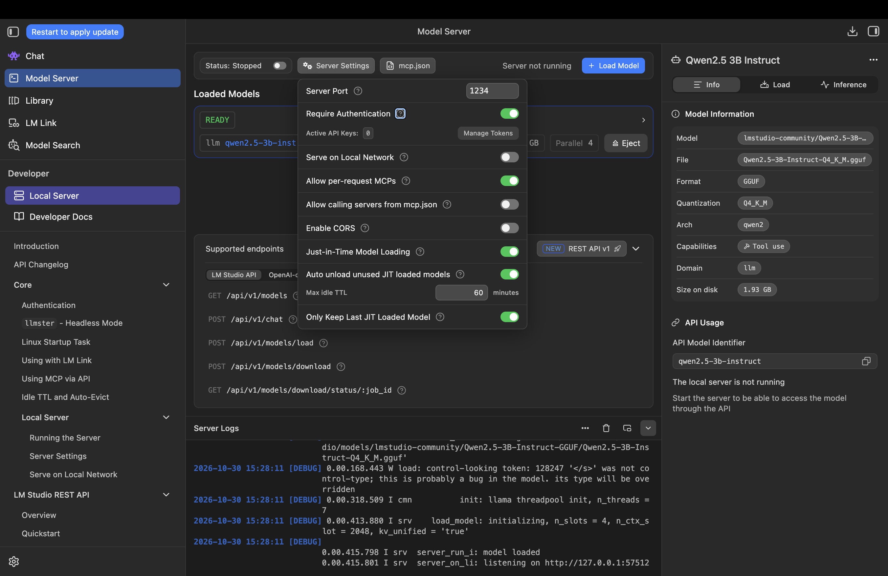

Рисунок 5. Сервер запущен, модель Qwen готова к запросам.

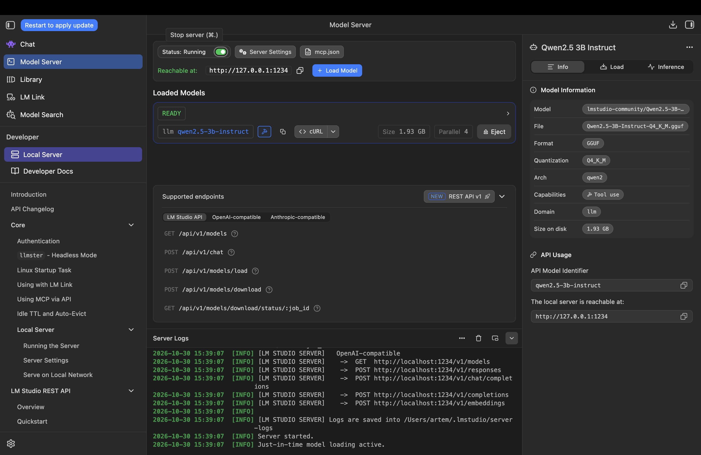

Адрес сервера — `http://127.0.0.1:1234`. В журнале есть совместимая с OpenAI точка `POST /v1/responses`. Идентификатор загруженной модели — `qwen2.5-3b-instruct`.

## 5. Проверка работоспособности

Программа `main.py` запрашивает список моделей и отправляет фразу «Я Артём». Сначала была загружена Qwen.

Рисунок 6. Ответ Qwen на проверке сервера.

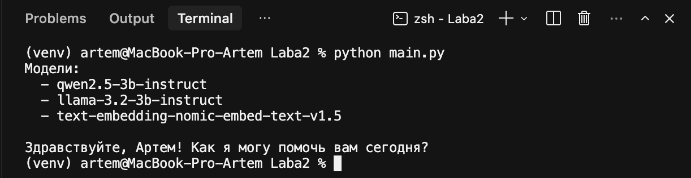

Сервер вернул три имени: `qwen2.5-3b-instruct`, `llama-3.2-3b-instruct` и служебную `text-embedding-nomic-embed-text-v1.5`. Qwen ответила: «Здравствуйте, Артем! Как я могу помочь вам сегодня?»

Затем в память загружена Llama с тем же контекстом 2048. В программе изменено только имя модели.

Рисунок 7. Ответ Llama на проверке сервера.

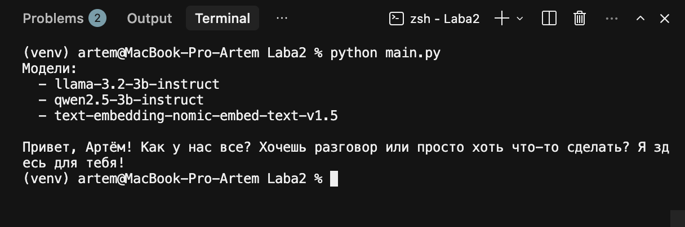

Llama ответила: «Привет, Артём! Как у нас все? Хочешь разговор или просто хоть что-то сделать? Я здесь для тебя!» Обе модели на локальном сервере отвечают.

## 6. Пять одинаковых запросов

Пять запросов собраны в `experiment.py`. Для обеих моделей temperature равна 0.2, контекст 2048. Программа печатает время полного ответа.

Запросы такие:

1. Объяснить, что такое переменная в программировании.
2. Написать функцию на Python, которая складывает два числа, и показать вызов.
3. Найти ошибку в `return a + b / 2` внутри функции среднего и дать исправленный вариант.
4. Из заметки извлечь имя, группу и язык программирования и вернуть только JSON. В тексте указаны Артём, группа ИС-23 и Python.
5. По той же заметке ответить, в каком городе живёт Артём. В инструкции есть фраза «Если информации недостаточно, сообщи об этом». Города в тексте нет.

### 6.1. Llama-3.2-3B-Instruct

Ответы Llama заняли два снимка одного запуска.

Рисунок 8. Llama, запросы 1 и 2.

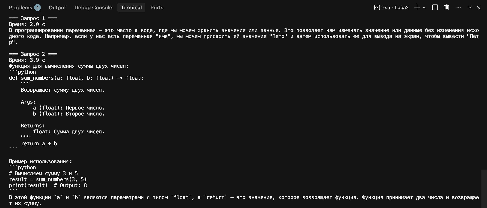

Рисунок 9. Llama, запросы 3–5.

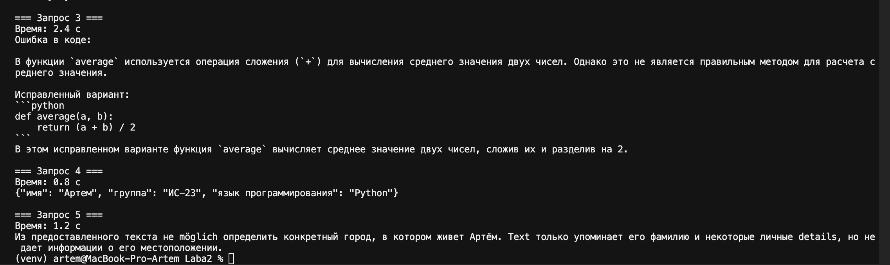

Время: 2,0 с, 3,9 с, 2,4 с, 0,8 с и 1,2 с.

1. Определение переменной в целом верное, пример с именем «Петр» уместный. Фраза о том, что значение можно менять, не меняя исходный код, лишняя.
2. Функция `sum_numbers(3, 5)` написана верно и возвращает 8.
3. Исправленный код верный: `(a + b) / 2`. Пояснение слабое: не сказано, что в исходной строке сначала делится только `b`.
4. JSON верный: имя Артем, группа ИС-23, язык Python. Ключи на русском, вокруг ответа нет лишнего текста.
5. Город модель не выдумала и сообщила, что в тексте его нет. В русскую фразу попали слова `möglich`, `Text` и `details`.

### 6.2. Qwen2.5-3B-Instruct

Все пять ответов Qwen поместились на один снимок.

Рисунок 10. Qwen, пять запросов.

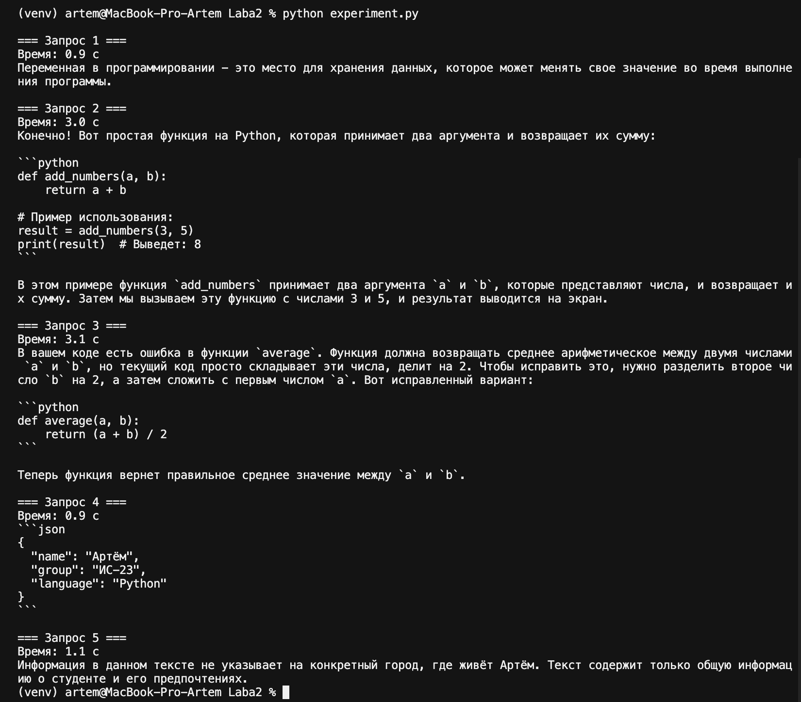

Время: 0,9 с, 3,0 с, 3,1 с, 0,9 с и 1,1 с.

1. Определение короткое и верное: переменная — место для данных, значение может меняться во время выполнения программы.
2. Функция `add_numbers(3, 5)` написана верно и выводит 8.
3. Код внизу ответа верный: `(a + b) / 2`. Слова над ним описывают обратное действие: разделить `b` на 2 и прибавить `a`. Это как раз исходная ошибка.
4. Данные верные: Артём, ИС-23, Python. Ключи записаны по-английски (`name`, `group`, `language`), а ответ обёрнут в блок `json`, хотя просили только JSON.
5. Город не выдуман. Ответ целиком на русском: в тексте нет конкретного города.

## 7. Влияние параметра temperature

Проверка сделана на одной модели. Выбрана Qwen: она уже была загружена с контекстом 2048. Остальные настройки не менялись. Один и тот же вопрос про переменную задан три раза при temperature 0.2 и три раза при 1.0. Программа — `temperature.py`.

Рисунок 11. Qwen при temperature 0.2 и 1.0.

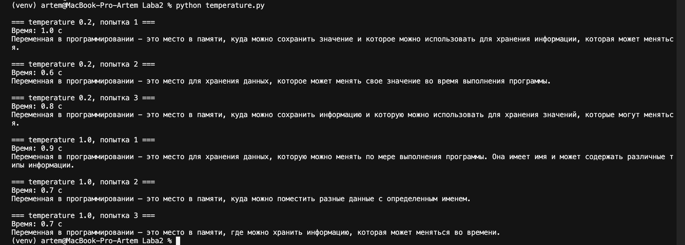

При 0.2 три ответа близки по словам. Все называют переменную местом для данных, значение которых может меняться. Время 1,0 с, 0,6 с и 0,8 с. В третьей попытке фраза корявая: «информацию и которую».

При 1.0 формулировки расходятся. Первая добавляет имя переменной и типы данных, но согласует слова с ошибкой: «данных, которую». Вторая короче и уже не говорит, что значение меняется. Третья пишет «меняться во времени», это менее точно, чем «во время работы программы». Время 0,9 с, 0,7 с и 0,7 с.

Все шесть ответов на русском и по теме вопроса. На время temperature почти не влияет: ответы короткие, около одной секунды. При 0.2 текст устойчивее. При 1.0 разнообразие выше и оговорки заметнее.

## 8. Сравнение моделей

Настройки пяти запросов совпадали: GGUF, Q4_K_M, контекст 2048, temperature 0.2, одна загруженная модель, порт 1234.

| Запрос | Llama, с | Qwen, с | Что совпало |
| --- | ---: | ---: | --- |
| Переменная | 2,0 | 0,9 | Обе объяснили понятие |
| Функция суммы | 3,9 | 3,0 | Обе дали рабочий пример |
| Ошибка в `average` | 2,4 | 3,1 | Код исправлен, пояснение слабое |
| JSON | 0,8 | 0,9 | Факты верные у обеих |
| Город | 1,2 | 1,1 | Обе сообщили, что города в тексте нет |

Сумма пяти ответов: у Llama 10,3 с, у Qwen 9,0 с. Разница небольшая. Самый долгий запрос у обеих — функция на Python.

По формату ровнее Qwen в свободном русском тексте и Llama в четвёртом запросе: Llama вернула один JSON с русскими ключами. Qwen добавила английские ключи и оформление блока кода. В пятом запросе ровнее Qwen: ответ без вкраплений других языков.

По правильности кода обе справились. Объяснение ошибки в среднем арифметическом ненадёжно у обеих: скобки в исправленной строке стоят верно, а текст рядом с ними путает порядок действий.

Память в обоих запусках оставалась около 2 ГБ из 16 ГБ. Для этого Mac запас большой.

## 9. Вывод

На MacBook Pro с чипом M4 и 16 ГБ памяти обе модели запускаются локально и отвечают через сервер LM Studio на порту 1234.

Для проверенных задач лучше подходит Qwen2.5-3B-Instruct в квантовании Q4_K_M. Она немного быстрее на этом наборе, устойчивее держит русский язык и короче объясняет понятие. Llama-3.2-3B-Instruct тоже помещается в память и пишет верную функцию, но в ответе про город смешивает языки, а JSON у неё получился удачным именно на этом тексте.

Ограничения общие для обеих. Это модели около 3 миллиардов параметров: исправленный код они выдают, а причину ошибки в `a + b / 2` формулируют неверно. Контекст в опытах равен 2048 токенам, длинные тексты так не проверялись. При temperature 1.0 ответы Qwen разнообразнее и чаще содержат оговорку, при 0.2 формулировка почти не меняется. Отдельная видеопамять компьютеру не потребовалась: для Q4 этого размера хватило общей памяти.
