Министерство науки и высшего образования Российской Федерации

Федеральное государственное бюджетное образовательное учреждение высшего образования

«Заполярный государственный университет им. Н. М. Федоровского» (ЗГУ им. Н. М. Федоровского)

Факультет «Электроэнергетики, экономики и управления»

Кафедра «Информационные системы и технологии»

Дисциплина «Технологии программирования»

Отчет к лабораторной работе 2

Тема: «Разработка API-сервиса структурирования текстовых данных с использованием локальных LLM»

Студент: Бородин А. С.

Группа: ИС-23

## Содержание

1. Цель и постановка задачи
2. Подготовка окружения
3. База данных
4. Схема извлечения и проверка
5. Сопоставление со справочником
6. Локальная модель
7. API и пять заказов
8. Чтение сохранённых заказов
9. Ошибочные ситуации
10. Расход токенов
11. Вывод

## 1. Цель и постановка задачи

Цель работы - сделать локальный веб-сервис, который принимает текст предварительного заказа мастерской, извлекает из него структурированные сведения локальной языковой моделью, проверяет ответ, связывает код услуги со справочником и сохраняет запись в реляционной базе.

Последняя цифра зачётной книжки - 9. Вариант: приём заказов в мастерской. Создаваемая запись - предварительный заказ. Справочник - услуги мастерской. Ресурс API - `/workshop-orders`.

Поставленные задачи:

1. Поднять PostgreSQL и просмотр таблиц через Adminer.
2. Заполнить справочник пятью услугами отдельным скриптом.
3. Задать шесть полей ответа модели и проверить их через Pydantic.
4. По коду услуги различать состояния `matched`, `not_found` и `not_provided`.
5. Подключить локальную модель Qwen2.5 7B Instruct через LM Studio.
6. Реализовать создание заказа, список заказов и получение одного заказа.
7. Проверить пять собственных сообщений и ошибочные ситуации из задания.
8. Зафиксировать расход токенов и время ответа.

Сервис только регистрирует предварительный заказ. Цену, расход материалов и производственное расписание он не считает. Отдельный сайт, авторизация и выкладка на внешний сервер не требуются: для демонстрации достаточно Swagger.

## 2. Подготовка окружения

Работа велась в каталоге `Laba2` на MacBook Pro 14 2024 года. Процессор Apple M4, оперативная память 16 ГБ. Память общая: отдельной видеопамяти сверх этих 16 ГБ нет.

Для программы создано виртуальное окружение `venv`. Установлены FastAPI, Uvicorn, клиент OpenAI, `python-dotenv` и `psycopg`. Список версий записан в `requirements.txt`. Основные версии: FastAPI 0.162.0, Uvicorn 0.54.0, OpenAI 3.46.0, Pydantic 2.14.3, psycopg 3.3.8.

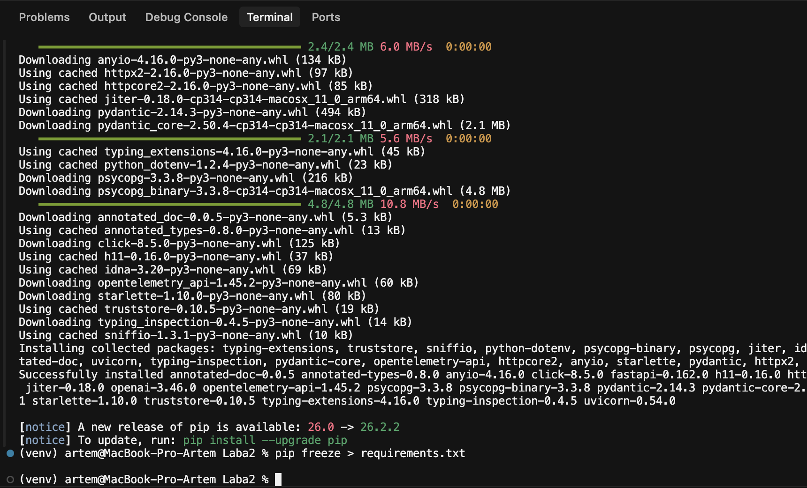

Рисунок 1. Установка библиотек и запись `requirements.txt`.

Параметры базы, адрес LM Studio, ключ сервера и имя модели лежат в `.env`. В программу они подставляются оттуда. Сам ключ в отчёт и на снимки не выносился. Файл `.env` добавлен в `.gitignore`.

База запущена в Docker. Образ PostgreSQL - `postgres:16`, база, пользователь и пароль учебные, имя базы `workshop`. Рядом поднят Adminer на порту 8080. Программа на компьютере подключается к `localhost:5432`. Adminer находится в той же сети Docker, поэтому в поле сервера указано имя службы `db`.

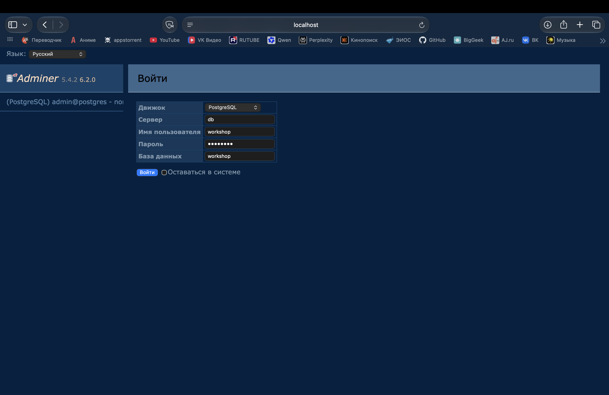

Рисунок 2. Вход в Adminer.

После входа база открылась пустой: таблиц ещё не было.

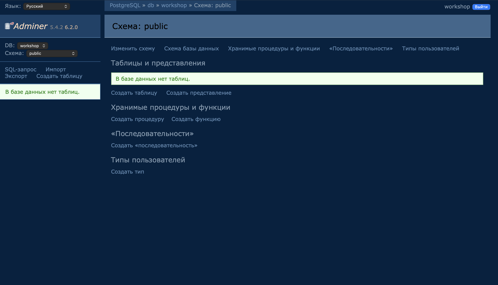

Рисунок 3. Пустая база `workshop`.

## 3. База данных

Скрипт `seed.py` создаёт две таблицы и заполняет справочник. Его можно запустить повторно: существующие коды услуг не дублируются.

Таблица `services` хранит внутренний номер, уникальный код и название. Внутренний номер выдаёт база. Код из текста заказа этот номер не заменяет.

В справочник записаны пять услуг:

| id | Код | Название                          |
| -: | ------ | ----------------------------------------- |
|  1 | SV-012 | Гравировка                      |
|  2 | SV-003 | Изготовление таблички |
|  3 | SV-018 | Ремонт замка                   |
|  4 | SV-025 | Заточка инструмента     |
|  5 | SV-031 | Покраска изделия           |

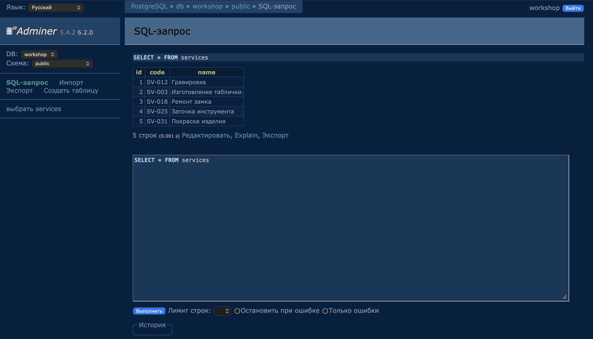

Рисунок 4. Пять услуг в таблице `services`.

Таблица `orders` хранит номер, время создания, исходный текст, категорию, краткое содержание, извлечённый код, описание изделия, срок, дополнительные сведения, номер связанной услуги и результат сопоставления. Связь со справочником необязательная. Сразу после создания таблица была пустой.

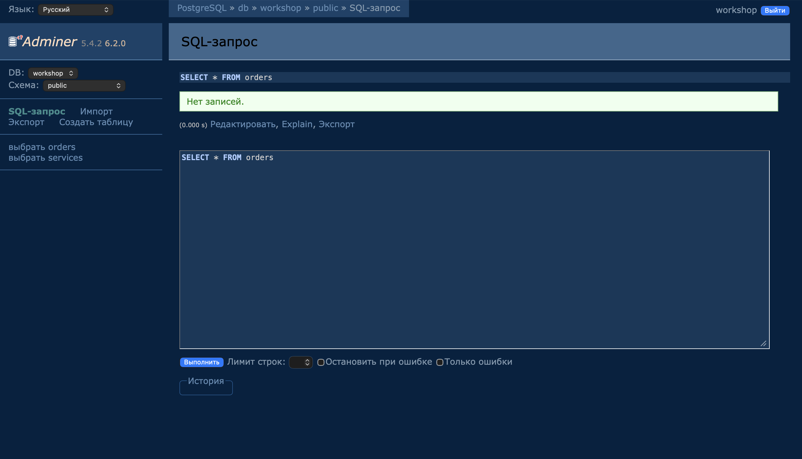

Рисунок 5. Пустая таблица `orders`.

## 4. Схема извлечения и проверка

Ответ модели состоит ровно из шести полей:

| Поле             | Смысл                                                                                         |
| -------------------- | -------------------------------------------------------------------------------------------------- |
| `category`         | `manufacture`, `repair`, `customization` или `other`                                    |
| `summary`          | Краткое содержание, непустая строка                                 |
| `service_code`     | Код услуги из текста или `null`                                              |
| `item_description` | Изделие или `null`                                                                     |
| `deadline_text`    | Срок так, как он написан, или `null`                                       |
| `details`          | Важная деталь, которой нет в остальных полях, или `null` |

`manufacture` - изготовление, `repair` - ремонт, `customization` - гравировка или другая персонализация. Если тема неясна, категория `other`. Числа и даты остаются текстом, относительные даты не пересчитываются. Отсутствующие сведения не выдумываются. Если в тексте есть только название услуги и нет кода, код остаётся `null`. Полный справочник модели не передаётся.

Системная инструкция описывает эти правила. Текст заказа уходит отдельным сообщением пользователя. Модели запрещено писать SQL и добавлять другие поля.

Проверка собрана в `01_pydantic_parse.py`. Функция `check_order` требует ровно шесть ключей, проверяет типы через Pydantic, допускает только четыре категории и не пропускает пустое краткое содержание. Пустая строка в коде, описании изделия, сроке и `details` превращается в `null`. Список или число вместо строки не превращается в текст: такой ответ отклоняется.

На примере гравировки проверка прошла. Ответ с категорией `price` отклонён.

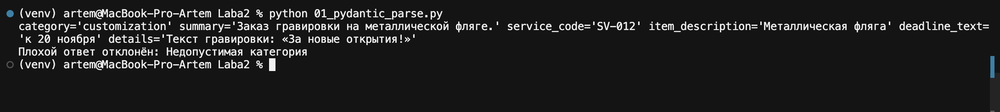

Рисунок 6. Принятый пример и отклонённая категория.

Проверка схемы подтверждает форму ответа. Совпадение с исходным текстом дальше оценивается отдельно, по каждому заказу.

## 5. Сопоставление со справочником

Поиск вынесен в `match_service.py`. Код из сообщения и код в справочнике приводятся к одному виду: убираются крайние пробелы, буквы переводятся в верхний регистр.

Возможны три состояния:

- `matched` - код найден, в заказ записывается внутренний номер услуги;
- `not_found` - код в тексте есть, но в справочнике его нет, связь пустая, сам код сохраняется;
- `not_provided` - кода нет, связь пустая.

Модель строку справочника не создаёт и не изменяет.

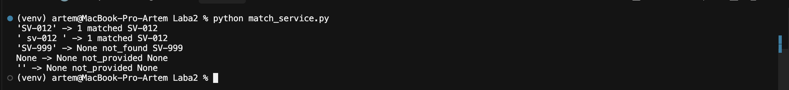

Рисунок 7. Три состояния сопоставления.

Код `SV-012` и тот же код с пробелами и другим регистром нашли услугу с номером 1. Код `SV-999` остался со статусом `not_found`. Пустое значение получило статус `not_provided`.

## 6. Локальная модель

Использована одна модель: Qwen2.5 7B Instruct, формат GGUF, квантование Q4_K_M. Это модель Instruct: она отвечает на инструкцию, а не продолжает произвольный текст. Идентификатор для API - `qwen2.5-7b-instruct`. При загрузке выбран контекст 8192. Файл модели занимает около 4,68 ГБ. С контекстом 8192 в общей памяти занято около 4,37 ГБ из 16 ГБ.

Сервер LM Studio слушает `http://127.0.0.1:1234`. Ключ передаётся из `.env`. Запрос идёт на совместимую с OpenAI точку чата. Температура равна 0, чтобы извлечение полей не менялось от запуска к запуску. Ожидание ответа ограничено 60 секундами.

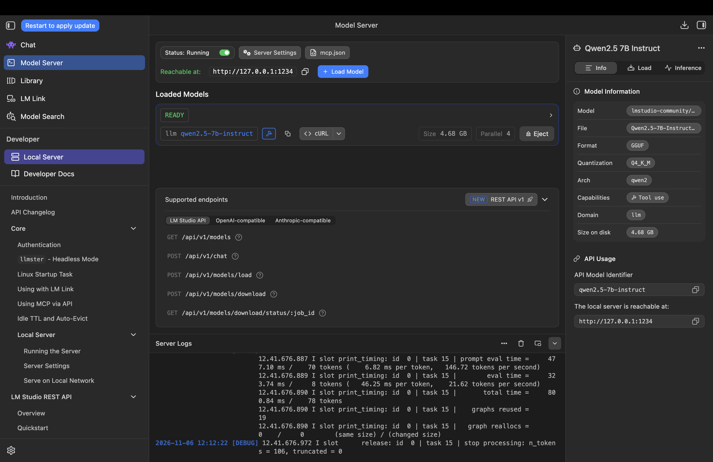

Рисунок 8. Сервер LM Studio запущен, модель Qwen2.5 7B загружена.

До включения API тот же пример из задания отправлен скриптом `02_model_request.py`. Модель вернула JSON, проверка Pydantic его приняла. Входных токенов 256, токенов ответа 83, всего 339. Время 4,0 с, скорость 20,8 токена в секунду по токенам ответа.

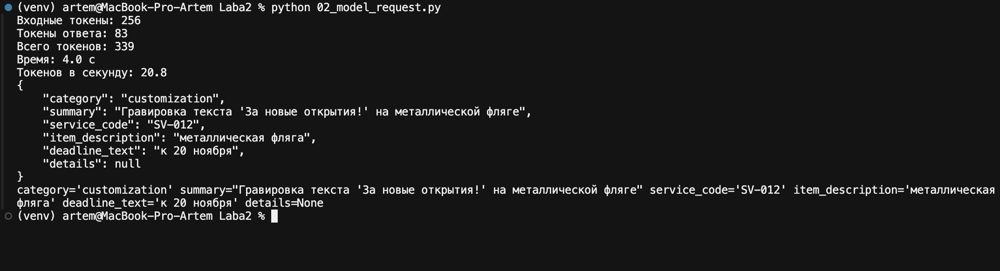

Рисунок 9. Первый ответ модели и проверка шести полей.

Фраза гравировки в этом ответе попала в `summary`, поле `details` осталось пустым. Код `SV-012`, фляга и срок «к 20 ноября» извлечены. В базу этот пробный запуск ничего не записывал.

## 7. API и пять заказов

Сервис собран в `main.py` и запускается командой `uvicorn main:app --reload`. Страница Swagger открывается по адресу `http://127.0.0.1:8000/docs`.

Тело создания заказа:

```json
{
  "message": "Текст сообщения"
}
```

`POST /workshop-orders` вызывает модель, проверяет JSON, ищет код и сохраняет заказ. Ответ `201` содержит номер, время, исходный текст, шесть полей, номер услуги или `null` и состояние сопоставления. Номер, время, связь и состояние ставит программа.

Для основных сценариев взяты собственные сообщения. Каждое описывает один предмет и одно намерение.

### 7.1. Полный заказ с существующим кодом

Сообщение: «Хочу заказать гравировку по услуге SV-012 на металлической фляге к 20 ноября. Текст: "За новые открытия!"».

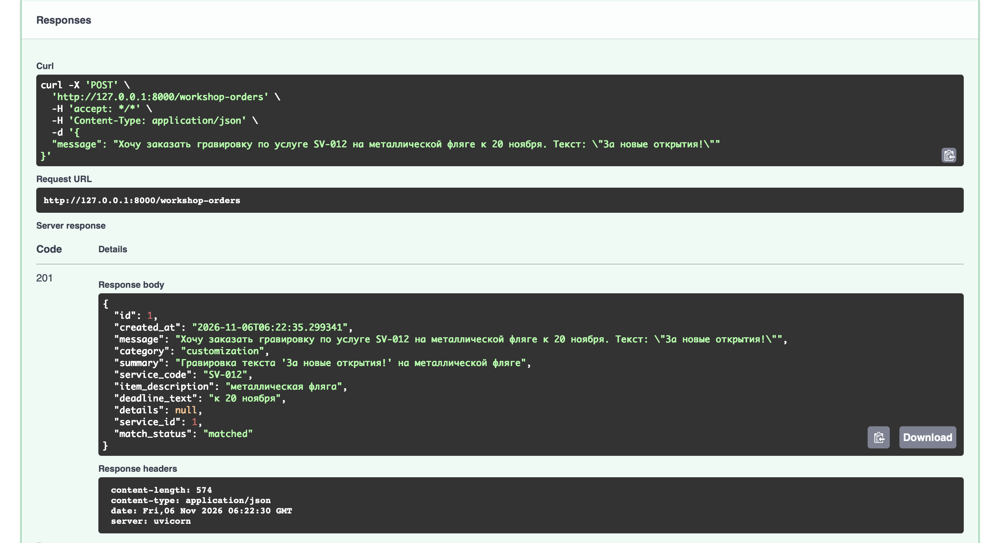

Рисунок 10. Заказ 1 создан, код `201`.

Категория `customization`. Код `SV-012` связан с услугой 1, состояние `matched`. Изделие - «металлическая фляга», срок - «к 20 ноября». Краткое содержание включило текст гравировки, поэтому `details` равен `null`. В примере задания эта фраза стоит в `details`, а краткое содержание короче. Смысл сообщения сохранён: гравировка, код, изделие, срок и надпись на месте. Дата в календарное число не превращена.

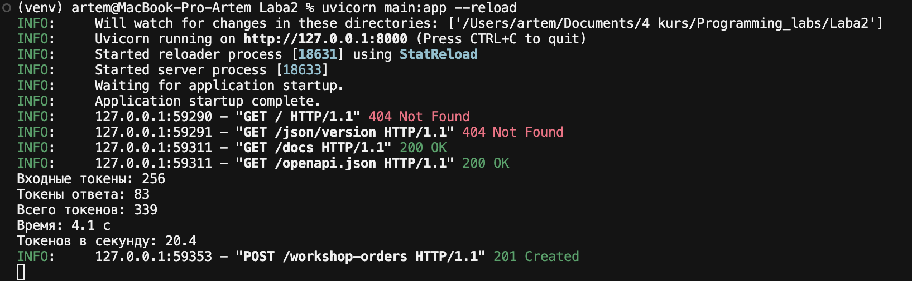

Рисунок 11. Токены первого заказа и ответ `201`.

Входных токенов 256, токенов ответа 83, всего 339. Время 4,1 с, скорость 20,4 токена в секунду.

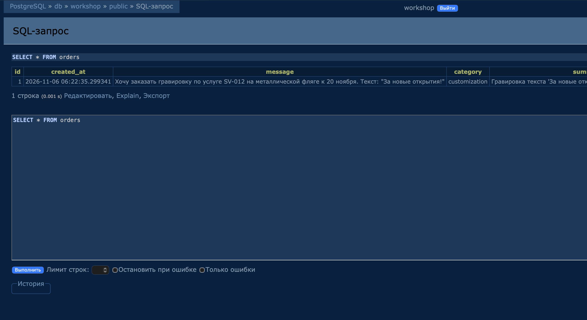

Рисунок 12. В таблице `orders` появилась первая строка.

### 7.2. Заказ без кода и без срока

Сообщение: «Прошу изготовить деревянную табличку для двери.»

Кода услуги в тексте нет, срока тоже нет. В справочнике есть услуга «Изготовление таблички» с кодом `SV-003`, но по названию программа код не ищет и модели справочник не отдаёт.

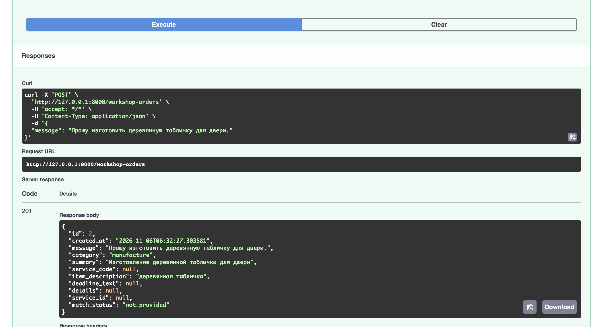

Рисунок 13. Заказ 2 без кода услуги.

Категория `manufacture`. Изделие - «деревянная табличка». Код, срок, `details` и номер услуги пустые. Состояние `not_provided`. Назначение «для двери» вошло в краткое содержание. Код `SV-003` не появился.

### 7.3. Неизвестный код

Сообщение: «Прошу изготовить полку по услуге SV-077 к 1 декабря.»

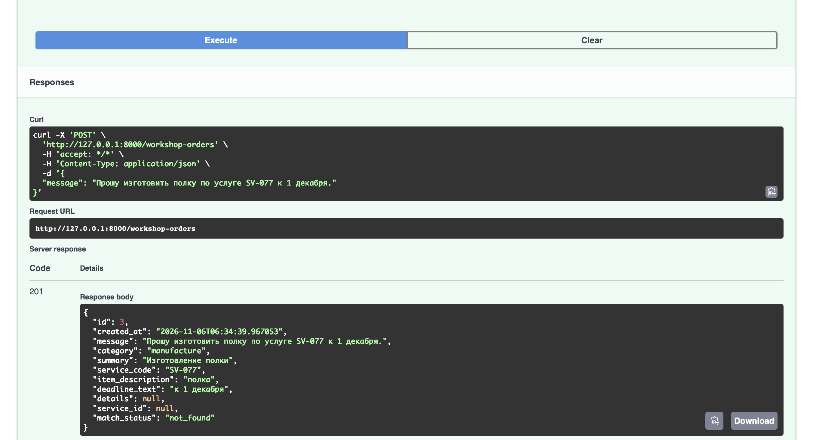

Рисунок 14. Заказ 3 с кодом, которого нет в справочнике.

Категория `manufacture`, изделие «полка», срок «к 1 декабря». Код `SV-077` сохранён. Номер услуги пустой, состояние `not_found`.

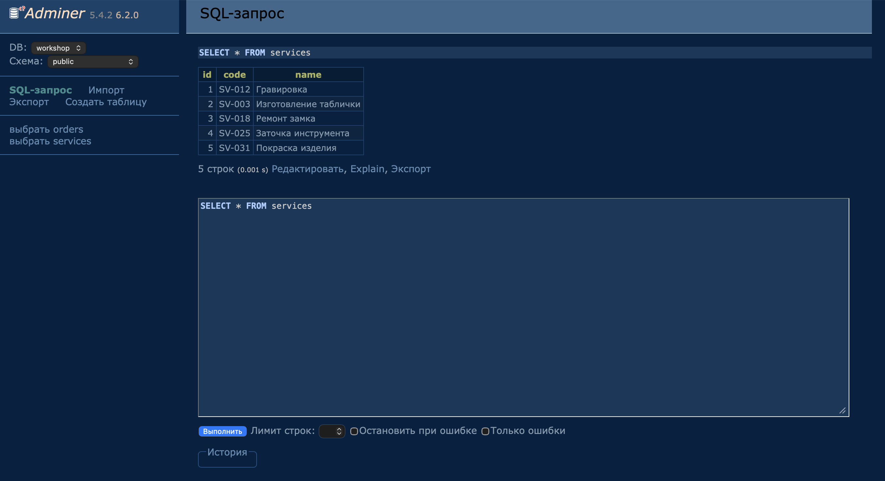

Рисунок 15. Справочник после неизвестного кода.

В `services` остались те же пять строк. Услуги `SV-077` база не создала.

### 7.4. Заказ другой категории

Сообщение: «Нужно отремонтировать дверной замок по услуге SV-018, ключ проворачивается.»

Предыдущие заказы на изготовление не должны были задать единственную категорию. Здесь речь о ремонте, а код `SV-018` есть в справочнике.

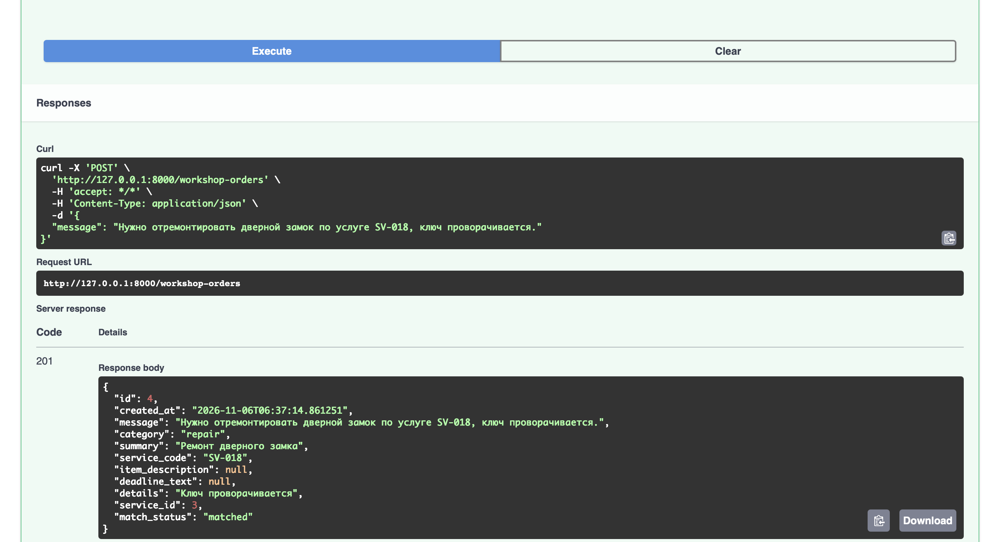

Рисунок 16. Заказ 4, категория ремонта.

Категория `repair`. Код `SV-018` связан с услугой 3, состояние `matched`. Срока в тексте нет, поле срока пустое. Название замка вошло в краткое содержание «Ремонт дверного замка», поэтому отдельное описание изделия пустое. Фраза «Ключ проворачивается» записана в `details`. Сведения из сообщения на месте.

### 7.5. Категория other

Сообщение: «Хочу узнать, есть ли у вас парковка у мастерской.»

Это вопрос, а не изготовление, ремонт или гравировка.


Рисунок 17. Заказ 5, резервная категория.

Категория `other`. Код, изделие, срок и дополнительные сведения пустые. Номер услуги пустой, состояние `not_provided`. Краткое содержание передаёт вопрос о парковке.

После пяти заказов в таблице пять строк: гравировка, изготовление таблички, изготовление полки, ремонт и вопрос о парковке.

Рисунок 18. Пять сохранённых заказов.

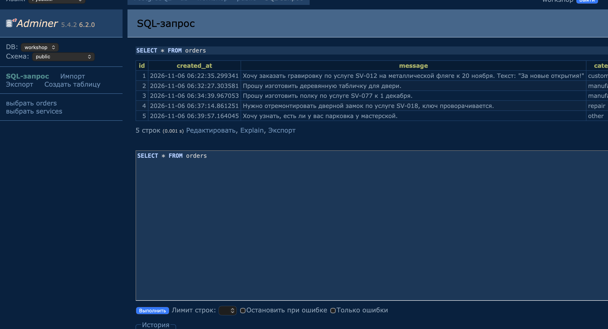

## 8. Чтение сохранённых заказов

`GET /workshop-orders` возвращает список. `GET /workshop-orders/1` возвращает один заказ. Оба ответа имеют код `200` и те же поля, что выдача при создании. Повторного запроса к модели нет.

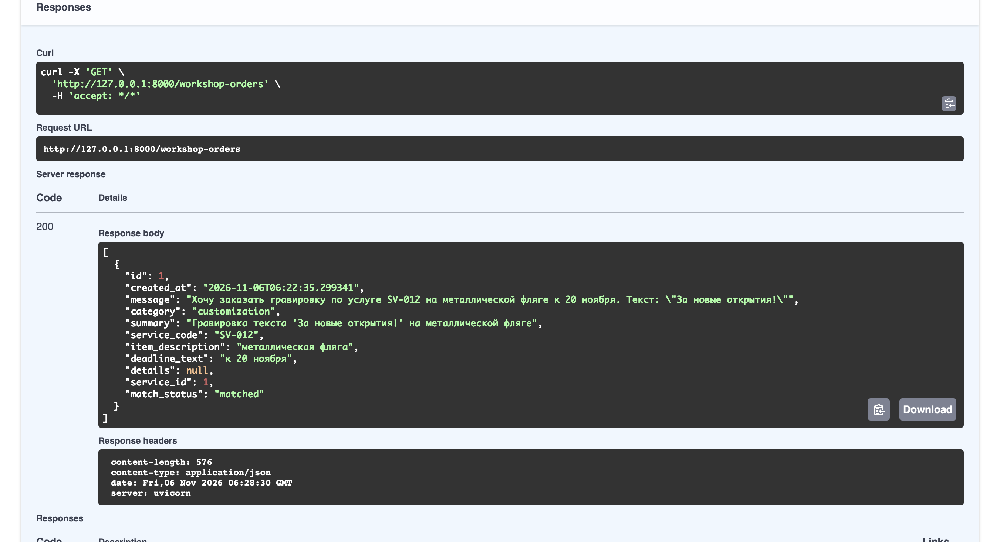

Рисунок 19. Список сохранённых заказов.

Запрос номера `999` возвращает `404` и описание «Заказ не найден».

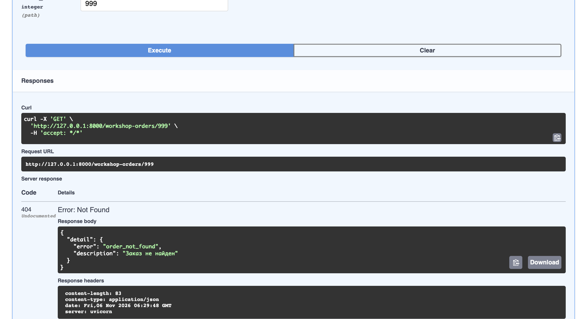

Рисунок 20. Несуществующий заказ.

В журнале сервера токены напечатаны один раз, перед созданием первого заказа. Три чтения после этого новых токенов не добавили.

Рисунок 21. Чтение заказов без нового вызова модели.

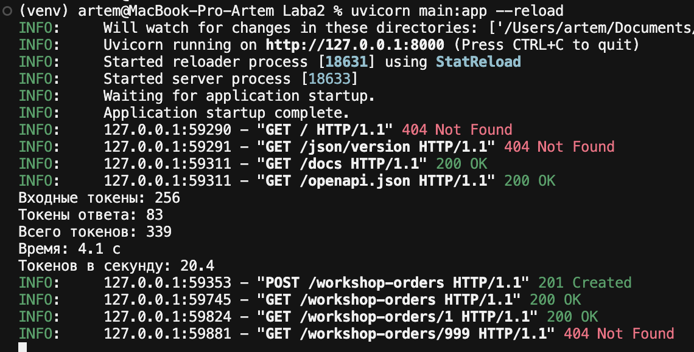

## 9. Ошибочные ситуации

Ошибки возвращаются кодом HTTP и коротким описанием. Секретный ключ и трассировка Python в ответ не попадают. При ошибке новая строка в `orders` не создаётся.

Пустое сообщение из пробелов отклонено до вызова модели: код `400`, описание «Сообщение пустое».

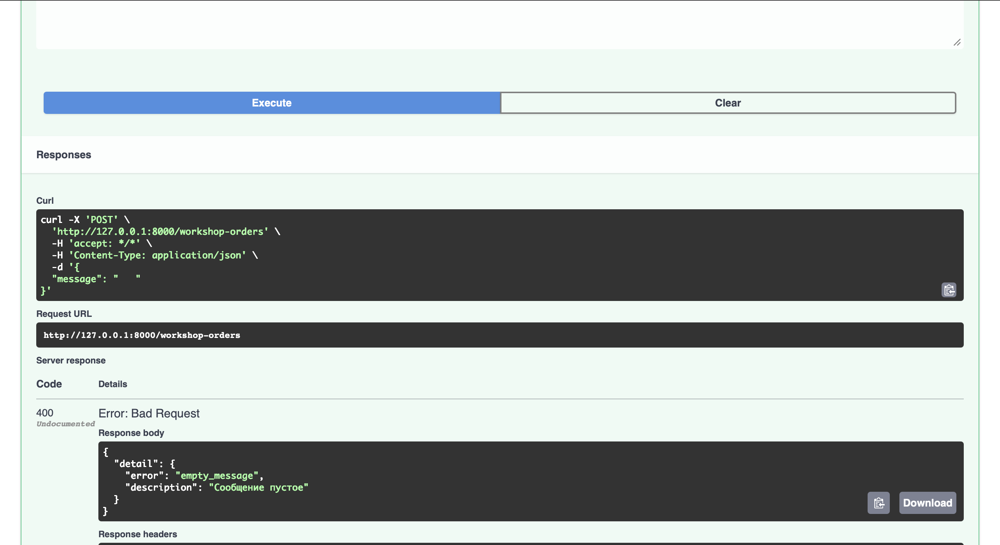

Рисунок 22. Пустое сообщение.

Тело `{}` без поля `message` тоже не доходит до модели. FastAPI отвечает `422` и сообщает, что поле обязательно.

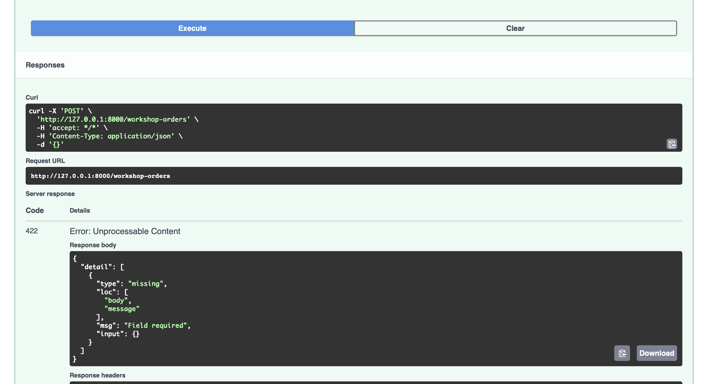

Рисунок 23. В запросе нет поля `message`.

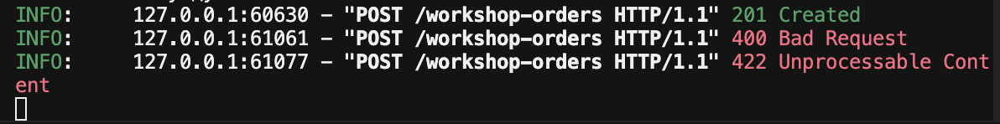

Рисунок 24. Коды `400` и `422` в журнале, новых токенов нет.

Для недоступного сервера локальный сервер LM Studio был остановлен. Обычный заказ «Прошу заточить нож по услуге SV-025.» получил код `503` и описание «Сервер модели недоступен».

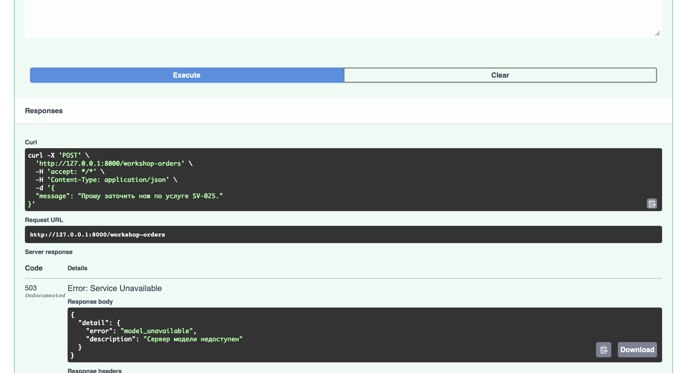

Рисунок 25. Сервер модели недоступен.

Для тайм-аута лимит временно уменьшен с 60 секунд до 1 секунды: обычный ответ модели занимает около трёх секунд. Тот же заказ про нож получил код `504` и описание «Модель не ответила за 1 секунду». После снимка лимит возвращён к 60 секундам.

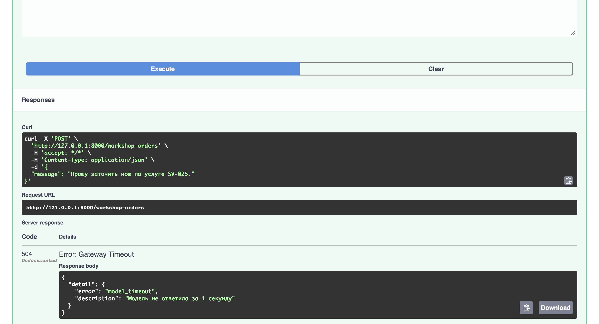

Рисунок 26. Превышен тайм-аут ожидания модели.

Для неверного JSON использована заглушка, которую задание допускает. Перед разбором текст ответа заменён на строку «это не json». Проверка не прошла, заказ не сохранился. Код ответа `502`, описание «Ответ модели не прошёл проверку». После снимка замена удалена. Модель при этом успела ответить, поэтому токены в журнале есть: 229 входных, 55 в ответе, 284 всего, 2,8 с и 19,5 токена в секунду.

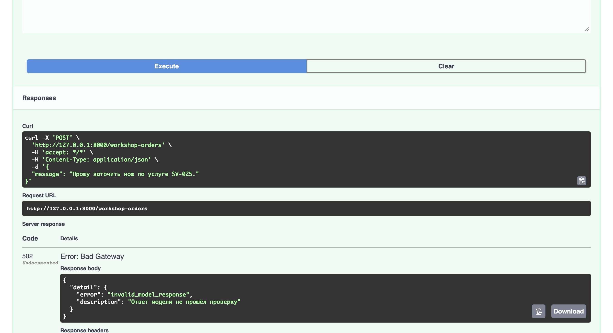

Рисунок 27. Ответ модели не прошёл проверку.

Заказ про заточку ножа в таблицу не попал. В `orders` остались пять строк основных сценариев.

## 10. Расход токенов

Скорость посчитана по токенам ответа. Таймер включает и отправку запроса, поэтому число может быть немного ниже показателя в окне LM Studio. Температура всех пяти заказов равна 0.

| Заказ | Смысл                       | Вход | Ответ | Всего | Время, с | Токенов/с |
| ---------- | -------------------------------- | -------: | ---------: | ---------: | -------------: | ----------------: |
| 1          | Гравировка `SV-012`  |      256 |         83 |        339 |            4,1 |              20,4 |
| 2          | Табличка без кода |      229 |         67 |        296 |            3,5 |              18,9 |
| 3          | Полка `SV-077`            |      232 |         61 |        293 |            3,3 |              18,5 |
| 4          | Ремонт `SV-018`          |      241 |         62 |        303 |            3,4 |              18,4 |
| 5          | Вопрос о парковке |      229 |         56 |        285 |            3,1 |              18,3 |

Пять сохранений заняли 17,4 с. Входных токенов 1187, токенов ответа 329, всего 1516. Самый длинный ответ - полный заказ гравировки. Самый короткий - вопрос о парковке, где большинство полей пустые.

Чтение списка и одного заказа токены не тратит. Пустое сообщение и отсутствующее поле тоже не вызывают модель. При выключенном сервере и при тайм-ауте готового ответа нет. При заглушке `502` модель ответила, но запись отброшена проверкой.

## 11. Вывод

Пять сообщений разобраны по смыслу. Гравировка связана с услугой `SV-012`, ремонт - с услугой `SV-018`. Заказ без кода сохранён со статусом `not_provided` и без выдуманного кода `SV-003`. Неизвестный код `SV-077` сохранён со статусом `not_found`, справочник не изменился. Вопрос о парковке получил категорию `other`.

Схема отсекает пустое сообщение, отсутствующее поле, неверный JSON, недоступный сервер и превышение тайм-аута. В этих случаях заказ не сохраняется. Чтение готовой записи модель не вызывает.

Ограничение видно на сравнении с текстом. Форма ответа верная, но модель иногда кладёт уже названную деталь в краткое содержание: надпись на фляге оказалась в `summary`, а отдельное поле `details` осталось пустым. У замка название изделия тоже вошло в краткое содержание, а признак поломки - в `details`. Сведения при этом не потеряны и из справочника не дописаны. Проверка Pydantic такую фактическую раскладку полей не исправляет: она проверяет форму, а сравнение с исходным текстом остаётся отдельным шагом.
