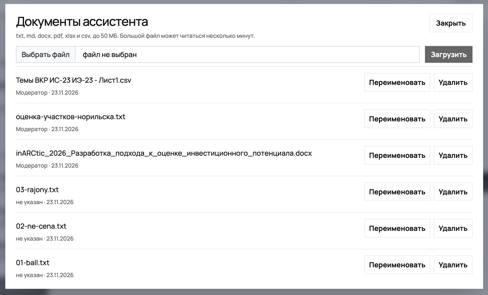
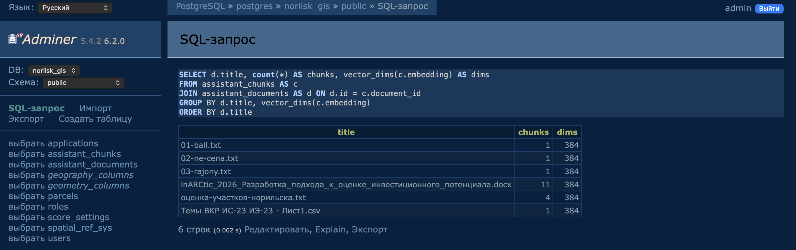
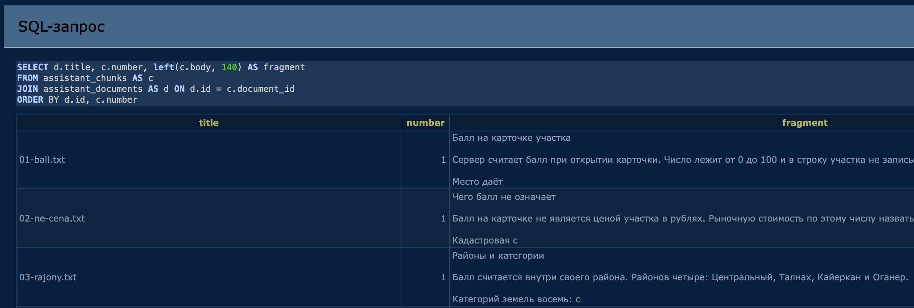
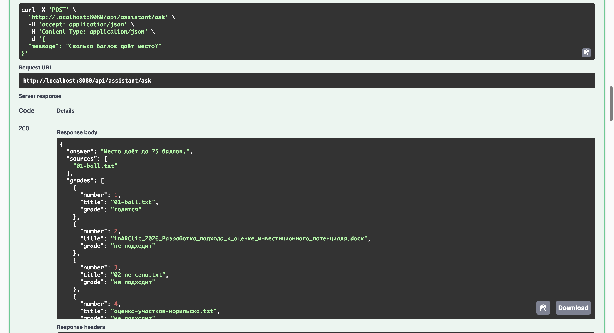
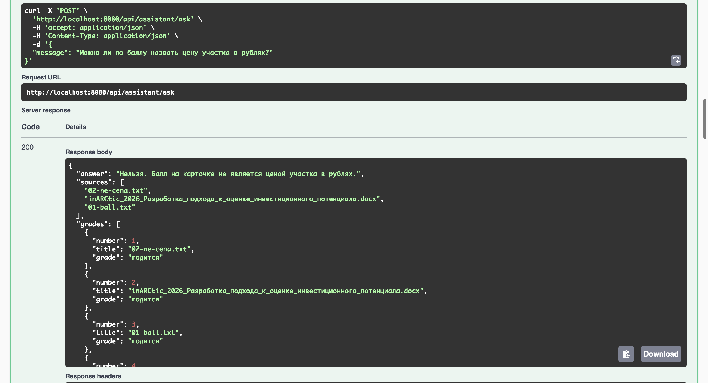
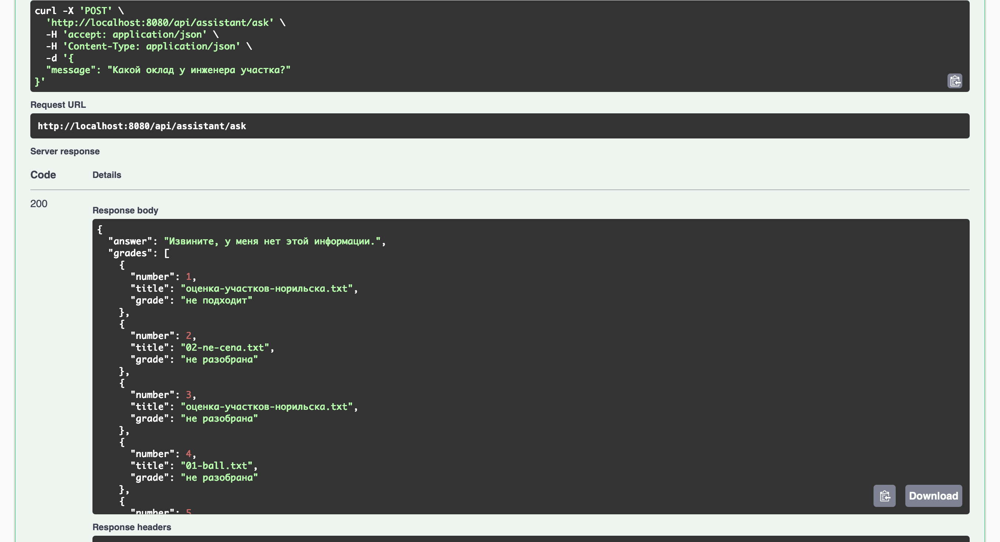

Министерство науки и высшего образования Российской Федерации

Федеральное государственное бюджетное образовательное учреждение высшего образования

«Заполярный государственный университет им. Н. М. Федоровского» (ЗГУ им. Н. М. Федоровского)

Факультет «Электроэнергетики, экономики и управления»

Кафедра «Информационные системы и технологии»

Дисциплина «Технологии программирования»

Отчет к лабораторной работе 3

Тема: «Ответ ассистента по документам оценки участков: поиск фрагментов и их проверка»

Студент: Бородин А. С.

Группа: ИС-23

## Содержание

1. Цель и постановка задачи
2. Подготовка окружения
3. База знаний
4. Нарезка и векторы
5. Классический поиск
6. Проверка фрагментов
7. Три вопроса
8. Уровни программы
9. Вывод

## 1. Цель и постановка задачи

Цель работы - подключить к уже идущему дипломному проекту поиск по своим документам и ответ локальной модели только по найденным фрагментам. Тема документов - балл участка в Норильске.

Поставленные задачи:

1. Собрать базу знаний по теме диплома, не меньше трёх файлов.
2. Хранить фрагменты в векторной базе.
3. Реализовать классическую цепочку: разрезать файл, записать векторы, найти близкие фрагменты, сформулировать ответ.
4. Вторым методом взять проверку фрагментов перед ответом.
5. Развести запись в базу, поиск с оценкой и HTTP-метод.

В дипломе векторы лежат в PostgreSQL, вектор считает multilingual-e5-small, текст ответа пишет Qwen2.5 7B Instruct. Обычный вопрос программа ищет сама, без выбора инструмента моделью.

Сервис не назначает рыночную цену и не называет оклад. Если в отобранных фрагментах нужного факта нет, наружу уходит одна и та же фраза: «Извините, у меня нет этой информации.»

## 2. Подготовка окружения

Работа велась на MacBook Pro 14 2024 года. Процессор Apple M4, оперативная память 16 ГБ. Память общая: отдельной видеопамяти сверх этих 16 ГБ нет.

Сайт и API проекта работают в Docker. Страница Swagger открыта на `http://localhost:8080/swagger/index.html`. База - PostgreSQL 16 с расширением PostGIS и расширением pgvector, имя базы `norilsk_gis`. Таблицы смотрел в Adminer на порту 8082. В форме входа сервер указан как `postgres`: так служба базы называется внутри сети Docker. Снаружи к API программа ходит через `localhost`.

Модели запущены отдельным процессом Python на самом Mac, порт 8090. Виртуальное окружение лежит в `gis-backend/assistant-model/.venv`. В него входят `sentence-transformers` и `llama-cpp-python` версии 0.3.30. Контейнер API обращается к этому процессу по адресу `host.docker.internal:8090`. Python базу не открывает: он только режет текст, считает векторы и пишет ответ. Файлы целиком складываются в MinIO, фрагменты и векторы - в PostgreSQL.

Файл модели ответа взят из каталога LM Studio: `Qwen2.5-7B-Instruct-Q4_K_M.gguf`. В окно чата LM Studio запрос не уходит. Температура обоих вызовов этой модели равна 0, длина контекста - 4096 токенов.

## 3. База знаний

Документы загружены через страницу учётной записи, блок «Документы ассистента». У трёх коротких файлов автор в интерфейсе показан как «не указан», у трёх остальных - «Модератор».

Рисунок 1. Шесть документов ассистента.

Шесть файлов:

| Файл           | Зачем он в базе                                                                                           |
| ------------------ | --------------------------------------------------------------------------------------------------------------------- |
| `01-ball.txt`    | Из чего складывается балл: место до 75, площадь до 25, итог от 0 до 100 |
| `02-ne-cena.txt` | Балл не является ценой в рублях                                                             |
| `03-rajony.txt`  | Четыре района и восемь категорий земель                                             |

Короткие три файла подготовлены так, чтобы по ним можно было проверить и удачный ответ, и отказ.

В Adminer посчитано число фрагментов и длина вектора. У пяти файлов фрагмент один. Записка `оценка-участков-норильска.txt` разрезана на 11 фрагментов. У всех строк длина вектора равна 384.

Рисунок 2. Число фрагментов и длина вектора.

Начала трёх коротких файлов прочитаны тем же запросом. Каждый из них лежит одним фрагментом с номером 1. У `02-ne-cena.txt` начало такое: «Балл на карточке не является ценой участка в рублях.»

Рисунок 3. Начала трёх коротких фрагментов.

## 4. Нарезка и векторы

Длину фрагмента задаёт токенизатор той же модели, которая строит вектор, а не число символов. Окно - 256 токенов, перекрытие - 40. У `multilingual-e5-small` предел контекста 512 токенов, поэтому окно взято меньше этого предела: к тексту ещё добавляется служебная приставка.

Перед подсчётом вектора к фрагменту приписывается `passage:` , к вопросу - `query:` . Так просит выбранная модель: документ и вопрос она кодирует с разными приставками. Числа вектора нормируются, длина становится равна единице. Сравнение потом смотрит на направление, то есть на близость смысла. Размер 384 записан и в колонке `embedding vector(384)`, и в проверке на стороне Go: фрагмент другой длины база не примет.

Индекс по колонке вектора - HNSW, операция `vector_cosine_ops`. На шестнадцати фрагментах полный перебор тоже был бы быстрым. Индекс оставлен, потому что таблица дипломная и документы будут добавляться.

## 5. Классический поиск

Цепочка классического RAG в этой работе такая.

Файл читается при загрузке. Текст уходит в Python на адрес `/prepare`. Оттуда возвращаются пронумерованные куски и их векторы. Go записывает исходный файл в MinIO, а куски - в таблицу `assistant_chunks`.

Вопрос приходит на `POST /api/assistant/ask` полем `message`. Go просит вектор вопроса у `/embed-query`. Ближайшие строки выбирает PostgreSQL оператором `<=>`, это косинусное расстояние pgvector. Берутся три строки с наименьшим расстоянием.

Рядом с векторным поиском есть запасной отбор по словам: до трёх фрагментов, в тексте которых встречаются основы из вопроса. Одинаковые куски отбрасываются. Поэтому в ответе Swagger иногда четыре или пять оценок, хотя векторный предел равен трём. На снимках про место и про цену оценок четыре, на снимке про оклад виден пятый номер.

Дальше отобранные тексты уходят в `/answer`. Модель ответа их не ищет сама.

## 6. Проверка фрагментов

Второй метод работы - проверка найденного перед формулировкой. Это отдельный вызов той же Qwen2.5 7B. Он не пишет ответ человеку. Он возвращает JSON со списком оценок.

Оценка бывает одной из четырёх:

| Оценка                | Когда ставится                                                                                 | Попадает ли фрагмент в ответ |
| --------------------------- | ----------------------------------------------------------------------------------------------------------- | ---------------------------------------------------- |
| `годится`          | В тексте есть ответ, в том числе запрет: нельзя, не является | Да                                                 |
| `мало данных`   | Тема та же, нужного факта нет                                                        | Нет                                               |
| `не подходит`   | Фрагмент про другое                                                                        | Нет                                               |
| `не разобрана` | Номер или слово оценки не прочитались                                       | Да                                                 |

Слова `подходит` и `сомнительно` программа понимает как `годится` и `мало данных`. Номер, присланный строкой из цифр, тоже читается. Если модель пропустила номер или написала оценку словом не из списка, фрагмент получает `не разобрана` и всё равно показывается модели ответа. Так пропуск оценки не превращается в ложный отказ.

Если после этого списка не осталось ни одного фрагмента с оценкой `годится` или `не разобрана`, второй вызов не делается. Наружу сразу уходит фраза «Извините, у меня нет этой информации.» Поля `sources` у такого ответа нет: источники собираются только когда текст ответа другой и среди оценок есть `годится` или `не разобрана`.

Сомнительный фрагмент в формулировку не подмешивается. Внешний поиск, если свои документы не подошли, не подключён.

## 7. Три вопроса

Все три вопроса отправлены из Swagger, метод `POST /api/assistant/ask`. Код ответа везде 200. В теле видны текст, при необходимости источники и список оценок.

Первый вопрос: «Сколько баллов даёт место?» Ответ: «Место даёт до 75 баллов.» Единственный источник - `01-ball.txt`, оценка `годится`. Статья, файл про цену и записка об оценке получили `не подходит` и в источники не вошли.

Рисунок 4. Вопрос про балл за место.

Второй вопрос: «Можно ли по баллу назвать цену участка в рублях?» Ответ: «Нельзя. Балл на карточке не является ценой участка в рублях.» Первым в `sources` стоит `02-ne-cena.txt`. Та же оценка `годится` стоит у статьи и у `01-ball.txt`, поэтому они тоже попали в список источников. Нужная фраза в ответе совпадает с началом файла `02-ne-cena.txt`, которое видно на рисунке 3.

Рисунок 5. Вопрос про цену в рублях.

Третий вопрос: «Какой оклад у инженера участка?» Ответ ровно «Извините, у меня нет этой информации.» Поля `sources` в JSON нет. У записки об оценке первая видимая оценка - `не подходит`. У `02-ne-cena.txt`, у второго фрагмента той же записки и у `01-ball.txt` стоит `не разобрана`. Пятая оценка в кадре только начата. Суммы оклада в ответе нет.

Рисунок 6. Вопрос про оклад.

## 8. Уровни программы

Запись и чтение таблиц отделены от HTTP и от моделей.

Уровень базы - файл `gis-backend/db/assistant.go`. Он создаёт расширение `vector`, таблицы `assistant_documents` и `assistant_chunks` и индекс HNSW. Колонка вектора имеет ширину 384.

Уровень логики раздвоен. Go в `store.go` и `recall.go` сохраняет фрагменты и ищет их: три ближайших по косинусу и до трёх по словам. Python в `assistant-model/server.py` режет текст, считает векторы, ставит оценки и пишет фразу. К PostgreSQL этот процесс не подключается.

Уровень API - обработчики в `handler.go`. Загрузка и список документов требуют учётную запись с ролью, поэтому из Swagger без входа они отвечают отказом. Вопрос `POST /api/assistant/ask` роль не требует: его и показывают рисунки 4-6. Тело запроса - объект с полем `message`. Тело ответа - `answer`, массив `grades` и, если ответ не является отказом, массив `sources`.

## 9. Вывод

Шесть документов по теме диплома лежат в PostgreSQL. У каждого фрагмента вектор из 384 чисел. Короткий файл сохраняется целиком, длинная записка режется на 11 фрагментов.

Классическая цепочка доходит до ответа. На вопрос про место программа нашла `01-ball.txt` и назвала предел 75 баллов. Лишние фрагменты на этом вопросе получили `не подходит` и в источники не попали.

Проверка фрагментов стоит вторым шагом. На вопросе про рубли ответ взял запрет из `02-ne-cena.txt`. На этом же вопросе проверка оказалась широкой: `годится` стоит и у файлов, где самой цены нет. Фраза ответа при этом не называет сумму в рублях.

На вопросе про оклад сумма не появилась. Ответ совпал с фразой отказа, списка источников нет. Часть оценок на снимке не `не подходит`, а `не разобрана`: номер в ответе модели оценок не был прочитан, и такие фрагменты всё равно дошли до формулировки. Формулировка оклада в них не нашла.

Ограничение работы видно на втором снимке Swagger. Отсев убирает чужую тему, как на вопросе про 75 баллов, но может оставить лишний файл с оценкой `годится`. Текст ответа всё равно ограничен присланными фрагментами: ни цена в рублях, ни оклад из них не сочинены.
