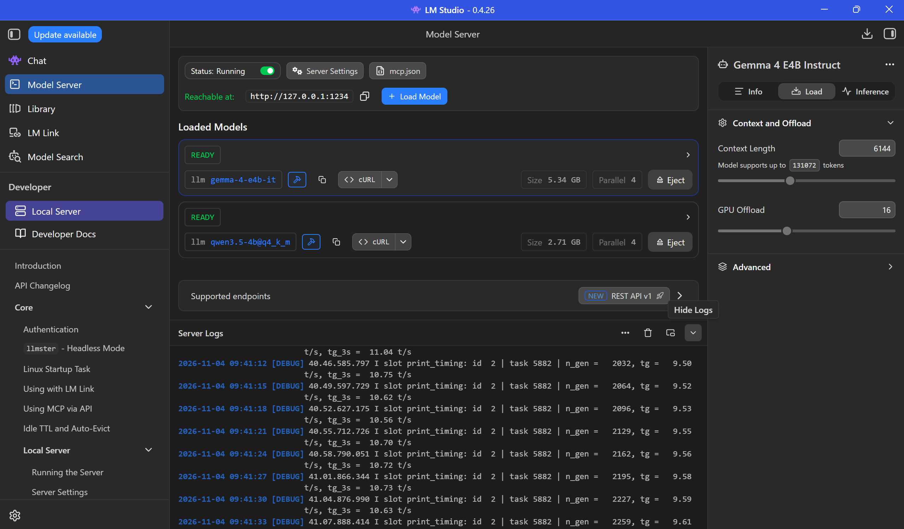
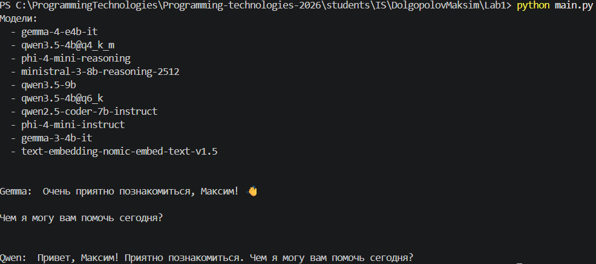
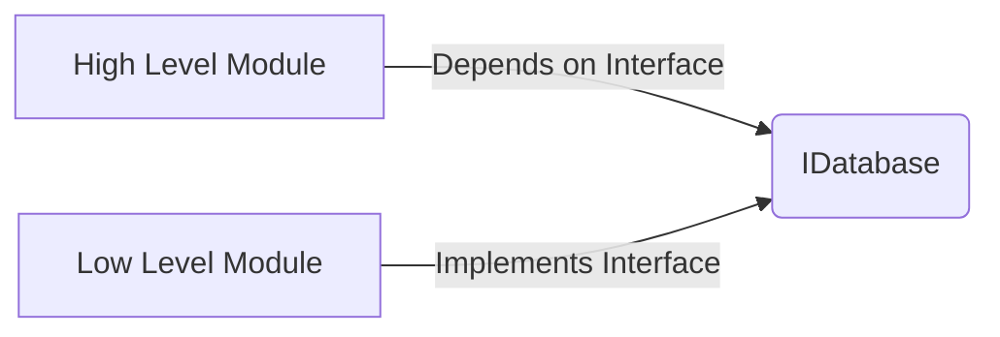
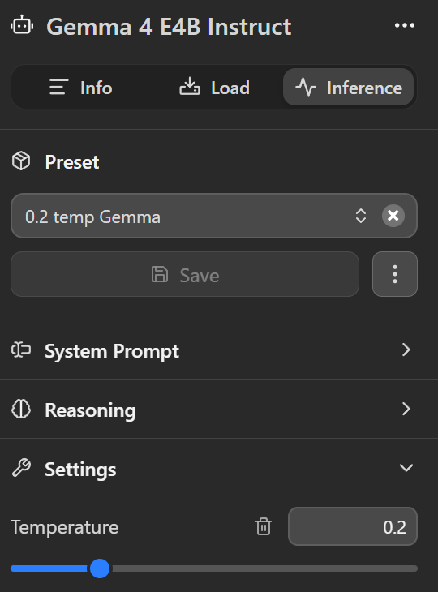

# Лабораторная работа №1. Эксплуатация локальной языковой модели.

## **Выполнил**: Студент группы ИС-23, Долгополов Максим

## **Цель работы**: ознакомление с средствами эксплуатации языковых моделей на личных ПК/серверах.

### Задание 1: Выбор моделей

Устройство, на котором будут производится тесты - ноутбук. Его параметры ниже:
| Компонент | Значение |
| ---: | ---: |
| Видеокарта | Nvidia GeForce RTX 3050M 4GB |
| ОЗУ | DDR4 32GB |

В качестве испытуемых были выбраны схожие LLM-модели Qwen и Gemma. Сравнение ниже:
| Модель | Параметров | Квантование | Ссылка |
| ---: | ---: | ---: | ---: |
| Gemma 4 | e4B | Q4 | [gemma-4-E4B-it](https://huggingface.co/lmstudio-community/gemma-4-E4B-it-GGUF/blob/main/gemma-4-E4B-it-Q4_K_M.gguf) |
| Qwen 3.5 | 4B | Q4 | [Qwen-4B-Q4](https://huggingface.co/lmstudio-community/Qwen3.5-4B-GGUF/blob/main/Qwen3.5-4B-Q4_K_M.gguf) |

### Задание 2: Работа с моделями через локальный сервер

Для работы с моделями локально вне LM Studio необходимо:
- Создание сервера и его настройка
- Добавление туда моделей и их настройка

После конечной настройки и получения токена интерфейс выглядит так:



Как можно заметить, для каждой модели был выбран контекст размером в 2304 токена, а также ускорение посредством видеокарты в 16 слоев. Также были загружены соответствующие модели.

Теперь нужно сделать .py скрипт для получения списка моделей и 1 промпта для модели. В моем случае - для двух моделей:

[Открыть main.py](./main.py)

<details>
<summary><strong>Посмотреть main.py</strong></summary>

```
from openai import OpenAI
import dotenv
from dotenv import load_dotenv
import os

load_dotenv()

client = OpenAI(
    base_url=os.getenv("BASE_URL"),
    api_key=os.getenv("API_KEY"),
)

GEMMA = "gemma-4-e4b-it"
QWEN = "qwen3.5-4b"

models = client.models.list()
print("Модели:")
for model in models.data:
    print(f"  - {model.id}")

responseG = client.responses.create(
    model=GEMMA,
    input="Я Максим",
)

responseQ = client.responses.create(
    model=QWEN,
    input="Я Максим",
)
print("\n")
print(f"Gemma: ", responseG.output_text)

print(f"Qwen: ", responseQ.output_text)
```

</details>

Что здесь происходит: 
- Из .env берется API ключ и ссылка для подключения к серверу;
- Эти переменные используются для дальнейшей работы с моделями через библиотеку OpenAI;
- Берется список из сервера посредством GET запроса к локальному серверу;
- Создается по 1 запросу к каждой модели с 1 промптом: "Я Максим", и отдельно выводится каждой модели.

На такой простой промпт без инструкций, у моделей заняло:
|  | Gemma 4 | Qwen 3.5 |
| ---: | ---: | ---: |
| Токенов (ввод) | 18 | 12 |
| Токенов (вывод) | 380 | 650 |
| Токенов (всего) | 398 | 662 |
| Времени | 1 минута 1 секунда | 3 минуты 11 секунд |

*P.s.* Время высчитывалось исходя из логов сервера.

Так выглядит вывод в консоли:


### Задание 3: Самостоятельная работа

Поскольку ранее модели уже были настроены и протестированы, а также показали успех в выполнении указанного промпта, то можно приступать к выполнению экспериментальных промптов. Промпты будут задаваться последовательно каждой модели в скриптовом файле.
Для работы обеих моделей были выставлены параметры:

- Context Length: 6144
- GPU Offload: 16

#### Сравнение работы моделей в промптах

Код скрипта для этого задания можно увидеть ниже:

[Ссылка на task1.py](./task1.py)

Список промптов (исходя из задания):

<details>
<summary><strong>Промпты</strong></summary>

1. Объяснение понятия из программирования:
``` Что такое SOLID в ООП и что в себя включает ```

2. Написание небольшой функции на Python:
``` Напиши функцию счетчика на языке программирования Python```

3. Поиск ошибки в готовом коде:
```
Найди здесь ошибки в коде:

from openapi import OpenAI
from dotenv import load_dotenv
import os

load_dotenv()

api_key = os.getenv("OPENAI_API_KEY")

client = OpenAI(api_key=api_key)
models = client.models.list
print(f {models} /n,)
```

4. Извлечение информации из предоставленного текста с ответом в JSON:

```
Извлеки всю ключевую информацию строго в формате JSON, без лишнего текста и вступлений:
Во всей линейки S26 модели доступны в четырех цветовых решениях, они одинаковы — белый, голубой, черный, фиолетовый.
Размеры телефона — 158.4 x 75.8 x 7.3 мм, вес — 190 грамм. Хорошо ложится в руку, сбалансированный, вес можно отметить как крайне комфортный (все, что до 200 грамм, воспринимается сейчас именно так).
Мы видим привычное для Samsung сочетание материалов, шасси телефона из армированного алюминия 7000-й серии, задняя спинка из стекла Corning Gorilla Glass Victus 2, стекло матовое, на нем не остаются следы от рук. В корпусах темного цвета стекло можно поцарапать, на нем будут оставаться следы, не очень заметные, но все же. Поэтому, возможно, имеет смысл использовать чехол, в комплекте его традиционно нет. Уровень защиты от воды IP68, тут никаких изменений.
Блок камер располагается несимметрично, как следствие, аппарат на столе переваливается из стороны в сторону, это стоит иметь в виду, он не лежит ровно.
Элементы управления расположены на правой боковой стороне, тут спаренная клавиша громкости, кнопка включения/выключения. На нижнем торце находятся USB Type C разъем, выход динамика (второй — на лицевой панели над экраном, стереопара хороша, аппарат громкий), микрофон (еще два на верхнем торце), слот для двух nanoSIM-карт.
Последнее, что хочу отметить: экран плоский, грань корпуса выступает на доли миллиметра, и палец ее почти не чувствует, но все равно ощущение края возникает. Узнать аппарат не составит труда, он имеет яркую, запоминающуюся внешность, особенно если вы используете AoD на весь экран.
Давайте посмотрим на технические характеристики экрана: 6.7 дюйма, 1440х3120 точек (19.5:9), Dynamic AMOLED 2x, LTPO, 513 ppi, автоматическая регулировка яркости, AlwaysOn Display, Corning Gorilla Glass Victus 2, HDR10+, частота обновления 1-120 Гц, 2800 нит на улице.
Встроенная Li-Ion батарея имеет емкость 4900 мАч, она поддерживает USB Power Delivery 3.0. Это позволяет избавиться от простой проблемы – долгой зарядки смартфона. Поддерживается зарядное устройство на 45 Вт, вот как выглядит зарядка с помощью этого устройства.
Беспроводная зарядка поддерживает мощность до 25 Вт, что позволяет зарядить смартфон за 75 минут, но приготовьтесь к тому, что корпус будет нагреваться до 40-42 градусов.
Обратная реверсивная зарядка позволяет подзарядить аксессуары или другой смартфон, мощность -до 4.5 Вт.
Есть поддержка Wi-Fi 6/7 (802.11ax), а также максимальная агрегация LTE-частот. Присутствует и Wi-Fi 6E, но для российских пользователей этот стандарт в данный момент не очень интересен.
Есть поддержка платежных систем Samsung Pay, Google Pay, работа не вызывает вопросов (в России не работают). Конечно же, полноценный NFC для всего, что только можно вообразить.
Версия Bluetooth 6.0, есть поддержка Auracast. Плюс это один из первых аппаратов, поддерживающих Apple AirDrop без необходимости установки дополнительного софта.
Объем встроенной памяти может быть в 256 или 512 ГБ, поддержки карт памяти нет. Самый популярный объем памяти, что выбирают покупатели, это 256 ГБ. Объем оперативной памяти — 12 ГБ (UFS 4.0).
Чипсет хорошо знаком нам по флагманам 2025 года, тут стоит Qualcomm Snapdragon 8 Elite Gen.5.
Основной блок камер состоит из трех модулей:
Основная: 50 МП, 1.0 μm, F1.8, Dual Pixel PDAF, OIS
Телефото: 10 МП, OIS, PDAF, F2.4, оптический зум x3
Ультраширокоугольная: 12 МП, F2.2, 1.4 μm
Аппарат на Android 16, внутри OneUI 8.5.
```

5. Вопрос по предоставленному тексту, ответа на который в тексте нет. В инструкции указать: «Если информации недостаточно, сообщи об этом»:

``` Чтобы установить модуль, сначала обесточьте систему. Затем снимите крышку отсека и аккуратно вставьте плату в слот до щелчка. После этого закрепите её винтом и верните крышку на место. Включите питание и проверьте индикаторы. Если недостаточно информации, сообщи об этом. ```

</details>

P.S. Последние 3 промпта пришлось разместить в текстовых документах и считывать оттуда.

Для выполнения задания код main.py был переработан: добавлен цикл для 5 промптов, а также сами промпты. Ответы можно увидеть снизу:

### Ответы моделей на задачи:

#### Задача 1

<details>
<summary><strong>Ответ на 1 задачу (Gemma 4)</strong></summary>

SOLID — это не жесткий набор правил и не какой-то уникальный язык программирования. Это акроним, который представляет собой пять ключевых принципов объектно-ориентированного проектирования (ООП).

Эти принципы были введены Робертом Смидсом и призваны помочь разработчикам создавать программный код, который является:
1. **Понятным** (легко понять, что делает каждая часть системы).
2. **Гибким** (можно добавлять новые функции без изменения старого кода).
3. **Поддерживаемым** (легко исправлять ошибки и обновлять систему).

Проще говоря, SOLID — это набор рекомендаций по «правильному» проектированию архитектуры, чтобы ваш код не превратился в "спагетти" через год работы.

***

## 💡 Разбор принципов SOLID

SOLID состоит из пяти заглавных букв (именно отсюда и взялось название): **S**, **O**, **L**, **I**, **D**.

---

### 🟢 S: Single Responsibility Principle (Принцип единственной ответственности)

**Суть:** Класс или модуль должен иметь только одну причину для изменения.
*(Иными словами: у каждой сущности должно быть одно, и только одно дело.)*

**Что это значит на практике?**
Не стоит создавать один класс, который занимается всем подряд: подключением к базе данных (слой доступа), обработкой бизнес-логики и выводом информации на экран (UI). Если вам нужно изменить способ сохранения данных, вы меняете этот же класс. Если изменится формат отображения — тоже его.

**Как исправить?**
Разделите обязанности между разными классами.
*   `DatabaseConnector` (Отвечает только за связь с БД).
*   `BusinessLogicProcessor` (Обрабатывает данные).
*   `ViewRenderer` (Форматирует и выводит результат).

---

### 🔵 O: Open/Closed Principle (Принцип открытости/закрытости)

**Суть:** Программные сущности (классы, модули) должны быть **открыты для расширения**, но **закрыты для модификации**.
*(Это означает: когда нужно добавить новую функциональность, вы не должны менять старый работающий код.)*

**Что это значит на практике?**
Представьте, что у вас есть система расчета скидок. Изначально она работает только со скидкой 10%. Если вам нужно добавить возможность использовать купонную скидку или сезонную акцию (новую функциональность), то по принципу OCP вы не должны залезать в код, который рассчитывает основную стоимость.

**Как исправить?**
Используйте механизмы расширения: интерфейсы, абстрактные классы и паттерны проектирования (например, Стратегия). Вы пишете новый класс, который реализует существующий контракт, а старый код остается нетронутым.

---

### 🟡 L: Liskov Substitution Principle (Принцип подстановки Барбары Лисков)

**Суть:** Объекты в программе должны быть заменяемыми экземплярами их подтипов без нарушения работы системы.
*(Проще говоря: если код ожидает объект класса А, то любой конкретный наследник этого класса должен работать точно так же, как и сам класс А.)*

**Что это значит на практике?**
Самый частый провал — когда вы создаете наследование, но в дочернем классе меняете поведение, которое было ожидаемо.
Например, если у вас есть базовый класс `Птица` с методом `летать()`. Если вы создадите наследника `Пингвин`, который не может летать, и при этом заставите его наследовать метод `летать()` (например, выбросив исключение), то код, который ожидал, что любой объект Птицы сможет летать, сломается.

**Как исправить?**
Убедитесь, что ваш наследник ведет себя предсказуемо и выполняет все контракты родительского класса. Если поведение сильно отличается, возможно, лучше пересмотреть наследование или использовать композицию.

---

### 🟣 I: Interface Segregation Principle (Принцип разделения интерфейса)

**Суть:** Клиенты не должны зависеть от методов, которые они не используют.
*(Нельзя заставлять объект реализовывать методы, которые ему вообще не нужны.)*

**Что это значит на практике?**
Представьте большой интерфейс `Работник`, который требует реализовать: `Печатать()`, `Сканировать()`, и `Есть()`. Но у вас есть класс `Трактор`. Трактор должен быть наследником `Работник`, но ему не нужно уметь печатать или сканировать. Он будет вынужден реализовывать эти методы, просто делая "пустые" заглушки (`throw new UnsupportedOperationException`).

**Как исправить?**
Разбейте огромные интерфейсы на маленькие, сфокусированные по ролям:
*   Интерфейс `IPrinter` (только метод печати).
*   Интерфейс `IScanner` (только метод сканирования).

---

### 🟠 D: Dependency Inversion Principle (Принцип инверсии зависимостей)

**Суть:** Модули верхнего уровня не должны зависеть от модулей нижнего уровня. Оба должны зависеть только от **абстракций** (интерфейсов).
*(Нельзя, чтобы высокоуровневая логика напрямую вызывала конкретную реализацию базы данных.)*

**Что это значит на практике?**
Вместо того чтобы позволять вашему бизнес-логическому модулю `OrderProcessor` напрямую создавать объект `MySQLDatabaseConnection`, вы заставляете его работать с абстракцией: интерфейсом `IDatabase`.



**Как исправить?**
Это один из самых важных принципов. Он достигается через **Инверсию Управления (IoC)** и часто реализуется паттерном **Внедрения Зависимостей (Dependency Injection, DI)**. Вместо того чтобы класс сам создавал свои зависимости внутри себя (`new ConcreteClass()`), ему передают эти зависимости извне (через конструктор или сеттеры).

***

## 🚀 Резюме: Зачем всё это нужно?

SOLID — это не просто список правил; это философия проектирования, которая ведет к **слабой связанности (low coupling)** и **высокой сцепленностью (high cohesion)**.

*   **Слабая связанность:** Изменение в одном месте системы минимально влияет на другие места.
*   **Высокая сцепленность:** Каждый класс или модуль сосредоточен только на одной, четко определенной задаче.

Следуя SOLID, вы пишете код, который не ломается при добавлении новых фич и остается понятным для других разработчиков (и для вас самих через полгода).

</details>

<details>
<summary><strong>Ответ на 1 задачу (Qwen)</strong></summary>

**SOLID** — это набор из пяти принципов объектно-ориентированного программирования (ООП), созданных для написания чистого, поддерживаемого и масштабируемого кода.

Принципы были формализованы Робертом Мартином (Robert C. Martin) в середине 90-х годов. Их главная цель — снизить **связность** между компонентами программы, чтобы при изменении одного модуля не ломался весь остальной код.

Вот подробный разбор каждого принципа по аббревиатуре:

---

### S — Single Responsibility Principle (SRP)
**Принцип одиночной ответственности.**

*   **Суть:** Класс должен иметь одну, и только одну причину для изменения. То есть, у класса должно быть одно-единственное назначение или функция.
*   **Зачем нужно:** Если класс делает всё сразу (например, `User` также отправляет письма, сохраняет данные в базу, отправляет уведомления), его сложно тестировать и модифицировать. При изменении логики сохранения данных может "сломаться" логика отправки писем.
*   **Пример:**
    *   ❌ *Плохо:* Один класс `Order` делает расчет стоимости, отправку email-уведомления и запись в БД. Если нужно изменить формат email, код станет сложнее из-за других зависимостей.
    *   ✅ *Хорошо:* Есть отдельные классы: `CalculationService`, `NotificationService`, `DatabaseRepository`. Каждый отвечает за свою задачу.

### O — Open/Closed Principle (OCP)
**Принцип открытости-закрытости.**

*   **Суть:** Модули программного обеспечения должны быть **открыты для расширения**, но **закрыты для модификации**. Это означает, что вы не должны менять существующий код, чтобы добавить новую функцию. Вы должны добавлять новый код (новые классы/методы).
*   **Зачем нужно:** Избегает рисков при изменении кода и упрощает поддержку системы в будущем.
*   **Пример:**
    *   ❌ *Плохо:* Если в методе `process()` используется массив классов, которые обрабатываются через `switch`, добавление нового типа обработки потребует изменить этот метод (нарушение принципа).
    *   ✅ *Хорошо:* Создать интерфейс `Processor`. У каждого нового типа данных свой класс, реализующий этот интерфейс. Основной код работает с интерфейсом и не меняется при появлении новых типов.

### L — Liskov Substitution Principle (LSP)
**Принцип подстановки Лисков.**

*   **Суть:** Объекты классов наследников должны быть замещаемыми объектами базовых классов без нарушения работы программы. Если вы хотите, чтобы объект класса-наследника мог вставить его место объекту родительского класса и код продолжил работать корректно.
*   **Зачем нужно:** Гарантирует, что наследование не нарушит логику программы (в отличие от OCP, который прощает добавление нового кода). LSP требует, чтобы поведение подкласса соответствовало поведению родителя.
*   **Пример:**
    *   ❌ *Плохо:* Базовый класс `Animal` имеет метод `fly()`. Наследник `Bird` может летать, но `Cat` не может. Если в коде используется тип `Animal`, вызов `animal.fly()` может вызвать ошибку для кошки.
    *   ✅ *Хорошо:* Убрать метод `fly()` из базового класса или сделать его по умолчанию отсутствующим у тех, кто не умеет летать (например, использовать `if` проверку или интерфейс с проверкой возможности).

### I — Interface Segregation Principle (ISP)
**Принцип разделения интерфейсов.**

*   **Суть:** Клиент (класс/объект) должен зависеть от мелких и специализированных интерфейсов, а не от больших "жирных" интерфейсов.
*   **Зачем нужно:** Избежать ситуаций, когда класс вынужден реализовать методы интерфейса, которые он никогда не будет использовать. Это упрощает поддержку и тестирование.
*   **Пример:**
    *   ❌ *Плохо:* Создать интерфейс `Worker`, который требует знать, как писать код (`writeCode`), и как собирать отчеты (`report`). У вас есть разработчик (он пишет) и бухгалтер (он не пишет). Бухгалтер вынужден реализовать методы, которые он никогда не будет использовать.
    *   ✅ *Хорошо:* Разделить интерфейсы на `Coder`, `Reporter`. Бухгалтер реализует только `Reporter`.

### D — Dependency Inversion Principle (DIP)
**Принцип инверсии зависимостей.**

*   **Суть:** Модули высокого уровня не должны зависеть от модулей низкого уровня. Как и абстракции, так и низкоуровневые модули должны зависеть от абстракций. Абстракция должна быть независима от деталей реализации.
*   **Зачем нужно:** Позволяет легко заменять реализации без изменения кода основного приложения (отлично подходит для Тестирования и Dependency Injection).
*   **Пример:**
    *   ❌ *Плохо:* Класс `Service` содержит метод, который внутри вызывает класс `Database`. Если нужно сменить базу на Cloud-сервис, код `Service` придется переписывать. (`HighLevel -> LowLevel`).
    *   ✅ *Хорошо:* `Service` зависит от абстракции `IRepository`. Функциональность инициализируется вне зависимости от того, какой именно репозиторий используется под капотом (часто реализуется через Dependency Injection).

---

### Итог: Зачем это нужно?
Следование этим принципам помогает достичь **Clean Code** (Чистого кода). Основные выгоды:

1.  **Легкость поддержки:** Легче найти и исправить ошибку, так как каждый класс имеет четкую задачу.
2.  **Гибкость:** Можно добавлять новые функции в систему без риска сломать существующую логику.
3.  **Меньше дублирования кода.**
4.  **Улучшенное тестирование:** Тестируется легче, так как зависимости от конкретных библиотек снижены.

Важно помнить, что соблюдение SOLID не означает "идеально спроектированный код" всегда (это сложно и затратно), но оно значительно повышает качество кода в больших проектах.

</details>

#### Задача 2

<details>
<summary><strong>Ответ на 2 задачу (Gemma 4)</strong></summary>

Поскольку "функция счетчика" может означать несколько вещей в зависимости от контекста (нужен ли вам просто подсчет, или вы хотите сохранить состояние между вызовами), я предоставлю три наиболее распространенных и правильных способа реализации счетчика на Python:

1. **Класс-счетчик (Самый рекомендуемый способ):** Идеален для сохранения состояния.
2. **Генератор-счетчик (Для бесконечного или очень большого счета):** Эффективен по памяти.
3. **Простая функция с передачей объекта (Базовый способ):** Для простого подсчета, если вы не хотите использовать класс.

---

### 🥇 Способ 1: Использование класса (Самый Pythonic и лучший)

Если счетчик должен сохранять свое значение между разными вызовами, он должен быть **объектом**. Класс — это идеальный способ создания такого объекта.

```python
class Counter:
    """Простой класс для реализации инкрементирующего счетчика."""
    def __init__(self, initial_value=0):
        # Инициализируем внутреннее состояние (значение счетчика)
        self.count = initial_value
        print(f"Счетчик создан с начальным значением: {self.count}")

    def increment(self, amount=1):
        """Увеличивает счетчик на заданное количество."""
        self.count += amount
        return self.count

    def get_value(self):
        """Возвращает текущее значение счетчика."""
        return self.count

# --- Пример использования ---

# 1. Создаем экземпляр (объект) счетчика
my_counter = Counter(initial_value=10)

print("-" * 25)

# 2. Вызываем метод для инкремента
current_count = my_counter.increment()
print(f"Текущее значение после первого увеличения: {current_count}") # Выведет 11

# 3. Снова вызываем (состояние сохранено!)
my_counter.increment(amount=5)
print(f"Текущее значение после увеличения на 5: {my_counter.get_value()}") # Выведет 16

# Проверка, что состояние сохранилось
my_counter.increment()
print(f"Финальное значение: {my_counter.get_value()}") # Выведет 17
```

**💡 Когда использовать:** Всегда, когда вам нужен счетчик, который должен *помнить* свое предыдущее состояние при вызовах функции или метода (например, в обработчике событий).

---

### ✨ Способ 2: Генератор-счетчик (`yield`)

Если вам нужен счетчик, который будет просто последовательно выдавать числа и не имеет конечного значения (или когда вы хотите считать очень много чисел без лишней памяти), используйте генераторы. Это наиболее эффективный способ для бесконечного счета.

```python
def infinite_counter(start=0):
    """Генератор, который бесконечно считает от начального значения."""
    current = start
    while True:
        # Ключевое слово 'yield' делает эту функцию генератором
        yield current
        current += 1

# --- Пример использования ---

# Создаем объект счетчика (это не выполняет код, а создает генератор)
counter_gen = infinite_counter(start=5)

print("Считаем первые 5 чисел:")

# Используем next() для получения следующего значения
for i in range(5):
    next_value = next(counter_gen)
    print(f"Число: {next_value}")

# Если бы мы использовали 'while True' и не прерывались, он работал бы бесконечно.
```

**💡 Когда использовать:** Для задач, требующих последовательной генерации данных (например, имитация времени, обработка потока данных или создание ID). Это самый эффективный способ с точки зрения памяти.

---

### 📦 Способ 3: Простая функция с передачей мутабельного объекта

Если вы не хотите использовать класс, но вам нужно сохранить состояние между вызовами, можно передавать счетчик как изменяемый объект (например, список или словарь) и изменять его внутри функции. Это менее элегантно, чем класс, но работает.

```python
def simple_counter(counter_obj):
    """Инкрементирует счетчик, переданный в виде списка."""
    # Мы меняем элемент по индексу 0 этого списка
    counter_obj[0] += 1
    return counter_obj[0]

# --- Пример использования ---

# Счетчик должен быть изменяемым объектом (списком) для сохранения состояния
my_count = [0] # Инициализация счетчика списком, чтобы он был mutable

print(f"Начальное значение: {my_count[0]}")

# Первый вызов - состояние сохраняется в my_count
result1 = simple_counter(my_count)
print(f"Первый результат: {result1}") # Выведет 1

# Второй вызов - используется обновленное состояние
result2 = simple_counter(my_count)
print(f"Второй результат: {result2}") # Выведет 2
```

**⚠️ Когда использовать:** В очень простых скриптах или учебных целях, когда нет необходимости создавать полноценный объект.

---

### Сводная таблица (Какой способ выбрать?)

| Ситуация | Рекомендуемый способ | Почему? |
| :--- | :--- | :--- |
| **Нужен счетчик с состоянием** (самый частый случай) | 🥇 Класс (`Counter`) | Четко отделяет состояние от логики; самый "Pythonic" подход. |
| **Бесконечный или очень большой поток чисел** | ✨ Генератор (`yield`) | Максимальная эффективность памяти, не хранит все числа сразу. |
| **Очень быстрый прототип / минимальный скрипт** | 📦 Простая функция с объектом | Самый короткий код, но менее чистый с точки зрения ООП. |

</details>

<details>
<summary><strong>Ответ на 2 задачу (Qwen)</strong></summary>

Понятие «счетчик» в Python может быть разным. Вот два самых распространенных способа его реализации:

1.  **Для подсчета элементов** (используем встроенную библиотеку `collections.Counter`).
2.  **Для отслеживания количества вызовов/увеличения переменной** (создаем свой объект-счетчик).

---

### Вариант 1: Подсчет элементов в коллекции
Это самый частый случай использования термина «Counter» в Python (например, посчитать, сколько раз встречается слово 'python' в тексте).

Для этого используется стандартная библиотека `collections`.

```python
from collections import Counter

# Список элементов для подсчета
items = ['apple', 'banana', 'apple', 'orange', 'banana']

# Создаем счетчик (дублирует список, но с количеством)
count_obj = Counter(items)

print("Итоги:", count_obj)  
# Вывод: Counter({'banana': 2, 'apple': 2, 'orange': 1})

# Найти самый частый элемент
most_common = count_obj.most_common(1)
print("Самый частый:", most_common)  # Вывод: [('apple', 2), ...] или [('banana', 2), ...]
```

---

### Вариант 2: Счетчик, который увеличивает значение (Custom Counter)
Если вам нужно создавать объект, у которого есть свойство `count`, которое увеличивается каждый раз при вызове метода.

**Вариант А: Класс (самый надежный способ для сохранения состояния)**
```python
class CustomCounter:
    def __init__(self):
        self.count = 0
    
    def increment(self, amount=1):
        """Увеличивает счетчик на заданную сумму"""
        self.count += amount
    
    def reset(self):
        """Сбрасывает значение до нуля"""
        self.count = 0

# Использование
counter_obj = CustomCounter()
print(counter_obj.count) # 0

for _ in range(5):
    counter_obj.increment()

print(counter_obj.count) # 5
```

**Вариант Б: Функция с замыканием (если хотите именно функцию)**
Если вы не хотите создавать класс, можно использовать замыкание (`nonlocal`), чтобы сохранять состояние внутри функции.

```python
def make_counter():
    """Функция, возвращающая счетчик"""
    
    # Переменная count создается здесь и сохраняется в замыкании
    def increment(current=0): 
        # Используем nonlocal для изменения внешней переменной current
        return lambda: (current := current + 1)
    
    counter = increment()
    return counter

# Получаем счетчик из функции
my_counter_func = make_counter()

print(my_counter_func()) # 1
print(my_counter_func()) # 2
print(my_counter_func()) # 3
```

---

### Вариант 3: Thread-safe счетчик (для многопоточных программ)
Если ваша программа работает в нескольких потоках, обычный класс может обновляться некорректно. Для этого нужно использовать блокировку.

```python
import threading

class SafeCounter:
    def __init__(self):
        self.value = 0
        self.lock = threading.Lock() # Блокировка для защиты доступа
    
    def increment(self, amount=1):
        with self.lock: # Блокирует потоки при входе
            self.value += amount
```

Какой из вариантов вам нужен больше всего? Я могу доработать код под вашу задачу.

</details>

#### Задача 3

<details>
<summary><strong>Ответ на 3 задачу (Gemma 4)</strong></summary>
В вашем коде есть несколько ошибок, связанных как с импортом библиотек, так и с синтаксисом вызовов методов в Python.

Вот подробный список ошибок и их исправление.

---

### 🐞 Обнаруженные ошибки

#### 1. Ошибка в импорте библиотеки (`from openapi import OpenAI`)
**Ошибка:** Вы используете `openapi`. Название пакета, который нужно установить (с помощью `pip install openai`), и из которого вы должны импортировать клиент — это **`openai`**.
**Исправление:** Измените строку импорта.

#### 2. Ошибка в вызове метода (`models = client.models.list`)
**Ошибка:** Вы обращаетесь к методу `list` как к свойству, не вызвав его (не поставив скобки). В Python методы необходимо вызывать с помощью круглых скобок `()`.
**Исправление:** Добавьте скобки: `client.models.list()`.

#### 3. Ошибка в синтаксисе f-строки и печати (`print(f {models} /n,)`)
Это самая сложная ошибка, так как она включает несколько проблем:
*   **Синтаксис:** Если вы используете f-строку (префикс `f`), все переменные должны быть внутри фигурных скобок `{}` и правильно объединены с текстом.
*   **Обработка переноса строки:** Чтобы вывести символ новой строки, нужно использовать экранированную последовательность `\n` **внутри кавычек**.

---

### ✅ Исправленный код

Вот как должен выглядеть работающий код:

```python
# 1. ИСПРАВЛЕНО: Импорт из правильного пакета 'openai'
from openai import OpenAI
from dotenv import load_dotenv
import os

load_dotenv()

api_key = os.getenv("OPENAI_API_KEY")

if not api_key:
    print("Ошибка: Не найден OPENAI_API_KEY в переменных окружения.")
else:
    client = OpenAI(api_key=api_key)
    
    # 2. ИСПРАВЛЕНО: Вызов метода list() с круглыми скобками
    try:
        models = client.models.list()
        
        # 3. ИСПРАВЛЕНО: Правильный синтаксис f-строки и вывод результата
        print("--- Список доступных моделей ---")
        for model in models.data:
            print(f"Название модели: {model.id}")
            print("-" * 20)
    except Exception as e:
        print(f"\nПроизошла ошибка при вызове API: {e}")

```

### Краткое резюме исправлений

| Оригинал | Ошибка | Исправление | Причина |
| :--- | :--- | :--- | :--- |
| `from openapi import OpenAI` | Неверный пакет. | `from openai import OpenAI` | Правильное название библиотеки. |
| `client.models.list` | Метод не вызван. | `client.models.list()` | В Python методы требуют вызова с помощью `()`. |
| `print(f {models} /n,)` | Неверный синтаксис f-строки и вывод `\n`. | Использование цикла `for...in` или правильная форматированная строка. | Для чистого и читаемого вывода лучше всего итерироваться по данным, полученным от API. |

</details>

<details>
<summary><strong>Ответ на 3 задачу (Qwen)</strong></summary>

 # Ошибки в коде и исправленный вариант

## 🔴 Основные ошибки:

### 1. **Неверный импорт**
```python
from openapi import OpenAI  # ❌ Неверное имя модуля
```
Должно быть:
```python
import openai  # ✅ Правильный импортирование SDK
```

### 2. **Опечатка в f-string**
```python
print(f {models} /n,)  # ❌ Функция и некорректное \n
```
Должно быть:
```python
print(models)  # ✅ ИЛИ print(f"Модели: {models}")
```

### 3. **Неправильный вызов метода**
```python
client.models.list  # ❌ Это объект, а не функция
```
Должно быть:
```python
models = client.models.list()  # ✅ Вызов функции с пустыми параметрами
```

### 4. **Отсутствие проверки API ключа**
```python
api_key = os.getenv("OPENAI_API_KEY")  # ❌ Может быть None
```
Должно быть:
```python
if not api_key or not openai.api_key:
    raise ValueError("Отсутствует API ключ OpenAI!")
```

## ✅ Исправленный код:

```python
import os
from openai import OpenAI  # Правильный импорт

# Загрузка переменных окружения
load_dotenv()  # Отдельно в отдельном файле .env

api_key = os.getenv("OPENAI_API_KEY")

if not api_key:
    raise ValueError("Отсутствует API ключ OpenAI!")

client = OpenAI(api_key=api_key)
models = client.models.list()  # Правильный вызов метода

print(models.data)  # Вывод списка моделей
```

## 📌 Дополнительные рекомендации:

| Проблема | Решение |
|----------|---------|
| **Возможность ошибки API ключа** | Проверка перед созданием клиента |
| **Некорректный вывод** | Использование `.data` для получения списка |
| **Импорт SDK** | `from openai import OpenAI`, а не от `openapi` |
| **Загрузка .env файла** | Не забудьте создать файл `.env` с переменной `OPENAI_API_KEY` |

## 📝 Пример файла `.env`:
```
OPENAI_API_KEY=your_api_key_here
```

Это исправленный и более безопасный код, который будет работать корректно.

</details>

#### Задача 4

<details>
<summary><strong>Ответ на 4 задачу (Gemma 4)</strong></summary>

```json
{
  "model_info": {
    "line": "S26",
    "colors_available": [
      "белый",
      "голубой",
      "черный",
      "фиолетовый"
    ],
    "dimensions": "158.4 x 75.8 x 7.3 мм",
    "weight": "190 грамм",
    "durability": {
      "water_resistance": "IP68",
      "materials": [
        "Армированный алюминий 7000-й серии (шасси)",
        "Corning Gorilla Glass Victus 2 (задняя спинка, матовое)"
      ],
      "notes": "Темный цвет стекла может оставлять следы от царапин. Рекомендуется использование чехла."
    }
  },
  "display_specs": {
    "size": "6.7 дюйма",
    "resolution": "1440x3120 точек (19.5:9)",
    "technology": "Dynamic AMOLED 2x, LTPO",
    "ppi": "513 ppi",
    "refresh_rate": "1-120 Гц",
    "brightness": {
      "outdoor": "2800 нит",
      "features": [
        "Автоматическая регулировка яркости",
        "AlwaysOn Display",
        "HDR10+"
      ]
    },
    "protection": "Corning Gorilla Glass Victus 2",
    "shape_note": "Плоский экран, выступающая грань корпуса (ощутимый край)."
  },
  "performance_specs": {
    "chipset": "Qualcomm Snapdragon 8 Elite Gen.5",
    "os": "Android 16 с OneUI 8.5",
    "memory": {
      "ram": "12 ГБ (UFS 4.0)",
      "storage": "256 ГБ или 512 ГБ",
      "expansion_support": "Нет поддержки карт памяти"
    }
  },
  "camera_system": {
    "layout": "Несимметричный (аппарат может не лежать ровно на столе)",
    "modules": [
      {
        "type": "Основная",
        "specs": "50 МП, 1.0 μm, F1.8, Dual Pixel PDAF, OIS"
      },
      {
        "type": "Телефото",
        "specs": "10 МП, OIS, PDAF, F2.4, оптический зум x3"
      },
      {
        "type": "Ультраширокоугольная",
        "specs": "12 МП, F2.2, 1.4 μm"
      }
    ]
  },
  "battery_and_charging": {
    "capacity": "4900 мАч (Li-Ion)",
    "wired_charging": {
      "support": "USB Power Delivery 3.0",
      "details": "Поддерживается зарядное устройство на 45 Вт."
    },
    "wireless_charging": {
      "power": "До 25 Вт",
      "time_estimate": "75 минут",
      "warning": "Корпус может нагреваться до 40-42 градусов."
    },
    "reverse_charging": {
      "power": "До 4.5 Вт",
      "description": "Возможность подзарядки аксессуаров или другого смартфона."
    }
  },
  "connectivity_and_ports": {
    "physical_ports": [
      "USB Type C разъем",
      "Выход динамика (второй, над экраном)",
      "Микрофон (два на верхнем торце)",
      "Слот для двух nanoSIM-карт"
    ],
    "controls": "Правая боковая сторона (спаренная клавиша громкости, кнопка включения/выключения)",
    "wireless_standards": {
      "wifi": ["Wi-Fi 6", "Wi-Fi 7 (802.11ax)"],
      "bluetooth": "Версия 6.0 (поддержка Auracast)",
      "payments": [
        "Samsung Pay",
        "Google Pay",
        "NFC (полноценный)"
      ],
      "airdrop_support": "Поддержка Apple AirDrop без установки дополнительного софта."
    }
  }
}
```

</details>

**Ответ от Qwen при текущих параметрах так и не был получен**

<details>
<summary><strong>Ответ на 5 задачу (Qwen)</strong></summary>

Данная инструкция описывает безопасный алгоритм установки аппаратного модуля (вероятно, серверной карты или расширения). Вот краткое резюме и важные дополнения к этим правилам:

1.  **Безопасность питания:** Обязательно отключить питание перед вмешательством в оборудование — это предотвращает короткое замыкание и повреждение компонентов статическим электричеством (ESD).
2.  **Порядок действий:** Удаление крышки → Вставка платы с правильной ориентацией → Фиксация винтом → Установка крышки → Подключение питания.
3.  **Проверка:** После включения нужно проверить работу индикаторов, звуковое уведомления (если есть) и стабильность работы.

**Важные дополнения:**
*   **Защита от статического электричества:** Рекомендуется работать в антистатическом браслете или держать руку на заземлённой металлической части корпуса, чтобы избежать повреждения платы электростатикой.
*   **Контроль совместимости:** Перед установкой убедитесь, что модуль поддерживает ваш тип разъёма (PCIe, SATA и т.д.) и имеет нужную версию драйверов/софта для вашей системы.

Вы хотите, чтобы я помог найти информацию по конкретной модели оборудования или проверю какие-то технические детали? Если у вас возникли вопросы после установки — обращайтесь, сообщите об этом для уточнения информации.


</details>

---

Итоги по ответам:
1. Обе модели справились и выдали полный ответ по принципу SOLID;
2. Модели предоставили по нескольку вариантов функций счётчиков на языке python;
3. Модели успешно исправили код скрипта на python (но Qwen убрал новую строку при выводе моделей из списка);
4. Gemma успешно дала ответ в формате JSON, пока Qwen так и не смогла дать ответ, зациклившись в рассуждении;
5. Qwen лишь предположила, от чего инструкция и попросила дать доп. информацию по ней, в то время как Gemma поняла весь промпт как инструкцию (в том числе последнее предложение "Если недостаточно информации, сообщи об этом.").

---
Вот сравнение выполнения запросов моделями:

| - | Всего токенов (Gemma 4) | Времени (Gemma 4) | Всего токенов (Qwen 3.5) | Времени (Qwen 3.5) |
| ---: | ---: | ---: | ---: | ---: |
| Задание 1 | 2293 | 7 минут 22 секунды | 2675 | 5 минут 42 секунды | 
| Задание 2 | 1861 | 5 минут 44 секунды | 2277 | 4 минуты 50 секунд |
| Задание 3 | 1578 | 4 минуты 26 секунд | 914 | 1 минута 44 секунды |
| Задание 4 | 3003 | 8 минут 22 секунды | - | - |
| Задание 5 | 1349 | 2 минуты 38 секунды | 2929 | 4 минуты 2 секунды |

**Вывод:** В ходе рассуждений модель Gemma 4 затрачивала больше времени, но при этом тратила меньше токенов, дав при этом 4 из 5 ответов удовлетворительно, поскольку пыталась искать смысл там, где его не было. В свою очередь Qwen 3.5 затрачивала больше токенов (мощностей), но справлялась за меньшее время и дала 4 из 5 удовлетворительных ответов.

Исходя из вышесказанного, Gemma годится для маломощных устройств и решения задач, где нужен структурированный вывод, а Qwen 3.5 - наоборот, больше для логических задач и мощных устройств, где важно само рассуждение.

#### Сравнение работы 1 модели с разной температурой

В настройках моделей в меню Inference есть возможность менять температуру конкретной модели и по умолчанию стоит 0.8. Выглядит настройка так:



Нужно проверить работу модели при температуре 0.2 и 1.0 при помощи одного и того же промпта. Возьмем в его качестве промпт с задачей про автоматы из прошлой работы и модель Gemma 4 в качестве испытуемого.

Сама задача:

```
На складе три автомата выдают напитки (чай, кофе, случайный). На этикетках перепутали все. Сколько монет надо бросить, чтобы гарантированно определить, где какой автомат?
```

В ходе запроса промпта по три раза на каждую температуру, были получены результаты (по токенам):

| № | Всего токенов при 0.2 | Время при 0.2 | Всего токенов при 1.0 | Время при 1.0 |
| ---: | ---: | ---: | ---: | ---: |
| 1 | 2163 | 7 минут 25 секунд | 2126 | 7 минут 22 секунды |
| 2 | 2071 | 7 минут 3 секунды | 2663 | 10 минут 0 секунд |
| 3 | 1719 | 5 минут 23 секунды | 2306 | 8 минут 9 секунд |

Также было замечено, что с температурой 0.2 модель тратит меньше времени на выполнение запроса. Наилучший ответ (1 монета) была выдана при температуре, равной 0.2 (последний ответ в [GemmaResponses_t0.2](./GemmaResponses_t0.2.md)).

Все ответы модели предоставлены в файлах:

[GemmaResponses_t0.2](./GemmaResponses_t0.2.md)
[GemmaResponses_t1.0](./GemmaResponses_t1.0.md)

Из этого теста следует вывод: при высокой температуре (в случае теста - это 1.0) модель глубже рассуждает, затрачивая больше токенов и времени для решения выданой задачи (в данном случае логической), в том числе из-за этого ответ оказывается неверным. Поэтому обычно выставляется среднее значение температуры (например, для Gemma 4 - это 0.8). 

## Заключение
В ходе выполнения лабораторной работы были протестированы две модели LLM: Qwen 3.5 и Gemma 4. Qwen 3.5 решила почти все задачи успешно и быстро, хоть и с большим потреблением памяти. Gemma также выполнила 4 задания из 5 и ей часто требовалось меньше токенов, что позволяет её ставить в менее требовательные системы.