# Лабораторная работа № 1

## Эксплуатация локальной языковой модели

**Дисциплина:** Технологии программирования  
**Студент:** Эльзессер Артём Федорович   
**Группа:** ИС-23  
**ОС:** Windows  
**Язык:** Python 3.14.3

## 1. Цель работы

Цель работы — попробовать запустить языковые модели на своём компьютере через LM Studio, подключиться к ним из Python и сравнить результаты.

По заданию нужно выбрать две модели, проверить их на пяти запросах и отдельно посмотреть, как на ответы влияет температура.

## 2. Характеристики компьютера

| Компонент | Характеристика |
|---|---|
| Процессор | Intel Core i5-13420 |
| Оперативная память | 16 ГБ |
| Графика | Intel UHD Graphics |
| Выделенная видеопамять | 128 МБ |
| Доступная графическая память | 8180 МБ (в том числе общая с ОЗУ) |
| Свободное место | 145 ГБ |

Так как у меня встроенная графика и 16 ГБ оперативной памяти, я решил выбрать не слишком большие модели.

## 3. Выбор моделей и LM Studio

Для работы я выбрал две модели с Hugging Face:

| Модель | Параметры | Квантование | Размер файла |
|---|---:|---|---:|
| Qwen2.5-1.5B-Instruct | 1,5 млрд | Q8_0 | 1,65 ГБ |
| Qwen2.5-3B-Instruct | 3 млрд | Q8_0 | 3,29 ГБ |

Первая модель: [Qwen2.5-1.5B-Instruct-GGUF](https://huggingface.co/lmstudio-community/Qwen2.5-1.5B-Instruct-GGUF).  
Вторая модель: [Qwen2.5-3B-Instruct-GGUF](https://huggingface.co/lmstudio-community/Qwen2.5-3B-Instruct-GGUF).

Сначала я установил LM Studio и нашёл первую модель через **Model Search**. При выборе файла стояло квантование `Q8_0`. Я решил его оставить, поэтому вторую модель тоже скачал в `Q8_0`, чтобы сравнивать в одинаковом варианте.

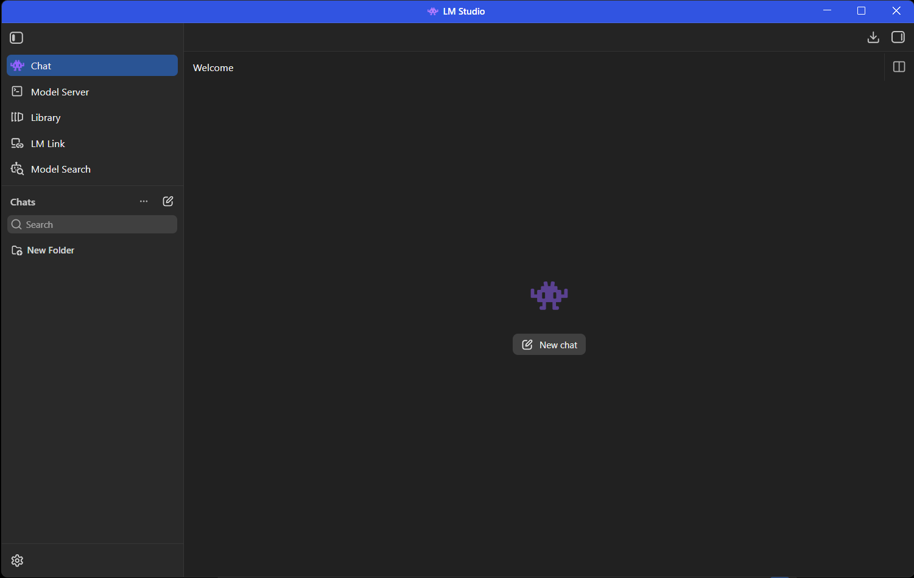

*Рисунок 1 — LM Studio после установки.*

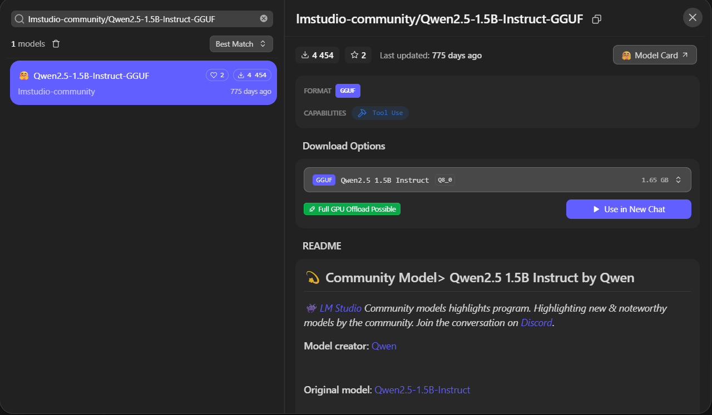

*Рисунок 2 — Первая выбранная модель.*

Для начала я проверил её прямо в чате: попросил объяснить, что такое переменная в Python. Ответ и пример кода появились без ошибок запуска.

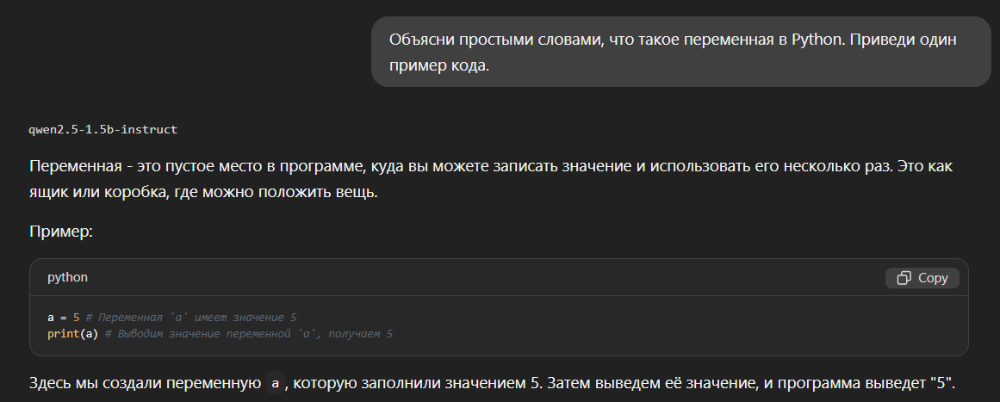

*Рисунок 3 — Проверка модели в чате.*

После этого скачал вторую модель.

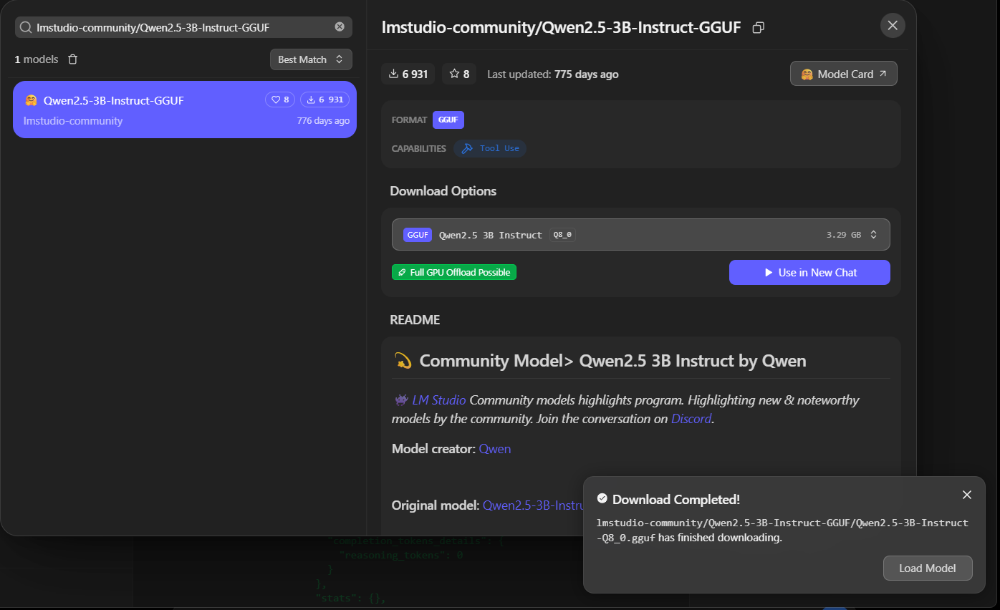

*Рисунок 4 — Загрузка Qwen2.5-3B-Instruct завершена.*

## 4. Настройка локального сервера

В разделе **Model Server** я поставил порт `7000`, включил **Require Authentication** и создал API-токен. Доступ из локальной сети оставил выключенным.

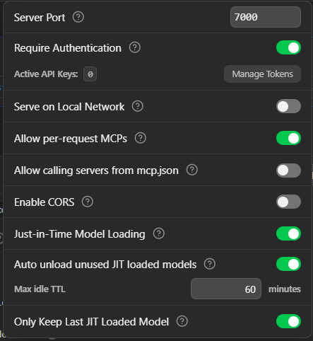

*Рисунок 5 — Настройки локального сервера.*

После запуска сервер показывал статус `Running`, а модель — `READY`. Модели загружал по очереди, чтобы не держать обе одновременно в памяти.

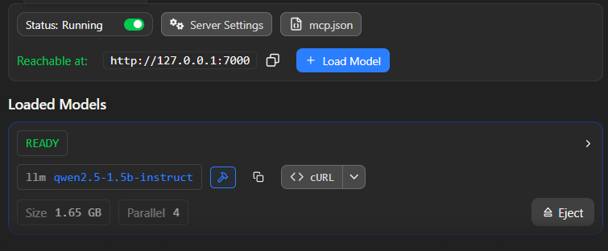

*Рисунок 6 — Сервер с моделью 1.5B.*

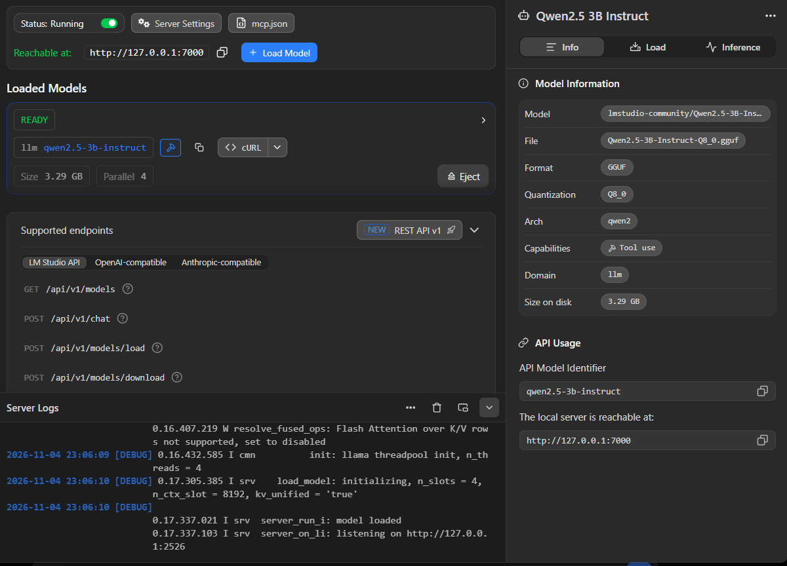

*Рисунок 7 — Сервер с моделью 3B.*

## 5. Подключение через Python

Проверил Python и установил библиотеку `openai` версии `3.45.0`:

```powershell
py --version
py -m pip install openai
py -m pip show openai
```

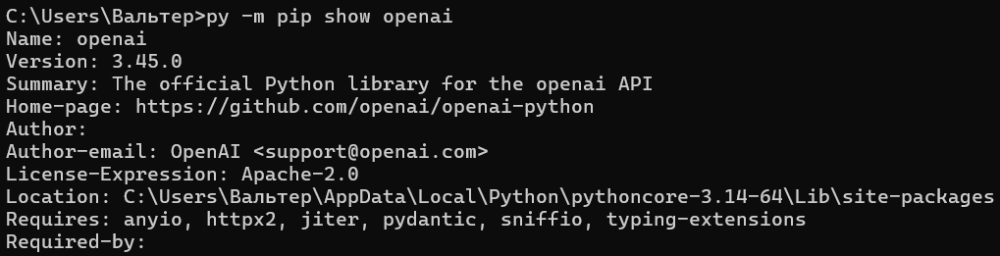

*Рисунок 8 — Проверка установленной библиотеки.*

Для подключения использовал локальный адрес `http://127.0.0.1:7000/v1`. Токен вводил при запуске программы, в файле его не сохранял.

Основная часть кода для запроса выглядела так:

```python
client = OpenAI(
    base_url="http://127.0.0.1:7000/v1",
    api_key=token
)

response = client.chat.completions.create(
    model=MODEL,
    messages=[{"role": "user", "content": prompt}],
    temperature=0.2,
    max_tokens=400
)
print(response.choices[0].message.content)
```

Я проверил, что через Python обе модели отвечают на вопрос о языке Python.

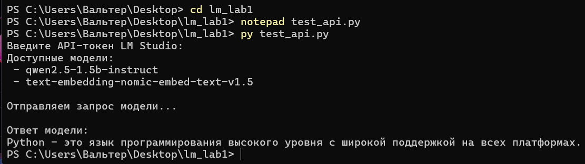

*Рисунок 9 — Проверка модели 1.5B через API.*

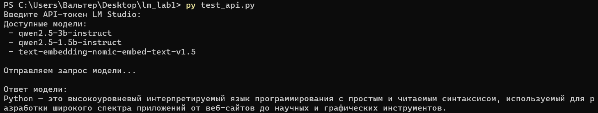

*Рисунок 10 — Проверка модели 3B через API.*

## 6. Основные тесты

В файле `prompts.py` подготовил пять запросов:

1. Объяснить, что такое список в Python, и привести пример.
2. Написать функцию, которая проверяет, чётное ли число.
3. Найти ошибку в коде, который должен складывать числа от 1 до 5.
4. Извлечь из текста данные о проекте в JSON.
5. Ответить на вопрос о прибыли компании, которой нет в исходном тексте.

Одинаковые запросы отправил сначала модели 3B, потом 1.5B. В программе `run_tests.py` измерял время с помощью `time.perf_counter()` и сохранял ответы в JSON. Настройки запросов были одинаковыми: `temperature = 0.2`, `max_tokens = 400`.

### Время ответов

| Тест | Qwen 1.5B, с | Qwen 3B, с |
|---|---:|---:|
| Объяснение списка | 20,15 | 70,71 |
| Написание функции | 5,31 | 3,92 |
| Поиск ошибки | 22,71 | 41,27 |
| JSON | 5,54 | 10,51 |
| Недостаточно информации | 6,06 | 15,02 |
| **Итого** | **59,77** | **141,43** |
| **Среднее** | **11,95** | **28,29** |

### Что получилось в тестах

- **Список Python.** Обе модели объяснили тему, но были неточности. Модель 1.5B написала, что список создаётся круглыми скобками, хотя в примере сама использовала квадратные. Модель 3B дала слишком длинный ответ, который оборвался.
- **Функция.** Обе модели написали правильную проверку `n % 2 == 0`. Модель 1.5B добавила лишние примеры, хотя требовался только код функции.
- **Поиск ошибки.** Обе правильно заменили `total = i` на `total += i`.
- **JSON.** Данные были правильными у обеих, но модели добавили Markdown-разметку вокруг JSON, хотя по запросу нужен был только JSON.
- **Недостаточно информации.** Обе модели правильно сказали, что прибыль компании в тексте не указана.

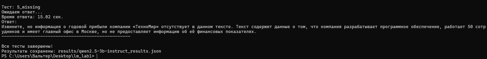

*Рисунок 11 — Результаты тестов модели 3B.*

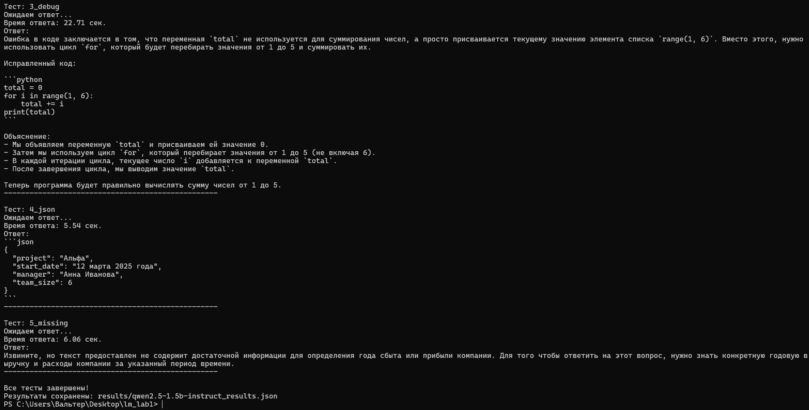

*Рисунок 12 — Результаты тестов модели 1.5B.*

В моей серии тестов 1.5B отвечала заметно быстрее: суммарно 59,77 секунды против 141,43 секунды. Но время зависит ещё и от того, какой длины ответ создаёт модель, поэтому это не сравнение скорости в токенах в секунду.

## 7. Эксперимент с температурой

Для модели **Qwen2.5-1.5B-Instruct** я взял первый запрос — объяснить список Python. Повторил его три раза с температурой `0.2` и три раза с `1.0`. Лимит остался `400` токенов.

| Температура | Запуск 1 | Запуск 2 | Запуск 3 | Среднее |
|---|---:|---:|---:|---:|
| 0.2 | 21,62 с | 16,53 с | 20,03 с | **19,39 с** |
| 1.0 | 13,72 с | 16,10 с | 34,79 с | **21,54 с** |


При `0.2` ответы были более похожими по времени и содержанию. Но и тут модель ошибалась: в одном ответе снова упомянула круглые скобки для списка.

При `1.0` ответы отличались сильнее. Встречались неточности в объяснении, а третий ответ не успел закончиться из-за ограничения по токенам (`finish_reason: length`).

По этим шести запускам у меня получилось, что для простого объяснения температура `0.2` удобнее. Но это небольшая проверка, поэтому такой результат не обязательно будет для всех запросов.

## 8. Вывод

В этой лабораторной я установил LM Studio, скачал две модели, настроил локальный сервер с API-токеном и отправил запросы к моделям из Python. Провёл пять одинаковых тестов для каждой модели и шесть запусков с разной температурой.

Обе модели справились с простым Python-кодом и исправлением ошибки. При этом иногда они не соблюдали формат ответа и допускали неточности. На моём компьютере **Qwen2.5-1.5B-Instruct оказалась удобнее**, потому что в этих тестах работала быстрее и занимала меньше памяти. Для более сложных вопросов можно попробовать 3B, но проверять её ответы всё равно нужно.

---

**Файлы экспериментов:** `scripts/prompts.py`, `scripts/run_tests.py`, `scripts/temperature_test.py`; результаты находятся в папке `results`.
