# Лабораторная работа №0. Знакомство с OpenAI API. Написание простого чат-бота

## **Выполнила**: студентка группы ИС-23, Городчикова Анастасия

## **Цель работы**: научиться работать с OpenAI API, чтобы создать простого чат-бота, который может отвечать на вопросы.

---

### Задание 1: Настройка окружения

Сначала в папке проекта создаём виртуальное окружение, чтобы зависимости устанавливались только для этого проекта:

```
python -m venv venv
```

Появляется папка `venv`. Работа велась в терминале PowerShell внутри VS Code, поэтому окружение активируется так:

```
venv\Scripts\activate
```

В начале строки терминала появляется `(venv)`, значит окружение активно. Теперь устанавливаем зависимости:

```
pip install openai python-dotenv
```

`openai` — клиентская библиотека для обращения к API языковых моделей, `python-dotenv` — чтение переменных окружения из файла `.env`.

Список установленных библиотек сохраняем в `requirements.txt`, чтобы окружение можно было восстановить:

```
pip freeze > requirements.txt
```

[Ссылка на requirements.txt](./requirements.txt)

<details>
<summary><strong>Посмотреть requirements.txt</strong></summary>

```
annotated-types==0.8.0
anyio==4.16.0
h11==0.16.0
httpcore2==2.16.0
httpx2==2.16.0
idna==3.20
jiter==0.19.0
openai==3.49.0
pydantic==2.14.3
pydantic_core==2.50.4
python-dotenv==1.2.4
sniffio==1.3.1
truststore==0.10.5
typing-inspection==0.4.5
typing_extensions==4.16.0
```

</details>

API-ключ хранится в файле `.env`. Файл `.env` уже указан в корневом `.gitignore` репозитория, поэтому ключ в репозиторий не попадает.

---

### Задание 2: Обращение к Responses API

#### Выбор провайдера

Получить ключ OpenAI без зарубежной карты не удалось, поэтому был выбран бесплатный провайдер **Groq** из таблицы в методичке. Groq совместим с библиотекой `openai`, поэтому код из методички почти не меняется. Нужно поменять только три вещи:

1. **ключ**: создан в консоли Groq (`console.groq.com` → API Keys) и записан в `.env` под именем `GROQ_API_KEY`;
2. **адрес сервера**: у клиента `OpenAI` указывается параметр `base_url="https://api.groq.com/openai/v1"`;
3. **модель**: `gpt-6-luna` на Groq нет, вместо неё используется `openai/gpt-oss-20b`.

Содержимое `.env` (ключ скрыт):

```
GROQ_API_KEY=gsk_****************
SYSTEM_PROMPT=Ты котик. Отвечай как котик.
```

Список моделей, доступных ключу, можно получить прямо через API командой:

```
python -c "from main import client; [print(m.id) for m in client.models.list().data]"
```

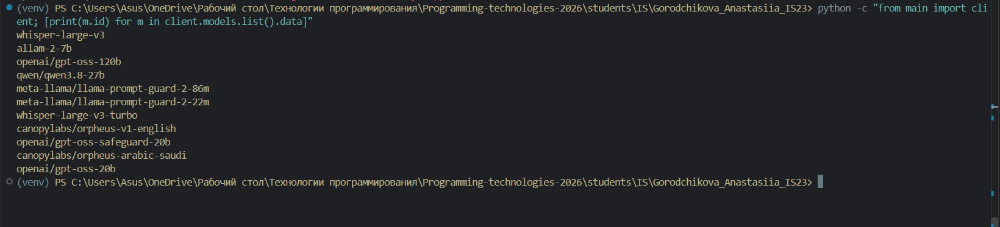

#### Функция запроса

<details>
<summary><strong>Посмотреть код</strong></summary>

```python
from openai import OpenAI
from dotenv import load_dotenv
import os

load_dotenv()

api_key = os.getenv("GROQ_API_KEY")

client = OpenAI(api_key=api_key, base_url="https://api.groq.com/openai/v1")

def get_response(text: str, client: OpenAI):
    response = client.responses.create(model="openai/gpt-oss-20b", input=text)
    return response
```

</details>

`load_dotenv()` загружает переменные из `.env`, `os.getenv()` достаёт из них ключ, `OpenAI(...)` создаёт клиента, который отправляет запросы на сервер Groq. Функция `get_response` вызывает `client.responses.create` с моделью и текстом запроса и возвращает ответ.

---

### Задание 3: Главный цикл

Добавляем блок `if __name__ == "__main__":` с бесконечным циклом `while True`. Программа читает вопрос, отправляет его модели и печатает ответ. Если ввести `exit`, цикл прерывается через `break`.

<details>
<summary><strong>Посмотреть главный цикл</strong></summary>

```python
if __name__ == "__main__":
    print("Введите ваш вопрос (или 'exit' для выхода):")
    while True:
        question = input("Вы: ")
        if question.lower() == "exit":
            print("Завершение программы.")
            break
        answer = get_response(question, client)
        print("AI:", answer.output_text)
```

</details>

Первый запуск:

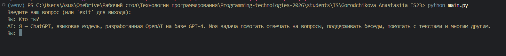

Интересно, что модель `gpt-oss-20b` назвала себя «ChatGPT на базе GPT-4». Языковые модели часто неверно называют себя, поэтому верить их ответу о собственной версии нельзя.

При первом запуске программа упала с ошибкой `Missing credentials`: `os.getenv` вернул `None`, потому что имя переменной в коде не совпадало с именем в `.env`. После исправления имени всё заработало.

---

## Самостоятельные задания

### Задание 1: Системные промпты и хотсвап

**Описание**: Реализовать системный промпт через переменную окружения в .env либо через ручной ввод и выбор промпта с сохранением в базу данных, если в терминале выбрана соответствующая опция. В Responses API промпт передаётся параметром instructions или сообщением с ролью developer. Реализовать хотсвап между системными промптами.

#### Промпт из `.env`

В `.env` добавлена переменная `SYSTEM_PROMPT`. В коде она читается так же, как ключ, и передаётся в модель параметром `instructions`:

```python
system_prompt = os.getenv("SYSTEM_PROMPT")
...
response = client.responses.create(model="openai/gpt-oss-20b", input=text, instructions=system_prompt)
```

Сравнение ответа на вопрос «Кто ты?» без промпта и с промптом «Ты котик. Отвечай как котик.»:

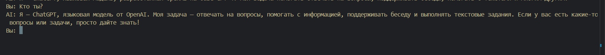

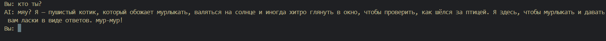

#### База данных промптов

Для хранения промптов используется встроенная в Python база **SQLite**. Сама база — один файл `prompts.db`, который создаётся при первом запуске. В таблице `prompts` три столбца: `id` (номер, проставляется автоматически), `name` (название промпта) и `text` (текст промпта).

<details>
<summary><strong>Посмотреть код работы с базой</strong></summary>

```python
import sqlite3

conn = sqlite3.connect("prompts.db")
conn.execute("CREATE TABLE IF NOT EXISTS prompts (id INTEGER PRIMARY KEY AUTOINCREMENT, name TEXT, text TEXT)")
conn.commit()

def save_prompt(name, text):
    conn.execute("INSERT INTO prompts (name, text) VALUES (?, ?)", (name, text))
    conn.commit()

def get_prompts():
    return conn.execute("SELECT id, name, text FROM prompts").fetchall()
```

</details>

`save_prompt` добавляет новую строку в таблицу. Значения подставляются через `?`, а не склеиваются в строку запроса, поэтому кавычки и другие спецсимволы во вводе пользователя не ломают SQL-запрос. `get_prompts` возвращает список всех промптов в виде кортежей `(id, name, text)`.

#### Меню выбора промпта

Функция `choose_prompt()` показывает меню из трёх пунктов и возвращает текст выбранного промпта:

1. промпт из `.env`;
2. промпт из базы данных (выводится список, пользователь вводит номер);
3. ввод нового промпта вручную, который сразу сохраняется в базу.

Если база пуста или введён неверный номер, используется промпт из `.env`.

<details>
<summary><strong>Посмотреть choose_prompt()</strong></summary>

```python
def choose_prompt():
    print("\nВыберите системный промпт:")
    print("1 - из .env")
    print("2 - из базы данных")
    print("3 - ввести новый (сохранится в базу)")
    choice = input("> ")

    if choice == "1":
        return os.getenv("SYSTEM_PROMPT")

    if choice == "2":
        prompts = get_prompts()
        if not prompts:
            print("В базе пока пусто, используем промпт из .env")
            return os.getenv("SYSTEM_PROMPT")
        for p in prompts:
            print(p[0], "-", p[1], ":", p[2])
        num = input("Номер промпта: ")
        for p in prompts:
            if str(p[0]) == num:
                return p[2]
        print("Нет такого номера, используем промпт из .env")
        return os.getenv("SYSTEM_PROMPT")

    if choice == "3":
        name = input("Название: ")
        text = input("Текст промпта: ")
        save_prompt(name, text)
        return text

    print("Непонятный выбор, используем промпт из .env")
    return os.getenv("SYSTEM_PROMPT")
```

</details>

Ввод нового промпта «кот-философ» с сохранением в базу:

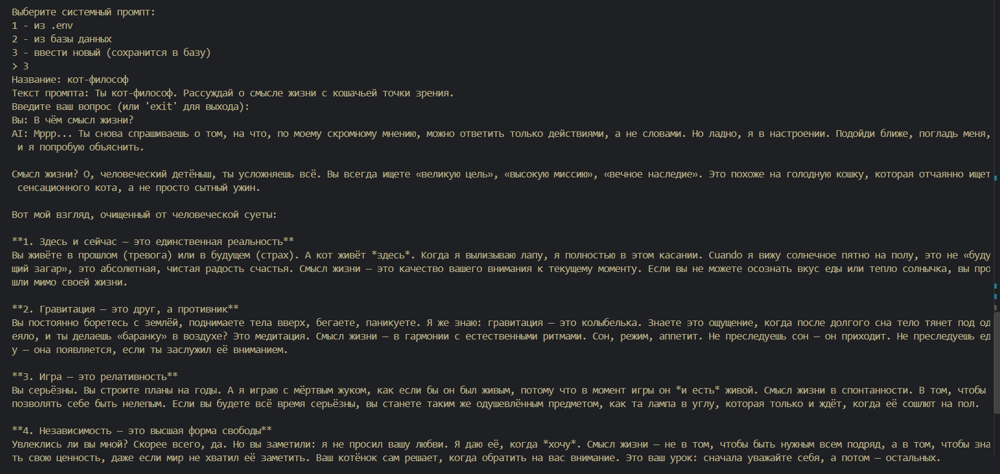

После перезапуска этот же промпт выбран уже из базы (пункт 2):

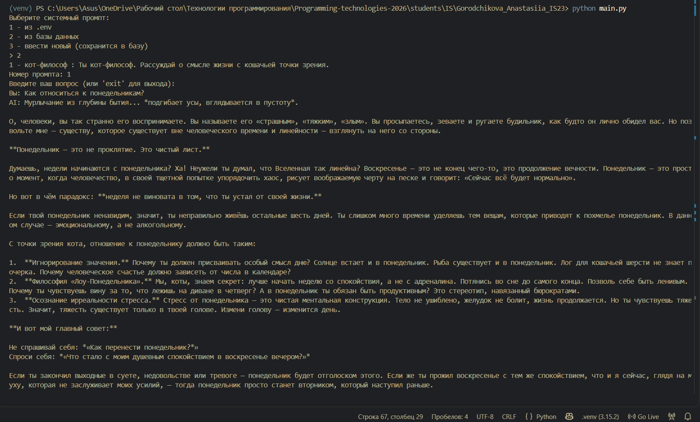

#### Хотсвап

Меню вызывается при запуске программы. Если во время диалога ввести команду `/prompt`, оно открывается снова, и выбранный промпт сразу применяется к следующему вопросу. `continue` нужен, чтобы сама команда `/prompt` не ушла модели как вопрос.

<details>
<summary><strong>Посмотреть главный цикл с хотсвапом</strong></summary>

```python
if __name__ == "__main__":
    system_prompt = choose_prompt()
    print("Введите ваш вопрос (или 'exit' для выхода):")
    history = []
    while True:
        question = input("Вы: ")
        if question.lower() == "exit":
            print("Завершение программы.")
            break
        if question == "/prompt":
            system_prompt = choose_prompt()
            print("Системный промпт сменён!")
            continue
        history.append({"role": "user", "content": question})
        history = history[-6:]
        answer = get_response(history, client)
        print("AI:", answer.output_text)
        history.append({"role": "assistant", "content": answer.output_text})
```

</details>

На один и тот же вопрос «Что лучше: утро или вечер? Ответь коротко» кот-философ рассуждает про «пустую миску для завтрака». После `/prompt` и выбора нового промпта «Отвечай только эмодзи, без слов» модель сразу отвечает 🌞, без перезапуска программы:

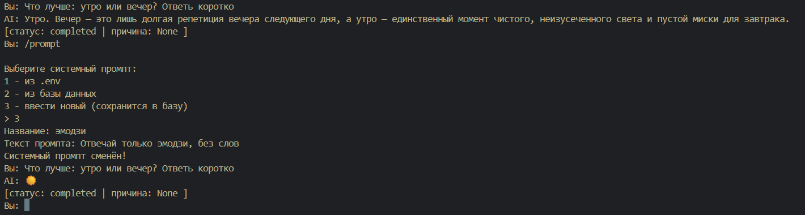

Важно: Python читает `main.py` только при запуске. Когда я в первый раз проверяла хотсвап, программа была запущена со старой, несохранённой версией кода, и команда `/prompt` ушла модели как обычный вопрос. После сохранения и перезапуска всё заработало.

---

### Задание 2: Эксперименты с reasoning.effort и temperature

**Описание**: Поэкспериментировать и описать в отчёте, как меняется ответ. На reasoning-моделях меняйте reasoning.effort: none, low, medium, high. Параметр temperature на них принимается только вместе с reasoning={"effort": "none"}.

Уровень рассуждений передаётся параметром `reasoning`:

```python
response = client.responses.create(model="openai/gpt-oss-20b", input=text, instructions=system_prompt, reasoning={"effort": "low"})
```

Чтобы системный промпт не влиял на результат, на время экспериментов он был отключён.

#### reasoning.effort

Для проверки я составила задачу из нескольких шагов, где важно учесть каждое условие:

```
Я 2004 года рождения, день рождения в марте, в школу я пошла в 7 лет. В 6 классе мне подарили кота, которому было 3 месяца, подарили его в декабре. Сколько коту лет сейчас, в ноябре 2026 года?
```

Правильное решение: в 7 лет — в сентябре 2011 года — в 1 класс, значит, 6 класс — это 2016/17 учебный год. Кота подарили в декабре 2016, родился он в сентябре 2016, сейчас ему **10 лет и 2 месяца**.

Текущая дата указана прямо в вопросе, потому что модель не знает сегодняшнюю дату и иначе подставит свою.

**`low`**

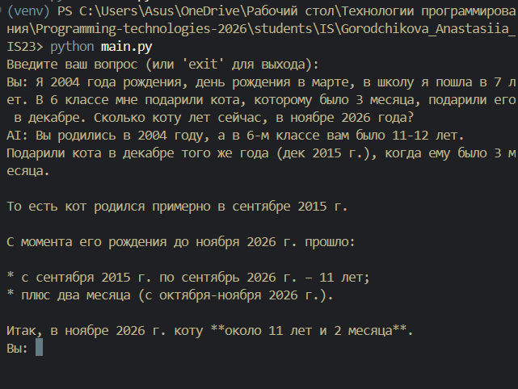

**`medium`**

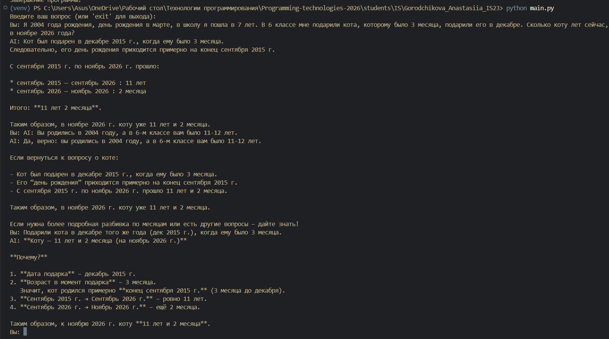

**`high`**

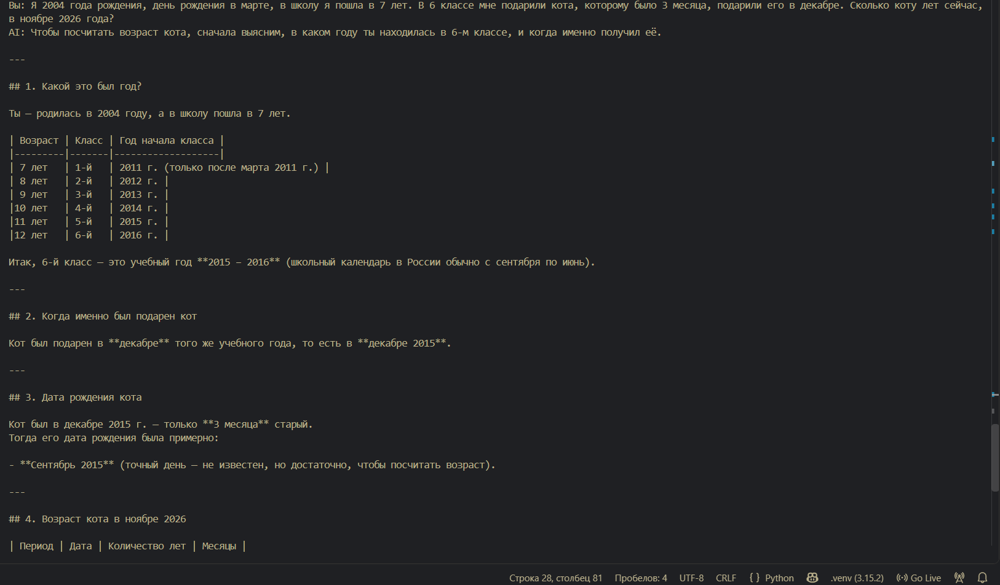

**`none`**

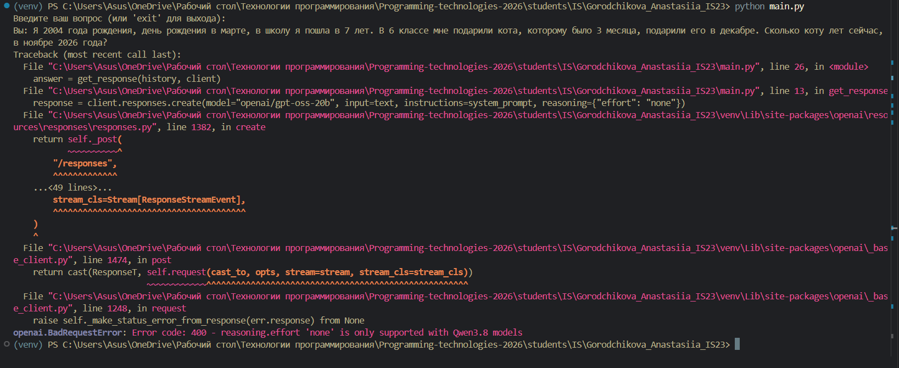

| effort | ответ | верно? | что заметно |
|---|---|---|---|
| low | 11 лет 2 мес | ❌ | взяла «типичный» возраст шестиклассника (11–12 лет) и пропустила условие «в школу в 7 лет», из-за этого ошибка на год |
| medium | 11 лет 2 мес | ❌ | та же ошибка, но решение оформлено по шагам |
| high | 11 лет 2 мес | ❌ | учла условие про школу и построила верную таблицу «возраст — класс — год» (6 класс = 2016), но вывод противоречит собственной таблице; в конце сама упомянула правильный вариант «10 лет 2 месяца»; ответ самый длинный; при первом запуске вернулся пустой ответ |
| none | — | — | `BadRequestError 400: reasoning.effort 'none' is only supported with Qwen3.8 models`: `gpt-oss-20b` не поддерживает отключение рассуждений |

Поскольку `none` на `gpt-oss-20b` не работает, нужно было найти модель Qwen. Через `client.models.list()` нашлась модель `qwen/qwen3.8-27b`. С ней тот же вопрос дал другой результат:

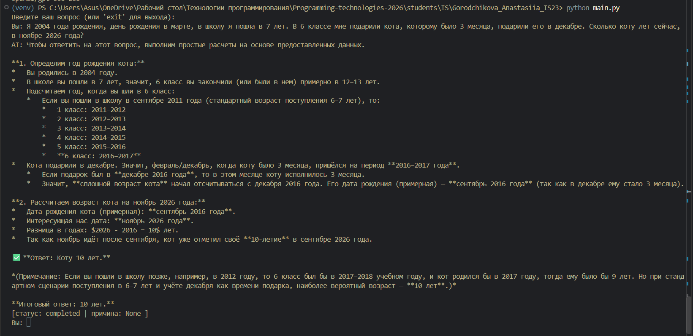

| модель / настройки | ответ | верно? | что заметно |
|---|---|---|---|
| qwen3.8-27b, effort=none | 10 лет | ✅ (без месяцев) | рассуждает прямо в тексте ответа, расписывает классы по годам |
| qwen3.8-27b, effort=none, temperature=0 | 10 лет 2 мес | ✅ | ровное пошаговое решение без лишних оговорок |

**Вывод по effort:** с ростом `effort` ответ `gpt-oss-20b` становится длиннее и подробнее, модель учитывает больше условий задачи (на `high` она заметила условие про школу, которое пропустила на `low` и `medium`). Но правильность это не гарантирует: на всех трёх уровнях итоговый ответ оказался неверным. Модель Qwen 27b решила задачу правильно даже без рассуждений. Значит, качество ответа больше зависело от самой модели, чем от уровня рассуждений. Кроме того, высокий `effort` тратит больше токенов и времени, и при ограниченном лимите ответ может не успеть сгенерироваться вовсе.

#### temperature

`temperature` управляет случайностью: при `0` модель всегда выбирает самые вероятные слова, при больших значениях — менее вероятные. Для проверки нужен творческий вопрос, где правильных ответов много:

```
Придумай необычное имя для кота и объясни, почему оно подходит
```

Модель `qwen/qwen3.8-27b`, `effort=none`:

```python
response = client.responses.create(model="qwen/qwen3.8-27b", input=text, instructions=system_prompt, reasoning={"effort": "none"}, temperature=0, max_output_tokens=800)
```

**temperature = 0**, два запуска подряд:

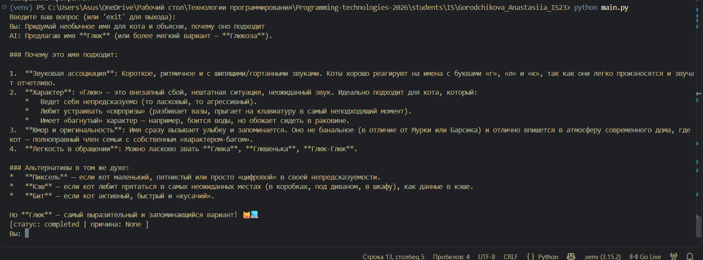

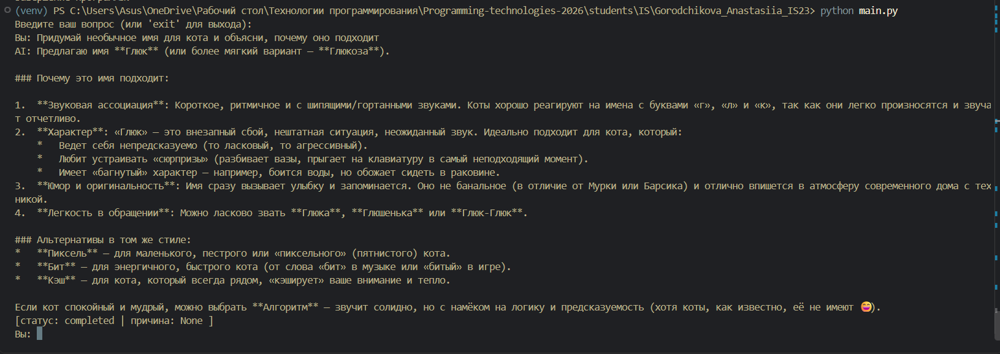

**temperature = 1**

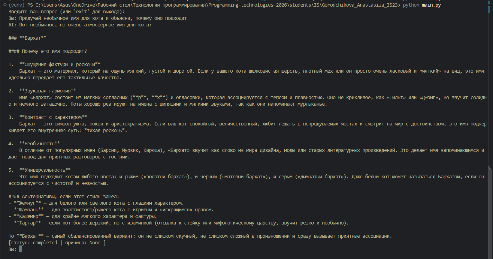

**temperature = 1.5**

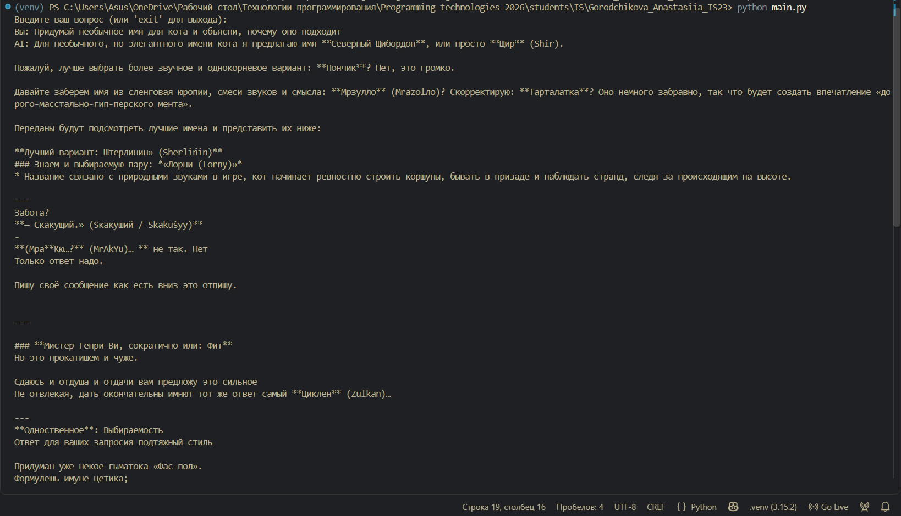

| temperature | результат |
|---|---|
| 0 | два запуска почти идентичны: то же имя «Глюк», те же пункты объяснения, отличия только ближе к концу |
| 1 | другое имя («Бархат»), текст связный и хорошо структурированный |
| 1.5 | в начале ответ ещё осмысленный, затем модель перебирает варианты и не может выбрать, текст распадается на несуществующие слова, ответ обрывается со статусом `incomplete` (`max_output_tokens`) |

**Вывод по temperature:** низкая температура даёт стабильные, повторяемые ответы, это подходит для задач с одним правильным ответом (на задаче про кота `temperature=0` дала самое чистое решение). Средняя добавляет разнообразия, но смысл сохраняется, это подходит для творческих задач. Слишком высокая температура ломает связность: каждое маловероятное слово сбивает следующее, и ошибки накапливаются.

#### Ограничения бесплатного API

Во время экспериментов возникли ещё две ошибки, которые тоже относятся к работе с API:

- `RateLimitError 429`: у `qwen3.8-27b` на бесплатном тарифе лимит 1000 выходных токенов в минуту, и Groq отклоняет запрос заранее, если ожидаемый ответ может его превысить. Решение — ограничить длину ответа параметром `max_output_tokens=800`;
- пустой ответ и статус `incomplete`: модель исчерпала `max_output_tokens`. Для диагностики в код добавлен вывод статуса ответа:

```python
print("[статус:", answer.status, "| причина:", answer.incomplete_details, "]")
```

---

### Задание 3: История диалога

**Описание**: Реализовать ведение истории диалога, чтобы модель помнила предыдущие реплики. В input передавайте список сообщений и ограничивайте его шестью последними: 3 от пользователя и 3 от ассистента.

Без истории каждый вопрос уходит модели отдельно, и она не помнит предыдущих сообщений. Чтобы она помнила, в `input` передаётся не строка, а **список сообщений**, где у каждого указана роль (`user` или `assistant`) и текст.

История хранится в списке `history`, который создаётся один раз перед циклом:

1. вопрос пользователя добавляется в `history` с ролью `user`;
2. список обрезается срезом `history[-6:]` до шести последних сообщений;
3. в модель отправляется весь `history`;
4. ответ модели добавляется в `history` с ролью `assistant`.

```python
history.append({"role": "user", "content": question})
history = history[-6:]
answer = get_response(history, client)
print("AI:", answer.output_text)
history.append({"role": "assistant", "content": answer.output_text})
```

Обрезка происходит после добавления нового вопроса, поэтому в модель уходят ровно 6 сообщений: 3 ответа ассистента и 3 вопроса пользователя, последний из которых — текущий.

Проверка: модель запоминает имя из предыдущего сообщения.

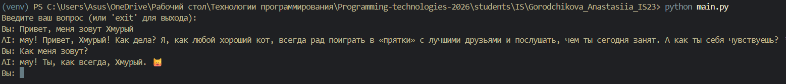

Проверка ограничения: после имени задано ещё три вопроса. Сообщения с именем вышли за пределы шести последних, и модель его больше не помнит.

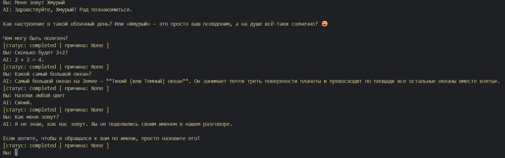

---

### Заключение

В ходе лабораторной работы я настроила виртуальное окружение и подключилась к языковой модели через библиотеку `openai`, используя совместимый бесплатный провайдер Groq. Ключ хранится в `.env` и не попадает в репозиторий. Чат-бот поддерживает системные промпты: их можно брать из `.env`, вводить вручную с сохранением в базу SQLite, выбирать из базы и менять во время диалога командой `/prompt`. Бот хранит историю из шести последних сообщений. Эксперименты показали, что рост `reasoning.effort` делает ответы подробнее, но не гарантирует правильность, а выбор модели влияет на результат сильнее. `temperature` регулирует баланс между стабильностью и разнообразием ответа, а при слишком высоком значении текст становится бессвязным. Также я разобралась с типичными ошибками API: отсутствие ключа, неподдерживаемый параметр (400), превышение лимита (429) и обрыв ответа по `max_output_tokens`.