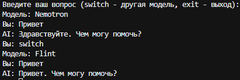
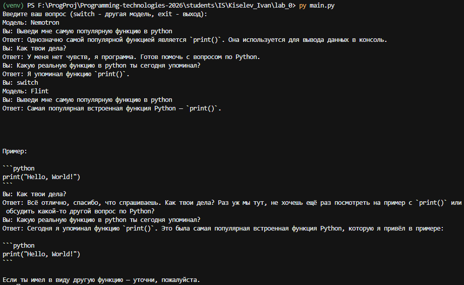

# **Отчёт по лабораторной работе №0**

**Студент**: Киселёв Иван Михайлович

**Группа**: ИС-23

## Подготовка к выполнению работы

Выполнен перечень подготовительных действий к выполнению заданий по лабораторной работы №0:

1. Настроено виртуальное python-окружение со всеми необходимыми зависимостями для выполнения работы
2. Настроено обращение к бесплатной api (OpenRouter)
3. Реализован главный цикл работы программы
4. API-ключ и ссылка на API-запросы к ИИ-моделям сохранены в файл переменных окружения. Используется практика .env.example для удобства работы на нескольких устройствах через один удалённый репозиторий
5. Обе бесплатные модели вызываются одним ключом OpenRouter. Используемые в лабораторной работе бесплатные ИИ-модели: `nvidia/nemotron-3.5-super-vl:free` и `recursive/flint-v1.0:free`

## Задание №1

Системный промпт задаётся переменной `SYSTEM_PROMPT` в `.env`. В Responses API он передаётся параметром `instructions`. Системный промпт можно сменить через `.env` файл

Место для наблюдений:

1. Вопрос: "Выведи мне самую популярную функцию в python". Для проверки роли дополнительно задавался вопрос "Как твои дела?"
2. Промпт из `.env`: отвечать как сеньор-разработчик на Python, кратко, по делу, без эмодзи и без выдуманных фактов, на русском языке. Nemotron назвал `print()` и коротко пояснил, что функция выводит данные в консоль. На вопрос о делах ответил, что является программой и готов помочь по Python
3. Второй текст промпта в сохранённом прогоне не подменялся: для смены правят `SYSTEM_PROMPT` и перезапускают скрипт. На действующем промпте Flint тоже назвал `print()`, но добавил пример кода и ответил заметно длиннее
4. При одном и том же промпте Nemotron держит требование краткости. Flint остаётся в теме Python, но тон у него разговорнее, а ответы подробнее

## Задание №2

У Nemotron reasoning выключен: в запрос для API уходят `reasoning.effort = none` и `temperature`. У Flint reasoning обязателен, поэтому НЕ reasoning-поля ему не отправляются.

Один ключ `FIRST_API_KEY` реализует обращение к двум моделям (хот-свитч реализован через команду `switch`):

1. `nvidia/nemotron-3.5-super-vl:free`
2. `recursive/flint-v1.0:free`

Один и тот же вопрос задавался при разной температуре на Nemotron.

**Наблюдения:**

1.1 Nemotron, temperature 0: ответы модели даны крайне оперативные, галлюцинаций обнаружено не было. Содержание краткое, без каких-либо подробностей и пояснений  
1.2 Nemotron, temperature 1: ответы модели мало чем отличаются от ответов при значении температуры "0". Единственное отличие: более развёрнутые, подробные ответы  
1.3 Nemotron, temperature 1.3: модель демонстрирует периодические зависания после первого заданного вопроса. Ответы от ИИ стали более развёрнутыми, но их содержание может иметь несколько отрывистое, неожиданное наполнение, "не в тематике" задаваемого вопроса и системного промпта  
1.4 Nemotron, temperature 1.5: зависание, модель не отвечает на этом показателе. Возможно, есть заданное системное ограничение модели, но даже так поведение нетипично. Обычно подобные ограничения сопровождаются ответами с определёнными http-кодами ошибки

2.1 Flint на вопрос "Привет" ответил: "Привет. Чем могу помочь?". Nemotron на тот же вопрос ответил: "Здравствуйте. Чем могу помочь?"
2.2 Flint, работа с контекстом: проблем обнаружено не было. Модель хорошо принимает системный промпт и следует его предписанию. Контекст принимает безоговорочно. После своего ответа про `print()` модель на уточняющий вопрос снова назвала `print()` и вернулась к примеру с `Hello, World!`
2.3 Чем ответ Flint отличается от Nemotron: обе модели сходятся на функции `print()`. Nemotron отвечает короче и суше. Flint добавляет пример кода и дольше удерживает разговорный тон  
2.4 Как менялся ответ Nemotron: при temperature 0 и 1 ответы близкие и короткие, при 1.3 становятся длиннее и менее собранными, при 1.5 модель перестаёт отвечать

Переключение моделей на одном и том же приветствии:

## Задание №3

История диалога хранится в памяти программы. В `input` уходят не более шести последних реплик: 3 от пользователя и 3 от ассистента. Ответ модели попадает в эту историю и переходит в следующий запрос. Команда `switch` и прекращение работы скрипта очищают контекст диалога с моделью

Проверка на запущенном скрипте:

1.1 Nemotron сначала назвал функцию `print()`. Следующим вопросом его спросили, какую функцию он уже упоминал. Модель ответила `print()`, то есть предыдущая реплика осталась в истории и ушла в новый запрос
1.2 Команда `switch` очистила историю. Дальше Flint отвечал уже в своей сессии: вопрос про популярную функцию ему задали заново, и он сам назвал `print()`
2.1 Внутри своей сессии Flint тоже помнит реплики. На вопрос, какую функцию он упоминал, модель повторила `print()` и вывела свой пример в markdown-формате, который привела выше

## Вывод

Выполнена лабораторная работа с использованием API OpenRouter, одного ключа на две бесплатные модели. Был задан системный промпт в `.env` и передаётся через `instructions`. У Nemotron параметр reasoning выключен, и по мере роста temperature ответы становятся длиннее, а на значении 1.5 модель перестаёт отвечать. У Flint reasoning обязателен и он используется по умолчанию всегда. История диалога хранится только в памяти скрипта, ограничена шестью репликами и сбрасывается при смене модели
