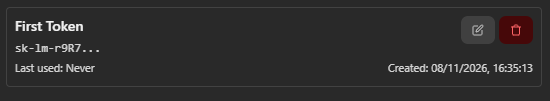
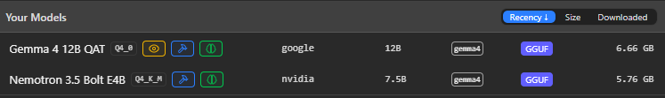
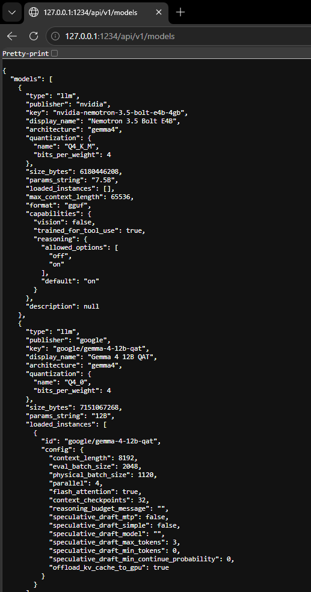
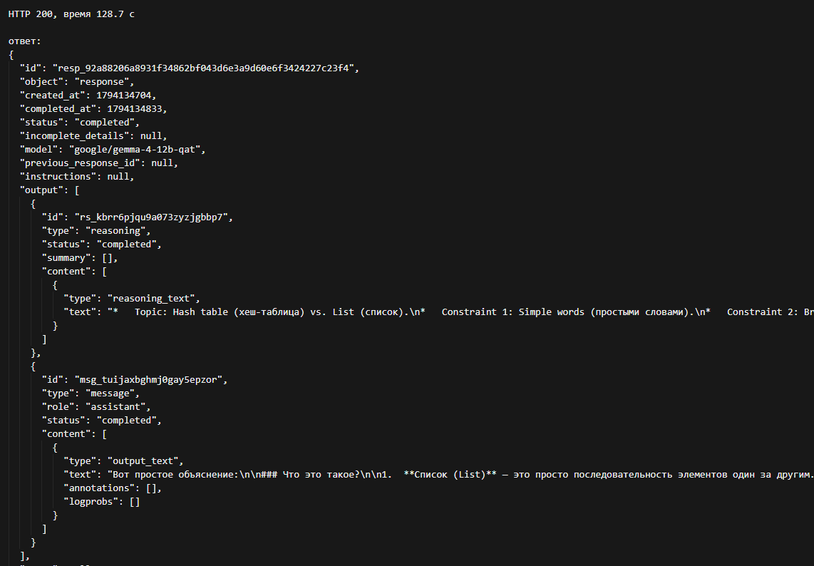
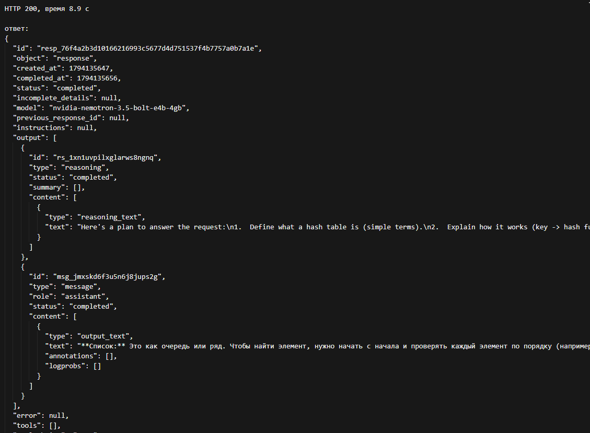

# **Отчёт по лабораторной работе №1**

**Студент**: Киселёв Иван Михайлович

**Группа**: ИС-23

## Подготовка к выполнению работы

Локальный запуск моделей выполняется в программе LM Studio. Обращение к загруженной модели идёт через локальный сервер.

1. Характеристики машины: CPU AMD Ryzen 7 7800X3D, GPU Nvidia RTX 3070, VRAM 8 ГБ, ОЗУ 32 ГБ, свободно на диске 500 ГБ
2. LM Studio: версия 0.4.26. Каталог моделей (`Models Directory`): C:\Users\Valder\lmstudio\models
3. Сервер: нативный адрес `http://127.0.0.1:1234/api/v1`. OpenAI-совместимые вызовы также держатся на `http://127.0.0.1:1234/v1`. Токен `First Token` создан в `Server Settings`, `Manage Tokens` и лежит в `.env` как `API_KEY`. В отчёт сам токен не вносится. На снимке токен ещё не использовался
4. Клиент: Python. Используются пакеты `openai` и `python-dotenv` (все зависимости сохранены в `requirements.txt`). `main.py` проверяет сервер. `requests.py` гоняет пять одинаковых запросов
5. Общие настройки пяти запросов: `TEMPERATURE=0.7` в `.env`. Скрипты не меняют контексты загрузок в LM Studio, как и их серверные параметры. Снятые параметры загрузки у обеих моделей: контекст 8192, flash attention, KV-cache на GPU, parallel 4, eval batch 2048. Physical batch различается: у Gemma 1120, у Nemotron 512
6. Для обеспечения практики безопасности, для доступа к API LM Studio используется Token:

## Задание №1. Выбор моделей

Обе модели загружены в формате `.gguf` и запускаются в LM Studio.

|                                      | Модель A                         | Модель B                           |
| ------------------------------------ | -------------------------------- | ---------------------------------- |
| Название                             | Gemma 4 12B QAT                  | Nemotron 3.5 Bolt E4B              |
| Откуда взята                         | каталог LM Studio                | Hugging Face, GGUF                 |
| Идентификатор на сервере             | `google/gemma-4-12b-qat`         | `nvidia-nemotron-3.5-bolt-e4b-4gb` |
| Число параметров                     | 12B                              | 7.5B                               |
| Квантование                          | Q4_0                             | Q4_K_M                             |
| Размер файла                         | 6,66 ГБ                          | 5,76 ГБ                            |
| Архитектура                          | gemma4                           | gemma4                             |
| Контекст при запуске                 | 8192                             | 8192                               |
| GPU                                  | KV-cache на GPU, flash attention | KV-cache на GPU, flash attention   |
| parallel / eval batch                | 4 / 2048                         | 4 / 2048                           |
| physical batch                       | 1120                             | 512                                |
| Максимальный поддерживаемый контекст | 262144                           | 65536                              |

Обоснование выбора: одна модель крупнее (12B), вторая меньше и дообучена NVIDIA на базе Gemma 4 E4B. Обе текстовые instruct-модели, поэтому их можно гонять на одном наборе запросов.

## Задание №2. Проверка локального сервера

Список моделей снят в браузере: `GET http://127.0.0.1:1234/api/v1/models`. В ответе есть обе модели работы. На ниже представленном скриншоте Gemma уже запущена с контекстом 8192, а у Nemotron список загруженных экземпляров пуст. На сервере также есть модель, загруженная LM Studio как демонстрационная:`text-embedding-nomic-embed-text-v1.5`, но в процессе лабораторной работы она не входит. После загрузки Nemotron повторный GET показывает её экземпляр, записанный в таблице выше. Повторная загрузка Gemma даёт те же параметры запуска.

Тот же список скрипт `main.py` запрашивает ещё раз: сырой GET на нативный адрес и `models.list()` на `/v1`. Оба вызова с токеном из `.env` вернули 200 и одни и те же идентификаторы. Короткий запрос ушёл в загруженные по очереди модели.

1. Модель A, `id`: `google/gemma-4-12b-qat`. Запрос: «Я Иван». Статус `completed`. Время 17,0 с. Ответ: «Привет, Иван! Очень приятно познакомиться. Чем я могу тебе помочь сегодня?»
2. Модель B, `id`: `nvidia-nemotron-3.5-bolt-e4b-4gb`. Запрос: «Я Иван». Статус `completed`. Время 0,7 с. Ответ: «Очень приятно, Иван! Чем могу помочь?» В тексте ответа есть эмодзи

## Задание №3. Набор запросов

Тексты запросов лежат в `requests.py` и отправляются обеим моделям

1. Понятие. "Объясни простыми словами, что такое хеш-таблица и чем она отличается от списка. Кратко, на русском."
2. Функция. "Напиши функцию на Python even_numbers(nums), которая принимает список чисел и возвращает новый список только из чётных чисел, сохраняя исходный порядок. Без пояснений вокруг кода."
3. Ошибка в коде. "Найди ошибку в коде и напиши, в каком случае функция вернёт неверный результат." Код `find_max` начинает максимум с нуля, поэтому на списке из отрицательных чисел вернёт 0, даже если нуля в списке не было
4. JSON. Текст: "Студент Иван сдал лабораторную 12 марта 2026 года. Язык решения - Python, оценка - 5." Нужен только JSON с ключами `name`, `date`, `language`, `grade`
5. Вопрос по этому же тексту: "Какой редактор кода использовал студент? Если информации недостаточно, сообщи об этом."

## Задание №4. Процесс отправки запросов к обеим моделям

Прогон: `python requests.py`. Без аргументов скрипт берёт `MODEL_1`, затем `MODEL_2`. Одну модель можно указать аргументом. Температура обоих прогонов одна, из переменной окружения `TEMPERATURE`. Время считается до полного ответа от модели по запросу

| №   | Задача              | Модель | Время, с | Результат верный | Формат соблюдён                     | Комментарий/Замечание                                        |
| --- | ------------------- | ------ | -------- | ---------------- | ----------------------------------- | ------------------------------------------------------------ |
| 1   | Понятие             | A      | 70,1     | да               | нет, ответ длиннее просьбы "кратко" | поиск по хешу описан верно                                   |
| 1   | Понятие             | B      | 6,2      | да               | нет, ответ длиннее просьбы "кратко" | поиск по хешу описан верно                                   |
| 2   | Функция             | A      | 15,4     | да               | да                                  | только функция в блоке кода                                  |
| 2   | Функция             | B      | 4,3      | да               | да                                  | только код, чётные числа, порядок сохранён                   |
| 3   | Ошибка в коде       | A      | 61,0     | да               | да                                  | старт с 0, ошибка на отрицательных числах и на пустом списке |
| 3   | Ошибка в коде       | B      | 24,2     | да               | да                                  | старт с 0, ошибка на отрицательных числах                    |
| 4   | JSON                | A      | 20,6     | да               | нет, JSON внутри md-блока           | поля совпали с текстом                                       |
| 4   | JSON                | B      | 5,3      | да               | да                                  | только JSON, поля совпали с текстом                          |
| 5   | Нет ответа в тексте | A      | 17,1     | да               | да                                  | сообщила, что редактора в тексте нет                         |
| 5   | Нет ответа в тексте | B      | 6,7      | да               | да                                  | прямо сообщила, что данных нет, редактор не выдумала         |

Оба прогона `requests.py` выполнены по очереди при значении `TEMPERATURE 0.7`, каждая модель была загружена отдельно в LM Studio

## Задание №5. Влияние температуры

Модель: `Gemma 4 12B QAT`, `google/gemma-4-12b-qat`. Запрос № 1, объяснение хеш-таблицы. Контекст, reasoning 0 и остальные настройки загрузки не менялись. Температура передавалась в теле curl-запроса на `http://127.0.0.1:1234/v1/responses`.

**temperature = 0.2**

1. 128,7 с. Список как очередь, хеш-таблица как словарь "ключ - значение". Поиск перебором против прыжка по хешу. Аналогия с библиотечной формой. Фрагмент ответа модели приведён в виде скриншота.

2. 122,5 с. Та же схема: очередь или список покупок против шкафа и словаря. В конце таблица «порядок против ключа
3. 125,3 с. Очередь против шкафа с номерами, таблица из четырёх строк. Итог снова длинный, хотя в тексте есть противоречивая пометка "кратко"

**temperature = 1.0**

1. 139,3 с. Список покупок и шкаф с номерами. Добавлен минус: разные ключи могут попасть на одну полку. Таблица та же, что при 0.2
2. 141,0 с. Список по порядку и телефонный справочник. Новый тезис: хеш-таблица занимает больше памяти, доступ по индексу отличается от доступа по ключу
3. 128,2 с. Очередь и поиск человека по имени, без таблицы. Короче остальных. Итог в одну фразу: список про последовательность, хеш-таблица про скорость поиска

Сравнение:

1. Разнообразие ответов: каркас один и тот же во всех шести текстах. При 0.2 совпадают и аналогии, и таблица. При 1.0 третий ответ уходит от таблицы к короткой истории, второй добавляет расход памяти. Разброс есть, но небольшой
2. Соблюдение инструкции: просьба ответить кратко не выполнена ни разу. Все ответы занимают несколько абзацев
3. Ошибки: определение хеш-таблицы не ломается. Дважды в русский текст попало английское слово: «шкаф сnumbered ячейками», один раз при 0.2 и один раз при 1.0

Тот же запрос № 1 отправлен curl-ом модели `Nemotron 3.5 Bolt E4B`, `nvidia-nemotron-3.5-bolt-e4b-4gb`. Контекст и reasoning 0 не менялись, температура снова стояла в теле запроса.

**temperature = 0.2**

1. 8,9 с. Список как очередь с перебором, хеш-таблица как формула, которая сразу даёт номер ячейки. Итог: поиск вручную против поиска по адресу. Фрагмент ответа модели приведён в виде скриншота.

2. 7,7 с. Почти тот же текст. Хеш описан как прямой адрес в памяти. Итог: последовательность против поиска по ключу
3. 7,1 с. Снова очередь и прямой адрес. Формулировки короче, схема не меняется

**temperature = 1.0**

1. 8,7 с. Список как ряд ячеек в книге, хеш-таблица как прямой номер полки
2. 8,1 с. Список как ряд карточек, хеш-таблица как телефонная книга: имя сразу указывает место записи
3. 7,5 с. Список как ряд коробок, хеш-таблица как прямой номер кабинета

Сравнение для Nemotron:

1. Разнообразие ответов: при 0.2 три текста почти совпадают. При 1.0 схема та же, меняется только аналогия
2. Соблюдение инструкции: ответы короче, чем у Gemma, и ближе к просьбе «кратко», но это всё ещё несколько абзацев, а не пара фраз
3. Ошибки: определение не ломается, посторонних слов в тексте нет

## Задание №6. Сравнение моделей

Сравнение берётся с прогона пяти запросов при temperature 0.7. Каждая модель была загружена отдельно, контекст 8192, reasoning 0.

1. Скорость полного ответа: Nemotron быстрее на всех пяти задачах. У Gemma ответы заняли 15,4-70,1 секунд, у Nemotron 4,3-24,2 с. Короткое приветствие тоже различалось: 17,0 с. против 0,7 с.
2. Обе модели попали в суть всех пяти запросов. Функция чётных чисел рабочая, ошибка `best = 0` названа, поля JSON совпали с текстом, редактор кода не выдумывался ни одной моделью.
3. Формат: чистый JSON дала только модель Nemotron. Gemma обернула тот же JSON в markdown-блок. На вопросе без ответа в тексте обе прямо сказали, что данных нет. Просьбу объяснить хеш-таблицу в краткой форме проигнорировали обе модели.
4. Поведение на этом ПК: RTX 3070, 8 ГБ VRAM. Файл Gemma 6,66 ГБ, ответы стабильные, без обрывов, но долгие. Файл Nemotron 5,76 ГБ, тот же контекст и KV-cache на GPU, генерация заметно быстрее. Сбоев сервера за время прогонов не было.

## Вывод

Для выбранной машины (ПК) и проверенных задач лучше подходит модель Nemotron 3.5 Bolt E4B. По смыслу она не уступила Gemma, отвечала быстрее и одна полностью соблюла формат JSON. Стоит отметить: обе модели пишут длиннее, чем просит инструкция. Gemma на 8 ГБ видеопамяти отвечает в несколько раз дольше, что явялется вполне ожидаемым исходом. Смена температуры с 0.2 на 1.0 у Gemma не исправила длину и не добавила фактических ошибок, изменились только примеры и оформление. У Nemotron на том же запросе ответы держатся в пределах 7-9 секунд, при 0.2 они почти совпадают, при 1.0 меняется аналогия. В целом, такие результаты при изменениях показателей температуры подталкивают на вывод о том, что архитектура моделей Gemma может иметь не совсем стандартизированное обозначение показателя "температура", или же это может быть следствием большого количества параметров у моделей-участников лабораторной работы
