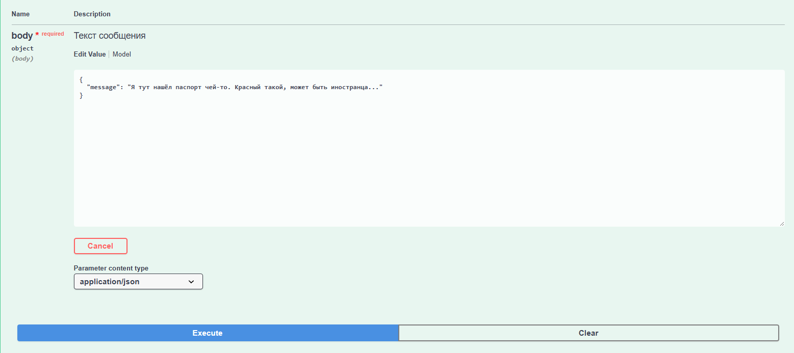
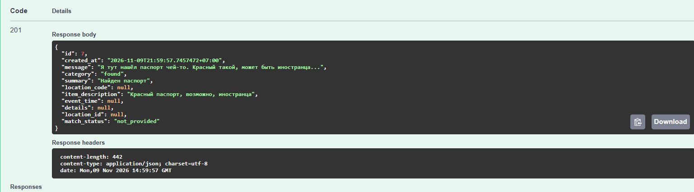

# **Отчёт по лабораторной работе №2**

**Студент**: Киселёв Иван Михайлович

**Группа**: ИС-23

## Подготовка к выполнению работы

Вариант 3: бюро находок, ресурс `/lost-found`. Справочник - локации

1. Сервис написан на Go: Gin, GORM, PostgreSQL и клиент `openai-go`. Документация API собирается через swaggo/swag, интерфейс - Swagger UI с того же компонента swaggo/swag
2. Локальная модель берётся из лабораторной №1. В `.env` распологаются`API_KEY`, `BASE_URL`, `MODEL_2` и `TEMPERATURE`
3. `BASE_URL` заканчивается на `/api/v1`. Для клиента OpenAI этот суффикс заменяется на `/v1`, дальше вызывается Responses API. Модель - оптимальная `nvidia-nemotron-3.5-bolt-e4b-4gb`. Reasoning выключен (`reasoning.effort = none`), температура `0.2`
4. PostgreSQL Alpine поднимается через `docker-compose`. Порт 5432 на машине уже занят, поэтому база проброшена на 5433
5. При старте создаются таблицы и пять локаций: `LOC-01` Вестибюль, `LOC-02` Гардероб, `LOC-03` Стойка охраны, `LOC-04` Читальный зал, `LOC-05` Столовая. Код локации не явяется внутренним идентификатором в БД

## Сервис

`POST /lost-found` принимает `{"message": "..."}`, отправляет текст модели отдельно от системной инструкции и сохраняет запись только после проверки JSON. В ответе шесть полей модели, ID связанной локации или `null` и состояние `matched`, `not_found` или `not_provided`. Эти служебные поля ставит само Go приложение.

`GET /lost-found` и `GET /lost-found/{id}` отдают уже сохранённые БД записи

Инструкция описывает категории `lost`, `found`, `claim`, `other` и запрещает выдумывать отсутствующие сведения. Пустая строка в необязательном поле приводится к `null`. Пустое `message` или неверный тип дают `400` без вызова модели. Неизвестный id возвращает ошибку`404`. Невалидный ответ модели, недоступность сервера и таймаут дают `502`, `503` и `504`, а сама запись при этом не сохраняется

## Тестирование работы

1. "Сегодня около 10 утра нашёл чёрный зонт у стойки охраны, локация LOC-03. На ручке красная лента". Категория `found`, код `LOC-03`, связь со стойкой охраны, состояние `matched`. Время осталось текстом "Сегодня около 10 утра"
2. "Потеряла перчатки в вестибюле, кода локации нет". Категория `lost`, `location_code` и `event_time` равны `null`, состояние `not_provided`. Код `LOC-01` по названию "вестибюль" модель не подставила
3. "Нашёл ключи у входа, локация LOC-99". Код `LOC-99` сохранён, `location_id` пустой, состояние `not_found`. Число записей справочника осталось пять
4. "Это мой чёрный зонт с красной лентой, я оставлял его у стойки охраны LOC-03". Категория `claim`, не `found`, код `LOC-03`, состояние `matched`
5. "Когда откроется бюро находок?". Категория `other`, поля кода, описания, времени и details равны `null`

На скриншотах отдельное сообщение без кода и без времени. Модель поставила `found`, описание паспорта оставила в `item_description`, а `location_code` и `event_time` не заполнила. Связи со справочником нет, состояние `not_provided`.

## Вывод

Сделан локальный сервис бюро находок на стеке Go+PostgreSQL + LM Studio (Nvidia Nemotron). Свободный текст разбирает модель через OpenAI-совместимый Responses API, ответ проверяется по фиксированной схеме и сохраняется в БД. Код локации сопоставляется со справочником, неизвестный или отсутствующий код запись не отбрасывает и справочник не меняет
