# Лабораторная работа 0

В этой лабораторной работе необходимо было написать консольного чат-бота на Python, который отправляет вопросы языковой модели через библиотеку `openai` и выводит ответ. Вместо OpenAI был использован бесплатный Groq, модель `openai/gpt-oss-20b`. 

## Файлы

- `main.py` - код бота
- `.env` - ключ API, адрес сервера, модель и системный промпт по умолчанию (в гит не заливается)
- `prompts.db` - база SQLite, куда сохраняются системные промпты
- `requirements.txt` - зависимости (сделан через `pip freeze`)
- `screens/` - скриншоты

## Запуск

```
python -m venv venv
venv\Scripts\activate
pip install -r requirements.txt
python main.py
```

Перед запуском был создан файл `.env`:

```
OPENAI_API_KEY=ключ
OPENAI_BASE_URL=https://api.groq.com/openai/v1
MODEL=openai/gpt-oss-20b
SYSTEM_PROMPT=Ты полезный ассистент. Отвечай кратко.
```

После запуска программа спрашивает, какой системный промпт использовать: из `.env`, из базы или ввести новый. Потом можно писать вопросы. Ещё есть команды:

- `/prompt` - поменять системный промпт
- `/effort low|medium|high` - поменять reasoning effort
- `/temp 0.7` - поменять temperature
- `/clear` - очистить историю
- `exit` - выход

## Как работает

Сначала из `.env` загружаются ключ и настройки, и создаётся клиент:

```python
load_dotenv()
api_key = os.getenv("OPENAI_API_KEY")
client = OpenAI(api_key=api_key, base_url=os.getenv("OPENAI_BASE_URL"))
```

Сам запрос к модели делается в функции `get_response` через `client.responses.create`. Туда передаются модель, системный промпт (параметр `instructions`), сообщения (`input`) и настройки reasoning/temperature. Текст ответа лежит в `response.output_text`.

Главный цикл находится под `if __name__ == "__main__"`, чтобы он запускался только при запуске самого файла. Вызов модели обёрнут в `try/except`, поэтому если что-то пойдёт не так (неправильный ключ, нет сети и т.д.), программа просто напишет ошибку и не вылетит.

### Задание 1 - системный промпт

Системный промпт - это инструкция для модели, как ей себя вести. Его можно взять из `.env` или из базы данных. Для базы я использовал SQLite, потому что он встроен в Python. Там одна таблица `prompts` (id и текст). Если выбрать "ввести новый", промпт сохраняется в базу, и потом его можно выбрать по номеру.

Промпт можно сменить прямо во время диалога командой `/prompt`, перезапускать программу не нужно.

### Задание 2 - reasoning.effort и temperature

Настройки хранятся в словаре `settings`, команды `/effort` и `/temp` их меняют. Если temperature не задана, она не передаётся в запрос, и модель использует значение по умолчанию.

- reasoning effort - насколько усердно модель "думает" перед ответом
- temperature - насколько случайные ответы (0 - всегда одинаковые, больше - разнообразнее)

### Задание 3 - история

Модель сама не помнит предыдущие сообщения, поэтому историю нужно каждый раз отправлять заново. Я храню её в списке `history`, где каждое сообщение - это словарь с ролью (`user` или `assistant`) и текстом. По заданию хранится не больше 6 сообщений (3 вопроса и 3 ответа), лишние удаляются:

```python
history.append({"role": "user", "content": text})
history.append({"role": "assistant", "content": response.output_text})
del history[:-6]
```

## Скриншоты и результаты

### Запуск

Выбрал промпт из `.env` и поздоровался:

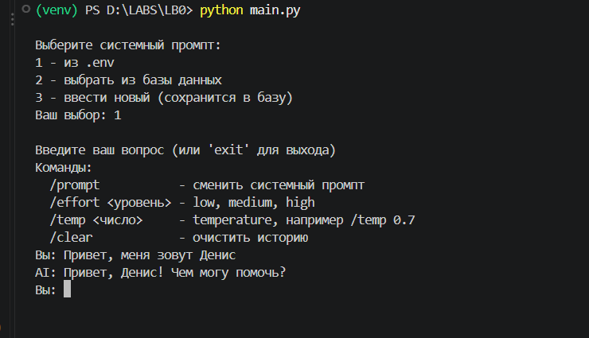

### Смена промпта

Через `/prompt` ввёл новый промпт "Отвечай как пират", и бот сразу начал отвечать по-другому. Первый раз случайно ввёл в промпт "Привет, меня зовут Денис", он тоже сохранился в базу.

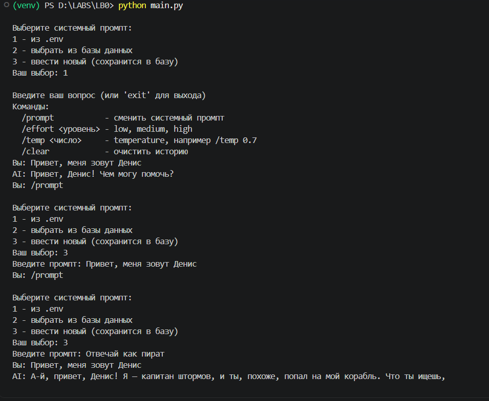

### reasoning.effort

Простую задачу про яблоки модель решила правильно даже на low:

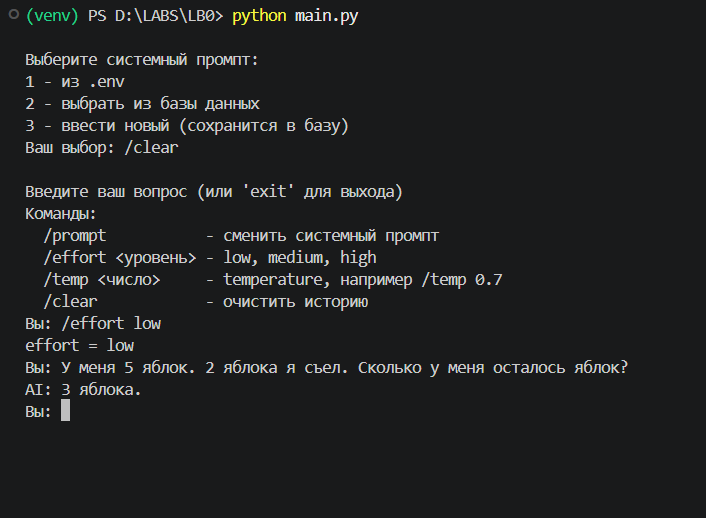

Потом дал задачу с подвохом: "У Вовы 3 сестры. У каждой сестры 2 брата. Сколько братьев у Вовы?". Правильный ответ. Перед каждой попыткой очищал историю.

low - ответила "два брата", неправильно:

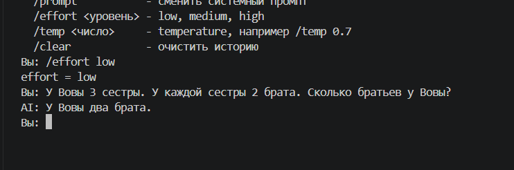

medium - тоже 2:

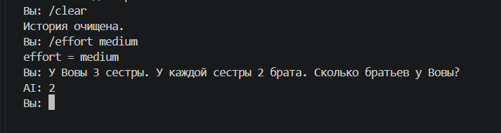

high - один брат, правильно:

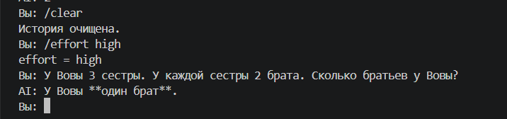

Получается, чем больше effort, тем лучше модель справляется с задачами на логику. Для простых вопросов хватает и low, он отвечает быстрее.

### temperature

Несколько раз задавал один и тот же вопрос "Придумай название для IT компании", очищая историю перед каждым.

При temperature 0 оба раза получился один и тот же ответ:

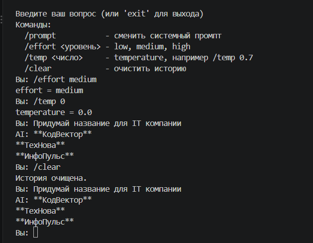

При 0.7 ответы уже разные:

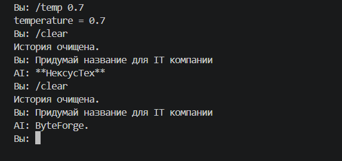

При 1.5 ещё разнообразнее, один раз вообще выдала список из 5 названий с пояснением:

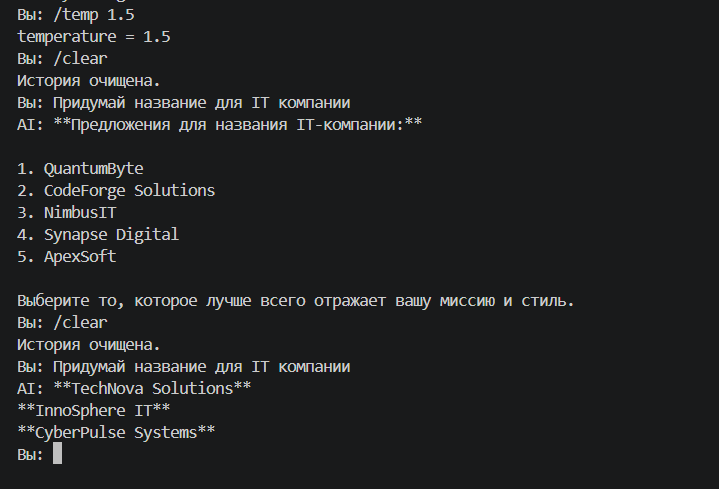

Если поставить temperature ещё выше и попросить рассказать что-нибудь длинное, модель начинает писать бред с несуществующими словами:

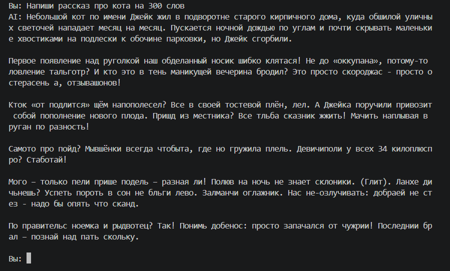

Вывод: низкая temperature нужна, когда важно получить точный и одинаковый ответ, средняя подходит для творческих задач, а слишком высокая ломает текст. В задании написано, что у reasoning-моделей OpenAI temperature работает только при effort = none, но у gpt-oss-20b на Groq она работала и с medium.

### История

Сначала написал своё имя, потом задал ещё 3 вопроса и спросил, как меня зовут. Бот не вспомнил, потому что первое сообщение уже удалилось из истории (хранится только 6 последних). На первом скриншоте видно, что сразу после знакомства он имя помнит.

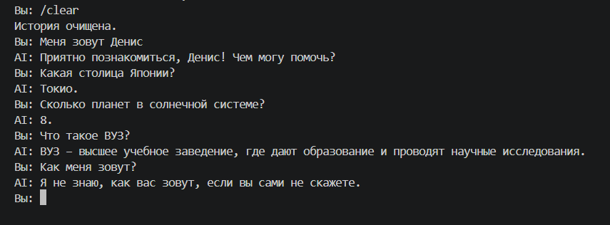


## Вывод

Вывод

В ходе работы я написал консольного чат-бота на Python с использованием OpenAI API (через совместимый сервис Groq). Реализовал выбор системного промпта из .env или базы данных с переключением во время диалога, настройку параметров temperature и reasoning.effort, а также историю из 6 последних сообщений. Эксперименты показали, что системный промпт задаёт стиль ответов. При temperature 0 ответы одинаковые, а с её ростом становятся разнообразнее, вплоть до потери смысла при максимальном значении. Модель помнит контекст, только пока он передаётся в истории.


