# Лабораторная работа №1. Эксплуатация локальной языковой модели

Выполнил: Никульшин Д.И., группа ИС-23

## Цель работы

Ознакомиться со средствами эксплуатации языковых моделей на личных ПК/серверах.

## Характеристики компьютера

Работа выполнялась на ноутбуке:

| Компонент | Значение |
|---|---|
| Процессор | Intel Core i5-10300H (4 ядра / 8 потоков) |
| Оперативная память | 16 ГБ |
| Видеокарта | NVIDIA GeForce GTX 1650 Ti, 4 ГБ видеопамяти (+ встроенная Intel UHD Graphics) |
| ОС | Windows |
| LM Studio | 0.4.28 |

Главное ограничение здесь - всего 4 ГБ видеопамяти. По таблице из методички для конфигурации "16 ГБ RAM и 4 ГБ VRAM" рекомендуются модели 1.5-3B в квантовании Q4, поэтому выбирал модели около 4B и следил, чтобы они целиком помещались в видеокарту.

## Задание 1. Выбор моделей

Выбрал две модели примерно одного размера от разных компаний, чтобы сравнение было честным:

- **Qwen3.5-4B** от Alibaba - [bartowski/Qwen_Qwen3.5-4B-GGUF](https://huggingface.co/bartowski/Qwen_Qwen3.5-4B-GGUF)
- **Phi-4-mini-instruct** от Microsoft - [bartowski/microsoft_Phi-4-mini-instruct-GGUF](https://huggingface.co/bartowski/microsoft_Phi-4-mini-instruct-GGUF)

Сначала хотел взять Qwen в Q4_K_M, но этот файл весит 3.38 ГБ, и LM Studio показывала для него только "Partial GPU Offload Possible", то есть модель не влезла бы в видеокарту полностью. Поэтому для Qwen взял квантование пониже - Q3_K_S, у него уже была пометка "Full GPU Offload Possible". Phi меньше по размеру, поэтому для неё хватило места и на Q4_K_S. Из-за этого квантования у моделей получились разные.

При поиске моделей в LM Studio попадалось много дообученных версий от случайных авторов (с приписками coder, heresy, NSFW и т.д.), их я не брал. Скачивал только у bartowski, у которого оригинальные модели просто переведены в GGUF.

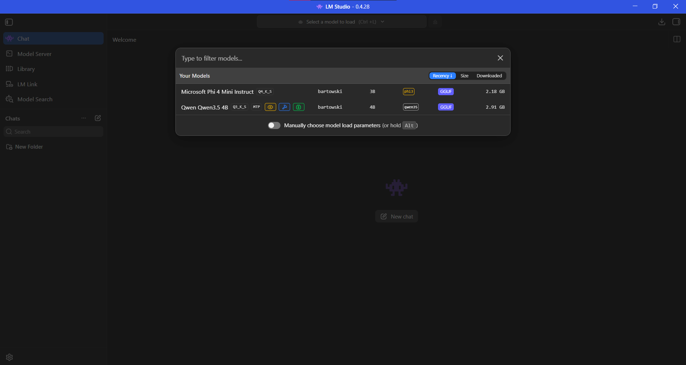

| | Qwen3.5-4B | Phi-4-mini-instruct |
|---|---|---|
| Разработчик | Alibaba (Qwen) | Microsoft |
| Число параметров | 4B | 3.8B |
| Квантование | Q3_K_S | Q4_K_S |
| Размер файла | 3.13 ГБ | 2.34 ГБ |
| Формат | GGUF | GGUF |
| Максимальный контекст | 262144 токенов | 131072 токенов |
| Особенности | рассуждение (Think), Vision, инструменты | обычная instruct-модель |

### Настройки запуска

Для обеих моделей поставил одинаковые настройки: контекст 2048 токенов (как советует методичка для первого запуска) и максимальный GPU Offload, чтобы все слои были на видеокарте.

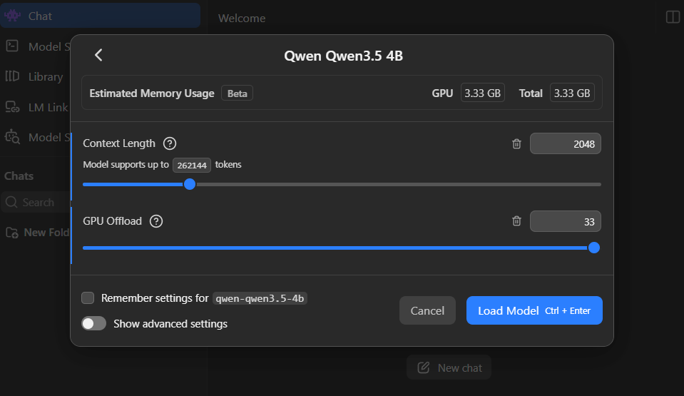

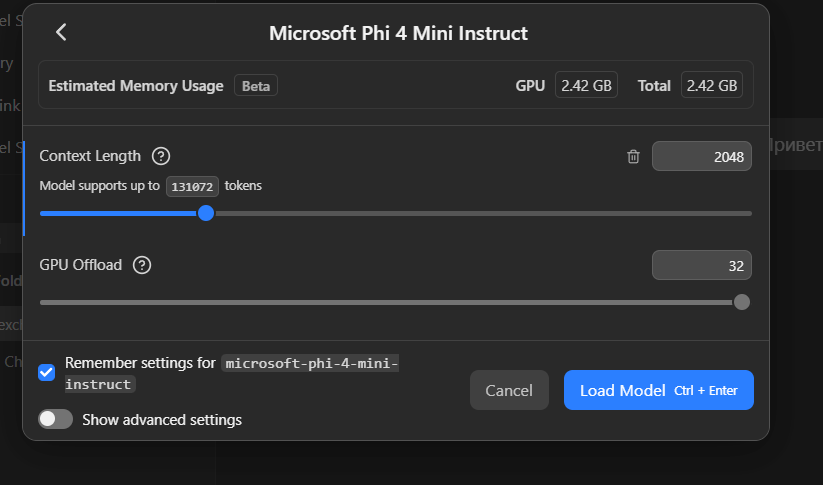

| | Qwen3.5-4B | Phi-4-mini-instruct |
|---|---|---|
| Context Length | 2048 | 2048 |
| GPU Offload | 33 из 33 слоёв | 32 из 32 слоёв |
| Оценка памяти (LM Studio) | 3.33 ГБ | 2.42 ГБ |
| Temperature | по умолчанию | по умолчанию |

С загруженной Qwen видеопамять заполнилась на 3.8 из 4.0 ГБ, то есть модель влезла почти впритык:

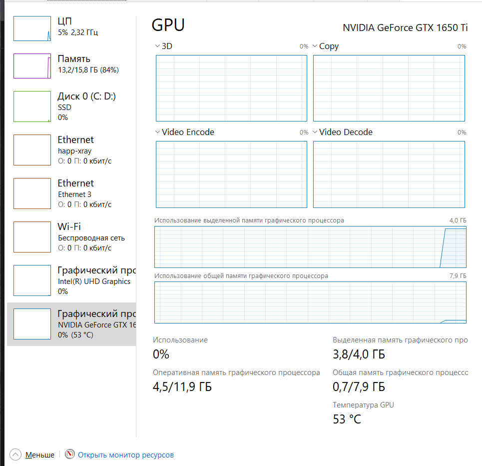

### Проверка в чате LM Studio

Сначала проверил модели прямо в чате LM Studio, написав им "Привет".

Qwen по умолчанию работает в режиме Think, то есть сначала рассуждает, а потом отвечает. На простое приветствие она думала 10.26 секунды и потратила 360 токенов, причём рассуждала на английском. Интересно, что в окне чата сначала отображалось только "Thought for 10.26 seconds", а сам ответ оказался внутри блока рассуждений:

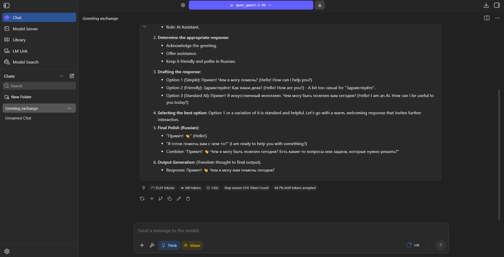

Без режима Think она ответила сразу - 11 токенов за 0.30 секунды:

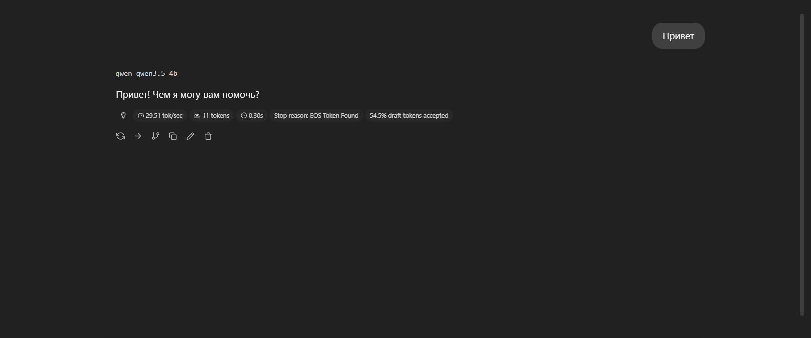

Phi ответила быстрее всех (43.39 токенов в секунду), но на русское "Привет" ответила по-английски:

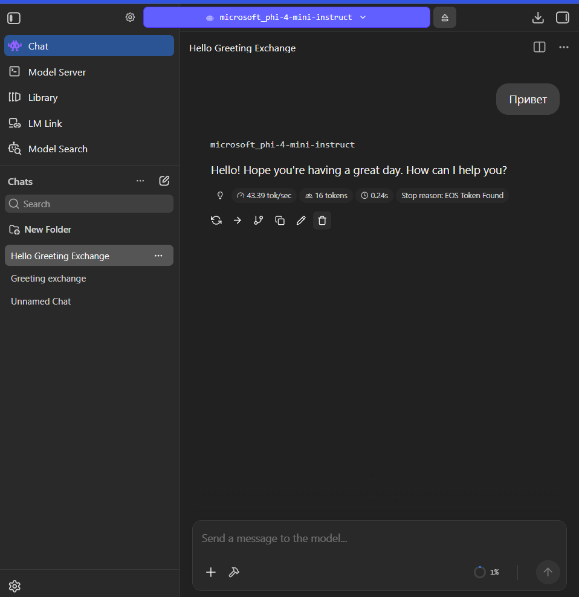

| Модель | Скорость | Токенов | Время | Ответ |
|---|---|---|---|---|
| Qwen (Think) | 35.01 tok/s | 360 | 10.26 с на размышления + 1.83 с | ответ спрятан в рассуждениях |
| Qwen (без Think) | 29.51 tok/s | 11 | 0.30 с | "Привет! Чем я могу вам помочь?" |
| Phi | 43.39 tok/s | 16 | 0.24 с | "Hello! Hope you're having a great day..." |

## Задание 2. Локальный сервер

Во вкладке Model Server открыл Server Settings, включил Require Authentication и через Manage Tokens создал токен. Также оставил включённым Just-in-Time Model Loading и Only Keep Last JIT Loaded Model. С ними сервер сам загружает модель, которую указали в запросе, и выгружает предыдущую. Для 4 ГБ видеопамяти это удобно, потому что две модели одновременно туда всё равно не влезут.

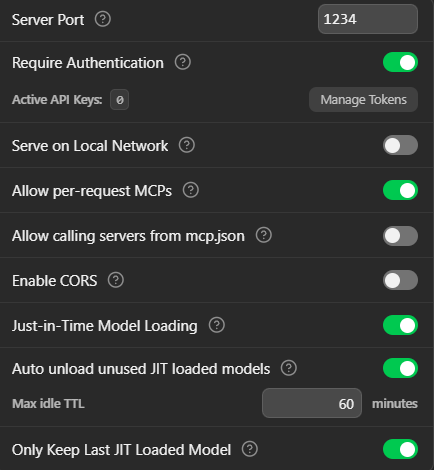

После запуска сервер стал доступен по адресу `http://127.0.0.1:1234`:

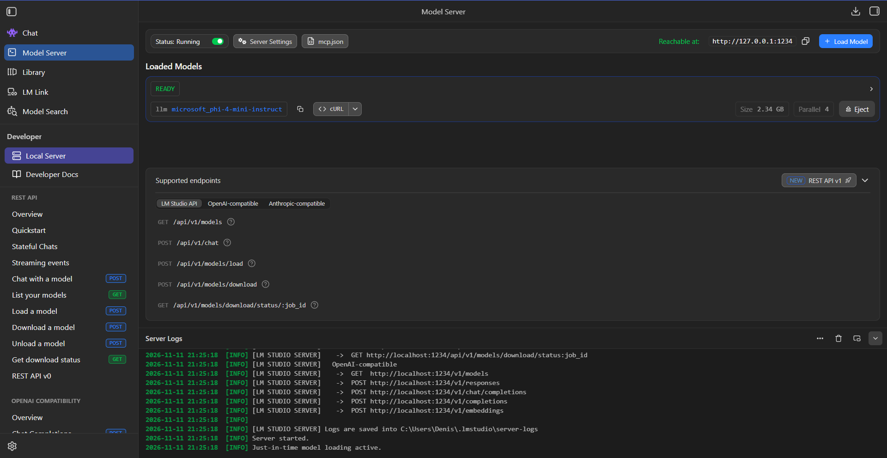

Код взял из методички, поменял только порт, модель и имя. Токен вынес в файл `.env`, чтобы он не попал на GitHub.

```python
from openai import OpenAI
from dotenv import load_dotenv
import os

load_dotenv()

client = OpenAI(
    base_url="http://127.0.0.1:1234/v1",
    api_key=os.getenv("LMSTUDIO_TOKEN"),
)

MODEL = "microsoft_phi-4-mini-instruct"

models = client.models.list()
print("Модели:")
for model in models.data:
    print(f"  - {model.id}")

response = client.responses.create(
    model=MODEL,
    input="Я Денис",
)
print("\n")
print(response.output_text)
```

Сначала в `base_url` у меня был `localhost`, и программа просто зависала, ничего не выводя. После замены на `127.0.0.1` (этот адрес показывает сама LM Studio) всё заработало.

Программа вывела список моделей на сервере. Кроме моих двух там есть `text-embedding-nomic-embed-text-v1.5` - это встроенная в LM Studio модель для эмбеддингов, на вопросы она не отвечает.

Ответ Phi:

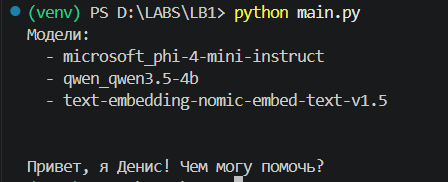

Ответ Qwen (поменял `MODEL` на `qwen_qwen3.5-4b`):

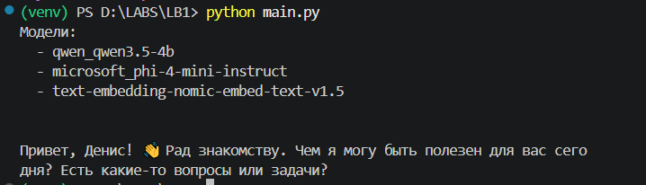

Phi ответила "Привет, я Денис!", то есть приняла моё имя на себя. Qwen поняла правильно и поздоровалась со мной. Получается, что маленькая модель может путаться даже в таком простом сообщении.

## Задание 3. Сравнение моделей на пяти запросах

Подготовил пять запросов по заданию:

1. Объяснение понятия из программирования (рекурсия).
2. Написание функции на Python (проверка палиндрома).
3. Поиск ошибки в готовом коде (в функции `average` цикл начинается с 1 и пропускает первый элемент).
4. Извлечение данных из текста с ответом в JSON.
5. Вопрос по тексту, ответа на который в тексте нет, с инструкцией "Если информации недостаточно, сообщи об этом".

Код `task.py`:

```python
from openai import OpenAI
from dotenv import load_dotenv
import os
import time

load_dotenv()

client = OpenAI(
    base_url="http://127.0.0.1:1234/v1",
    api_key=os.getenv("LMSTUDIO_TOKEN"),
)

MODEL = "microsoft_phi-4-mini-instruct"

prompts = [
    "Объясни простыми словами, что такое рекурсия в программировании.",
    "Напиши функцию на Python, которая проверяет, является ли строка палиндромом.",
    "Найди ошибку в коде:\n"
    "def average(numbers):\n"
    "    total = 0\n"
    "    for i in range(1, len(numbers)):\n"
    "        total += numbers[i]\n"
    "    return total / len(numbers)",
    "Извлеки данные из текста и верни ответ в формате JSON (name, age, group, email).\n"
    "Текст: Иван Петров, 21 год, группа ИС-23, почта ivan.petrov@example.com.",
    "Компания «ТехСофт» основана в 2015 году в Новосибирске. "
    "Какую прибыль получила компания в 2023 году? Если информации недостаточно, сообщи об этом.",
]

for prompt in prompts:
    print("Вопрос:", prompt)
    print("Ждём ответ...")
    start = time.time()
    response = client.responses.create(model=MODEL, input=prompt)
    print("Ответ:", response.output_text)
    print("Время:", round(time.time() - start, 2), "с")
    print("-" * 50)
```

Сначала запустил с Phi, потом поменял `MODEL` на `qwen_qwen3.5-4b` и запустил ещё раз. Настройки у моделей одинаковые (см. задание 1). Полные ответы лежат в файлах [PhiResponses.md](PhiResponses.md) и [QwenResponses.md](QwenResponses.md), ниже кратко разбираю каждый запрос.

### Запрос 1. Рекурсия

**Phi** объяснила правильно и привела пример на Python - рекурсивную сумму чисел от 1 до n. Но в тексте есть странные места, например "процесс выполнения задачи путем самовзвешивания к более мелким задачам", а комментарий в коде не совпадает с тем, что этот код делает.

**Qwen** объяснила через пример с матрёшкой, отдельно выделила условие остановки (базовый случай) и разобрала факториал. Объяснение получилось понятнее, но без кода (в запросе его и не просили).

### Запрос 2. Палиндром

**Phi** выдала одну правильную функцию: убирает всё, кроме букв и цифр, приводит к нижнему регистру и сравнивает строку с перевёрнутой. Есть примеры использования.

**Qwen** написала целых четыре варианта, это лишнее. К тому же в них есть ошибки: для `"AbaBA"` в комментарии написано `True`, хотя функция вернёт `False`, четвёртый вариант подписан "с использованием `re`", но `re` в нём не используется, а про рекурсивный вариант сказано "без использования срезов", хотя срезы там есть.

### Запрос 3. Поиск ошибки

**Phi** ошиблась. Она написала, что код не учитывает *последний* элемент, хотя на самом деле пропускается *первый* (цикл начинается с индекса 1). "Исправленный" код она тоже предложила неправильный - формулы в нём не дают правильного среднего.

**Qwen** нашла ошибку правильно: цикл начинается с 1 и пропускает элемент с индексом 0. Исправила на `range(len(numbers))`, предложила вариант через `sum()` и показала ошибку на примере `[10, 20, 30]`.

### Запрос 4. JSON

Обе модели извлекли данные правильно, и обе обернули JSON в markdown-разметку ` ```json `. Если такой ответ сразу отдать в `json.loads()`, будет ошибка, поэтому разметку пришлось бы убирать отдельно.

У **Phi** в поле `group` попало лишнее слово: `"группа ИС-23"`. У **Qwen** поле чистое: `"ИС-23"`.

### Запрос 5. Ответа нет в тексте

**Phi** ответила правильно: сказала, что информации о прибыли нет, и ничего не выдумала.

**Qwen** вернула **пустой ответ** через 61.96 секунды. Судя по времени, она всё это время рассуждала и потратила на это весь контекст (2048 токенов), так что до самого ответа не дошла. То же самое было видно в чате: даже на "Привет" она тратила на рассуждения 360 токенов.

### Итоговая таблица

| Запрос | Phi: время | Phi: результат | Qwen: время | Qwen: результат |
|---|---|---|---|---|
| 1. Рекурсия | 32.61 с* | верно | 51.19 с* | верно |
| 2. Палиндром | 22.92 с | верно | 22.29 с | частично (лишнее и ошибки в комментариях) |
| 3. Поиск ошибки | 12.3 с | неверно | 13.32 с | верно |
| 4. JSON | 3.92 с | частично (разметка, лишнее слово) | 13.1 с | частично (разметка) |
| 5. Нет ответа | 7.44 с | верно | 61.96 с | пустой ответ |
| **Сумма времени** | **79.19 с** | | **161.86 с** | |

\* в первый запрос входит время загрузки модели на сервере (Just-in-Time), поэтому он дольше остальных.

По количеству правильных ответов модели вышли примерно на одном уровне, но ошибаются по-разному. Phi в два раза быстрее и всегда даёт ответ, но хуже справляется с логикой - она неправильно нашла ошибку в коде. Qwen лучше рассуждает и аккуратнее с данными, но медленнее и может вообще не ответить, если не хватит контекста.

## Сравнение с разной температурой

Для эксперимента с температурой взял Phi, потому что она быстрее и не уходит в долгие рассуждения. В качестве запроса выбрал извлечение данных в JSON - по нему удобно проверять, соблюдает ли модель формат. Запрос выполнил по три раза при температуре 0.2 и 1.0, остальные параметры не менял.

Код `temperature.py`:

```python
from openai import OpenAI
from dotenv import load_dotenv
import os
import time

load_dotenv()

client = OpenAI(
    base_url="http://127.0.0.1:1234/v1",
    api_key=os.getenv("LMSTUDIO_TOKEN"),
)

MODEL = "microsoft_phi-4-mini-instruct"

prompt = ("Извлеки данные из текста и верни ответ в формате JSON (name, age, group, email).\n"
          "Текст: Иван Петров, 21 год, группа ИС-23, почта ivan.petrov@example.com.")

for temperature in [0.2, 1.0]:
    for i in range(3):
        print(f"Температура {temperature}, попытка {i + 1}:")
        print("Ждём ответ...")
        start = time.time()
        response = client.responses.create(model=MODEL, input=prompt, temperature=temperature)
        print(response.output_text)
        print("Время:", round(time.time() - start, 2), "с")
        print("-" * 50)
```

Полные ответы - в файле [TemperatureResponses.md](TemperatureResponses.md).

| Температура | Попытка | Время | Поле `group` | Что отличается |
|---|---|---|---|---|
| 0.2 | 1 | 9.23 с* | группа ИС-23 | - |
| 0.2 | 2 | 4.41 с | группа ИС-23 | ответ совпадает с первым полностью |
| 0.2 | 3 | 4.34 с | группа ИС-23 | ответ совпадает с первым полностью |
| 1.0 | 1 | 4.31 с | группа ИС-23 | - |
| 1.0 | 2 | 4.06 с | ИС-23 | другое значение поля |
| 1.0 | 3 | 4.27 с | группа ИС-23 | другие отступы (4 пробела вместо 2) |

\* в первую попытку входит загрузка модели.

**Разнообразие ответов.** При 0.2 все три ответа совпали посимвольно. При 1.0 ответы начали отличаться: в одном изменилось значение поля, в другом форматирование.

**Соблюдение инструкции.** Во всех шести попытках модель вернула JSON с нужными ключами, но каждый раз в markdown-разметке. Температура на это не повлияла.

**Ошибки.** Фактических ошибок в данных не было ни разу - имя, возраст и почта везде правильные. Единственное, что спорно, - это лишнее слово "группа" в поле `group`.

**Время** от температуры почти не зависит, около 4 секунд в обоих случаях.

Разница между 0.2 и 1.0 получилась небольшой. Думаю, это потому, что задача строгая: при извлечении данных у модели почти нет вариантов, что написать. На творческом запросе разница была бы заметнее.

## Заключение

Для моего ноутбука с 4 ГБ видеопамяти больше подходит **Phi-4-mini-instruct**. Она занимает меньше памяти (2.42 ГБ против 3.33 ГБ), поэтому влезла в видеокарту даже в квантовании Q4, работает в два раза быстрее и всегда даёт ответ. Для простых задач вроде объяснения понятий, написания функций или извлечения данных её хватает. Но в задачах на логику ей лучше не доверять: ошибку в коде она нашла неправильно и при этом уверенно предложила неработающее исправление.

**Qwen3.5-4B** оказалась умнее: она правильно нашла ошибку в коде, аккуратнее извлекла данные и лучше поняла сообщение "Я Денис". Но на моём железе она работает хуже. Её пришлось взять в более низком квантовании Q3_K_S, она заняла почти всю видеопамять (3.8 из 4 ГБ), отвечает медленнее из-за рассуждений, а один раз вообще вернула пустой ответ.

Какие ограничения обнаружил:

- 4 ГБ видеопамяти не хватает, чтобы загрузить модель 4B в Q4 целиком, поэтому приходится понижать квантование, а это ухудшает качество;
- из-за небольшого контекста (2048 токенов) рассуждающая модель может потратить весь контекст на размышления и не выдать ответ. Увеличить контекст сильно нельзя, потому что видеопамяти почти не осталось;
- режим рассуждения сильно увеличивает время ответа даже на простые вопросы;
- обе модели не выполнили требование вернуть "чистый" JSON и добавили разметку;
- Phi хуже работает с русским языком: на русское приветствие ответила по-английски и путается в ролях;
- маленькие модели могут уверенно выдавать неправильный ответ, поэтому их результаты нужно проверять.
