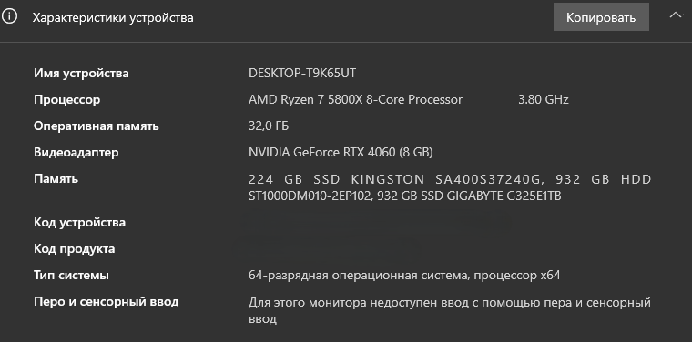
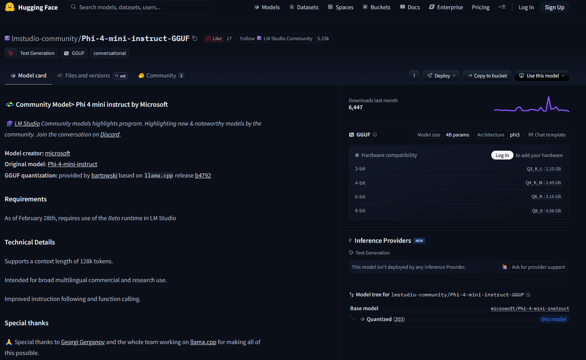
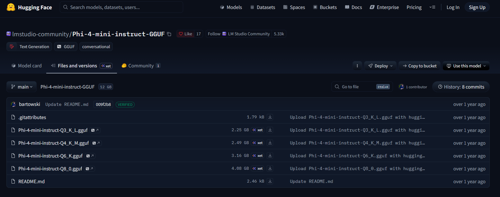
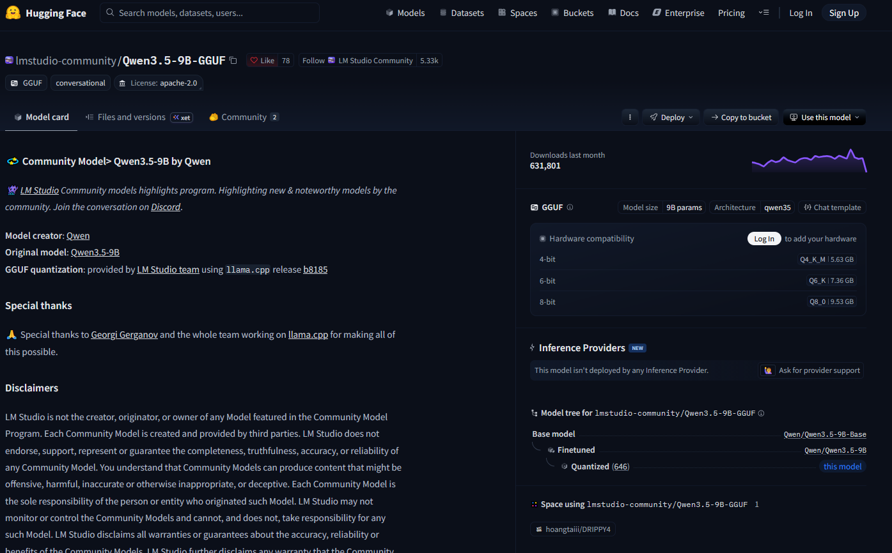
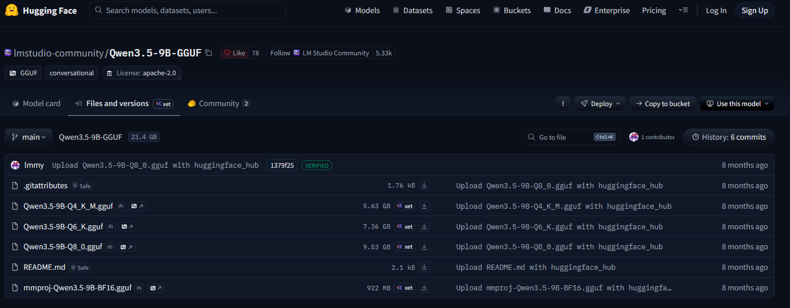
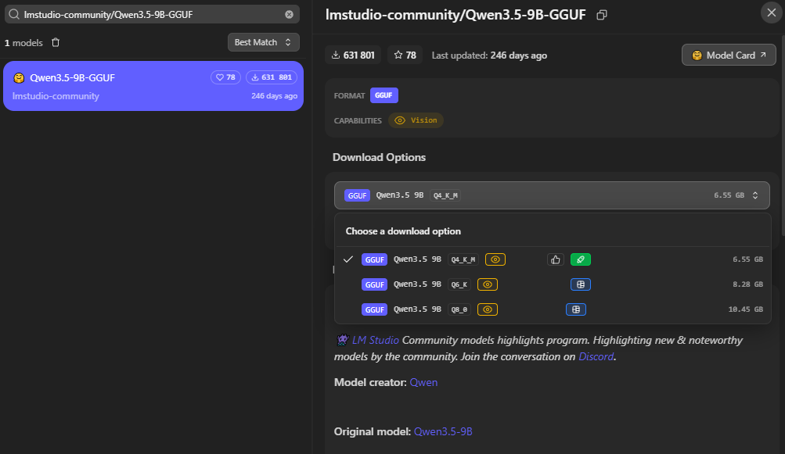
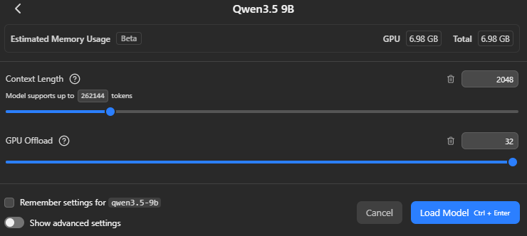
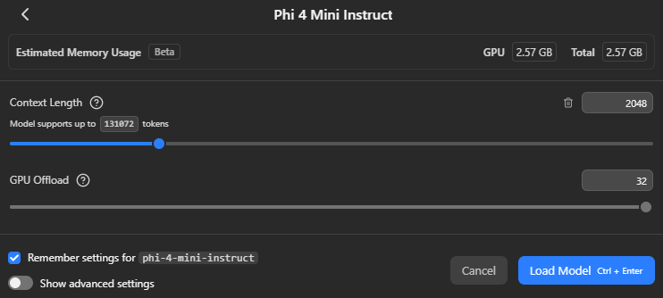
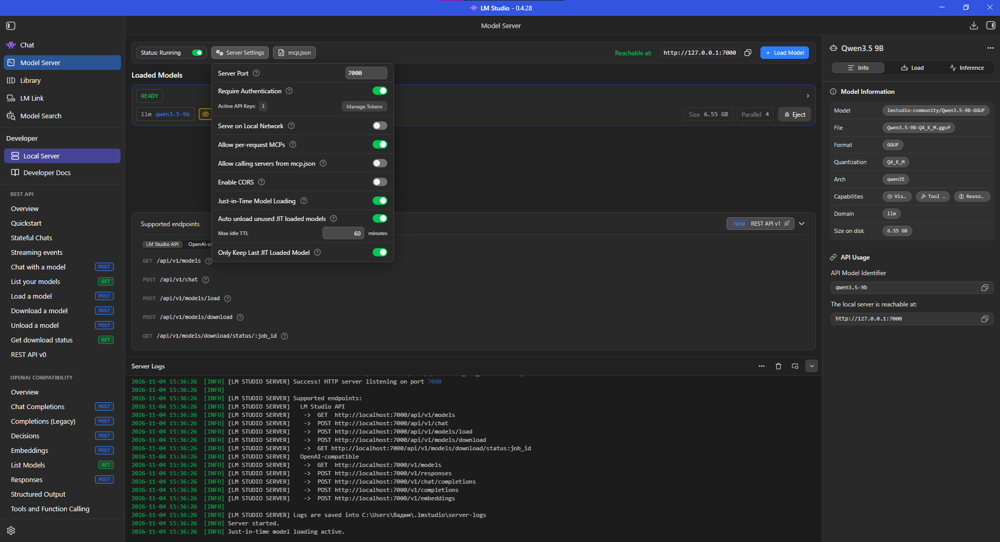
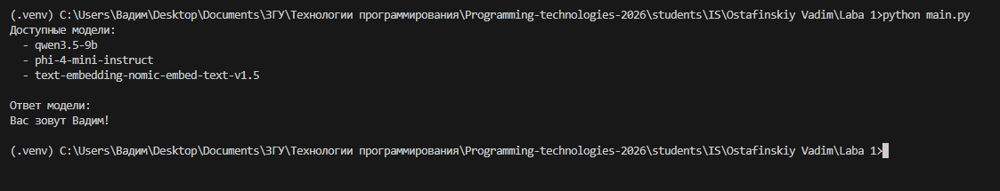

# Лабораторная работа № 1

## Эксплуатация локальной языковой модели

**Дисциплина:** Технологии программирования  
**Студент:** Остафинский Вадим  
**Группа:** ИС-23  
**Язык программирования:** Python 3.14.10  
**Модели:** `qwen3.5-9b` и `phi-4-mini-instruct`  
**Формат и квантование:** GGUF, `Q4_K_M`  

---

## 1. Цель и постановка задачи

Цель лабораторной работы — ознакомиться со средствами эксплуатации языковых моделей на персональном компьютере, научиться выбирать модели с учётом аппаратных ресурсов, запускать их в LM Studio и использовать локальный API для программного тестирования.

В ходе выполнения работы необходимо:

1. Выбрать две подходящие модели на Hugging Face для запуска в LM Studio.
2. Поочерёдно загрузить модели, настроить локальный сервер и проверить получение ответов.
3. Подготовить пять одинаковых запросов: объяснение понятия программирования, написание функции на Python, поиск ошибки в коде, извлечение JSON и проверка отсутствующих сведений.
4. Отправить запросы обеим моделям через локальный API; зафиксировать модели, квантование и параметры запуска.
5. Для одной модели выполнить один и тот же запрос по три раза при температурах `0.2` и `1.0`, не меняя остальные условия.
6. Сравнить корректность ответов, соблюдение требований к формату и полное время получения ответа.
7. Выбрать подходящую модель для используемого компьютера и указать ограничения.

---

## 2. Аппаратная конфигурация и выбор подхода

### 2.1. Характеристики компьютера

Использовался персональный компьютер со следующими характеристиками:

| Компонент | Характеристика |
|---|---|
| Операционная система | Windows, 64-разрядная |
| Процессор | AMD Ryzen 7 5800X, 8 ядер |
| Видеокарта | NVIDIA GeForce RTX 4060 |
| Видеопамять | 8 ГБ VRAM |
| Оперативная память | 32 ГБ RAM |
| Накопители | SSD и HDD |

<p align="center"></p>
<p align="center"><em>Рисунок 1 — Характеристики компьютера, на котором выполнялась лабораторная работа.</em></p>

Для запуска локальной языковой модели особенно важна видеопамять. Если модель вместе с рабочими буферами и контекстом не помещается в VRAM, часть вычислений может выполняться на CPU с использованием RAM, что часто снижает скорость. Объём оперативной памяти и свободное место на диске также влияют на возможность загрузки модели.

### 2.2. Количество параметров

Обозначение `B` в названии языковой модели означает *billion* — миллиард параметров. Например, `9B` соответствует приблизительно девяти миллиардам параметров. Большое количество параметров само по себе не гарантирует лучший ответ на каждую задачу, однако часто повышает требования к памяти и вычислениям.

Грубая оценка памяти только для весов модели:

$$
M_{\text{весов}} \approx \frac{N\cdot b}{8},
$$

где $N$ — количество параметров, а $b$ — число бит, используемых для хранения одного параметра. Например, для 9 миллиардов параметров при условных 4 битах на параметр оценка равна $9\cdot10^9\cdot4/8=4{,}5\cdot10^9$ байт, то есть около **4,5 ГБ в десятичном исчислении**, без накладных расходов. Реальное потребление отличается из-за особенностей формата, неравномерной точности весов, контекста и служебных буферов.

### 2.3. Квантование

**Квантование** уменьшает точность хранения весов, сокращая объём модели. Вместо более тяжёлых представлений весов применяются компактные схемы, благодаря чему модели можно запускать на видеокартах с ограниченной памятью.

Выбран вариант **`Q4_K_M`**: он представляет практический компромисс между качеством и потреблением памяти.

Для запуска моделей был выбран формат **`GGUF`**, поскольку LM Studio поддерживает его напрямую. Это позволяет скачать модель, загрузить её через интерфейс программы и сразу начать работу.

Существует и другой формат — `.safetensors`, который чаще используется с такими инструментами, как Transformers и vLLM. Для нашей лабораторной удобнее GGUF, так как он позволяет запускать модели в LM Studio без дополнительной настройки других инструментов.

### 2.4. Контекст

Контекст определяет объём токенов, с которым модель может работать в рамках запроса. Увеличение контекста требует дополнительных ресурсов. Для первого запуска и коротких контрольных запросов установлен **`Context Length = 2048`**. Максимальный контекст модели не равен оптимальному контексту для конкретного ПК.

---

## 3. Выбор моделей

Сайт **Hugging Face** предоставляет карточки моделей, сведения об их назначении и файлы различных форматов и квантований.

Были выбраны две разные по размеру модели:

1. **Qwen3.5-9B** — более крупная модель, выбранная для проверки качества программных и текстовых задач.
2. **Phi-4-mini-instruct** — более компактная инструкционная модель семейства Phi, выбранная для сравнения скорости и требований к видеопамяти.

### 3.1. Выбор Phi-4-mini-instruct

На странице модели изучены описание, назначение и варианты файлов. Суффикс **`instruct`** означает ориентацию на выполнение пользовательских инструкций. Была выбрана GGUF-версия с квантованием `Q4_K_M`.

<p align="center"></p>
<p align="center"><em>Рисунок 2 — Карточка модели Phi-4-mini-instruct на Hugging Face.</em></p>

<p align="center"></p>
<p align="center"><em>Рисунок 3 — Просмотр файлов модели Phi-4-mini-instruct и доступных вариантов квантования.</em></p>

### 3.2. Выбор Qwen3.5-9B

Для более ресурсоёмкой модели также изучены карточка и состав файлов. При выборе учтено, что 8 ГБ видеопамяти ограничивают размер модели, которую можно полностью или преимущественно исполнять на GPU. Поэтому использована квантованная GGUF-сборка `Q4_K_M`.

<p align="center"></p>
<p align="center"><em>Рисунок 4 — Карточка модели Qwen3.5-9B на Hugging Face.</em></p>

<p align="center"></p>
<p align="center"><em>Рисунок 5 — Доступные файлы и варианты квантования Qwen3.5-9B.</em></p>

### 3.3. Основные причины выбора двух моделей

| Критерий | Qwen3.5-9B | Phi-4-mini-instruct |
|---|---|---|
| Количество параметров | Около 9 млрд | Около 3,8 млрд |
| Тип | Инструкционная языковая модель | Компактная инструкционная языковая модель |
| Файл для LM Studio | GGUF | GGUF |
| Вариант квантования | Q4_K_M | Q4_K_M |
| Предполагаемое преимущество | Более качественное выполнение сложных инструкций | Скорость и экономия видеопамяти |

Преимущество по качеству или скорости не принимается заранее как факт, а определяется по фактическим результатам тестирования.

---

## 4. Установка, загрузка и настройки LM Studio

### 4.1. LM Studio

**LM Studio 0.4.28** позволяет находить, скачивать и запускать модели на собственном компьютере. Кроме обычного чата, приложение предоставляет **Model Server**, то есть локальный HTTP-сервер для обращения к загруженным моделям из стороннего кода.

Преимущество такого подхода для данной лабораторной: запросы обрабатываются локальной моделью на ПК, а код Python использует OpenAI-совместимый интерфейс. При этом не требуется переносить вычисления на сторонний облачный API.

### 4.2. Загрузка модели

Во встроенном поиске LM Studio была найдена **Qwen3.5-9B-GGUF**, затем выбран вариант `Q4_K_M` и выполнено скачивание. На скриншоте видны доступные варианты файла.

<p align="center"></p>
<p align="center"><em>Рисунок 6 — Выбор версии Qwen3.5-9B с квантованием Q4_K_M для загрузки в LM Studio.</em></p>

### 4.3. Настройка загрузки моделей

Для каждой модели применялись:

- **Context Length:** `2048` токенов;
- **GPU Offload:** `32`;
- **Quantization:** `Q4_K_M`;

Оценка памяти была следующей:

| Показатель | Qwen3.5-9B | Phi-4-mini-instruct |
|---|---:|---:|
| Оценка потребления GPU-памяти в LM Studio | **6,98 ГБ** | **2,57 ГБ** |
| Контекст при запуске | 2048 токенов | 2048 токенов |
| GPU Offload | 32 | 32 |
| Квантование | Q4_K_M | Q4_K_M |

6,98 и 2,57 ГБ — это лишь предварительные оценки потребления видеопамяти в интерфейсе LM Studio.

<p align="center"></p>
<p align="center"><em>Рисунок 7 — Параметры загрузки Qwen3.5-9B.</em></p>

<p align="center"></p>
<p align="center"><em>Рисунок 8 — Параметры загрузки Phi-4-mini-instruct.</em></p>

### 4.4. Настройка локального сервера и аутентификации

В LM Studio была открыта вкладка **Model Server**. В настройках сервера выполнены следующие действия:

1. Установлен порт **`7000`**.
2. Включена настройка **Require Authentication**, чтобы запросы к API требовали токен.
3. Через **Manage Tokens** создан личный API-токен.
4. Сервер включён; в интерфейсе отображались состояния **Running** и **READY** для загруженной модели.
5. Доступ к API осуществлялся по локальному адресу `http://localhost:7000/v1`.

<p align="center"></p>
<p align="center"><em>Рисунок 9 — Model Server.</em></p>

### 4.5. Режим Thinking

У **Qwen3.5-9B** в интерфейсе доступен отдельный режим генерации рассуждений. Для основных тестов и эксперимента с температурой он был **отключён**, чтобы модель не тратила дополнительные ресурсы на отдельную фазу рассуждения и сравнение происходило в равных условиях.

**Phi-4-mini-instruct** использовалась как обычная инструкционная модель, без отдельного переключаемого режима Thinking, аналогичного выбранной конфигурации Qwen.

---

## 5. Подготовка репозитория и окружения Python

### 5.1. Подготовка Python и установка зависимостей

Для выполнения лабораторной работы использовался **Python 3.14.10**. Сначала была проверена его версия, затем создано и активировано виртуальное окружение `.venv`, чтобы библиотеки проекта не зависели от глобального окружения Python.

```cmd
python --version
python -m venv .venv
.venv\Scripts\activate
```

Для взаимодействия с локальным API установлены две библиотеки:
- `openai` — для отправки запросов языковой модели;
- `python-dotenv` — для загрузки настроек из файла `.env`.

Установка библиотек выполнена командой:

```cmd
pip install openai python-dotenv
```

### 5.2. Секреты и адрес API

Чтобы не записывать API-токен непосредственно в программу, создан файл `.env` следующей структуры:

```dotenv
LM_STUDIO_API_KEY=ВАШ_ЛОКАЛЬНЫЙ_ТОКЕН
LM_STUDIO_BASE_URL=http://localhost:7000/v1
```

Здесь первая строка хранит токен, выданный LM Studio, а вторая — адрес локального OpenAI-совместимого API.

В Python эти значения загружаются следующим образом:

```python
load_dotenv()

client = OpenAI(
    base_url=os.getenv("LM_STUDIO_BASE_URL"),
    api_key=os.getenv("LM_STUDIO_API_KEY"),
)
```

`load_dotenv()` считывает файл `.env`, `os.getenv()` получает значения по именам переменных, а `OpenAI(...)` создаёт HTTP-клиент. Хотя применяется библиотека `openai`, запросы отправляются не в облачный сервис OpenAI, а на локальный сервер LM Studio, поскольку явно задан `base_url`.

---

## 6. Проектирование программы

### 6.1. Проверка подключения к модели

Для проверки подключения был отправлен простой тестовый запрос с информацией об имени пользователя и вопросом о нём. Модель успешно обработала запрос и вернула ответ «Вас зовут Вадим!». Это подтвердило работоспособность локального API и корректность подключения Python-программы к LM Studio.

```python
models = client.models.list()
for model in models.data:
    print(model.id)

response = client.responses.create(
    model=MODEL,
    input="Меня зовут Вадим. Как меня зовут?",
)
print(response.output_text)
```

Метод `client.models.list()` получает список моделей, доступных на локальном сервере LM Studio. Метод `client.responses.create()` отправляет сообщение выбранной модели, а `response.output_text` позволяет получить её текстовый ответ.

Для взаимодействия с моделью использовался **Responses API**, который поддерживается локальным сервером LM Studio через адрес `/v1/responses`.

<p align="center"></p>
<p align="center"><em>Рисунок 10 — Проверка подключения к локальному серверу LM Studio и получение первого ответа модели.</em></p>

### 6.2. Ручной режим

Первоначальную программу дополнили возможностью интерактивного ввода вопросов: теперь программа не завершается после одного запроса, а позволяет последовательно отправлять новые вопросы. Для этого введён цикл `while True`, ввод через `input()` и команда выхода `exit`.

```python
def manual_mode():
    print("\nРучной режим. Для выхода в меню введите 'exit'.")

    while True:
        question = input("\nВведите вопрос: ").strip()

        if question.lower() == "exit":
            break

        if not question:
            print("Вопрос не может быть пустым.")
            continue

        response = client.responses.create(
            model=MODEL,
            input=question,
            temperature=TEMPERATURE,
        )
        print("\nОтвет модели:")
        print(response.output_text)
```

**Разбор:** `strip()` удаляет пробелы по краям; `lower()` позволяет распознать команду выхода независимо от регистра; `break` завершает цикл; `continue` пропускает пустой запрос. Каждый вызов API независим: в этом режиме история беседы не передаётся и не хранится, поскольку лабораторная №1 посвящена сравнению отдельных ответов.

### 6.3. Файл prompts.py

Чтобы модели получали **одинаковые запросы**, тексты вынесены в список `PROMPTS` в самостоятельном файле. Каждый тест представлен словарём с идентификатором, названием и полным текстом. Такой подход при переключении модели упрощает повторение эксперимента.

### 6.4. Автоматический запуск тестов

Для сравнительного эксперимента реализована функция `test_mode()`. Она проходит циклом по `PROMPTS`, отправляет каждый вопрос одной выбранной модели, измеряет полное время ожидания и добавляет результат в список словарей:

```python
start_time = time.perf_counter()
response = client.responses.create(
    model=MODEL,
    input=test["prompt"],
    temperature=TEMPERATURE,
)
elapsed_time = time.perf_counter() - start_time
answer = response.output_text
```

Здесь **`time.perf_counter()`** используется как счётчик прошедшего времени. Разница между значениями до и после вызова включает ожидание ответа сервера и обработку запроса, то есть программа запоминает время перед отправкой запроса модели, а после получения полного ответа смотрит, сколько секунд прошло. Измеряется **полное время получения ответа с точки зрения клиента**.

В JSON сохраняются `model`, `temperature`, `context_length`, `quantization`, номер и название теста, исходный `prompt`, полный `answer` и `elapsed_time`. Имена файлов содержат модель и временную метку, чтобы не перезаписывать предыдущие результаты.

### 6.5. Эксперимент с температурой

После завершения основных тестов в программу добавлена функция `temperature_test()`. Для исследования температуры был выбран **второй тест** — написание функции для суммы чётных чисел. Программа использует два вложенных цикла: первый последовательно устанавливает температуру `0.2` и `1.0`, а второй при каждом значении отправляет одинаковый запрос три раза. Таким образом, выполняется шесть независимых запросов к одной модели.

```python
test = PROMPTS[1]
temperatures = [0.2, 1.0]

for temperature in temperatures:
    for attempt in range(1, 4):
        response = client.responses.create(
            model=MODEL,
            input=test["prompt"],
            temperature=temperature,
        )
```


### 6.6. Консольное меню

Для управления всеми режимами реализовано простое меню:

```text
Выберите режим работы:
1. Ручной ввод вопросов
2. Тесты
3. Исследование температуры
0. Выход
```

Выбор пункта запускает соответствующую функцию. Переключение между двумя моделями выполнялось изменением константы `MODEL` в `main.py` и загрузкой соответствующей модели в LM Studio.

---

## 7. Подготовленные запросы

Тексты намеренно различаются по проверяемому навыку и одинаковы для Qwen и Phi. Файл `prompts.py`:

```python
PROMPTS = [
    {
        "id": 1,
        "name": "Объяснение понятия",
        "prompt": (
            "Объясни простыми словами, что такое рекурсия "
            "в программировании. Приведи один пример на Python. "
            "Ответ должен быть понятен начинающему программисту."
        ),
    },
    {
        "id": 2,
        "name": "Написание функции",
        "prompt": (
            "Напиши функцию на Python, которая принимает список "
            "целых чисел и возвращает сумму только чётных чисел. "
            "Приведи пример использования функции."
        ),
    },
    {
        "id": 3,
        "name": "Поиск ошибки",
        "prompt": (
            "Найди ошибку в следующем коде Python и исправь её. "
            "Объясни причину ошибки:\n\n"
            "def average(numbers):\n"
            "    return sum(numbers) / len(numbers)\n\n"
            "print(average([]))"
        ),
    },
    {
        "id": 4,
        "name": "Извлечение данных в JSON",
        "prompt": (
            "Извлеки информацию из текста и верни ответ строго "
            "в формате JSON без пояснений и Markdown.\n\n"
            "Текст: Иван работает Python-разработчиком в компании "
            "TechSoft. Ему 25 лет, опыт работы — 3 года.\n\n"
            "Поля JSON: name, age, company, position, experience."
        ),
    },
    {
        "id": 5,
        "name": "Проверка недостатка информации",
        "prompt": (
            "Прочитай текст и ответь на вопрос.\n\n"
            "Текст: Иван работает программистом в компании "
            "DataTech. Он занимается разработкой веб-приложений.\n\n"
            "Вопрос: Сколько лет Ивану?\n\n"
            "Если информации недостаточно, сообщи об этом."
        ),
    },
]
```

### 7.1. Объяснение рекурсии

Проверяется способность объяснить базовое понятие программирования понятным языком и привести **синтаксически корректный, работающий пример Python**.

### 7.2. Функция суммы чётных чисел

В этом тесте проверяется, сможет ли модель написать правильную функцию на Python, которая складывает только чётные числа из списка, а также привести пример её использования.

### 7.3. Поиск ошибки

В этом тесте проверяется, сможет ли модель найти и исправить ошибку в Python-коде. При вызове `average([])` программа пытается вычислить среднее значение пустого списка. Поскольку в списке нет элементов, происходит деление на ноль и возникает ошибка `ZeroDivisionError`. Модель должна объяснить причину ошибки и предложить исправление, например добавить проверку на пустой список перед делением.

### 7.4. Извлечение JSON

Проверяется не только правильность извлечённых данных, но и **строгое соблюдение формата**: ответ должен содержать чистый JSON-объект с пятью указанными ключами.

### 7.5. Проверка недостатка информации

В исходном тексте отсутствует возраст Ивана. Правильная стратегия — указать, что сведений недостаточно, а не придумывать число. Это простой тест на склонность модели выдумывать отсутствующие факты.

---

## 8. Итоговый код программы `main.py`

Ниже приведена версия, которой выполнялись итоговые сравнительные тесты и эксперимент с температурой. Для запуска основных тестов Phi изменялось значение `MODEL` на `"phi-4-mini-instruct"`; остальные тексты запросов оставались прежними.

```python
import os
import time
import json

from datetime import datetime
from pathlib import Path
from prompts import PROMPTS
from dotenv import load_dotenv
from openai import OpenAI

load_dotenv()

client = OpenAI(
    base_url=os.getenv("LM_STUDIO_BASE_URL"),
    api_key=os.getenv("LM_STUDIO_API_KEY"),
)

MODEL = "qwen3.5-9b"
TEMPERATURE = 1.0
CONTEXT_LENGTH = 2048
QUANTIZATION = "Q4_K_M"


def manual_mode():
    print("\nРучной режим. Для выхода в меню введите 'exit'.")

    while True:
        question = input("\nВведите вопрос: ").strip()

        if question.lower() == "exit":
            break

        if not question:
            print("Вопрос не может быть пустым.")
            continue

        response = client.responses.create(
            model=MODEL,
            input=question,
            temperature=TEMPERATURE,
        )

        print("\nОтвет модели:")
        print(response.output_text)


def test_mode():
    print(f"\nЗапуск тестов для {MODEL}")

    results = []

    for test in PROMPTS:
        print(f"\nТест №{test['id']}: {test['name']}")
        print(f"Запрос: {test['prompt']}")

        start_time = time.perf_counter()

        response = client.responses.create(
            model=MODEL,
            input=test["prompt"],
            temperature=TEMPERATURE,
        )

        elapsed_time = time.perf_counter() - start_time
        answer = response.output_text

        print("\nОтвет модели:")
        print(answer)
        print(f"\nВремя полного ответа: {elapsed_time:.2f} сек.")
        print("-" * 60)

        results.append({
            "model": MODEL,
            "temperature": TEMPERATURE,
            "context_length": CONTEXT_LENGTH,
            "quantization": QUANTIZATION,
            "test_id": test["id"],
            "test_name": test["name"],
            "prompt": test["prompt"],
            "answer": answer,
            "elapsed_time": round(elapsed_time, 2),
        })

    results_dir = Path("results")
    results_dir.mkdir(exist_ok=True)

    timestamp = datetime.now().strftime("%Y-%m-%d_%H-%M-%S")
    filename = results_dir / f"{MODEL}_{timestamp}.json"

    with open(filename, "w", encoding="utf-8") as file:
        json.dump(results, file, ensure_ascii=False, indent=4)

    print(f"\nРезультаты сохранены в файл: {filename}")


def temperature_test():
    test = PROMPTS[1]
    temperatures = [0.2, 1.0]
    results = []

    print(f"\nИсследование температуры для {MODEL}")
    print(f"Тест: {test['name']}")

    for temperature in temperatures:
        for attempt in range(1, 4):
            print(f"\nТемпература: {temperature}, повторение: {attempt}")

            start_time = time.perf_counter()

            response = client.responses.create(
                model=MODEL,
                input=test["prompt"],
                temperature=temperature,
            )

            elapsed_time = time.perf_counter() - start_time
            answer = response.output_text

            print("\nОтвет модели:")
            print(answer)
            print(f"\nВремя: {elapsed_time:.2f} сек.")

            results.append({
                "model": MODEL,
                "temperature": temperature,
                "context_length": CONTEXT_LENGTH,
                "quantization": QUANTIZATION,
                "attempt": attempt,
                "test_id": test["id"],
                "prompt": test["prompt"],
                "answer": answer,
                "elapsed_time": round(elapsed_time, 2),
            })

    results_dir = Path("results")
    results_dir.mkdir(exist_ok=True)

    timestamp = datetime.now().strftime("%Y-%m-%d_%H-%M-%S")
    filename = results_dir / f"{MODEL}_temperature_{timestamp}.json"

    with open(filename, "w", encoding="utf-8") as file:
        json.dump(results, file, ensure_ascii=False, indent=4)

    print(f"\nРезультаты эксперимента сохранены: {filename}")


def main():
    models = client.models.list()

    print("Доступные модели:")
    for model in models.data:
        print(f"  - {model.id}")

    while True:
        print("\nВыберите режим работы:")
        print("1. Ручной ввод вопросов")
        print("2. Тесты")
        print("3. Исследование температуры")
        print("0. Выход")

        choice = input("\nВаш выбор: ").strip()

        if choice == "1":
            manual_mode()
        elif choice == "2":
            test_mode()
        elif choice == "3":
            temperature_test()
        elif choice == "0":
            print("Программа завершена.")
            break
        else:
            print("Неверный выбор. Попробуйте снова.")


if __name__ == "__main__":
    main()
```

### 8.1. Константы контекста и квантования

Константы:

```python
CONTEXT_LENGTH = 2048
QUANTIZATION = "Q4_K_M"
```

Переменные `CONTEXT_LENGTH` и `QUANTIZATION` используются для сохранения настроек эксперимента в JSON-файл. Сами настройки задаются в LM Studio при загрузке модели. Поэтому эти значения записываются в результаты, чтобы было понятно, с какими параметрами проводилось тестирование.

---

## 9. Сравнительное тестирование двух моделей

### 9.1. Методика

Для каждой модели были последовательно выполнены пять запросов из `prompts.py`.

Обеим моделям отправлялись одинаковые запросы в одинаковом порядке. Мы измеряли время получения полного ответа. При этом модели могли создавать ответы разной длины, поэтому сравнивалось общее время ожидания, а не скорость генерации текста в токенах за секунду.

**Итоговые файлы:**

```text
results/qwen3.5-9b_2026-11-04_16-50-26.json
results/phi-4-mini-instruct_2026-11-04_16-54-53.json
```

### 9.2. Время полного ответа

| № | Тест | Qwen3.5-9B, с | Phi-4-mini, с |
|---:|---|---:|---:|
| 1 | Объяснение рекурсии | 22,12 | 2,50 |
| 2 | Написание функции | 11,88 | 3,30 |
| 3 | Поиск ошибки | 10,05 | 1,08 |
| 4 | Извлечение JSON | 1,46 | 0,61 |
| 5 | Отсутствующие сведения | 0,94 | 0,18 |
| **Итого** | | **46,45** | **7,67** |
| **В среднем** | | **9,29** | **1,53** |

Расчёт среднего полного времени:

$$
\bar t_{\mathrm{Qwen}}=\frac{22{,}12+11{,}88+10{,}05+1{,}46+0{,}94}{5}=9{,}29\text{ с},
$$

$$
\bar t_{\mathrm{Phi}}=\frac{2{,}50+3{,}30+1{,}08+0{,}61+0{,}18}{5}=1{,}534\approx1{,}53\text{ с}.
$$

Отношение средних времён:

$$
\frac{9{,}29}{1{,}534}\approx6{,}06.
$$

Этот результат нельзя напрямую интерпретировать как шестикратное превосходство по количеству генерируемых токенов в секунду, потому что модели создавали ответы разной длины, следовательно этот показатель отражает только время ожидания готового ответа, а не скорость генерации текста.

### 9.3. Тест 1 — объяснение рекурсии

**Qwen3.5-9B:** модель подробно объяснила, что такое рекурсия, и привела работающий пример на Python. В примере функция `sum_recursive(3)` правильно вычисляет сумму чисел от 1 до 3 и возвращает `6`. Также модель объяснила, что рекурсивная функция должна иметь условие остановки, иначе она будет вызывать себя снова и снова.

Недостаток — ответ получился слишком подробным для простого вопроса. Кроме того, в комментарии написано, что функция останавливается, если число равно нулю или меньше, хотя в коде проверяется только `n == 0`.

**Phi-4-mini-instruct:** модель правильно объяснила смысл рекурсии, но допустила ошибку в примере Python. Вместо английских команд `if`, `return` и `else` использовала русские слова `если`, `возвращать`, `иначе` и `вернуть`. Такой код Python выполнить не сможет.

**Вывод:** Qwen3.5-9B справилась с заданием лучше, поскольку привела правильный и работающий пример кода.

### 9.4. Тест 2 — написание функции

Обе модели написали правильную функцию для вычисления суммы чётных чисел:

```python
def sum_even_numbers(numbers):
    return sum(num for num in numbers if num % 2 == 0)
```

Функция перебирает числа из списка, выбирает те, которые делятся на 2 без остатка, и складывает их. Например, для списка `[1, 2, 3, 4, 5, 6]` результат будет `12`, поскольку `2 + 4 + 6 = 12`.

**Qwen3.5-9B:** написала правильную функцию и привела примеры её использования. Однако в описании указала, что функция может возвращать `None`, хотя представленный код всегда возвращает число.

Также модель предложила дополнительный вариант функции, который возвращает `None`, если сумма равна нулю. Это не совсем правильно: например, для списка `[-2, 2]` сумма чётных чисел равна `0`, и функция должна вернуть именно `0`, а не `None`.

**Phi-4-mini-instruct:** написала правильную функцию и привела корректный пример. Для списка `[1, 2, 3, 4, 5, 6, 7, 8, 9]` она правильно вычислила сумму чётных чисел: `2 + 4 + 6 + 8 = 20`.

**Вывод:** обе модели справились с основным заданием, но Phi-4-mini-instruct точнее описала работу своей функции.

### 9.5. Тест 3 — поиск ошибки в коде

Моделям был передан следующий код:

```python
def average(numbers):
    return sum(numbers) / len(numbers)

print(average([]))
```

Этот код должен вычислять среднее значение чисел в списке, но при передаче пустого списка `[]` возникает ошибка `ZeroDivisionError`.

Причина в том, что `sum([])` возвращает `0`, а `len([])` также возвращает `0`. В результате программа пытается разделить `0` на `0`, что в Python запрещено.

**Qwen3.5-9B:** правильно обнаружила ошибку и предложила добавить проверку на пустой список. Если список пустой, исправленная функция возвращает `0.0`, чтобы избежать деления на ноль.

**Phi-4-mini-instruct:** также правильно определила причину ошибки и предложила проверять список перед вычислением среднего значения. В её варианте для пустого списка возвращается `0`.

Оба исправления предотвращают ошибку. Однако среднее значение пустого списка математически вычислить невозможно, поэтому возвращение нуля является лишь одним из возможных способов обработки такой ситуации.

**Вывод:** обе модели правильно нашли причину ошибки и предложили рабочее исправление.

### 9.6. Тест 4 — извлечение данных в JSON

Моделям нужно было извлечь сведения о человеке из текста и вернуть их строго в формате JSON, без дополнительных пояснений и Markdown.

Ожидаемый результат:

```json
{
  "name": "Иван",
  "age": 25,
  "company": "TechSoft",
  "position": "Python-разработчик",
  "experience": 3
}
```

**Qwen3.5-9B:** правильно извлекла все сведения и вернула JSON без лишнего текста и оформления. Все требования запроса были выполнены.

**Phi-4-mini-instruct:** также правильно извлекла имя, возраст, компанию, должность и опыт работы. Однако модель поместила JSON внутрь блока Markdown с обозначением `json`, хотя в запросе это было запрещено.

Из-за этого весь ответ Phi нельзя сразу использовать как JSON без удаления лишнего оформления.

Кроме того, Phi записала опыт работы как `"3 года"`, а Qwen — как число `3`. Это не считается ошибкой, поскольку в задании не было указано, каким должен быть тип этого значения.

**Вывод:** Qwen3.5-9B справилась лучше, так как не только правильно извлекла данные, но и соблюла требование к формату ответа.

### 9.7. Тест 5 — проверка недостатка информации

Моделям был предоставлен текст о программисте Иване, который работает в компании DataTech и занимается разработкой веб-приложений.

Затем был задан вопрос: «Сколько лет Ивану?»

В тексте возраст Ивана не указан. Поэтому правильный ответ — сообщить, что этой информации недостаточно, а не придумывать возраст.

**Qwen3.5-9B:** правильно ответила, что в тексте нет информации о возрасте Ивана.

**Phi-4-mini-instruct:** также правильно сообщила, что возраст Ивана неизвестен.

**Вывод:** обе модели полностью справились с заданием и не стали придумывать отсутствующую информацию.

### 9.8. Сводная качественная оценка

| Задание | Qwen3.5-9B | Phi-4-mini-instruct |
|---|---|---|
| 1. Рекурсия | Выполнено, рабочий код; избыточное объяснение | Понятие объяснено, но пример Python не запускается |
| 2. Функция | Основной код верен; неточности в описании | Основной код и пример верны |
| 3. Поиск ошибки | Верно найдена ошибка и предложена защита | Верно найдена ошибка и предложена защита |
| 4. JSON | Чистый JSON, формат соблюдён | Сведения извлечены, но формат нарушен |
| 5. Отсутствующая информация | Не выдумала возраст | Не выдумала возраст |

---

## 10. Эксперимент по влиянию температуры на одну модель

### 10.1. Что регулирует температура

Параметр **`temperature`** влияет на случайность выбора следующего токена при генерации. При меньших значениях выбор обычно более сосредоточен на наиболее вероятных продолжениях. При большем значении альтернативные продолжения могут выбираться чаще, что способно повысить разнообразие. Однако температура **сама по себе не гарантирует** ни разнообразия, ни ошибок, ни более высокого качества.

По заданию исследования выбрана **одна модель — Qwen3.5-9B**, и **один запрос — тест №2** о сумме чётных чисел.

**Использованный запрос:**

> Напиши функцию на Python, которая принимает список целых чисел и возвращает сумму только чётных чисел. Приведи пример использования функции.

В реализации запрос выбирается строкой `test = PROMPTS[1]`. Именно один и тот же элемент списка отправляется все шесть раз.

Файл результатов:

```text
results/qwen3.5-9b_temperature_2026-11-04_17-02-01.json
```

### 10.2. Результаты всех шести запусков

| Температура | Повторение | Полное время, с | Основная функция | Замечания |
|---:|---:|---:|---|---|
| 0.2 | 1 | 15,99 | Верная | Ошибочная формулировка `int или None` в документации |
| 0.2 | 2 | 14,64 | Верная | Аналогичная неточность в документации |
| 0.2 | 3 | 18,43 | Верная | Неточность в документации и спорная альтернативная реализация с `None` |
| 1.0 | 1 | 15,43 | Верная | В примере нет арифметической ошибки; есть избыточные рекомендации |
| 1.0 | 2 | 12,69 | Верная | Неправильный ожидаемый результат `0` вместо `-4` в комментарии |
| 1.0 | 3 | 8,74 | Верная | Основной код и приведённый пример верны |

**Средние значения:**

$$
\bar t_{0.2}=\frac{15{,}99+14{,}64+18{,}43}{3}=16{,}35\text{ с};
$$

$$
\bar t_{1.0}=\frac{15{,}43+12{,}69+8{,}74}{3}=12{,}29\text{ с}.
$$

Среднее время при `1.0` оказалось меньше **в этой небольшой серии**, но отсюда нельзя сделать вывод, что высокая температура систематически ускоряет модель.

### 10.3. Разнообразие ответов

Во **всех шести** запусках основная функция была одной и той же:

```python
def sum_even_numbers(numbers):
    return sum(num for num in numbers if num % 2 == 0)
```

Различия проявились в **оформлении и дополнительных примерах**. При `0.2` модель обычно подробно описывала граничные случаи и иногда предлагала реализации через `filter()` или цикл. При `1.0` ответы тоже различались: появлялись дополнительные рекомендации по типам данных, альтернативная реализация через цикл и разные тестовые списки. Следовательно, вариативность имелась **при обеих температурах**, но она не изменила главный алгоритм.

### 10.4. Соблюдение инструкции

Все шесть ответов содержали требуемую функцию и пример её применения, поэтому по **основной инструкции** результат составил **6 из 6**. Отдельно фиксировались неточности в документации и комментариях к дополнительным примерам.

### 10.5. Анализ ошибок при температуре 0.2

**Повторения 1–3:**  во всех трёх ответах модель написала правильную основную функцию, но допустила неточность в её описании. Qwen указала, что функция может возвращать `None`, хотя в представленном коде используется `sum()`, которая возвращает числовую сумму. Даже если список пустой или в нём нет чётных чисел, результатом будет `0`, а не `None`.

**Повторение 3:** предложен дополнительный вариант:

```python
return even_sum if even_sum != 0 else None
```

Он возвращает `None` не только при отсутствии чётных чисел, но и если чётные числа есть, а их сумма равна нулю. Например, для `[-2, 2]` сумма должна быть `0`. Следовательно, эта альтернативная реализация **не соответствует первоначальной задаче**, требующей вернуть сумму.

### 10.6. Анализ ошибок при температуре 1.0

**Повторение 2:** для списка

```python
[-4, -3, -2, -1, 0, 1, 2]
```

модель указала в комментарии итог `0`, но сумма **только чётных элементов** равна:

$$
(-4)+(-2)+0+2=-4.
$$

Основная функция модели рассчитала бы `-4` правильно; ошибка была в **текстовом комментарии к ожидаемому выводу**, а не в алгоритме.

**Повторение 1:**  модель написала правильную функцию и привела корректный пример её использования. Также она предложила дополнительный вариант с циклом, рекомендуя его для больших списков. Однако эта рекомендация спорная, поскольку основной вариант с `sum()` тоже экономно использует память и не создаёт дополнительный список чисел.

### 10.7. Вывод по влиянию температуры

Эксперимент подтвердил, что при температурах `0.2` и `1.0` Qwen3.5-9B стабильно создавала правильную **основную функцию** для достаточно простой задачи. При этом ответы не были полностью одинаковыми: менялись пояснения, примеры и дополнительные реализации.

При температуре `0.2` обнаружены повторяющиеся ошибки в документации; при `1.0` — арифметическая ошибка в комментарии одного примера. Поэтому по шести наблюдениям нельзя обоснованно утверждать, что одно значение температуры обеспечивает более высокую точность. Для сложных или более творческих задач различия могли бы быть иными.

---

## 11. Общая сравнительная оценка и выбор модели

### 11.1. Итоговое сравнение

| Критерий | Qwen3.5-9B | Phi-4-mini-instruct |
|---|---|---|
| Размер по числу параметров | 9B | 3,8B |
| Квантование | Q4_K_M | Q4_K_M |
| Оценка GPU-памяти при запуске | 6,98 ГБ | 2,57 ГБ |
| Контекст в тестах | 2048 | 2048 |
| Среднее полное время ответа | 9,29 с | 1,53 с |
| Код рекурсии | Рабочий для показанного случая | Синтаксически некорректный |
| Функция суммы чётных | Рабочая; неточность в документации | Рабочая |
| Обнаружение ошибки деления на ноль | Верно | Верно |
| Строгий JSON без Markdown | Выполнено | Нарушено |
| Ответ при отсутствии информации | Корректный | Корректный |
| Преимущество | Корректность проверенных форматов и примера кода | Скорость и меньшая оценка VRAM |

Разница по оценке видеопамяти составляет `6,98 / 2,57 ≈ 2,72`, то есть в интерфейсе LM Studio для Phi прогнозировалось приблизительно **в 2,7 раза меньше GPU-памяти**. Это оценка, а не замер фактической нагрузки видеокарты.

### 11.2. Ограничения Qwen3.5-9B

- Более высокие требования к GPU-памяти: при оценке `6,98 ГБ` модель занимает значительную часть доступных 8 ГБ VRAM.
- Большее время получения полного ответа, особенно для развёрнутых объяснений.
- Возможная избыточная детализация для простых вопросов.
- Ошибки в пояснениях и дополнительных вариантах кода, выявленные в основных тестах и эксперименте с температурой.
- Для другого размера контекста или при включённом Thinking потребление памяти и время могут измениться.

### 11.3. Ограничения Phi-4-mini-instruct

- Синтаксические ошибки в сгенерированном Python-коде: в тесте рекурсии использованы русские ключевые слова.
- Неполное соблюдение требования к точному формату: JSON оказался обрамлён Markdown.
- Смешение русских и английских терминов в объяснении ошибки, снижающее читабельность.
- Высокая скорость не гарантирует корректность каждого результата; код необходимо проверять перед исполнением.

### 11.4. Обоснованный выбор

**Для задач программирования на исследуемом компьютере предпочтительна Qwen3.5-9B с квантованием Q4_K_M.** Она успешно запускалась на RTX 4060 с 8 ГБ VRAM и в пяти выбранных заданиях лучше соблюдала требуемый формат и корректнее составила основной пример Python для объяснения рекурсии. Её более высокая ресурсоёмкость является приемлемой в ситуации, когда важнее правильность программного решения, чем минимальная задержка.

**Phi-4-mini-instruct** целесообразно рассматривать как быстрый экономичный вариант для простых запросов, предварительных объяснений и других случаев, где важнее скорость и меньшие требования к памяти.

При работе с обеими моделями необходимо проверять код и фактические утверждения.

---

## 12. Вывод

В ходе лабораторной работы были успешно запущены и протестированы две локальные языковые модели — Qwen3.5-9B и Phi-4-mini-instruct. Были освоены загрузка и настройка моделей в LM Studio, запуск локального сервера, подключение к нему через Python с использованием OpenAI Responses API, а также проведение тестов, измерение времени ответов и сохранение результатов в JSON.

Сравнение показало, что Qwen3.5-9B лучше справлялась с написанием кода и соблюдением требований к формату ответа, а Phi-4-mini-instruct отвечала значительно быстрее и требовала меньше видеопамяти. Также было исследовано влияние параметра `temperature` на ответы Qwen3.5-9B. При этом тестирование выявило отдельные ошибки и неточности, поэтому ответы языковых моделей необходимо проверять.

По итогам работы был получен практический опыт запуска, настройки и тестирования локальных языковых моделей.

---

