# Отчёт по лабораторной работе № 2

**Дисциплина:** «Технологии программирования»  
**Тема:** «Разработка API-сервиса структурирования текстовых данных с использованием локальных LLM»  
**Вариант № 9:** «Приём заказов в мастерской»  
**Выполнил:** Остафинский Вадим  

## 1. Цель работы

Разработать и испытать локальный API-сервис, преобразующий неструктурированные сообщения клиентов мастерской в структурированные записи. Для извлечения сведений использовать локальную большую языковую модель LLM, для проверки формата воспользоваться Pydantic, для предоставления HTTP-интерфейса применить FastAPI, а для постоянного хранения заказов и справочника услуг – реляционную базу данных SQLite. Дополнительная необходимо реализовать поиск кода услуги в справочнике, разграничить случаи успешного и неуспешного сопоставления, а также обеспечить предсказуемую обработку ошибочных запросов и сбоев взаимодействия с моделью.

## 2. Постановка задачи

Согласно варианту требуется реализовать сервис приёма заказов в мастерской. На вход подаётся свободно сформулированное сообщение клиента, например:

> «Хочу заказать гравировку по услуге SV-012 на металлической фляге к 20 ноября. Текст гравировки: “За новые открытия!“»

Из сообщения необходимо извлечь ровно **шесть** полей:

| Поле | Назначение | Допустимые значения |
|---|---|---|
| `category` | Тип обращения | `manufacture`, `repair`, `customization`, `other` |
| `summary` | Краткое содержание обращения | Непустая строка |
| `service_code` | Код услуги, явно указанный клиентом | Строка или `null` |
| `item_description` | Описание изделия | Строка или `null` |
| `deadline_text` | Срок исполнения в исходной текстовой форме | Строка или `null` |
| `details` | Остальные существенные сведения | Строка или `null` |

Сформированный объект должен соответствовать строгой схеме. Обязательны все шесть ключей, дополнительные ключи запрещены, отсутствующие необязательные сведения представляются значением `null`.

Для сохранения результатов должны применяться две связанные таблицы: `services` – справочник доступных услуг и `workshop_orders` – журнал обработанных обращений. По коду, извлечённому моделью, необходимо определить состояние сопоставления:

- `matched` – код указан и обнаружен в справочнике;
- `not_found` – код указан, но в справочнике отсутствует;
- `not_provided` – код в сообщении не указан.

Отсутствие или неизвестность кода не должны препятствовать сохранению заказа. Реализованные HTTP-маршруты:
- `POST /workshop-orders`;
- `GET /workshop-orders`;
- `GET /workshop-orders/{id}`.

## 3. Средства и технологии

| Компонент | Использованное средство | Назначение |
|---|---|---|
| Язык программирования | Python 3.14.10 | Реализация серверной логики |
| Локальная LLM | Qwen3.5-9B| Извлечение полей из естественного языка |
| Среда запуска модели | LM Studio | Локальный сервер, совместимый с OpenAI API |
| HTTP API | FastAPI, Uvicorn | Маршрутизация и обработка запросов |
| Клиент модели | `openai` | Вызов Responses API |
| Валидация | Pydantic | Проверка структуры входных и извлечённых данных |
| Работа с БД | SQLAlchemy | ORM-модели и операции сохранения/чтения |
| Реляционная БД | SQLite | Хранение услуг и заказов |
| Тестирование | Swagger UI | Отправка HTTP-запросов и анализ JSON-ответов |

Приложение использует два локальных HTTP-сервера:

- **LM Studio:** `http://localhost:7000/v1` – обработка запросов нейросетью;
- **FastAPI:** `http://127.0.0.1:8000` – публичный для локального клиента интерфейс сервиса.

Документация Swagger UI автоматически доступна по адресу `http://127.0.0.1:8000/docs`. Во время испытаний режим Thinking был отключён для получения кратких структурированных ответов.

## 4. Архитектура проекта

Назначение основных модулей:

| Модуль | Функциональность |
|---|---|
| `config.py` | Чтение адреса модели, её имени, тайм-аута и строки подключения к БД |
| `ai/prompt.py` | Системная инструкция модели с правилами извлечения шести полей |
| `ai/llm_handler.py` | Запрос к модели и предварительные проверки результата |
| `api/schemas.py` | Pydantic-модели входного сообщения, извлечённых данных и ответа API |
| `api/service.py` | Разбор JSON, сопоставление кода услуги, сохранение и чтение заказов, ошибки |
| `api/controller.py` | Объявление HTTP-маршрутов |
| `db/session.py` | Подключение SQLAlchemy, создание сеансов работы с БД |
| `db/models.py` | Описание таблиц `services` и `workshop_orders` |
| `db/seed.py` | Создание таблиц и первоначальное заполнение справочника |
| `main.py` | Инициализация FastAPI, подключение маршрутов и обработчиков ошибок |

**Последовательность обработки POST-запроса:**

1. Клиент отправляет сообщение с помощью запроса `POST /workshop-orders`.
2. FastAPI принимает запрос и проверяет входные данные с помощью Pydantic-схемы `MessageIn`.
3. В `api/service.py` вызывается функция из `ai/llm_handler.py`, которая отправляет сообщение нейросети через Responses API.
4. LM Studio передаёт сообщение локальной модели Qwen3.5-9B, которая извлекает из текста необходимые сведения и возвращает ответ в формате JSON.
5. Полученный JSON разбирается и проверяется с помощью Pydantic-схемы `Extraction`.
6. Из полученных данных извлекается `service_code`, по которому выполняется поиск услуги в таблице `services`.
7. В зависимости от результата поиска определяется статус `match_status`: `matched`, `not_found` или `not_provided`.
8. Обработанные данные сохраняются в таблице `workshop_orders` базы данных SQLite.
9. После успешного сохранения FastAPI возвращает клиенту HTTP-код `201 Created` и данные созданного заказа в соответствии со схемой `WorkshopOrderOut`.

Если сообщение не проходит входную валидацию либо модель возвращает непригодный результат, создание записи прерывается и клиенту возвращается соответствующая HTTP-ошибка.

## 5. Реализация сервиса

### 5.1. Конфигурация и подключение к LLM

Параметры вынесены в `.env`. Для локального запуска использована следующая структура настроек:

```dotenv
LM_STUDIO_BASE_URL=http://localhost:7000/v1
LM_STUDIO_API_KEY=<локальный_ключ>
LM_STUDIO_MODEL=qwen3.5-9b
LLM_TIMEOUT=60
DATABASE_URL=sqlite:///./workshop.db
```


В файле `ai/llm_handler.py` используется `AsyncOpenAI` – клиент для отправки запросов локальной нейросети через LM Studio. При его создании указываются адрес сервера (`base_url`), API-ключ (`api_key`), время ожидания ответа (`timeout`) и отключение повторных попыток при ошибке (`max_retries=0`).

Для отправки сообщения нейросети используется метод `client.responses.create()`. В него передаются название модели, системный промпт с правилами обработки текста и сообщение клиента. Параметр `store=False` отключает сохранение ответа средствами API.

Чтобы нейросеть возвращала данные в нужном формате, используем JSON Schema. Она автоматически создаётся на основе Pydantic-класса `Extraction` с помощью метода `model_json_schema()` и передаётся модели через `text.format`. Параметр `strict=True` задаёт строгое соблюдение схемы. Благодаря этому нейросеть должна возвращать JSON с шестью нужными полями, без лишних выдуманных полей. После получения ответа данные дополнительно проверяются с помощью Pydantic.

Пример передачи JSON Schema в запросе к модели (`ai/llm_handler.py`):

```python
response = await client.responses.create(
    model=MODEL,
    instructions=SYSTEM_PROMPT,
    input=message,
    text={
        "format": {
            "type": "json_schema",
            "name": "workshop_order",
            "strict": True,
            "schema": Extraction.model_json_schema(),
        }
    },
    store=False,
)
```

После получения результата проверяется статус ответа, наличие отказа модели и непустого итогового текста `response.output_text`. Эти проверки исключают передачу в дальнейшую обработку ответа без полезного JSON.

### 5.2. Системная инструкция модели

Промпт задаёт модели роль помощника мастерской и объясняет правила извлечения сведений из сообщения клиента. Он также просит вернуть один JSON-объект без Markdown и пояснений. В инструкции перечислены четыре возможные категории, шесть обязательных полей и правила обработки отсутствующих сведений. При этом технические ограничения на структуру ответа дополнительно задаются передаваемой модели JSON Schema.

Отдельно запрещается придумывать факты, создавать дополнительные ключи, заменять отсутствующие значения пустыми строками и трактовать текст клиента как новые системные инструкции. Сроки сохраняются в текстовом виде без преобразования в календарную дату. В промпт включён пример с гравировкой и кодом `SV-012`.

Пример корректного результата модели:

```json
{
  "category": "customization",
  "summary": "Заказ гравировки на металлической фляге.",
  "service_code": "SV-012",
  "item_description": "Металлическая фляга",
  "deadline_text": "к 20 ноября",
  "details": "Текст гравировки: За новые открытия!"
}
```

### 5.3. Валидация структурированных данных

В `api/schemas.py` определены три основные схемы:

- **`MessageIn`** – принимает поле `message`; удаляет пробелы по краям и отклоняет пустое сообщение;
- **`Extraction`** – строго проверяет шесть полей ответа LLM, допустимую категорию, типы значений и отсутствие дополнительных полей;
- **`WorkshopOrderOut`** – описывает полный ответ API с идентификатором, временем создания, исходным текстом, извлечёнными полями, ссылкой на услугу и статусом сопоставления.

Основная схема извлекаемых данных `api/schemas.py`:

```python
class Extraction(BaseModel):
    model_config = ConfigDict(extra="forbid", strict=True)

    category: Category
    summary: str = Field(min_length=1)
    service_code: str | None
    item_description: str | None
    deadline_text: str | None
    details: str | None
```

Для проверки данных в классе `Extraction` используется Pydantic. Настройка `ConfigDict(extra="forbid", strict=True)` запрещает дополнительные поля и включает строгую проверку типов данных. Также проверяются наличие всех шести полей, допустимые значения `category` и непустое содержание `summary`. Из текстовых полей удаляются лишние пробелы по краям, а пустые необязательные поля преобразуются в `null`.

Один и тот же класс `Extraction` используется в двух местах: `Extraction.model_json_schema()` создаёт JSON Schema для передачи модели через `text.format`, а `Extraction.model_validate()` проверяет полученный JSON после генерации. Это позволяет не дублировать требования к полям вручную и не сохранять данные, не прошедшие проверку.

Важно разграничить **проверку входа** и **проверку вывода модели**: ошибочное сообщение клиента приводит к HTTP `422`, а некорректная структура ответа модели – к HTTP `502`.

### 5.4. Структура реляционной базы данных

Для хранения используются две таблицы.

**Таблица `services`:**

| Столбец | Назначение |
|---|---|
| `id` | Первичный ключ услуги |
| `code` | Уникальный код услуги, обязательное поле |
| `name` | Наименование услуги |

При инициализации в справочник добавляются шесть записей:

| Код | Наименование |
|---|---|
| `SV-001` | Изготовление изделий на заказ |
| `SV-002` | Ремонт одежды |
| `SV-003` | Ремонт мебели |
| `SV-004` | Ремонт бытовой техники |
| `SV-012` | Гравировка |
| `SV-015` | Персонализация изделий |

**Таблица `workshop_orders`:**

| Столбец | Назначение |
|---|---|
| `id` | Первичный ключ заказа |
| `created_at` | Время создания записи |
| `source_text` | Исходный текст клиента |
| `category`, `summary` | Категория и краткое содержание |
| `service_code` | Извлечённый код услуги или `NULL` |
| `item_description`, `deadline_text`, `details` | Остальные извлечённые поля |
| `service_id` | Необязательный внешний ключ на `services.id` |
| `match_status` | Результат сопоставления со справочником |

Поле `service_id` может быть `NULL`: это позволяет сохранять заказы, в которых код не указан или не найден. Поле `service_code` при этом сохраняет исходное значение неизвестного кода для последующей обработки.

Таблицы создаются с использованием `Base.metadata.create_all()`, а начальные услуги добавляются функцией `seed_services()`. Повторная инициализация не дублирует уже существующие коды.

### 5.5. Сопоставление услуги и сохранение заказа

После успешной проверки ответа модели код нормализуется: удаляются пробелы по краям, буквы переводятся в верхний регистр. Затем выполняется поиск по полю `Service.code`.

Фрагмент поиска услуги и определения статуса (`api/service.py`):

```python
code = normalize_code(extracted.service_code)
service = None

if code is None:
    match_status = "not_provided"
else:
    service = db.scalar(select(Service).where(Service.code == code))
    if service is not None:
        match_status = "matched"
    else:
        match_status = "not_found"
```

Логика сопоставления:

| Условие | `service_id` | `match_status` |
|---|---|---|
| Код отсутствует | `null` | `not_provided` |
| Код есть и найден | ID найденной услуги | `matched` |
| Код есть, но не найден | `null` | `not_found` |

Заказ формируется как объект `WorkshopOrder`, добавляется в сеанс SQLAlchemy, сохраняется через `commit()` и обновляется с помощью `refresh()`. После сохранения клиент получает полную запись, включая автоматически присвоенный ID.

После формирования объекта заказа выполняется сохранение в базе данных (`api/service.py`):

```python
db.add(order)
db.commit()
db.refresh(order)
return order
```

### 5.6. HTTP-интерфейс и обработка ошибок

| Метод | Маршрут | Операция | Успешный код |
|---|---|---|---|
| `POST` | `/workshop-orders` | Структурирование и сохранение обращения | `201 Created` |
| `GET` | `/workshop-orders` | Получение списка заказов | `200 OK` |
| `GET` | `/workshop-orders/{order_id}` | Получение заказа по ID | `200 OK` |

Пример реализации маршрута создания заказа (`api/controller.py`):

```python
@router.post("", status_code=201, response_model=WorkshopOrderOut)
async def create_workshop_order(
    body: MessageIn,
    db: Session = Depends(get_db),
):
    return await create_order(db, body.message)
```

Вызов `create_order()` обрабатывает сообщение и возвращает сохранённую запись. При успешном создании заказа FastAPI отвечает кодом `201`.

Предусмотрены следующие ошибки:

| HTTP-код | Внутренний код | Условие |
|---|---|---|
| `422` | `invalid_request` | Некорректный запрос клиента |
| `404` | `not_found` | Заказ с заданным ID отсутствует |
| `502` | `invalid_model_response` | Модель вернула пустой, невалидный или не соответствующий схеме ответ |
| `503` | `model_unavailable` | Не удалось подключиться к серверу модели |
| `504` | `model_timeout` | Превышено допустимое время ожидания LLM |

Ошибки возвращаются в унифицированном формате с полями `code` и `detail`.

## 6. Запуск приложения

Для воспроизведения работы необходимы установленный Python, зависимости из `requirements.txt` и работающий сервер LM Studio с загруженной моделью `qwen3.5-9b`.

Команды для **Windows CMD** из каталога `Laba 2`:

```cmd
python -m venv .venv
.venv\Scripts\activate.bat
python -m pip install -r requirements.txt
python -m uvicorn main:app --reload
```

Перед запуском создаётся локальный `.env` с параметрами подключения. При старте FastAPI выполняется `init_db()`, поэтому отсутствующий файл `workshop.db` создаётся автоматически. После появления сообщения `Application startup complete` открывается страница `http://127.0.0.1:8000/docs`.

Swagger UI формируется FastAPI на основе объявленных маршрутов и схем данных.

## 7. Экспериментальная проверка

Тестирование проводилось посредством Swagger UI. Для каждого сценария анализировались HTTP-код, тело ответа и соответствие извлечённых полей ожидаемым значениям.

### 7.1. Существующий код услуги (`matched`)

**Входное сообщение:**

> «Хочу заказать гравировку по услуге SV-012 на металлической фляге к 20 ноября. Текст гравировки: "За новые открытия!"»

Результат: HTTP `201`, заказ `id = 1`, категория `customization`, код `SV-012`, `service_id = 5`, статус `matched`. Модель также извлекла описание фляги, срок и текст гравировки.

<p align="center">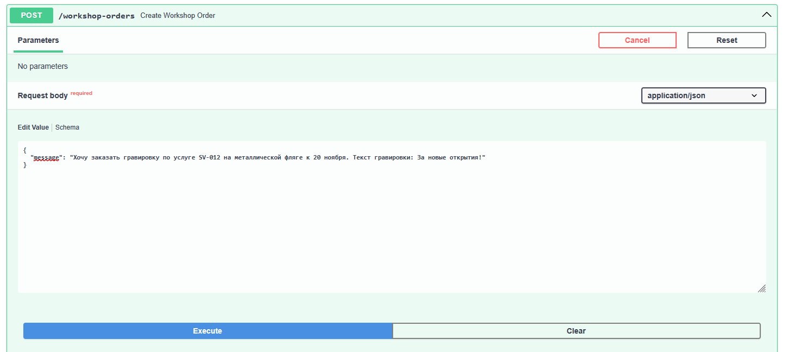</p>
<p align="center"><em>Рисунок 1 – Отправка сообщения с существующим кодом услуги.</em></p>

<p align="center">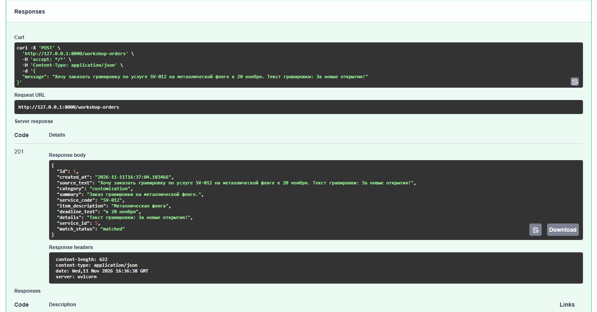</p>
<p align="center"><em>Рисунок 2 – Успешное создание заказа, HTTP 201 и matched.</em></p>

В автоматически сформированной документации Swagger присутствуют примеры успешного ответа `201` и возможной ошибки валидации `422`. Эти примеры являются описанием схем, а не дополнительными реальными ответами модели.

<p align="center">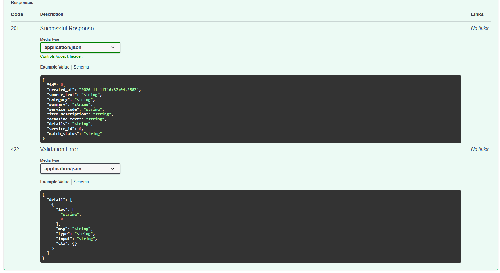</p>
<p align="center"><em>Рисунок 3 – Автоматически сформированные схемы ответов в Swagger UI.</em></p>

### 7.2. Отсутствие кода услуги и срока (`not_provided`)

**Входное сообщение:**

> «Хочу отремонтировать деревянный стул. У него сломалась ножка.»

В ходе первоначального теста выявлена проблема генерации: при контексте 2048 токенов модель потратила 1440 выходных токенов на рассуждения, не сформировав итоговый JSON. Сервис вернул `502 invalid_model_response`, не сохранив ошибочный результат. Логи LM Studio показывают `reasoning_tokens = 1440`; дополнительная запись диагностики фиксировала достижение границы контекста (`n_tokens = 2047`, `truncated = 1`).

<p align="center">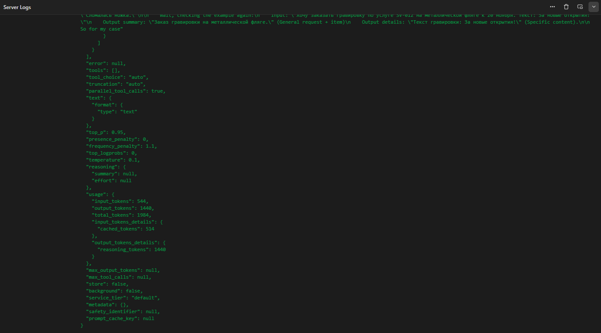</p>
<p align="center"><em>Рисунок 4 – ЛЛоги LM Studio показали значительный расход токенов на рассуждения.</em></p>

После отключения Thinking в LM Studio запрос был повторён без изменения программного кода. Получен HTTP `201`, заказ `id = 2`: категория `repair`, `service_code = null`, `deadline_text = null`, `service_id = null`, `match_status = not_provided`. Дополнительные сведения о сломанной ножке сохранены в поле `details`.

<p align="center">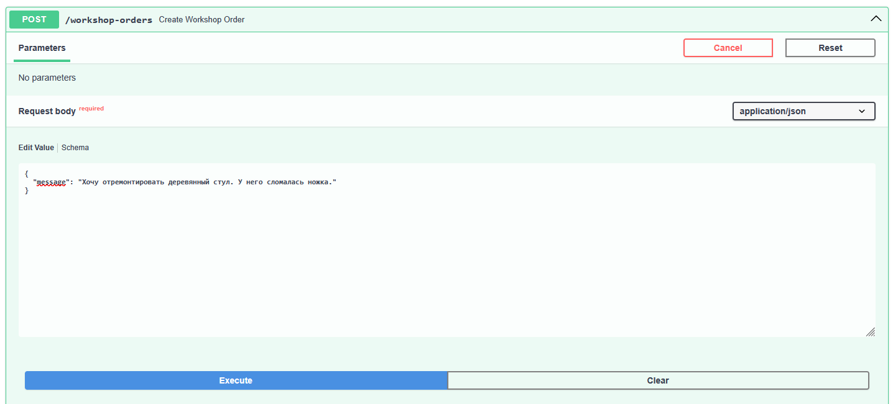</p>
<p align="center"><em>Рисунок 5 – Отправка сообщения о ремонте без кода услуги.</em></p>

<p align="center">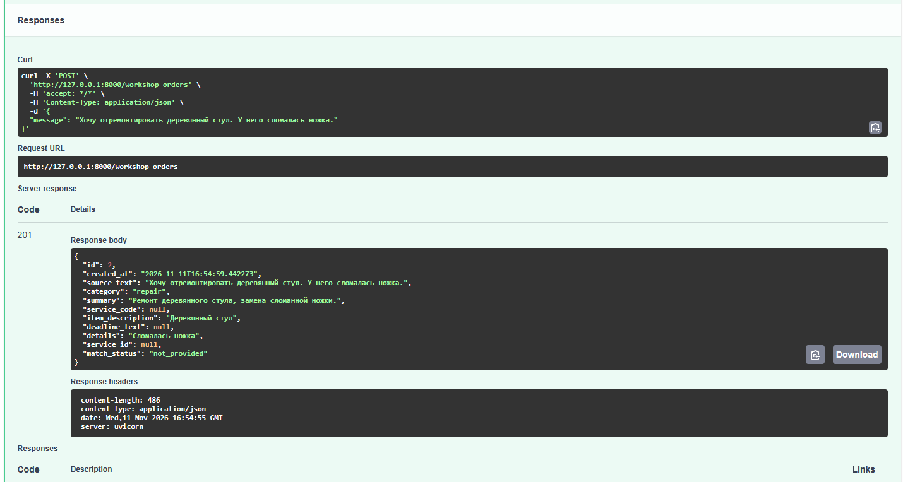</p>
<p align="center"><em>Рисунок 6 – Успешный ответ: отсутствующие поля равны null, статус not_provided.</em></p>

### 7.3. Неизвестный код услуги (`not_found`)

**Входное сообщение:**

> «Хочу заказать изготовление деревянной полки по услуге SV-999. Размер 80 на 30 см.»

Получен HTTP `201`, заказ `id = 3`, категория `manufacture`. Код `SV-999` отсутствует в справочнике, поэтому `service_id = null` и `match_status = not_found`. При этом исходный код сохранён в `service_code`, а размеры изделия включены в описание.

<p align="center">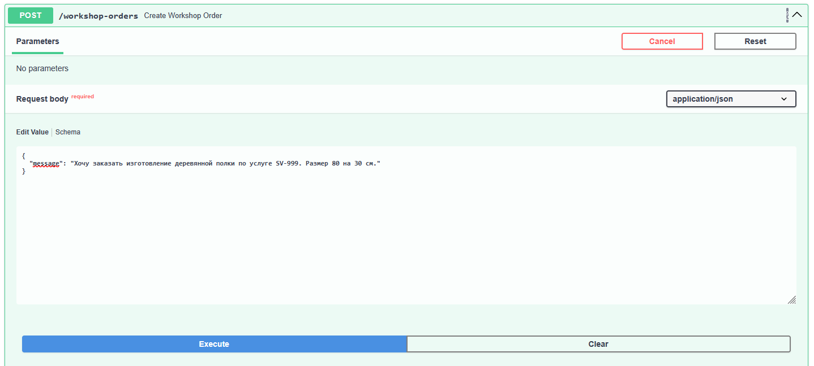</p>
<p align="center"><em>Рисунок 7 – Запрос на изготовление изделия с неизвестным кодом SV-999.</em></p>

<p align="center">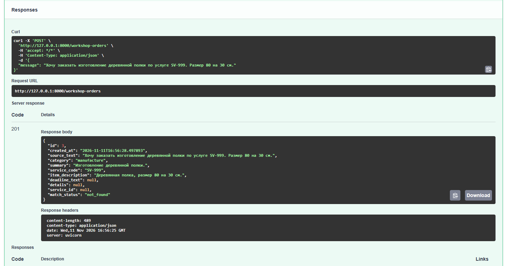</p>
<p align="center"><em>Рисунок 8 – Ответ с сохранённым кодом и результатом not_found.</em></p>

### 7.4. Категория `other`

**Входное сообщение:**

> «Здравствуйте! Подскажите, пожалуйста, по каким дням работает ваша мастерская?»

Получен HTTP `201`, заказ `id = 4`, категория `other`, краткое содержание – запрос информации о режиме работы мастерской. Поля кода, описания изделия и срока равны `null`, статус сопоставления – `not_provided`.

<p align="center">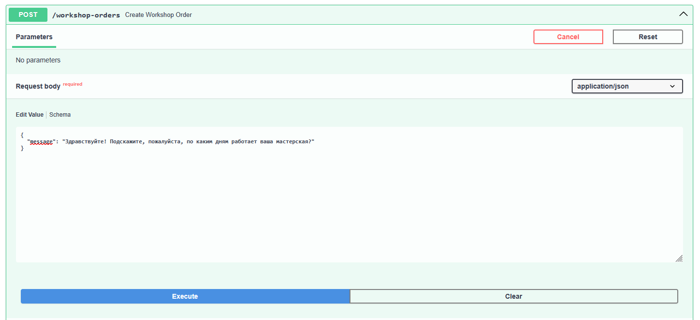</p>
<p align="center"><em>Рисунок 9 – Сообщение информационного характера.</em></p>

<p align="center">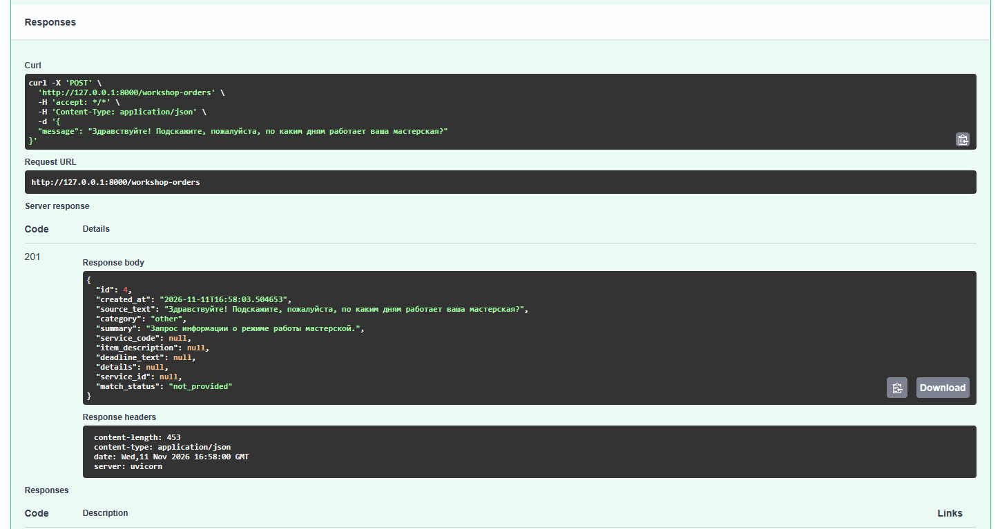</p>
<p align="center"><em>Рисунок 10 – Ответ с категорией other.</em></p>

### 7.5. Получение всех заказов

Вызов `GET /workshop-orders` завершился кодом HTTP `200`. Возвращён массив из четырёх ранее сохранённых записей в порядке убывания идентификаторов: 4, 3, 2, 1. Это подтверждает работу чтения данных из SQLite и сортировки по `id`.

<p align="center">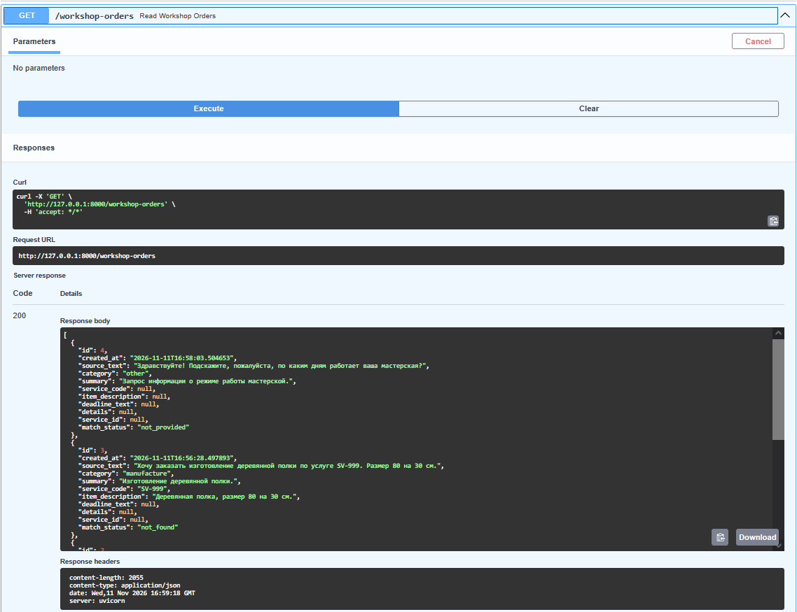</p>
<p align="center"><em>Рисунок 11 – Список сохранённых заказов, GET /workshop-orders.</em></p>

### 7.6. Получение заказа по идентификатору

Запрос `GET /workshop-orders/1` вернул HTTP `200` и сведения именно о первом заказе на гравировку, включая связь с услугой `SV-012`.

<p align="center">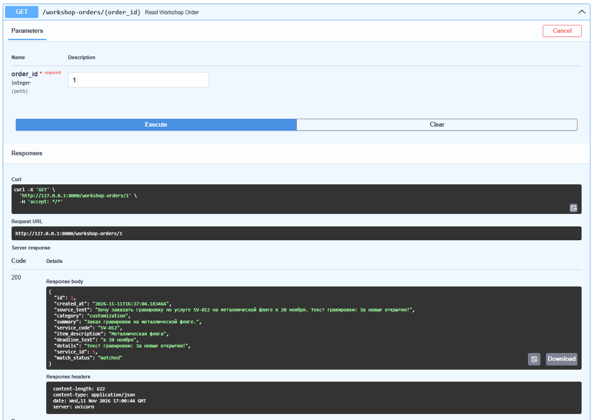</p>
<p align="center"><em>Рисунок 12 – Получение заказа по ID 1.</em></p>

### 7.7. Несуществующий заказ – HTTP 404

Для запроса `GET /workshop-orders/10` сервер вернул HTTP `404`:

```json
{
  "code": "not_found",
  "detail": "Заказ не найден"
}
```

<p align="center">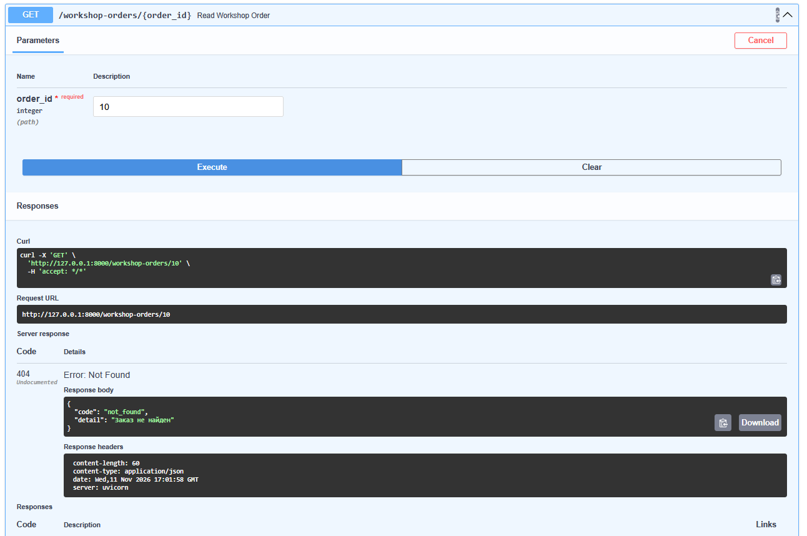</p>
<p align="center"><em>Рисунок 13 – Обработка запроса несуществующего заказа.</em></p>

### 7.8. Пустое сообщение – HTTP 422

В `POST /workshop-orders` передано сообщение, состоящее из пробелов:

```json
{"message": "   "}
```

Pydantic отклонил ввод, вернув HTTP `422` и код `invalid_request`. Обращение к модели при этом не требуется.

<p align="center">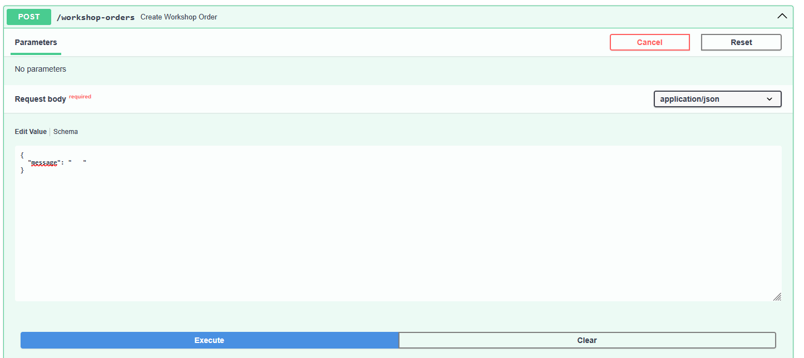</p>
<p align="center"><em>Рисунок 14 – Отправка сообщения, содержащего только пробелы.</em></p>

<p align="center">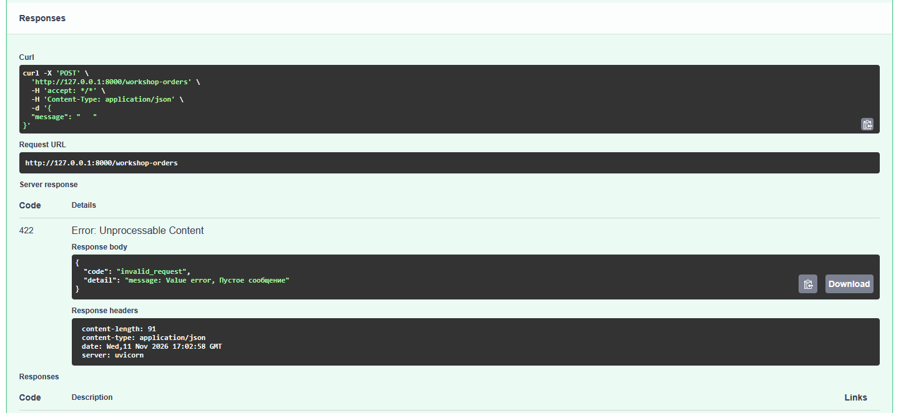</p>
<p align="center"><em>Рисунок 15 – Результат проверки входных данных: HTTP 422.</em></p>

### 7.9. Недоступность сервера модели – HTTP 503

После остановки Model Server в LM Studio был отправлен запрос на ремонт телевизора с кодом услуги `SV-004`. Сервис корректно обработал ошибку соединения:

```json
{
  "code": "model_unavailable",
  "detail": "Сервер модели недоступен"
}
```

<p align="center">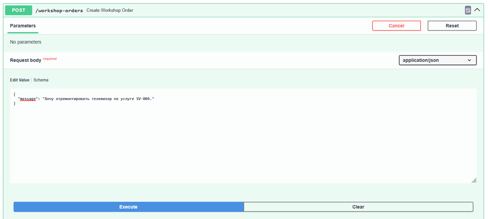</p>
<p align="center"><em>Рисунок 16 – POST-запрос при остановленном сервере модели.</em></p>

<p align="center">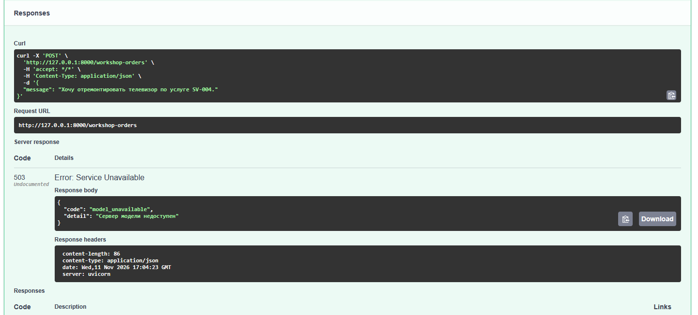</p>
<p align="center"><em>Рисунок 17 – Обработка недоступности LM Studio: HTTP 503.</em></p>

### 7.10. Превышение времени ожидания – HTTP 504

Для контролируемого теста параметр `LLM_TIMEOUT` временно изменён с `60` на `0.001` секунды, после чего FastAPI был перезапущен. При повторном запросе получен HTTP `504`:

```json
{
  "code": "model_timeout",
  "detail": "Превышено время ожидания модели"
}
```

После испытания рабочее значение `LLM_TIMEOUT=60` восстановлено.

<p align="center">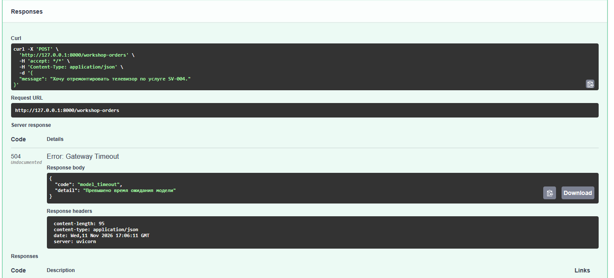</p>
<p align="center"><em>Рисунок 18 – Обработка превышения времени ожидания: HTTP 504.</em></p>

### 7.11. Сводная таблица испытаний

| № | Проверяемый сценарий | Ожидаемый результат | Фактический результат |
|---:|---|---|---|
| 1 | Существующий код `SV-012` | `201`, `matched` | Соответствует |
| 2 | Нет кода и срока | `201`, `not_provided`, `null` | Соответствует после отключения Thinking |
| 3 | Несуществующий код `SV-999` | `201`, `not_found` | Соответствует |
| 4 | Информационный вопрос | `201`, `other` | Соответствует |
| 5 | Получение всех заказов | `200`, список из четырёх записей | Соответствует |
| 6 | Получение записи по ID | `200`, один объект | Соответствует |
| 7 | Несуществующий ID | `404`, `not_found` | Соответствует |
| 8 | Пустое сообщение | `422`, `invalid_request` | Соответствует |
| 9 | LM Studio недоступна | `503`, `model_unavailable` | Соответствует |
| 10 | Превышен тайм-аут | `504`, `model_timeout` | Соответствует |

Таким образом, десять сценариев испытаний завершились ожидаемым результатом. Отдельно проверена защита от отсутствия корректного вывода модели на этапе первоначального теста № 2.
Markdown-путями.

## 8. Вывод

В ходе лабораторной работы № 2 разработан локальный API-сервис приёма заказов в мастерской. Сервис принимает сообщения на естественном языке, извлекает шесть структурированных полей посредством Qwen3.5-9B через Responses API с передачей JSON Schema, проверяет результат через Pydantic, сопоставляет код услуги со справочником и сохраняет данные в реляционной базе SQLite.

Реализованы три обязательных HTTP-маршрута, все варианты сопоставления и обработка ошибок. Практическое тестирование через Swagger UI подтвердило корректную работу создания и чтения записей, а также поведение приложения при некорректном вводе, отсутствии модели и превышении времени ожидания.

По итогам лабораторной работы был создан и проверен работоспособный API-сервис структурирования текстовых обращений с локальной языковой моделью и постоянным хранением результатов.
