# Отчёт по лабораторной работе № 3

**Дисциплина:** «Технологии программирования»  
**Тема:** «Интеграция RAG в рабочий процесс языковой модели»  
**Предметная область:** «Приём заказов в мастерской»  
**Выполнил:** Остафинский Вадим

## 1. Цель работы

Ознакомиться с методами RAG (Retrieval Augmented Generation), реализовать поиск информации в локальной базе знаний и генерацию ответов языковой моделью на основании найденных документов. Реализовать классический RAG и его модификацию CRAG, сравнить их поведение и предоставить доступ к обоим методам через HTTP API.

## 2. Постановка задачи

В соответствии с методическими указаниями необходимо:

1. Подготовить документы, составляющие базу знаний.
2. Выбрать векторную базу данных.
3. Реализовать чтение документов, разбиение на чанки, преобразование чанков в векторы, сохранение и поиск в БД, генерацию ответа на основании результатов поиска.
4. Реализовать один дополнительный метод RAG. В работе выбран CRAG (Corrective Retrieval Augmented Generation).
5. Обернуть реализованные методы в API с разделением на уровни DB, Logic, API.

**Предметная область:** помощник мастерской, отвечающий на вопросы о ценах, услугах, сроках, гарантиях и заказах на основе документов.

## 3. Средства и технологии

| Компонент | Использованное средство | Назначение |
|---|---|---|
| Язык | Python 3.14.10 | Реализация приложения |
| Генеративная модель | Qwen3.5-9B, Q4_K_M | Выбор инструмента, оценка чанков, генерация ответа |
| Модель эмбеддингов | `BAAI/bge-m3` | Преобразование текста в плотные векторы из 1024 чисел |
| Векторная БД | Qdrant | Хранение векторов и исходных фрагментов, поиск по сходству |
| Обработка Word | `python-docx` | Чтение абзацев и таблиц |
| Токенизация | `transformers`, `AutoTokenizer` | Разбиение текста по токенам bge-m3 |
| Эмбеддинги | `sentence-transformers`, `torch` | Загрузка и выполнение модели bge-m3 |
| API | FastAPI, Uvicorn | Обработка HTTP-запросов |
| Валидация | Pydantic | Проверка данных |

## 4. Архитектура проекта

| Уровень | Модули | Ответственность |
|---|---|---|
| DB | `vector_db` | Чтение, нарезка, эмбеддинги, сохранение и поиск |
| Logic | `ai`, `api/service.py` | Вызовы модели, инструменты, градация, обработка результатов и ошибок |
| API | `api/controller.py`, `api/schemas.py`, `main.py` | Маршрутизация, проверка запроса, HTTP-ответ |

Подготовка базы знаний выполняется до обработки запросов пользователей. Документы Word считываются, разбиваются на чанки, преобразуются в числовые векторы и сохраняются в Qdrant.

Пользователь отправляет вопрос, после чего модель определяет, нужен ли поиск по базе знаний. В режиме RAG найденные чанки сразу передаются модели, а в режиме CRAG дополнительно оцениваются и фильтруются.

На общие вопросы нейросеть отвечает самостоятельно. Прямого доступа к базе данных у неё нет – поиск выполняет Python-программа, которая передаёт найденную информацию модели для формирования итогового ответа.

## 5. Реализация сервиса

### 5.1. Конфигурация

Ключ считывается под фактическим именем переменной окружения. Основные строки `config.py`:

```python
import os
from dotenv import load_dotenv

load_dotenv()
MODEL_TOKEN = os.getenv("LM_STUDIO_API_KEY", "")
BASE_URL = os.getenv("BASE_URL", "http://localhost:7000/v1")
MODEL_NAME = os.getenv("MODEL_NAME", "qwen3.5-9b")
LLM_TIMEOUT = float(os.getenv("LLM_TIMEOUT", "60"))
```

`AsyncOpenAI` создаёт клиент для локального сервера. `LLM_TIMEOUT` ограничивает время ожидания отдельного API-вызова, а не всей цепочки RAG или CRAG.

### 5.2. Подготовка базы знаний

Подготовлено пять документов с абзацами и таблицами.

| Документ | Содержание |
|---|---|
| `01_Прайс-лист.docx` | Цены, дополнительные услуги, коды и тарифы |
| `02_Регламент_приема_заказов.docx` | Правила приёма и оформления заказов |
| `03_Гарантийные_условия.docx` | Гарантии и ограничения |
| `04_Сроки_выполнения_работ.docx` | Сроки различных работ |
| `05_Журнал_заказов.docx` | Примеры заказов, стоимости и статусов |

<p align="center">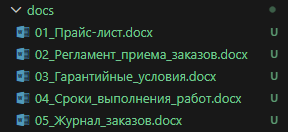</p>
<p align="center"><em>Рисунок 1 – Документы базы знаний.</em></p>

В прайс-листе указано, что, например, восстановление одной ножки деревянного стула стоит 1500 рублей при отсутствии дополнительных повреждений. Эта информация использована как зафиксированный факт при проверке RAG и CRAG.

<p align="center">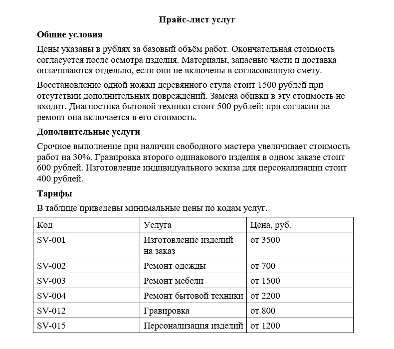</p>
<p align="center"><em>Рисунок 2 – Содержимое прайс-листа услуг.</em></p>

### 5.3. Чтение документов

Парсер `vector_db/parser.py` получает путь к Word-файлу и возвращает объект `ParsedDocument`, содержащий путь источника и список блоков `Block`. Каждый блок хранит тип и текст. Абзацы и таблицы извлекаются в исходном порядке через XML-элементы документа, пустые блоки пропускаются.

```python
@dataclass(frozen=True)
class Block:
    kind: str
    text: str

@dataclass(frozen=True)
class ParsedDocument:
    source: Path
    blocks: list[Block]
```

```python
def _iter_blocks(document: DocumentObject):
    for child in document.element.body.iterchildren():
        if child.tag == qn("w:p"):
            yield Paragraph(child, document)
        elif child.tag == qn("w:tbl"):
            yield Table(child, document)
```

Текст абзаца нормализуется через `" ".join(item.text.split())`. Для таблиц каждая строка преобразуется в последовательность ячеек, разделённых вертикальной чертой, а строки объединяются символом перевода строки. Например:

```text
Код | Услуга | Цена, руб.
SV-003 | Ремонт мебели | от 1500
SV-012 | Гравировка | от 800
```

Это позволяет сохранить связь между значениями одной строки таблицы в текстовом представлении. Функция `parse_docx()` выполняет преобразование всего документа.

### 5.4. Разбиение текста на чанки

Чанк – фрагмент документа, для которого строится отдельный вектор. Если хранить большой документ одним вектором, его содержание представлено обобщённо, поэтому отдельные детали могут хуже находиться по смысловому запросу. Небольшие фрагменты позволяют точнее выбирать нужный текст и уменьшают объём информации, передаваемой LLM. Слишком маленькие чанки могут терять смысловой контекст.

```python
ROOT = Path(__file__).resolve().parent.parent
DOCS_DIR = ROOT / "docs"
TEMP_DIR = DOCS_DIR / "temp"
TOKENIZER_NAME = "BAAI/bge-m3"
CHUNK_SIZE = 200
CHUNK_OVERLAP = 20
```

Первоначально использовались параметры 600 и 60 токенов, при которых каждый из пяти небольших документов помещался в один чанк. Для демонстрации реального разбиения размер уменьшен до 200 токенов, перекрытие – до 20 токенов.

`ROOT` вычисляется относительно файла модуля, поэтому абсолютные пути не требуются. `AutoTokenizer.from_pretrained(TOKENIZER_NAME)` загружает токенайзер той же модели, которая используется для эмбеддингов.

```python
encoded = tokenizer(
    text,
    add_special_tokens=False,
    return_offsets_mapping=True,
    truncation=False,
)
offsets = encoded["offset_mapping"]
step = size - overlap
pieces = []
start = 0
while start < len(offsets):
    end = min(start + size, len(offsets))
    char_start = offsets[start][0]
    char_end = offsets[end - 1][1]
    pieces.append(text[char_start:char_end])
    if end == len(offsets):
        break
    start += step
```

Текст блоков одного документа объединяется через `"\n\n"`. Токенайзер возвращает позиции токенов в исходном тексте (`offset_mapping`), по которым извлекаются фрагменты. Шаг равен 180 токенам: первый чанк содержит токены 1–200, второй – 181–380. Перекрытие снижает вероятность потери информации на границе.

`build_temp_chunks()` удаляет старые `.txt` из `docs/temp`, перебирает документы `glob("*.docx")`, вызывает парсер и сохраняет чанки с именами вида `01_Прайс-лист_1.txt`. Код запускается как модуль из корня проекта:

```cmd
python -m vector_db.chunker
```

В результате подготовлено 10 чанков из пяти документов.

<p align="center">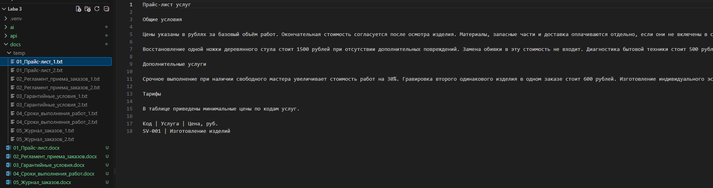</p>
<p align="center"><em>Рисунок 3 – Результат разбиения документов на текстовые чанки.</em></p>

### 5.5. Эмбеддинги и векторная база

Эмбеддинг – числовое представление текста, которое позволяет сравнивать тексты по смысловой близости. В работе используется плотное представление bge-m3 размерностью 1024.

```python
def _get_model():
    global _model
    if _model is None:
        _model = SentenceTransformer(TOKENIZER_NAME)
    return _model


def embed_texts(texts: list[str]) -> list[list[float]]:
    if not texts:
        return []
    vectors = _get_model().encode(
        texts,
        batch_size=4,
        normalize_embeddings=True,
        show_progress_bar=False,
        convert_to_numpy=True,
    )
    return [vector.tolist() for vector in vectors]
```

`batch_size=4` задаёт обработку текстов группами, нормализация приводит векторы к единичной длине. `load_chunks()` читает `.txt` и восстанавливает название исходного Word-документа и номер чанка из имени файла.

```python
QDRANT_DIR = ROOT / "qdrant"
COLLECTION = "docs"
client = QdrantClient(path=str(QDRANT_DIR))
```

Qdrant используется в локальном режиме: данные физически находятся в папке `qdrant`. `fill_database()` при повторной индексации удаляет прежнюю коллекцию `docs`, создаёт новую с метрикой `Distance.COSINE` и записывает точки через `upsert()`.

```python
client.create_collection(
    collection_name=COLLECTION,
    vectors_config=VectorParams(
        size=len(vectors[0]),
        distance=Distance.COSINE,
    ),
)
```

Каждая точка имеет уникальный идентификатор, вектор и полезную нагрузку:

```python
PointStruct(
    id=index,
    vector=vector,
    payload={
        "source": chunk.source.name,
        "chunk": chunk.number,
        "text": chunk.text,
    },
)
```

Вектор нужен для поиска, `payload` – для получения исходного текста и его источника. Клиент закрывается в блоке `finally`. Функция `index_documents()` сначала обновляет чанки, затем заполняет коллекцию.

```cmd
python -m vector_db.embedder
```

Фактический результат – `10 points -> docs`.

<p align="center">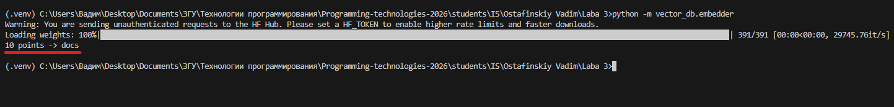</p>
<p align="center"><em>Рисунок 4 – Индексация десяти точек в Qdrant.</em></p>

### 5.6. Поиск по векторной БД

Функция `search(query, limit=3)` преобразует поисковый запрос той же моделью bge-m3 и запрашивает ближайшие точки:

```python
vector = embed_texts([query])[0]
found = client.query_points(
    collection_name=COLLECTION,
    query=vector,
    limit=limit,
    with_payload=True,
)
```

Косинусное сходство характеризует близость направлений двух векторов. Более высокий `score` означает большую близость по выбранной метрике.

### 5.7. Классический RAG и Function Calling

Классический RAG дополняет знания языковой модели информацией, найденной в документах. Системный промпт определяет роль помощника, русский язык ответа, необходимость поиска по вопросам мастерской и запрет выдумывать сведения. На общие вопросы разрешено отвечать без поиска.

```python
TOOLS = [
    {
        "type": "function",
        "name": "search_knowledge_base",
        "description": "Поиск информации в документах мастерской",
        "strict": False,
        "parameters": {
            "type": "object",
            "properties": {
                "query": {
                    "type": "string",
                    "description": "Короткий поисковый запрос по документам мастерской",
                }
            },
            "required": ["query"],
            "additionalProperties": False,
        },
    }
]
```

Описание инструмента передаётся в Responses API вместе с вопросом и системной инструкцией:

```python
response = await client.responses.create(
    model=MODEL_NAME,
    instructions=SYSTEM_PROMPT,
    input=conversation,
    tools=TOOLS,
    tool_choice="auto",
    timeout=LLM_TIMEOUT,
)
```

`tool_choice="auto"` позволяет модели самостоятельно решать, нужен ли поиск. Если модель возвращает элемент `function_call`, приложение извлекает название инструмента и аргументы, вызывает соответствующую функцию и добавляет результат в диалог с тем же `call_id`.

```python
for _ in range(MAX_TOOL_ROUNDS):
    calls = [item for item in response.output
             if item.type == "function_call"]
    if not calls:
        return response.output_text
    conversation.extend(response.output)
    for call in calls:
        conversation.append({
            "type": "function_call_output",
            "call_id": call.call_id,
            "output": await _call_tool(
                call.name, call.arguments, message, mode
            ),
        })
    response = await client.responses.create(
        model=MODEL_NAME,
        instructions=SYSTEM_PROMPT,
        input=conversation,
        tools=TOOLS,
        tool_choice="auto",
        timeout=LLM_TIMEOUT,
    )
return response.output_text
```

`MAX_TOOL_ROUNDS=3` ограничивает число исполнений инструментов. `_parse_arguments()` разбирает JSON-аргументы и проверяет, что они являются словарём. `_call_tool()` проверяет имя инструмента и непустой запрос. `asyncio.to_thread(_search, query)` позволяет выполнить синхронный поиск без блокирования основного асинхронного цикла. `_search()` возвращает название источника, номер чанка и текст, не передавая `score` в модель. Для классического RAG найденные фрагменты сразу сериализуются в JSON и передаются Qwen.

### 5.8. CRAG

CRAG добавляет этап оценки результатов поиска перед генерацией итогового ответа. Используются три оценки:

| Оценка | Значение | Действие |
|---|---|---|
| Подходит | Есть сведения для ответа | Передать фрагмент модели |
| Сомнительно | Тематика близкая, данных недостаточно | Передать с оценкой, если есть хотя бы один подходящий фрагмент |
| Не подходит | Нет нужной связи с вопросом | Исключить фрагмент |

Реализован вариант CRAG с локальной фильтрацией без внешнего поиска. Используется та же модель Qwen3.5-9B, но с отдельным промптом `GRADING_PROMPT`. Для оценки передаётся исходный вопрос пользователя, а не только сокращённый поисковый запрос, поскольку их смысл может различаться.

```python
class ChunkGrade(BaseModel):
    number: int
    grade: Literal["подходит", "сомнительно", "не подходит"]

class GradingResult(BaseModel):
    grades: list[ChunkGrade]
```

Функция `grade_chunks()` формирует объект с полями `question` и `chunks`, нумерует результаты поиска от единицы и выполняет отдельный запрос:

```python
response = await client.responses.create(
    model=MODEL_NAME,
    instructions=GRADING_PROMPT,
    input=json.dumps(data, ensure_ascii=False),
    text={
        "format": {
            "type": "json_schema",
            "name": "grading",
            "schema": GradingResult.model_json_schema(),
            "strict": True,
        }
    },
    timeout=LLM_TIMEOUT,
)
result = GradingResult.model_validate_json(response.output_text)
```

JSON Schema задаёт ожидаемую структуру, Pydantic отдельно проверяет полученный ответ. Дополнительно проверяется, что каждый найденный чанк получил ровно одну оценку релевантности.

```python
grades = {item.number: item.grade for item in result.grades}
if (len(result.grades) != len(hits)
        or set(grades) != set(range(1, len(hits) + 1))):
    raise ValueError("Некорректные оценки чанков")

suitable = []
for number, hit in enumerate(hits, start=1):
    grade = grades[number]
    print(f"CRAG: {hit['source']}, чанк {hit['chunk']} – {grade}")
    if grade != "не подходит":
        suitable.append({**hit, "grade": grade})
return suitable
```

В `_call_tool()` выбор метода реализован условием:

```python
hits = await asyncio.to_thread(_search, query)
if mode == "crag":
    hits = await grade_chunks(client, message, hits)
    if not any(hit["grade"] == "подходит" for hit in hits):
        return json.dumps(
            {"message": "В документах нет достаточной информации для ответа"},
            ensure_ascii=False,
        )
return json.dumps(hits, ensure_ascii=False)
```

Если хотя бы один чанк признан подходящим, модели передаются подходящие и сомнительные фрагменты с оценками. Если подходящих нет, вместо фрагментов передаётся сообщение о недостаточности информации. Таким образом, CRAG снижает риск использования нерелевантного текста, но качество фильтрации всё равно зависит от решений языковой модели.

### 5.9. HTTP API и валидация

Используется один маршрут `POST /assistant/ask` с выбором режима в теле запроса. Это позволяет сравнивать методы через одинаковый интерфейс без дублирования контроллеров.

`api/schemas.py`:

```python
from typing import Literal
from pydantic import BaseModel, Field

class MessageIn(BaseModel):
    message: str = Field(min_length=1)
    mode: Literal["rag", "crag"] = "rag"

class AnswerOut(BaseModel):
    answer: str
```

`message` должен содержать хотя бы один символ, `mode` принимает только `rag` или `crag`. При отсутствии `mode` используется классический RAG. Проверка минимальной длины не исключает сообщение, состоящее только из пробелов.

`api/controller.py`:

```python
from fastapi import APIRouter
from api.schemas import MessageIn, AnswerOut
from api.service import answer_question

router = APIRouter(prefix="/assistant", tags=["assistant"])

@router.post("/ask", response_model=AnswerOut)
async def ask(body: MessageIn):
    return await answer_question(body.message, body.mode)
```

`api/service.py` вызывает `llm_response(message, mode)` и преобразует исключения в HTTP-ответы. `main.py` создаёт объект `FastAPI` и подключает маршрутизатор.

## 7. Экспериментальная проверка

### 7.1. Общий вопрос без необходимости поиска

```json
{"message": "Что такое язык программирования Python?"}
```

Получен HTTP 200. Модель корректно описала Python. Вопрос не требует обращения к документам. Сам ответ подтверждает корректность генерации, но отсутствие вызова инструмента следует устанавливать по логам, а не только по тексту ответа.

<p align="center">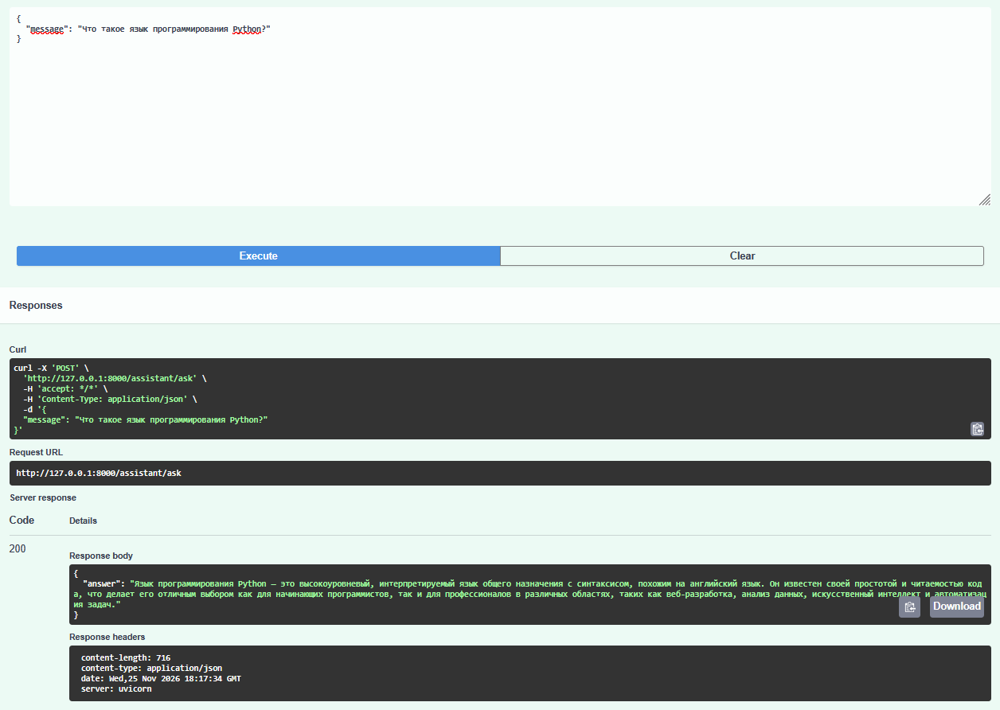</p>
<p align="center"><em>Рисунок 4 – Ответ на общий вопрос о Python.</em></p>

### 7.2. Классический RAG: стоимость ремонта

```json
{"message": "Сколько стоит ремонт ножки стула?"}
```

Получен HTTP 200. Модель указала 1500 рублей при отсутствии дополнительных повреждений, возможность согласования окончательной стоимости после осмотра и отдельную оплату материалов, запасных частей и доставки. Ответ соответствует прайс-листу.

<p align="center">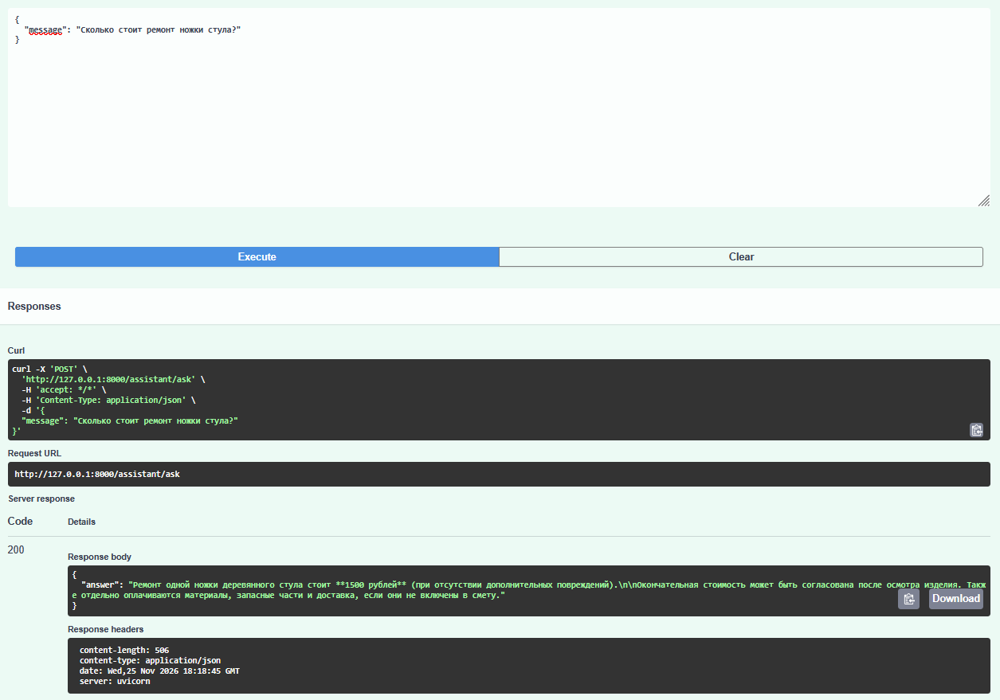</p>
<p align="center"><em>Рисунок 5 – Ответ классического RAG о стоимости ремонта.</em></p>

### 7.3. Подтверждение Function Calling

Прямое подтверждение выполнения поиска – элемент `function_call` с аргументами `{"query":"ремонт ножка стула стоимость цена"}` и следующий `function_call_output` с тем же идентификатором `call_808353593820000`. В результате инструмента виден источник `01_Прайс-лист.docx` и номер чанка. Надпись `Truncated in logs` обозначает сокращённое отображение результата в журнале.

<p align="center">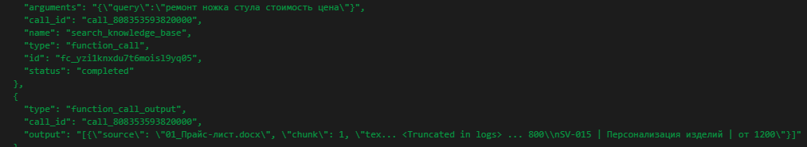</p>
<p align="center"><em>Рисунок 6 – Вызов инструмента и передача найденных чанков в LM Studio.</em></p>

### 7.4. Классический RAG: отсутствующая информация

```json
{"message": "Какая ежемесячная зарплата у мастеров мастерской?"}
```

Получен HTTP 200 и сообщение, что документы не содержат сведений о зарплате. Модель не назвала вымышленную сумму.

<p align="center">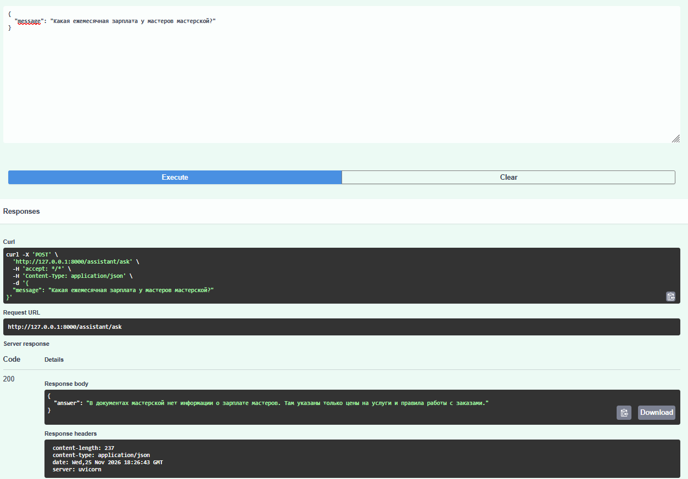</p>
<p align="center"><em>Рисунок 7 – Ответ классического RAG при отсутствии информации о зарплате.</em></p>

### 7.5. CRAG: оценка найденных фрагментов и ответ

```json
{"message": "Сколько стоит ремонт ножки стула?", "mode": "crag"}
```

В консоли Uvicorn зафиксированы следующие фактические оценки:

| Источник | Чанк | Оценка |
|---|---:|---|
| 01_Прайс-лист.docx | 1 | подходит |
| 05_Журнал_заказов.docx | 1 | не подходит |
| 01_Прайс-лист.docx | 2 | подходит |

<p align="center">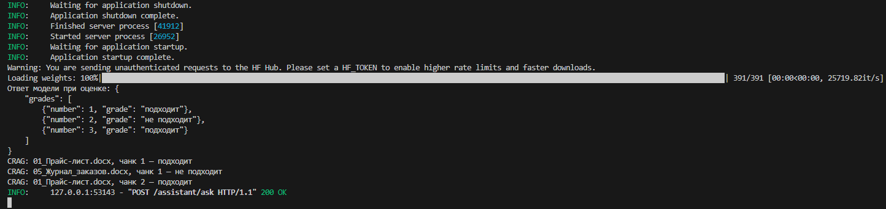</p>
<p align="center"><em>Рисунок 8 – Оценки чанков CRAG при поиске стоимости ремонта.</em></p>

В данном запуске журнал заказов исключён, а оба чанка прайс-листа сохранены. Эти оценки отличаются от возможной ручной оценки: журнал содержит пример заказа, а второй чанк прайс-листа – общую минимальную цену ремонта мебели, а не точную стоимость ножки стула. Это показывает, что градация LLM не является безошибочной. Тем не менее первый чанк содержит необходимый факт и позволяет сформировать корректный ответ.

Получен HTTP 200 и стоимость 1500 рублей с условиями, соответствующими документу.

<p align="center">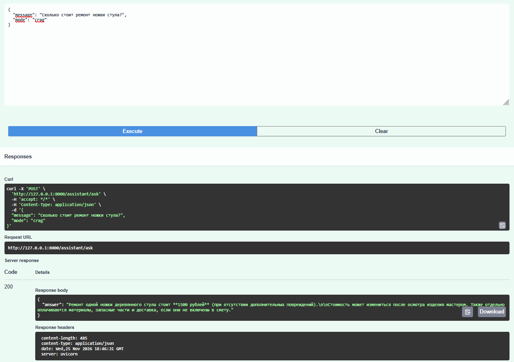</p>
<p align="center"><em>Рисунок 9 – Ответ CRAG о стоимости ремонта ножки стула.</em></p>

### 7.6. CRAG: отсутствующая информация

```json
{"message": "Какая ежемесячная зарплата у мастеров мастерской?", "mode": "crag"}
```

Получен HTTP 200 и ответ: «К сожалению, в наших документах нет информации о размере ежемесячной зарплаты мастеров».

<p align="center">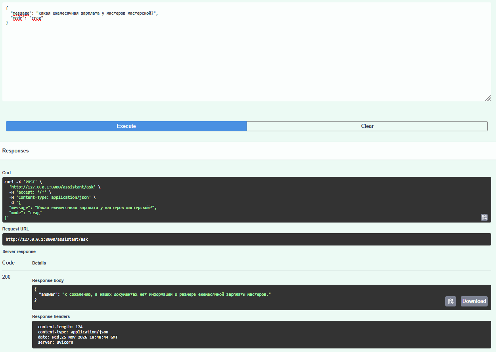</p>
<p align="center"><em>Рисунок 10 – Ответ CRAG при отсутствии сведений о зарплате.</em></p>

Векторный поиск вернул три близких фрагмента, однако все получили оценку «не подходит»:

| Источник | Чанк | Оценка |
|---|---:|---|
| 05_Журнал_заказов.docx | 1 | не подходит |
| 02_Регламент_приема_заказов.docx | 1 | не подходит |
| 01_Прайс-лист.docx | 1 | не подходит |

<p align="center">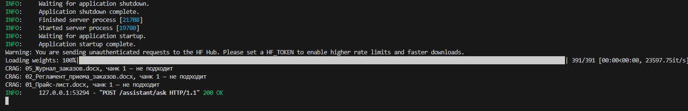</p>
<p align="center"><em>Рисунок 11 – Отбрасывание неподходящих чанков в CRAG.</em></p>

Все три чанка исключены, модели передано сообщение о недостаточности данных. В отличие от классического RAG, здесь отсутствие подходящих сведений дополнительно подтверждено отдельной оценкой результатов поиска.

### 7.7. Пустое сообщение – HTTP 422

```json
{"message": "", "mode": "rag"}
```

Получен HTTP 422, тип ошибки `string_too_short`, поле `body.message`. Проверка `Field(min_length=1)` сработала до вызова модели.

<p align="center">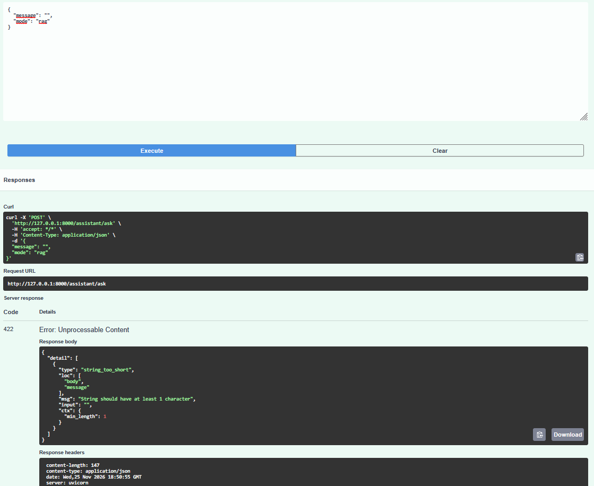</p>
<p align="center"><em>Рисунок 12 – Ошибка HTTP 422 при пустом сообщении.</em></p>

### 7.8. Недопустимый режим – HTTP 422

```json
{"message": "Сколько стоит ремонт стула?", "mode": "baza"}
```

Получен HTTP 422, тип ошибки `literal_error`. Допускаются только значения `rag` и `crag`.

<p align="center">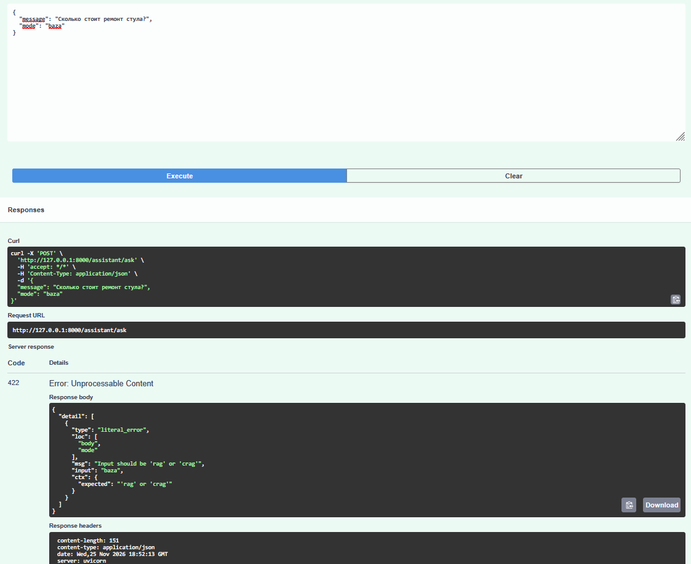</p>
<p align="center"><em>Рисунок 13 – Ошибка HTTP 422 при недопустимом режиме.</em></p>

### 7.9. Недоступность модели – HTTP 503

Сервер LM Studio был остановлен при работающем Uvicorn. Запрос о стоимости ремонта стула с режимом `rag` вернул:

```json
{"detail": "Модель недоступна"}
```

HTTP 503 подтверждает обработку ошибки подключения.

<p align="center">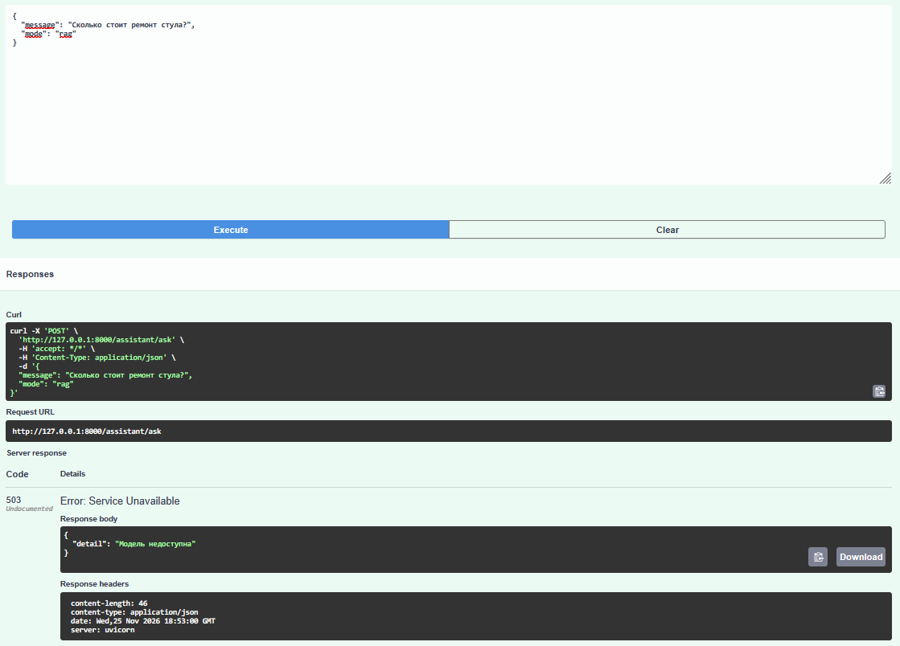</p>
<p align="center"><em>Рисунок 14 – Ошибка HTTP 503 при недоступности модели.</em></p>

### 7.10. Превышение времени ожидания – HTTP 504

В `.env` временно задано `LLM_TIMEOUT=0.0001`. После полного перезапуска Uvicorn отправлен запрос о стоимости ремонта стула. Получен HTTP 504:

```json
{"detail": "Превышено время ожидания ответа модели"}
```

<p align="center">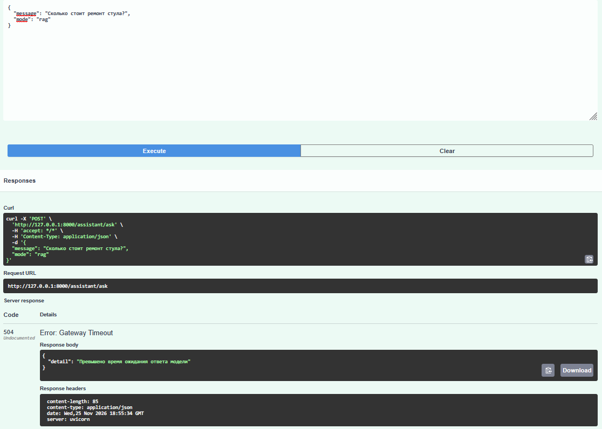</p>
<p align="center"><em>Рисунок 19 – Ошибка HTTP 504 при превышении тайм-аута.</em></p>

### 7.11. Сравнение RAG и CRAG

В обоих режимах получена правильная стоимость ремонта и корректный отказ назвать отсутствующую зарплату. CRAG позволяет явно наблюдать отбрасывание нерелевантных чанков. Дополнительный вызов модели увеличивает объём вычислений.

## 8. Вывод

В ходе лабораторной работы разработан локальный API-помощник мастерской с использованием Qwen3.5-9B, bge-m3 и Qdrant. Создана база знаний из пяти документов Word, реализованы чтение абзацев и таблиц, разбиение на чанки с перекрытием, построение эмбеддингов, индексация десяти точек и поиск по косинусному сходству.

Реализованы классический RAG с Function Calling и модификация CRAG с дополнительной градацией найденных фрагментов. Через единый HTTP-маршрут пользователь может выбрать способ обработки запроса. На контрольных вопросах оба метода дали правильные ответы, а при отсутствии сведений о зарплате CRAG дополнительно исключил все неподходящие чанки. Проверены ошибки валидации, недоступности модели и превышения тайм-аута.

Полученные результаты демонстрируют, как внешняя база знаний позволяет модели отвечать на вопросы о конкретной предметной области без дообучения. При этом качество ответа зависит от полноты документов, параметров разбиения, качества векторного поиска и соблюдения инструкций моделью.
