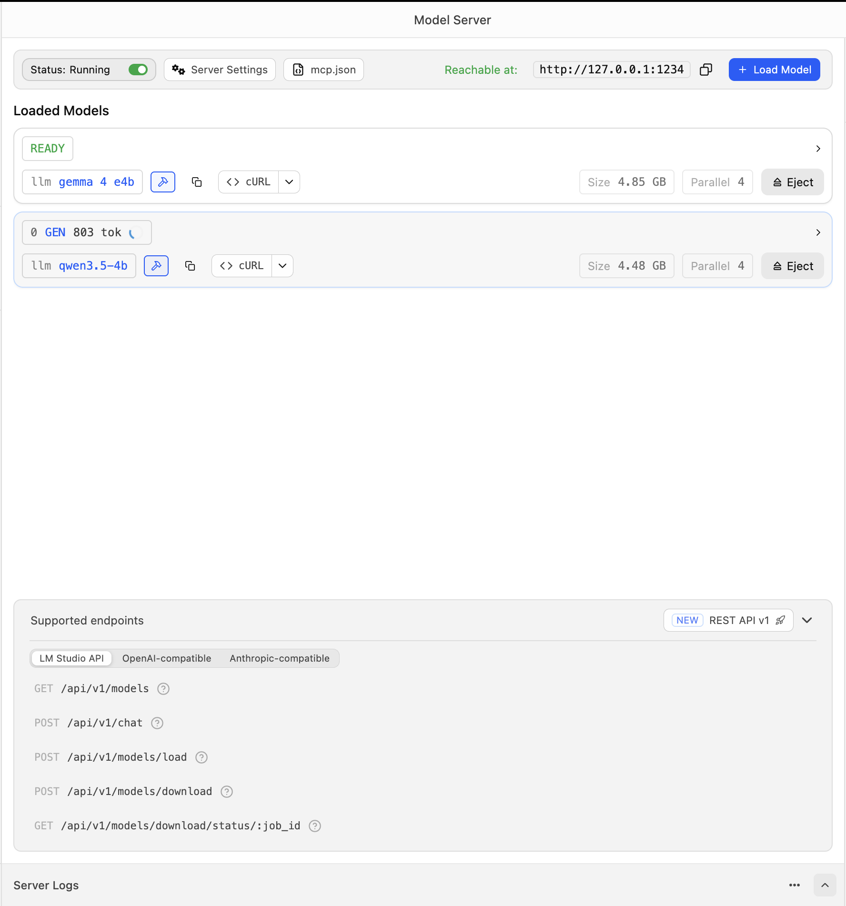
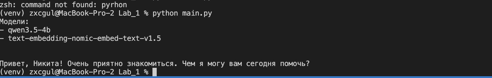
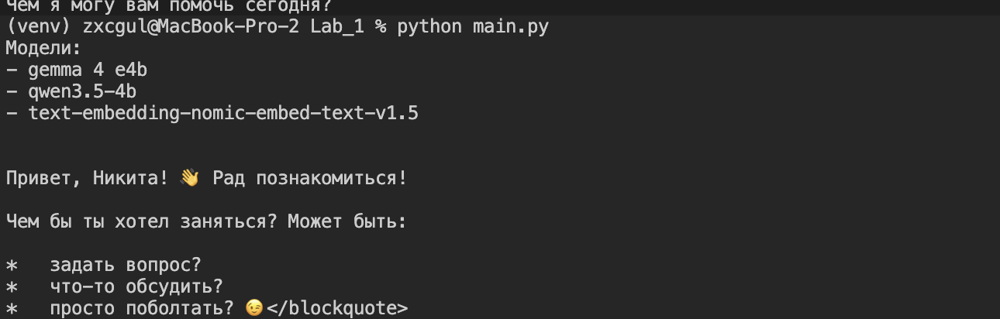
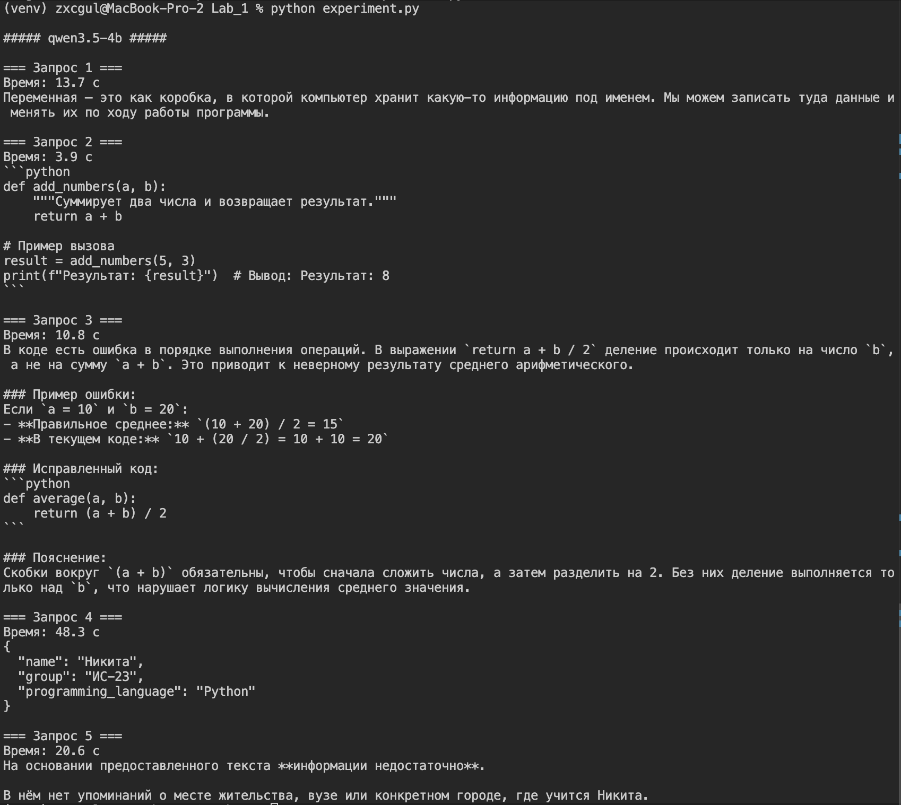
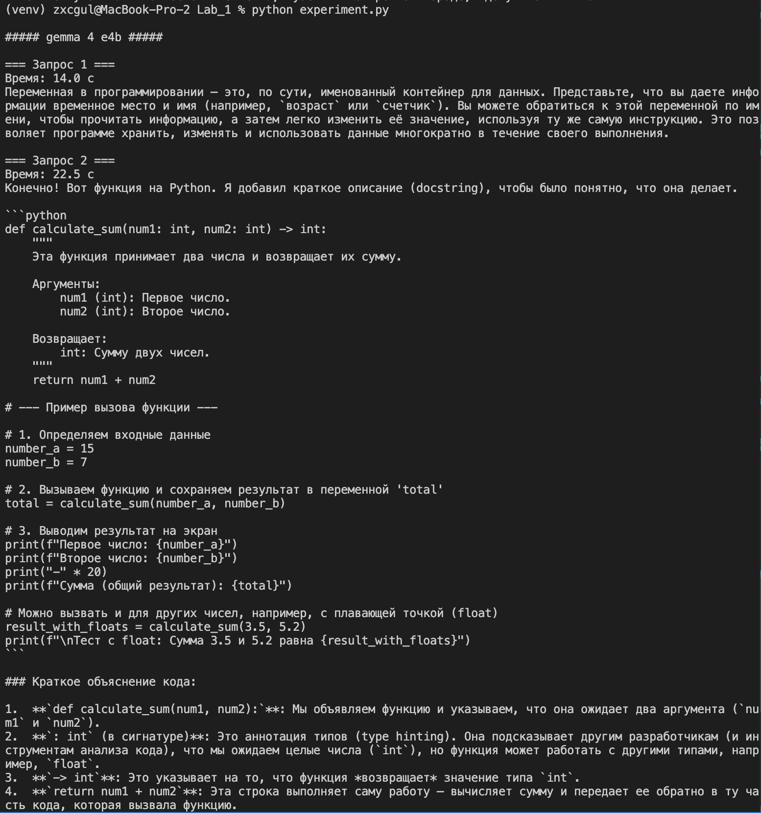
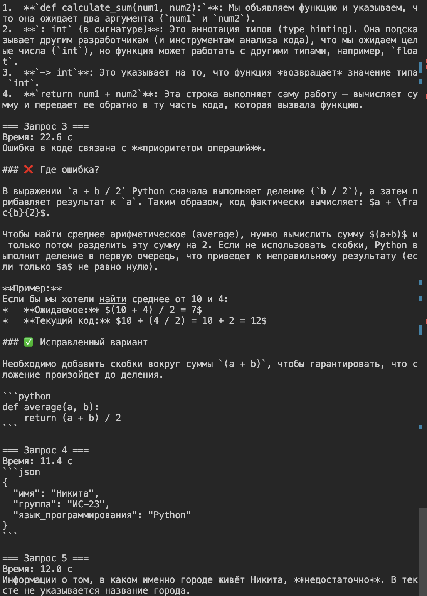
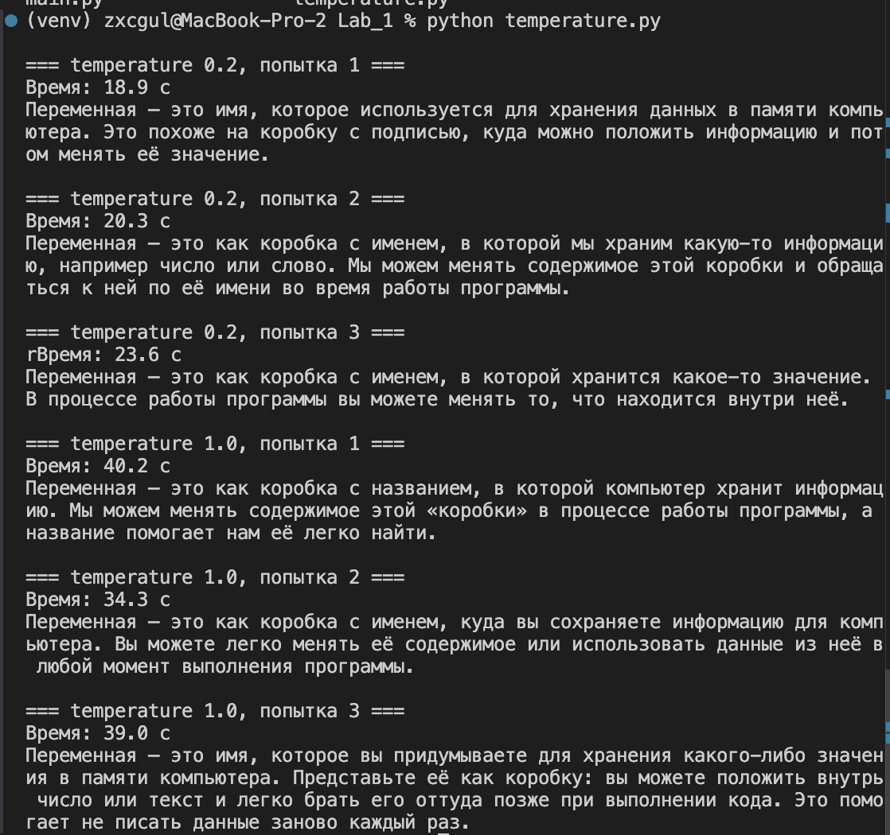
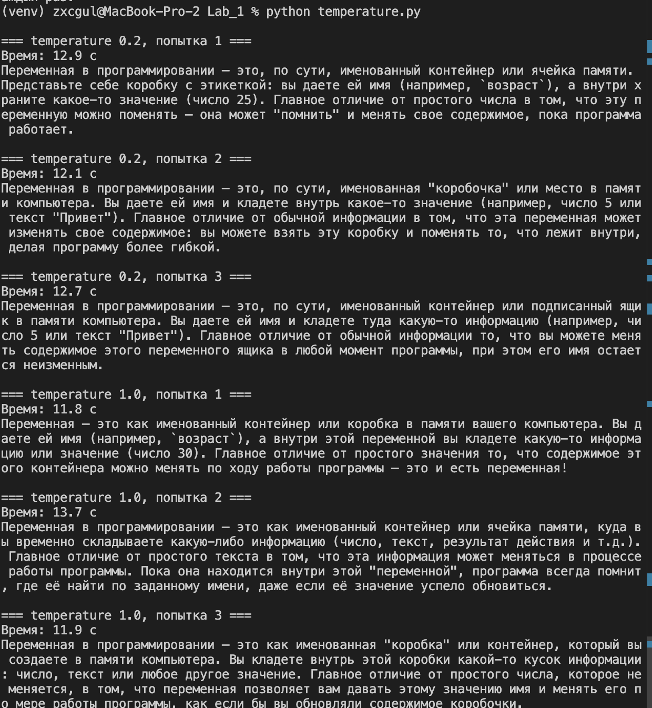

Министерство науки и высшего образования Российской Федерации

Федеральное государственное бюджетное образовательное учреждение высшего образования

«Заполярный государственный университет им. Н. М. Федоровского» (ЗГУ им. Н. М. Федоровского)

Факультет «Электроэнергетики, экономики и управления»

Кафедра «Информационные системы и технологии»

Дисциплина «Технологии программирования»

Отчет к лабораторной работе 1

Тема: «Эксплуатация локальной языковой модели»

Студент: Поляков Никита

Группа: ИС-23

## Содержание

1. Цель и постановка задачи
2. Подготовка окружения
3. Выбор моделей
4. Локальный сервер
5. Проверка работоспособности
6. Пять одинаковых запросов
7. Влияние параметра temperature
8. Сравнение моделей
9. Вывод

## 1. Цель и постановка задачи

Цель работы — поднять языковые модели на своём компьютере через LM Studio и сравнить их на одном и том же наборе запросов.

Поставленные задачи:

1. Выбрать две модели на Hugging Face в формате GGUF для LM Studio.
2. Проверить, что обе отвечают через локальный сервер.
3. Собрать пять запросов: объяснение понятия из программирования, небольшая функция на Python, поиск ошибки в готовом коде, извлечение данных из текста в JSON и вопрос, ответа на который в тексте нет. В последнем запросе есть фраза «Если информации недостаточно, сообщи об этом».
4. Отправить эти запросы обеим моделям и записать название, число параметров, квантование и то, как модель была запущена.
5. Для одной модели повторить один запрос три раза при temperature 0.2 и три раза при 1.0.
6. Сравнить время полного ответа, правильность и соблюдение формата.
7. Сделать вывод, какая модель лучше подходит этому компьютеру и этим задачам, и какие ограничения нашлись.

## 2. Подготовка окружения

Работа выполнена на MacBook Pro, идентификатор Mac16,8. Чип Apple M4 Pro, 12 ядер, из них 8 производительных и 4 энергоэффективных. Оперативная память 24 ГБ, она общая для процессора и графики: отдельной видеопамяти сверх этих 24 ГБ нет.

Запросы из терминала идут из каталога `Lab_1`. Создано виртуальное окружение `venv`, установлены `openai` и `python-dotenv`, полный список записан в `requirements.txt`.

Токен локального сервера лежит в `.env` и в программу попадает через `load_dotenv()`. В отчёт и на снимки токен не выносился.

Библиотека `openai` здесь только клиент. Адрес `http://localhost:1234/v1` указывает на LM Studio на этом же компьютере. К платным моделям OpenAI запросы не уходят.

## 3. Выбор моделей

В методичке для первого запуска советуют модель с запасом по памяти и не ставить сразу максимальный контекст из карточки. На 24 ГБ общей памяти четырёхмиллиардные модели в квантовании помещаются, и даже обе сразу.

Взяты два файла GGUF:

| Модель | Параметров | Квантование | Файл на диске | В памяти LM Studio |
| --- | --- | --- | --- | --- |
| Qwen3.5-4B | 4B | Q8_0 | `Qwen3.5-4B-Q8_0.gguf`, 4,2 ГБ | 4,48 ГБ |
| Gemma 4 E4B | 4,5B эффективных, с эмбеддингами около 8B | Q3_K_M | `Gemma-4-E4B-Uncensored-HauhauCS-Aggressive-Q3_K_M.gguf`, 4,5 ГБ | 4,85 ГБ |

Буква E в названии Gemma означает effective: рабочие параметры около 4,5 миллиарда, а таблицы эмбеддингов поднимают полный счёт примерно до 8 миллиардов. Файл Gemma — сторонняя сборка в квантовании Q3_K_M, оно грубее, чем Q8_0 у Qwen. Идентификаторы на сервере: `qwen3.5-4b` и `gemma 4 e4b`.

В списке моделей ещё есть служебная `text-embedding-nomic-embed-text-v1.5`. В опытах она не вызывалась.

На снимке сервера обе модели уже в состоянии READY, у каждой указано Parallel 4.

Рисунок 1. Обе модели загружены, сервер слушает порт 1234.

## 4. Локальный сервер

Запросы идут на вкладку Model Server. Сервер в статусе Running, адрес на снимке — `http://127.0.0.1:1234`. Для вызова из Python нужен токен, он хранится в `.env`.

Клиент создаётся так: `base_url` равен `http://localhost:1234/v1`, ключ читается из окружения. Дальше используется `client.responses.create`.

## 5. Проверка работоспособности

`main.py` печатает список моделей и отправляет фразу «Я Никита». На первом запуске в списке были `qwen3.5-4b` и служебная модель эмбеддингов. Qwen ответила: «Привет, Никита! Очень приятно знакомиться. Чем я могу вам сегодня помочь?»

Рисунок 2. Проверка сервера на модели Qwen.

После загрузки Gemma в том же списке появились три имени: `gemma 4 e4b`, `qwen3.5-4b` и служебная модель. На фразу «Я Никита» Gemma ответила приветствием с эмодзи и предложила задать вопрос, что-то обсудить или поболтать. В конце строки на снимке виден обрывок `</blockquote>`: в ответ попала служебная разметка. Сервер при этом работает, обе модели отвечают.

Рисунок 3. Проверка сервера на модели Gemma.

Один запуск `main.py` прошёл, пока сервер был выключен: программа получила `Connection refused` и напечатала `APIConnectionError`. После включения LM Studio тот же скрипт снова дошёл до ответа.

## 6. Пять одинаковых запросов

Запросы собраны в `experiment.py`. У обеих моделей temperature равна 0.2. Программа печатает время до полного ответа. Текст заметки один и тот же: студент 4 курса, группа ИС-23, имя Никита, язык Python, в 2024 году куплен первый MacBook. Города в тексте нет.

Запросы такие:

1. Объяснить, что такое переменная. Ответ на русском, два-три предложения.
2. Написать функцию на Python, которая складывает два числа, и показать вызов.
3. Найти ошибку в `return a + b / 2` внутри функции среднего и дать исправленный код.
4. Из заметки достать имя, группу и язык и вернуть только JSON.
5. По той же заметке сказать, в каком городе живёт Никита. В запросе есть фраза «Если информации недостаточно, сообщи об этом».

Модели запускались по очереди одним и тем же скриптом: в `MODELS` оставлялось одно имя, затем `python experiment.py`. Temperature у обоих прогонов равна 0.2.

### 6.1. Qwen3.5-4B

Рисунок 4. Пять запросов к Qwen.

Время: 13,7 с, 3,9 с, 10,8 с, 48,3 с и 20,6 с.

1. Переменная названа коробкой, в которой компьютер хранит информацию под именем. Два предложения, по-русски, ограничение по длине соблюдено.
2. Функция `add_numbers(5, 3)` возвращает сумму. В примере напечатано «Результат: 8». Код рабочий, ответ короткий.
3. Причина названа верно: без скобок считается `a + (b / 2)`. Для 10 и 20 ошибочная строка даёт 20, среднее равно 15. Исправленный код: `(a + b) / 2`.
4. Факты верные: Никита, ИС-23, Python. Это один объект JSON без блока кода. Ключи английские: `name`, `group`, `programming_language`. Сам ответ короткий, но до него прошло 48,3 с.
5. Город не выдуман. Модель пишет, что информации недостаточно: в тексте нет места жительства.

### 6.2. Gemma 4 E4B

Ответы Gemma заняли два снимка одного запуска.

Рисунок 5. Gemma, запросы 1–3.

Рисунок 6. Gemma, запросы 4 и 5.

Время: 14,0 с, 22,5 с, 22,6 с, 11,4 с и 12,0 с.

1. Определение верное: именованный контейнер, значение можно менять. Текст длиннее двух-трёх предложений, которые просили, но он по теме и на русском.
2. Функция `calculate_sum(15, 7)` считает сумму правильно. Рядом ещё вызов с 3,5 и 5,2. В аннотации указан `int`, а пример ниже передаёт дробные числа. Пояснение длинное.
3. Скобки и пояснение на этот раз согласованы. Модель пишет, что сначала делится только `b`, и проверяет числами: для 10 и 4 код даёт 12, а среднее равно 7. Исправленный вариант: `(a + b) / 2`.
4. Факты верные: Никита, ИС-23, Python. Ключи русские: `имя`, `группа`, `язык_программирования`. Объект обёрнут в блок `json`, хотя просили только JSON.
5. Город не выдуман. Ответ прямо говорит, что информации недостаточно и название города в тексте не указано.

## 7. Влияние параметра temperature

Один и тот же вопрос про переменную задан скриптом `temperature.py`: три раза при 0.2 и три раза при 1.0. Сначала так прогнана Qwen, затем в `MODEL` поставлено `gemma 4 e4b` и прогон повторён. Остальной текст запроса не менялся.

Рисунок 7. Qwen при temperature 0.2 и 1.0.

У Qwen при 0.2 все три ответа держат одну коробку с именем и говорят, что содержимое можно менять. Время 18,9 с, 20,3 с и 23,6 с. При 1.0 сравнение с коробкой остаётся, но фразы длиннее: появляется этикетка, затем совет не писать данные заново. Ошибки в определении нет. Время 40,2 с, 34,3 с и 39,0 с, то есть ответы стали заметно дольше.

Рисунок 8. Gemma при temperature 0.2 и 1.0.

У Gemma при 0.2 три текста почти одного каркаса: именованный контейнер или коробочка, значение можно менять, имя остаётся. Время 12,9 с, 12,1 с и 12,7 с. При 1.0 каркас тот же, добавляются примеры вроде `возраст` и число 30. Время 11,8 с, 13,7 с и 11,9 с. На этой модели температура почти не сдвинула ни смысл, ни длительность.

Все двенадцать ответов на русском и про переменную. У Qwen рост температуры удлинил ответ и время. У Gemma разнообразие слабее: меняются примеры, а не устройство фразы.

## 8. Сравнение моделей

Пять запросов шли при temperature 0.2. Обе модели были загружены одновременно, на снимке сервера у каждой Parallel 4.

| Запрос | Qwen, с | Gemma, с | Что совпало |
| --- | ---: | ---: | --- |
| Переменная | 13,7 | 14,0 | Обе объяснили понятие по-русски |
| Функция суммы | 3,9 | 22,5 | Обе дали рабочий пример |
| Ошибка в `average` | 10,8 | 22,6 | Обе назвали приоритет деления и поставили скобки |
| JSON | 48,3 | 11,4 | Факты верные у обеих |
| Город | 20,6 | 12,0 | Обе сообщили, что города в тексте нет |

Сумма пяти ответов: у Qwen 97,3 с, у Gemma 82,5 с. Gemma быстрее в сумме, но почти весь выигрыш сидит в JSON: Qwen думала над коротким объектом 48,3 с. Функцию и разбор ошибки быстрее написала Qwen, за 3,9 с и 10,8 с против 22,5 с и 22,6 с.

По смыслу на этом прогоне обе справились. Ошибку `a + b / 2` обе объяснили через приоритет операций и проверили числами: Qwen взяла 10 и 20, Gemma взяла 10 и 4. Город не назвала ни одна.

По формату ровнее Qwen. Определение уложилось в два предложения, функция короткая, JSON без ограждения. Gemma определение растянула, функцию сопроводила длинным текстом и в аннотации указала `int`, хотя ниже сложила дробные числа. JSON у неё с русскими ключами, но внутри блока кода. На приветствии у Gemma в ответ попал обрывок разметки `</blockquote>`.

Память на снимке: 4,48 ГБ и 4,85 ГБ, вместе около 9,3 ГБ из 24 ГБ. Для этого Mac запас остаётся, даже когда загружены обе.

## 9. Вывод

На MacBook Pro с чипом M4 Pro и 24 ГБ памяти обе модели запускаются локально и отвечают через LM Studio на порту 1234. Их можно держать в памяти одновременно. Если сервер выключен, клиент получает `Connection refused` и на этом запрос кончается.

Для проверенных задач лучше подходит Qwen3.5-4B в квантовании Q8_0. Она короче держит инструкцию: два предложения про переменную, компактная функция, JSON без лишней обёртки, верный разбор среднего. Gemma 4 E4B в квантовании Q3_K_M на этом наборе тоже не ошиблась в фактах и в скобках, а пять ответов суммарно выдала быстрее, 82,5 с против 97,3 с. Платит она длиной текста и менее строгим форматом.

Ограничения такие. Время полного ответа не совпадает с длиной текста: JSON у Qwen занял 48,3 с. При temperature 1.0 Qwen пишет дольше и многословнее, при 0.2 формулировка устойчивее. У Gemma температура на этом вопросе почти ничего не сдвинула. Длинные документы в наборе не проверялись: все пять запросов короткие.
