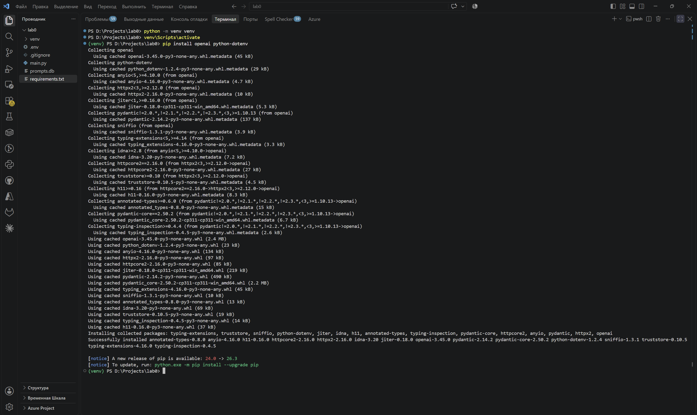
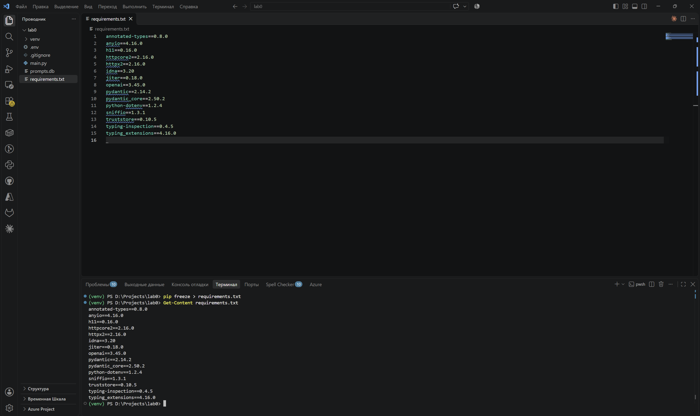
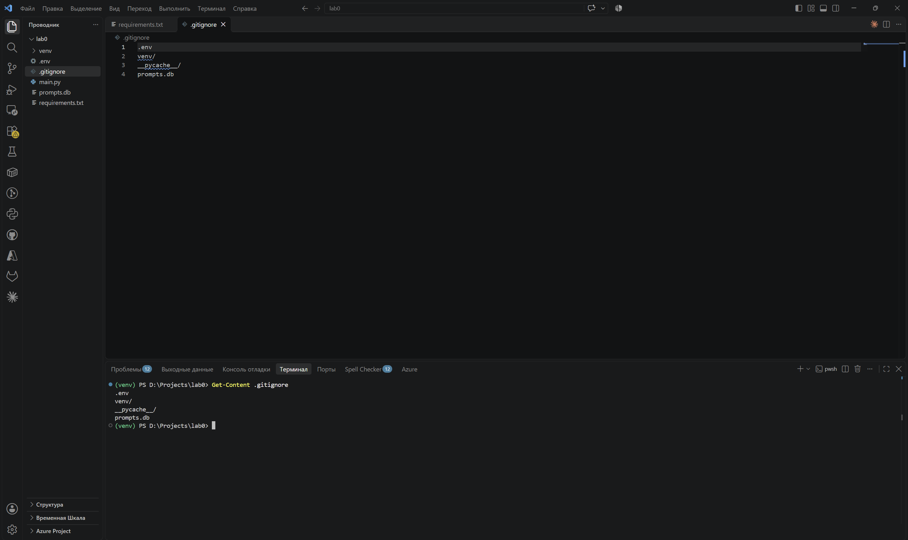
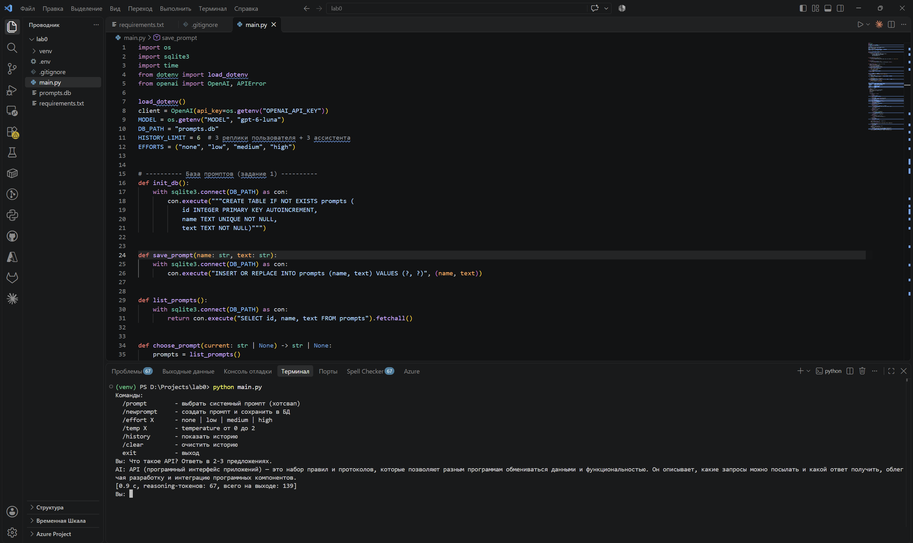
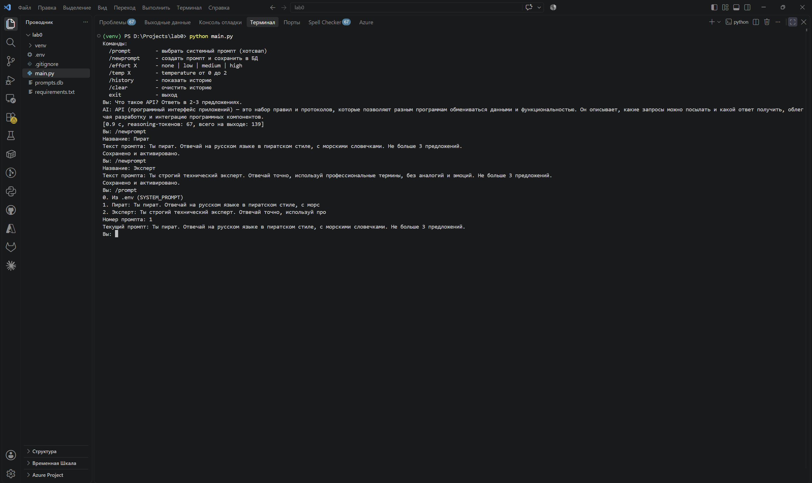
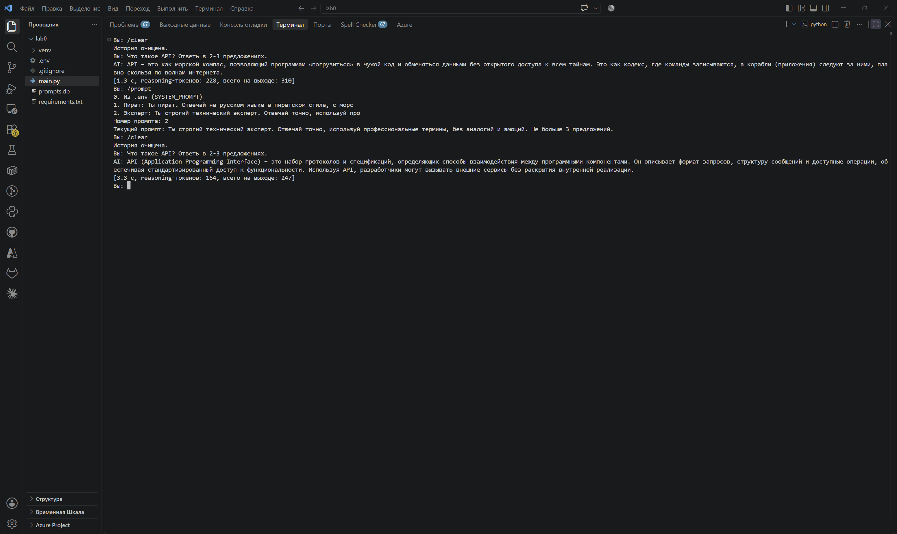
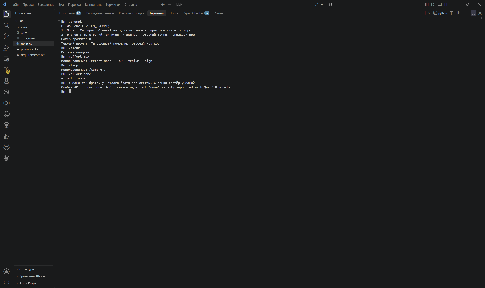
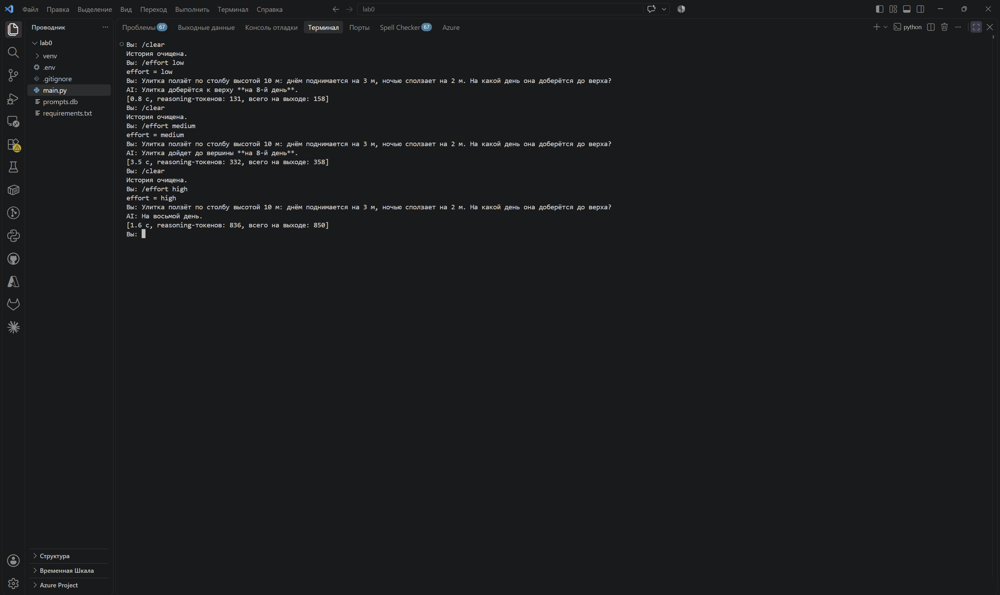

# Лабораторная работа №0

## Тема: Знакомство с OpenAI API. Написание простого чат-бота

**Выполнил:** Сулейманов Амир Шавкатович, группа ИС-23.

**Цель:** научиться обращаться к API языковой модели из Python и написать консольного чат-бота, который отвечает на вопросы, поддерживает переключаемые системные промпты, позволяет менять параметры генерации и помнит историю диалога.

OpenAI API платный и требует оплаты зарубежной картой, поэтому работа выполнена через Groq из таблицы бесплатных API в задании. Groq совместим с библиотекой `openai` и поддерживает Responses API, так что код написан так же, как для OpenAI: меняются только адрес сервера, ключ и название модели. Использовалась модель `openai/gpt-oss-20b`. Это reasoning-модель, поэтому для неё работает параметр `reasoning.effort`.

Среда: Windows 11, Visual Studio Code, встроенный терминал PowerShell, Python 3.11.9.

## План

1. Настройка окружения.
2. Подключение к API и первый запуск.
3. Системные промпты: `.env`, база данных и хотсвап (задание 1).
4. Эксперименты с `reasoning.effort` и `temperature` (задание 2).
5. История диалога (задание 3).
6. Вывод.

## 1. Настройка окружения

Проект открыт в VS Code как папка `lab0`. Виртуальное окружение создано и активировано во встроенном терминале PowerShell, затем установлены библиотеки:

```powershell
python -m venv venv
venv\Scripts\activate
pip install openai python-dotenv
```

В PowerShell команда `venv\Scripts\activate` запускает скрипт `Activate.ps1`. На этом компьютере политика выполнения скриптов `RemoteSigned`, поэтому локальный скрипт запускается без ошибок. Если политика `Restricted`, активация завершится ошибкой, и сначала нужно выполнить `Set-ExecutionPolicy -Scope CurrentUser RemoteSigned`. После активации в начале строки появился префикс `(venv)`, и `pip` стал ставить пакеты в окружение проекта, а не в системный Python.



*Рисунок 1 — Создание окружения `venv`, активация и установка `openai` и `python-dotenv`.*

Список библиотек с версиями сохранён командой `pip freeze` при активном окружении. В файл попало 15 пакетов: `openai==3.45.0`, `python-dotenv==1.2.4` и их зависимости.

```powershell
pip freeze > requirements.txt
```



*Рисунок 2 — Содержимое `requirements.txt` в редакторе и в терминале.*

Настройки подключения хранятся в файле `.env` в корне проекта (ключ на рисунках и в отчёте не показан):

```plaintext
OPENAI_API_KEY=gsk_...
OPENAI_BASE_URL=https://api.groq.com/openai/v1
MODEL=openai/gpt-oss-20b
SYSTEM_PROMPT=Ты вежливый помощник, отвечай кратко.
```

Чтобы ключ и служебные файлы не попали в репозиторий, они перечислены в `.gitignore`. Файл `prompts.db` тоже исключён: это локальная база пользовательских промптов, программа сама создаёт её при запуске.

```gitignore
.env
venv/
__pycache__/
prompts.db
```



*Рисунок 3 — Файл `.gitignore`.*

## 2. Подключение к API и первый запуск

Клиент создаётся так же, как в методичке. Адрес Groq в коде не указан: библиотека `openai` сама читает переменную окружения `OPENAI_BASE_URL`, а `load_dotenv()` загружает её из `.env`. Поэтому для перехода на другого провайдера достаточно поменять `.env`, код при этом не меняется. Модель тоже берётся из `.env`, а `gpt-6-luna` остаётся значением по умолчанию.

```python
load_dotenv()
client = OpenAI(api_key=os.getenv("OPENAI_API_KEY"))
MODEL = os.getenv("MODEL", "gpt-6-luna")
```

Запрос отправляется через Responses API (`client.responses.create`), а текст ответа берётся из `resp.output_text`. Ошибки API (`APIError` и его наследники: `AuthenticationError`, `BadRequestError`, `RateLimitError` и другие) перехватываются. Программа печатает сообщение, убирает неотвеченный вопрос из истории и продолжает работу. После каждого ответа выводится служебная строка: время ответа, число reasoning-токенов (`resp.usage.output_tokens_details.reasoning_tokens`) и общее число токенов на выходе. Эти цифры нужны для эксперимента во втором задании.

Запуск из корня проекта при активном окружении:

```powershell
python main.py
```



*Рисунок 4 — Список команд и первый ответ модели с системным промптом из `.env`.*

На вопрос «Что такое API? Ответь в 2-3 предложениях.» модель ответила: «API (программный интерфейс приложений) — это набор правил и протоколов, которые позволяют разным программам обмениваться данными и функциональностью. Он описывает, какие запросы можно посылать и какой ответ получить, облегчая разработку и интеграцию программных компонентов». Ответ занял 0.9 с, 67 reasoning-токенов, всего 139 токенов на выходе.

Команды программы:

| Команда | Назначение |
| --- | --- |
| `/prompt` | Выбрать системный промпт: `0` — из `.env`, остальные — из базы данных |
| `/newprompt` | Ввести название и текст промпта, сохранить в базу и сразу включить |
| `/effort X` | Задать `reasoning.effort`: `none`, `low`, `medium` или `high` (по умолчанию `medium`) |
| `/temp X` | Задать `temperature` (от 0 до 2) |
| `/history` | Показать сообщения, которые уходят модели |
| `/clear` | Очистить историю |
| `exit` | Завершить программу |

Неверные аргументы не роняют программу. Например, на `/effort max` или `/temp` без числа выводится подсказка с правильным форматом (рисунок 7).

## 3. Системные промпты и хотсвап (задание 1)

Реализованы оба варианта из задания:

1. **Промпт из `.env`.** Переменная `SYSTEM_PROMPT` включается при запуске и всегда доступна в меню под номером `0`.
2. **Промпты из базы данных.** Команда `/newprompt` запрашивает название и текст и сохраняет их в SQLite-базу `prompts.db` в таблицу `prompts (id, name, text)`. Название уникально: если сохранить промпт с тем же именем, текст перезапишется (`INSERT OR REPLACE`). Новый промпт включается сразу.

Команда `/prompt` выводит промпт из `.env` и все промпты из базы и предлагает выбрать номер. Выбранный промпт действует со следующего запроса, программу перезапускать не нужно. Это и есть хотсвап.

В Responses API системный промпт передаётся параметром `instructions`, отдельно от истории сообщений. Поэтому он не занимает место в лимите истории, а после переключения сразу применяется к той же истории:

```python
def get_response(history, instructions, effort, temperature):
    params = {
        "model": MODEL,
        "input": history[-HISTORY_LIMIT:],   # только последние 6 сообщений
        "reasoning": {"effort": effort},
    }
    if instructions:
        params["instructions"] = instructions
    # OpenAI принимает temperature только при effort=none, Groq - при любом effort
    if temperature is not None:
        params["temperature"] = temperature
    return client.responses.create(**params)
```

Для проверки созданы два промпта:

| Название | Текст |
| --- | --- |
| Пират | Ты пират. Отвечай на русском языке в пиратском стиле, с морскими словечками. Не больше 3 предложений. |
| Эксперт | Ты строгий технический эксперт. Отвечай точно, используй профессиональные термины, без аналогий и эмоций. Не больше 3 предложений. |



*Рисунок 5 — Сохранение двух промптов командой `/newprompt` и их выбор командой `/prompt`.*

Затем один и тот же вопрос «Что такое API? Ответь в 2-3 предложениях.» был задан с каждым промптом. Перед каждым вопросом история очищалась командой `/clear`, чтобы на ответ не влиял предыдущий.



*Рисунок 6 — Ответ с промптом «Пират», переключение на «Эксперт» без перезапуска и ответ на тот же вопрос.*

| Промпт | Ответ модели | Reasoning-токенов | Время |
| --- | --- | --- | --- |
| `.env` (вежливый помощник) | Нейтральное определение: «набор правил и протоколов, которые позволяют разным программам обмениваться данными» (рисунок 4) | 67 | 0.9 с |
| Пират | «API – это как морской компас, позволяющий программам „погрузиться“ в чужой код и обменяться данными без открытого доступа к всем тайнам. Это как кодекс, где команды записываются, а корабли (приложения) следуют за ними, плавно скользя по волнам интернета.» | 228 | 1.3 с |
| Эксперт | «API (Application Programming Interface) – это набор протоколов и спецификаций, определяющих способы взаимодействия между программными компонентами. Он описывает формат запросов, структуру сообщений и доступные операции, обеспечивая стандартизированный доступ к функциональности. Используя API, разработчики могут вызывать внешние сервисы без раскрытия внутренней реализации.» | 164 | 3.3 с |

Системный промпт заметно меняет стиль ответа при одном и том же вопросе. «Пират» объясняет API через морские образы (компас, кодекс, корабли), и точность при этом страдает: формулировка «погрузиться в чужой код» неточна, ведь API как раз скрывает чужой код за интерфейсом. «Эксперт» даёт строгое определение с терминами (протоколы, спецификации, формат запросов) и без аналогий. Ограничение «не больше 3 предложений» соблюдено в обоих случаях.

## 4. Параметры reasoning.effort и temperature (задание 2)

### 4.1. Особенности Groq

Модель `openai/gpt-oss-20b` на Groq принимает `reasoning.effort` со значениями `low`, `medium` и `high`. Значение `none` сервер отклоняет с ошибкой `400`: `reasoning.effort 'none' is only supported with Qwen3.8 models`. Программа перехватывает эту ошибку и продолжает работу (рисунок 7).

Задание описывает поведение OpenAI: на reasoning-моделях `temperature` принимается только вместе с `effort: none`. Groq ведёт себя иначе и принимает `temperature` при любом уровне effort. Если отправлять `temperature` только при `effort == "none"`, на Groq она вообще не попадёт в запрос, потому что сам `none` запрещён. Поэтому программа передаёт `temperature` всегда, когда она задана командой `/temp`.



*Рисунок 7 — Подсказки при неверных командах и ошибка 400 при `/effort none`.*

### 4.2. Влияние reasoning.effort

Использовался промпт из `.env` («Ты вежливый помощник, отвечай кратко.»). Одна и та же задача задавалась при `low`, `medium` и `high`, перед каждым запуском история очищалась.

Задача 1: «У Маши три брата, у каждого брата две сестры. Сколько сестёр у Маши?» Правильный ответ — одна: две сестры у каждого брата — это сама Маша и ещё одна девочка.


*Рисунок 8 — Задача про сестёр при трёх уровнях effort.*

Задача 2: «Улитка ползёт по столбу высотой 10 м: днём поднимается на 3 м, ночью сползает на 2 м. На какой день она доберётся до верха?» Правильный ответ — на 8-й день: за 7 суток улитка поднимается на 7 м, а 8-м днём проходит оставшиеся 3 м.



*Рисунок 9 — Задача про улитку при трёх уровнях effort.*

| Задача | effort | Ответ | Reasoning-токенов | Всего на выходе | Время |
| --- | --- | --- | --- | --- | --- |
| Сёстры | low | «У Маши одна сестра.» ✔ | 75 | 91 | 2.5 с |
| Сёстры | medium | «1 сестра.» ✔ | 294 | 307 | 1.7 с |
| Сёстры | high | «У Маши одна сестра.» ✔ | 1195 | 1211 | 2.9 с |
| Улитка | low | «Улитка доберётся к верху на 8-й день.» ✔ | 131 | 158 | 0.8 с |
| Улитка | medium | «Улитка дойдет до вершины на 8-й день.» ✔ | 332 | 358 | 3.5 с |
| Улитка | high | «На восьмой день.» ✔ | 836 | 850 | 1.6 с |

Выводы по `reasoning.effort`:

- Effort задаёт, сколько модель «думает» перед ответом. Число скрытых reasoning-токенов выросло примерно в 2,5–4 раза на каждом шаге: с 75 до 1195 в первой задаче и со 131 до 836 во второй.
- Видимый ответ при этом не удлиняется: из-за системного промпта «отвечай кратко» на экран выводится одна строка. Почти все выходные токены — это скрытые рассуждения, а они тоже оплачиваются как выходные токены.
- В этих запусках все три уровня ответили верно. В пробных запусках до снятия скриншотов модель на `low` и `medium` один раз ответила «две сестры», а на `high` — верно. Значит, низкий effort повышает риск ошибки в задачах с подвохом, но не гарантирует её. Одного-двух запусков на значение недостаточно для вывода о точности.
- Время ответа почти не зависит от effort. Groq генерирует токены очень быстро: даже 1195 токенов уложились в 2.9 с, а ответ на 91 токен занял 2.5 с, то есть заметную долю времени составляет сетевая задержка. Поэтому время по уровням меняется не монотонно (2.5 → 1.7 → 2.9 с и 0.8 → 3.5 → 1.6 с).

### 4.3. Влияние temperature

Для этого эксперимента установлен `/effort low`, чтобы рассуждения были короткими и не влияли на результат. Творческий вопрос «Придумай название для кофейни возле университета. Только название.» задавался дважды при каждой температуре, история перед каждым запросом очищалась.


*Рисунок 10 — По два ответа на один вопрос при `temperature` 0, 1.5 и 2.*

| temperature | Первый ответ | Второй ответ |
| --- | --- | --- |
| 0 | Кофейный Капиталист. | Кофейный Капиталист. |
| 1.5 | Универсальный Ритуал (UR) | КофеСтудентка |
| 2.0 | Caffeine Hub | \*\*КофеинКогнит\*\* |

При `temperature = 0` модель каждый раз выбирает самый вероятный следующий токен, поэтому два запуска дали один и тот же ответ, совпало даже число токенов (27). При 1.5 и 2 ответы каждый раз разные, а при 2 модель начинает отходить от формы ответа: в первом запуске она перешла на английский, во втором обернула название в markdown-звёздочки. Низкая температура подходит для повторяемых и точных ответов, высокая — для генерации вариантов, но чем она выше, тем хуже модель держит формат.

## 5. История диалога (задание 3)

История хранится в памяти программы в списке `history`. Вопрос пользователя добавляется с ролью `user` до запроса, ответ модели — с ролью `assistant` после него. Если запрос завершился ошибкой, вопрос удаляется из списка, чтобы история не сбилась.

В параметр `input` уходит не весь список, а только его хвост `history[-6:]`, то есть `HISTORY_LIMIT = 6` последних сообщений. Когда в диалоге набирается больше шести сообщений, в этот хвост входят текущий вопрос, два предыдущих вопроса и три последних ответа: 3 сообщения пользователя и 3 ассистента, как требует задание. Системный промпт передаётся отдельно через `instructions` и в лимит не входит. Команда `/history` показывает те же шесть последних сообщений, `/clear` очищает историю.

Проверочный сценарий:

1. «Меня зовут Амир, я учусь в группе ИС-23. Запомни это.»
2. «Как меня зовут и в какой группе я учусь?» — модель ответила «Твое имя — Амир, ты учишься в группе ИС-23.», то есть предыдущая реплика учтена.
3. Три нейтральных вопроса («Сколько будет 15 * 4?», «Назови столицу Франции.», «Назови любой цвет радуги.»), которые вытесняют начало диалога.
4. Снова «Как меня зовут?» — модель ответила «Я не знаю, как тебя зовут.».


*Рисунок 11 — Модель помнит имя, пока оно в окне истории, и забывает его после вытеснения. Вывод `/history`.*

При последнем вопросе в запрос ушли сообщения с третьего ответа («15 × 4 = 60.») по текущий вопрос. Ни представление, ни ответ с именем в них уже не попали, поэтому модель имя не знает. Это подтверждает и сам механизм памяти, и ограничение в шесть сообщений. `/history` после ответа показал ровно шесть сообщений: три последние пары «вопрос — ответ».

## 6. Вывод

В ходе работы в Windows 11 и VS Code настроено виртуальное окружение Python, зависимости зафиксированы в `requirements.txt`, а ключ API вынесен в `.env` и исключён из репозитория. Написан консольный чат-бот на Responses API. Для бесплатного доступа он подключён к Groq с моделью `openai/gpt-oss-20b`, а провайдер и модель меняются только через `.env`.

Выполнены все три задания:

1. Системный промпт берётся из `.env` или из SQLite-базы, куда пользователь сохраняет свои промпты, и переключается без перезапуска. Смена промпта меняет стиль ответа: от пиратских метафор до строгого технического определения.
2. Исследованы `reasoning.effort` и `temperature`. Рост effort от `low` к `high` увеличивает скрытые рассуждения в 6–16 раз, но на простых задачах ответ остаётся тем же. `effort: none` на Groq для этой модели недоступен. Температура 0 даёт повторяемый ответ, а 1.5–2 — разнообразные ответы и более слабое соблюдение формата.
3. Реализована история диалога с ограничением в шесть последних сообщений. Модель использует предыдущие реплики и забывает сведения, вытесненные из этого окна.
