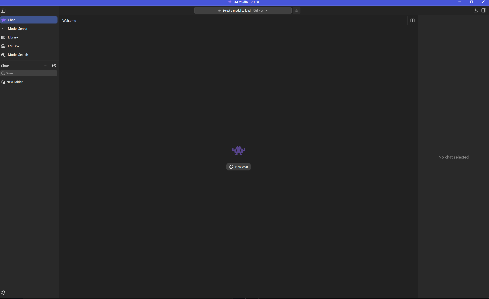
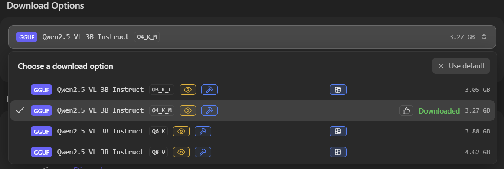
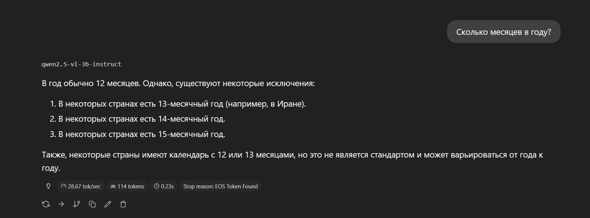
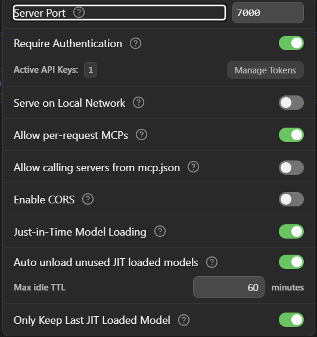
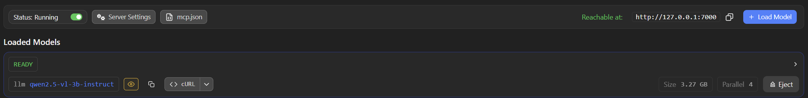
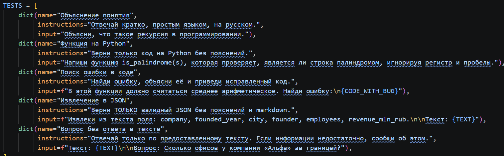
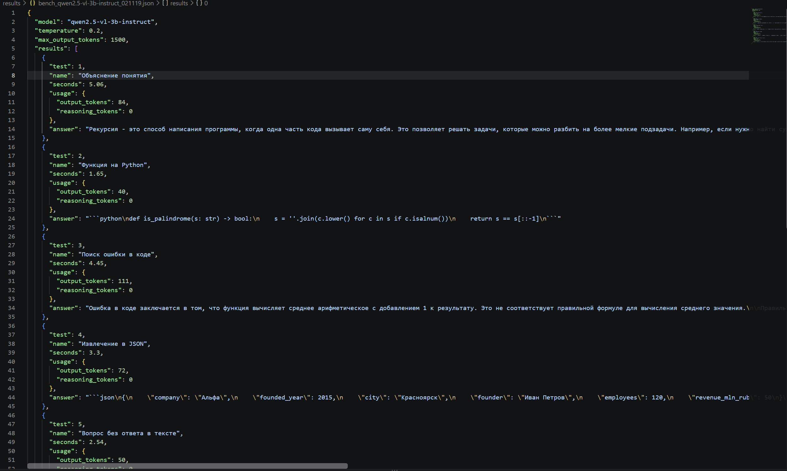
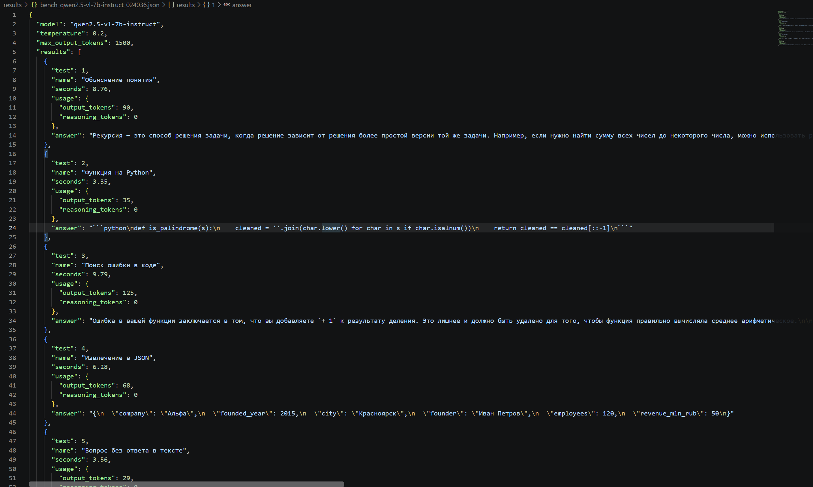
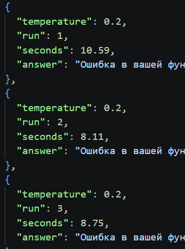
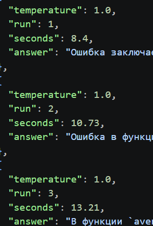

# Лабораторная работа № 1

## Эксплуатация локальной языковой модели

**Дисциплина:** Технологии программирования  
**Студент:** Сулейманов Амир Шавкатович 
**Группа:** ИС-23  
**ОС:** Windows  
**Язык:** Python 3.14.3

## 1. Цель работы

Цель работы — попробовать запустить языковые модели на своём компьютере через LM Studio, подключиться к ним из Python и сравнить результаты.

По заданию нужно выбрать две модели, проверить их на пяти запросах и отдельно посмотреть, как на ответы влияет температура.

## 2. Характеристики компьютера

| Компонент | Характеристика |
|---|---|
| Процессор | AMD Ryzen AI 9 HX 370 w/ Radeon 890M |
| Оперативная память | 32 ГБ |
| Графика | AMD Radeon Graphics |
| Свободное место | 145 ГБ |

## 3. Выбор моделей и LM Studio

Для работы я выбрал две модели с Hugging Face:

| Модель | Квантование | Размер файла |
|---|---|---|
| Qwen2.5-vl-3b-instruct | Q4_K_M | 3,27 ГБ |
| Qwen2.5-vl-7b-instruct | Q4_K_M | 6,04 ГБ |

Сначала я установил LM Studio и нашёл первую модель через **Model Search**. При выборе файла стояло квантование `Q4_K_M`. Я решил его оставить, поэтому вторую модель тоже скачал в `Q4_K_M`, чтобы сравнивать в одинаковом варианте.

*Рисунок 1 — LM Studio после установки.*

*Рисунок 2 — Первая выбранная модель.*

Для начала я проверил её прямо в чате сделал небольшую проверку на работоспособность. Полученный ответ правильный.

*Рисунок 3 — Проверка модели в чате.*

После этого скачал вторую модель. И сделал такую же проверку.

## 4. Настройка локального сервера

В разделе **Model Server** я поставил порт `7000`, включил **Require Authentication** и создал API-токен.

*Рисунок 4 — Настройки локального сервера.*

После запуска сервер показывал статус `Running`, а модель — `READY`. Модели загружал по очереди, чтобы не держать обе одновременно в памяти.

## 5. Локальные эксперементы
Набор из пяти запросов для проверки моделей

Выполнил одинаковые запросы к обеим моделям через локальный API. Для каждой модели зафиксировать название, число параметров, вариант квантования и настройки запуска.

*Рисунок 7 — Файл с вопросами 1.*

*Рисунок 8 — Файл с вопросами 2.*

## 6. Исследование влияния температуры

Выбрал запрос номер 3 и выполнил его по три раза при температуре 0.2 и 1.0, сохранив остальные параметры.

При температуре 0.2:

*Рисунок 9 — Температура 0.2*

При температуре 1.0:

*Рисунок 10 — Температура 1.0*

| Температура | Запуск 1 | Запуск 2 | Запуск 3 | Среднее |
|---|---:|---:|---:|---:|
| 0.2 | 10.59 с | 8.11 с | 8.75 с | **9,15 с** |
| 1.0 | 8.4 с | 10.73 с | 13.21 с | **10,78 с** |

При `0.2` ответы были более похожими по времени и содержанию.

При `1.0` ответы отличались сильнее. Встречались неточности в объяснении.

По этим шести запускам у меня получилось, что для простого объяснения температура `0.2` удобнее. Но это небольшая проверка, поэтому такой результат не обязательно будет для всех запросов.

## 8. Вывод

В этой лабораторной я установил LM Studio, скачал две модели, настроил локальный сервер с API-токеном и отправил запросы к моделям из Python. Провёл пять одинаковых тестов для каждой модели и шесть запусков с разной температурой.

Обе модели справились с простым Python-кодом и исправлением ошибки. При этом иногда они не соблюдали формат ответа и допускали неточности. На моём компьютере **Qwen2.5-vl-3b-instruct оказалась удобнее**, потому что в этих тестах работала быстрее и занимала меньше памяти.