# Лабораторная работа № 3

**Дисциплина:** Технологии программирования  
**Тема:** Интеграция RAG в рабочий процесс языковой модели  
**Выполнила:** Тихомирова Екатерина Юрьевна  

## 1. Цель и постановка задачи

Изучить организацию поиска по базе знаний с последующей генерацией ответа языковой моделью. Реализовать классический RAG и один дополнительный метод, предоставить доступ к ним через API и разделить приложение на уровни работы с базой данных, логики и API.

Для работы выбрана документация учебной системы телеметрии. Тематика связана с дипломной задачей обнаружения аномалий телеметрических данных и сравнения методов машинного обучения с пороговым контролем. В этой лабораторной разработан помощник по документам: обучение модели обнаружения аномалий и экспериментальное сравнение методов в ее состав не входят.

В качестве дополнительного метода реализован локальный вариант CRAG: после векторного поиска языковая модель оценивает пригодность каждого фрагмента. Для ответа используются только фрагменты, прошедшие отбор. Внешний поиск в этой реализации не выполняется.

## 2. Средства разработки и настройка моделей

Использованы Python 3.14, FastAPI, Uvicorn, Pydantic, Qdrant Client, python-docx, Transformers, HTTPX, библиотека OpenAI и python-dotenv. Зависимости установленного окружения сохранены в `requirements.txt`.

Векторы строит локальная модель `text-embedding-bge-m3`. Ответы и оценки фрагментов формирует `qwen2.5-1.5b-instruct`. Обращения выполняются к OpenAI-совместимому API LM Studio по адресу `http://127.0.0.1:1234/v1`.

Первоначально проверялась Qwen3.5 4B, однако запросы завершались превышением времени ожидания. При работе наблюдалась высокая загрузка оперативной памяти: на ноутбуке установлено 8 ГБ, из которых системе доступно около 6,9 ГБ. Для дальнейших проверок выбрана меньшая Qwen2.5 1.5B.

Параметры подключения хранятся в `.env`. Файл с настоящим ключом доступа исключен из Git. Для запросов к моделям установлен тайм-аут 120 секунд, для генерации текста и структурированных оценок `temperature=0`. Автоматические повторные запросы клиента OpenAI отключены.

## 3. База знаний и структура проекта

Подготовлены пять документов Word с описанием вымышленного учебного стенда. Они не содержат производственных данных предприятия или полученных результатов исследования.

| Документ | Содержание |
| --- | --- |
| `01_platform.docx` | Назначение платформы, состав измерений и отображение данных |
| `02_sensors.docx` | Коды датчиков, величины и единицы измерения |
| `03_quality.docx` | Устаревание измерений, пропуски, повторы и разделение выборок |
| `04_anomalies.docx` | Пороговый контроль, Isolation Forest и метрики оценки |
| `05_diagnostics.docx` | Порядок проверки данных, журнал и таблица диагностических событий |

Документы размещены в `docs/source/`. Скрипт `scripts/create_documents.py` создает исходные файлы. Пороговые значения и диагностические коды в них относятся только к учебному примеру.

Приложение разделено на следующие части:

| Файл или каталог | Назначение |
| --- | --- |
| `app/config.py` | Чтение настроек и определение путей |
| `app/clients/embeddings.py` | Получение и нормализация эмбеддингов |
| `app/clients/llm.py` | Обычная генерация и запросы со строгой JSON-схемой |
| `app/db/vector_store.py` | Создание коллекции Qdrant, запись и поиск точек |
| `app/logic/documents.py` | Чтение абзацев и таблиц Word |
| `app/logic/chunking.py` | Разбиение текста по токенам |
| `app/logic/retrieval.py` | Построение вектора вопроса и обращение к поиску |
| `app/logic/rag.py` | Классический RAG |
| `app/logic/grading.py` | Оценка фрагмента и проверка подтверждающей цитаты |
| `app/logic/crag.py` | Отбор фрагментов и подготовка ответа CRAG |
| `app/logic/assistant.py` | Выбор режима обработки |
| `app/schemas.py` | Схемы запросов и ответов API |
| `app/main.py` | Маршрут API и обработка ошибок |
| `scripts/` | Подготовка, индексация и ручные проверки |

Обработчик API передает запрос логическому слою. Логика поиска обращается к клиенту эмбеддингов и слою базы данных. HTTP-обработчик не выполняет векторные операции самостоятельно.

## 4. Подготовка и индексация документов

### 4.1. Чтение и разбиение

Из Word извлекаются непустые абзацы и таблицы в порядке их расположения. Ячейки строки таблицы соединяются символом `|`, строки сохраняются рядом. Блоки документа объединяются с разделением пустой строкой.

Для нарезки используется токенайзер `BAAI/bge-m3`. Максимальный размер фрагмента составляет 600 токенов, перекрытие 60 токенов. По позициям токенов в исходной строке извлекается обычный текст без специальных токенов модели.

Фрагменты сохраняются в `docs/temp/` как текстовые файлы, а сведения о них в `chunks.json`. Каждый исходный документ оказался короче 600 токенов, поэтому в данном наборе получено по одному фрагменту на документ. Перекрытие между несколькими фрагментами на этих файлах не проверялось.

| Документ | Число фрагментов | Число токенов в фрагменте |
| --- | --- | --- |
| `01_platform.docx` | 1 | 180 |
| `02_sensors.docx` | 1 | 154 |
| `03_quality.docx` | 1 | 133 |
| `04_anomalies.docx` | 1 | 222 |
| `05_diagnostics.docx` | 1 | 213 |

### 4.2. Получение векторов и запись в Qdrant

Предварительный запрос к модели эмбеддингов вернул вектор размерностью 1024. Эмбеддинги фрагментов рассчитываются пакетами и нормализуются до единичной длины.

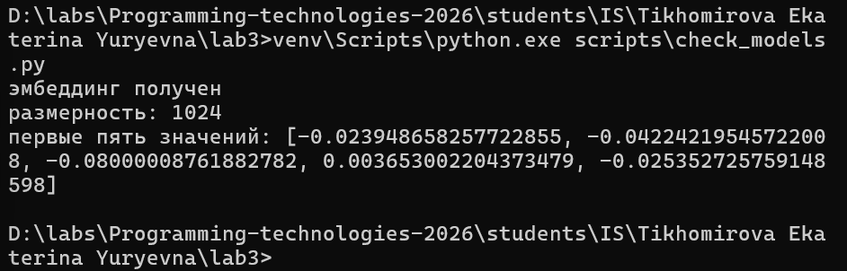

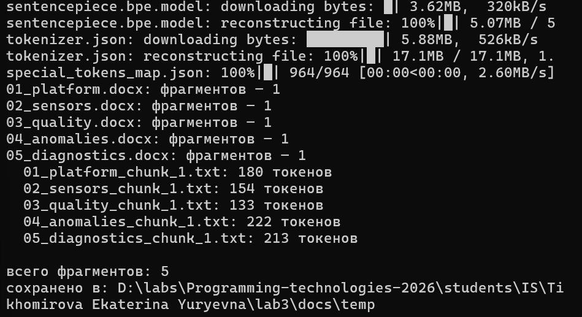

Qdrant работает в локальном режиме и хранит данные в каталоге `qdrant/`. Docker и отдельный сервер базы не используются. В коллекцию `telemetry_docs` записываются вектор, имя исходного документа, номер фрагмента, текст и идентификатор модели эмбеддингов. Размерность коллекции определяется по полученным векторам, мера сходства косинусная.

При повторной индексации коллекция пересоздается, чтобы старая нарезка не смешивалась с новой. Записаны пять точек размерностью 1024. Клиент Qdrant закрывается после операции.

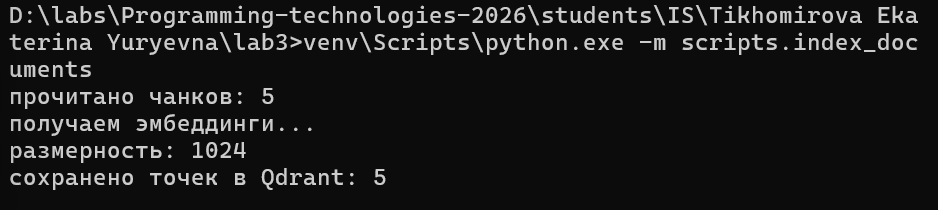

## 5. Классический RAG

Вопрос пользователя преобразуется в вектор той же моделью bge-m3. Поиск возвращает ближайшие фрагменты с текстом, источником, номером и оценкой сходства. По умолчанию выбираются три результата, число можно изменить параметром `limit`.

При поиске по вопросу «когда измерение считается устаревшим?» первым найден `03_quality.docx` со сходством около 0,6457. В нем записано правило: измерение устаревает, когда с момента последнего полученного измерения прошло более 60 секунд. Ровно 60 секунд еще не считается превышением.

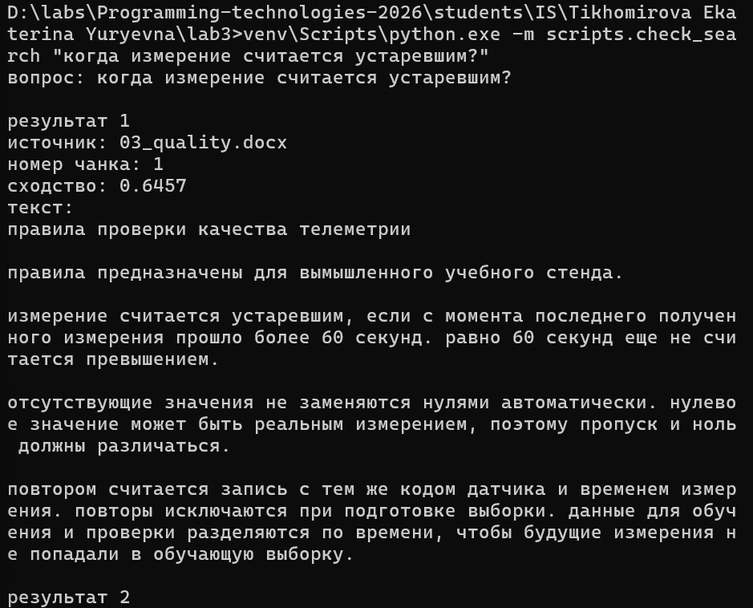

Найденные тексты передаются Qwen вместе с вопросом и системной инструкцией. Поиск вызывает программный код для каждого вопроса; модель не выбирает инструмент поиска самостоятельно. Числа `score` остаются в результате приложения для анализа и не передаются в промпт.

В одном из консольных запусков модель правильно сформулировала условие устаревания.

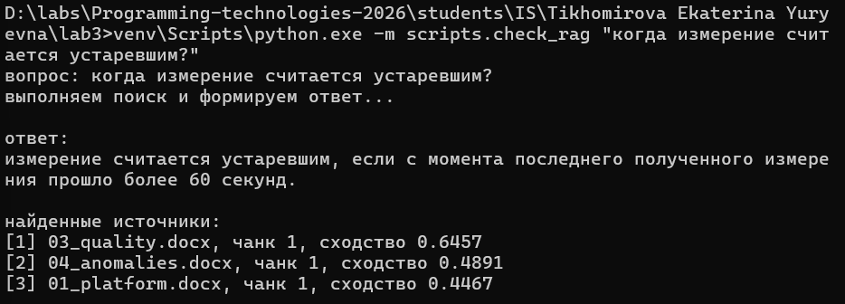

Дополнительные вопросы выявили ограничения генерации. На вопрос о ровно 60 секундах в одном из запусков получен неверный ответ "устаревшим", хотя нужный документ найден. На вопрос о численных значениях precision и recall модель сообщила об отсутствии ответа: результатов эксперимента в базе действительно нет.

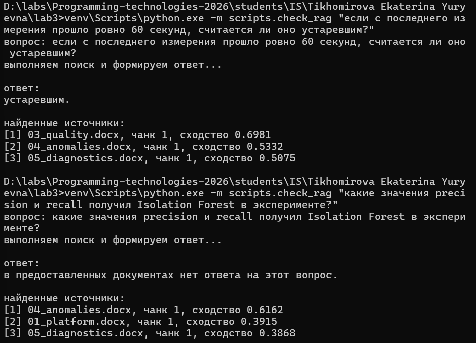

При итоговой проверке RAG через API с `limit=1` сервер вернул `200`. Ответ содержал правильное условие, но после него модель добавила противоречащую фразу об отсутствии ответа в документах. Следовательно, успешный HTTP-ответ и правильный поиск не гарантируют смысловую корректность генерации.

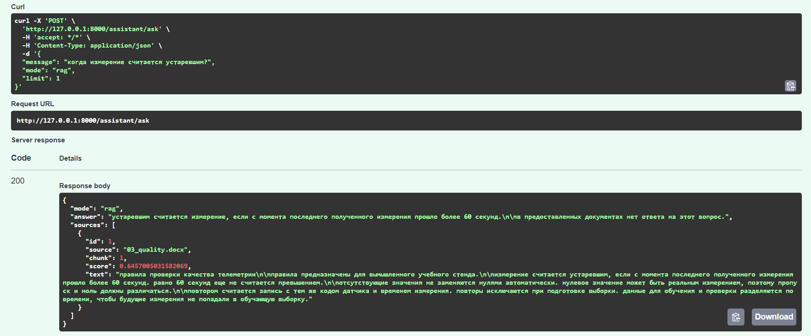

## 6. Реализация CRAG

В режиме CRAG после поиска каждый фрагмент отдельно передается той же языковой модели вместе с исходным вопросом. Оценщик должен сначала извлечь точную цитату, затем указать оценку и обоснование.

| Поле | Назначение |
| --- | --- |
| `evidence` | Точная цитата из фрагмента или `null` |
| `grade` | `relevant`, `partial` или `irrelevant` |
| `reason` | Непустое текстовое обоснование |

`relevant` означает, что фрагмент позволяет ответить на весь вопрос. `partial` предназначен для случая, когда есть ответ только на часть составного вопроса. `irrelevant` означает отсутствие необходимых сведений.

Формат задается не только текстом инструкции: схема Pydantic передается в `response_format` типа `json_schema` с параметром `strict=true` через Chat Completions API. Все три поля обязательны, дополнительные поля запрещены. Полученный JSON повторно проверяется приложением.

Для оценок `relevant` и `partial` обязательна цитата, для `irrelevant` требуется `evidence=null`. Дополнительно проверяется наличие цитаты в исходном фрагменте после нормализации пробельных символов. Эта проверка обнаруживает отсутствующую в тексте цитату, но не доказывает, что она отвечает на вопрос.

В итоговой реализации применяется осторожный отбор: для генерации используются только цитаты из фрагментов с оценкой `relevant`. Фрагменты `partial` и `irrelevant` исключаются. Некорректный результат оценщика получает техническую отметку `invalid` и также не используется. Ошибка оценки отдельного фрагмента не прерывает проверку остальных.

Если подходящих цитат нет, приложение возвращает сообщение о недостатке подтвержденных сведений без вызова итоговой генерации. Если пригодные цитаты есть, Qwen формирует по ним ответ. Внешний поиск и автоматическое исправление запроса в данном варианте не реализованы.

### 6.1. Вопрос с ответом в базе

Для вопроса об устаревании измерения из документа `03_quality.docx` извлечена цитата с условием «более 60 секунд». Она получила `relevant` и использована для ответа. Часть других оценок не прошла проверку либо получила `partial` и не была использована.

На рисункt 14 показана часть ответа API. Скриншоты в отчете относятся к нескольким запускам; оценки отдельных дополнительных фрагментов между запусками могли различаться. Ниже приведен полный JSON одного из итоговых ответов без исправления текста модели.

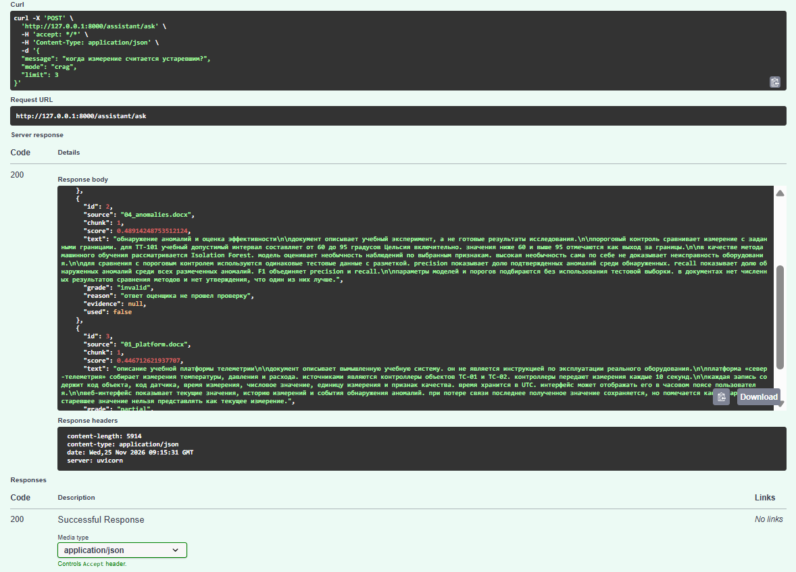

```json
{
  "mode": "crag",
  "answer": "измение считается устаревшим, если с момента последнего полученного измерения прошло более 60 секунды.",
  "sources": [
    {
      "id": 1,
      "source": "03_quality.docx",
      "chunk": 1,
      "score": 0.6457005031582069,
      "text": "правила проверки качества телеметрии\n\nправила предназначены для вымышленного учебного стенда.\n\nизмерение считается устаревшим, если с момента последнего полученного измерения прошло более 60 секунд. равно 60 секунд еще не считается превышением.\n\nотсутствующие значения не заменяются нулями автоматически. нулевое значение может быть реальным измерением, поэтому пропуск и ноль должны различаться.\n\nповтором считается запись с тем же кодом датчика и временем измерения. повторы исключаются при подготовке выборки. данные для обучения и проверки разделяются по времени, чтобы будущие измерения не попадали в обучающую выборку.",
      "grade": "relevant",
      "reason": "документ содержит информацию о том, когда измерение считается устаревшим.",
      "evidence": "измерение считается устаревшим, если с момента последнего полученного измерения прошло более 60 секунд.",
      "used": true
    },
    {
      "id": 2,
      "source": "04_anomalies.docx",
      "chunk": 1,
      "score": 0.48914248753512124,
      "text": "обнаружение аномалий и оценка эффективности\n\nдокумент описывает учебный эксперимент, а не готовые результаты исследования.\n\nпороговый контроль сравнивает измерение с заданными границами. для TT-101 учебный допустимый интервал составляет от 60 до 95 градусов Цельсия включительно. значения ниже 60 и выше 95 отмечаются как выход за границы.\n\nв качестве метода машинного обучения рассматривается Isolation Forest. модель оценивает необычность наблюдений по выбранным признакам. высокая необычность сама по себе не доказывает неисправность оборудования.\n\nдля сравнения с пороговым контролем используются одинаковые тестовые данные с разметкой. precision показывает долю подтвержденных аномалий среди обнаруженных. recall показывает долю обнаруженных аномалий среди всех размеченных аномалий. F1 объединяет precision и recall.\n\nпараметры моделей и порогов подбираются без использования тестовой выборки. в документах нет численных результатов сравнения методов и нет утверждения, что один из них лучше.",
      "grade": "invalid",
      "reason": "ответ оценщика не прошел проверку",
      "evidence": null,
      "used": false
    },
    {
      "id": 3,
      "source": "01_platform.docx",
      "chunk": 1,
      "score": 0.446712621937707,
      "text": "описание учебной платформы телеметрии\n\nдокумент описывает вымышленную учебную систему. он не является инструкцией по эксплуатации реального оборудования.\n\nплатформа «север-телеметрия» собирает измерения температуры, давления и расхода. источниками являются контроллеры объектов ТС-01 и ТС-02. контроллеры передают измерения каждые 10 секунд.\n\nкаждая запись содержит код объекта, код датчика, время измерения, числовое значение, единицу измерения и признак качества. время хранится в UTC. интерфейс может отображать его в часовом поясе пользователя.\n\nвеб-интерфейс показывает текущие значения, историю измерений и события обнаружения аномалий. при потере связи последнее полученное значение сохраняется, но помечается как устаревшее. устаревшее значение нельзя представлять как текущее измерение.",
      "grade": "partial",
      "reason": "документ указывает, что время хранится в UTC и интерфейс показывает время в часовом поясе пользователя, но не конкретизирует когда измерение считается устаревшим.",
      "evidence": "время хранится в UTC. интерфейс может отображать его в часовом поясе пользователя.",
      "used": false
    }
  ]
}
```

В ответе сохранено нужное условие, но присутствуют опечатка «измение» и ошибка согласования "60 секунды". Оценка `partial` для цитаты о UTC также неточна: сведения о часовом поясе не отвечают на вопрос об устаревании. Такой фрагмент исключен из итогового контекста, однако сам оценщик нельзя считать полностью надежным.

### 6.2. Отсутствие результатов эксперимента

Передан вопрос: «какие значения precision и recall получил Isolation Forest в эксперименте?». Поиск нашел документ об аномалиях, но численных результатов в нем нет. Оценщик ошибочно отнес определение метрики к `partial`. Поскольку частичные и неподходящие результаты не используются для генерации, приложение сообщило о недостатке подтвержденных сведений. Числа не были придуманы.

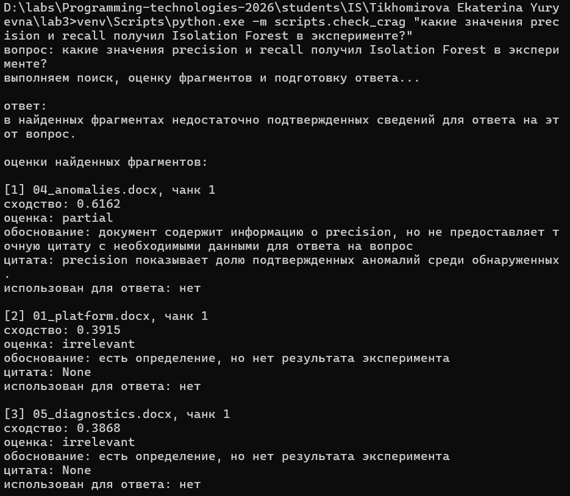

## 7. API и обработка ошибок

Реализован маршрут `POST /assistant/ask`. Тело запроса содержит:

| Поле | Ограничения |
| --- | --- |
| `message` | Обязательная строка от 1 до 4000 символов; строка из пробелов отклоняется |
| `mode` | `rag` или `crag`, по умолчанию `rag` |
| `limit` | Целое число от 1 до 20, по умолчанию 3 |

Пример запроса:

```json
{
  "message": "когда измерение считается устаревшим?",
  "mode": "crag",
  "limit": 3
}
```

Ответ содержит режим, текст ответа и найденные источники. Для CRAG дополнительно возвращаются оценка, обоснование, цитата и признак `used`. В RAG список источников показывает результаты поиска; наличие источника в этом списке само по себе не означает, что ответ правильно использует его содержание.

Запросы проверялись вручную через Swagger UI. Подтверждены следующие результаты:

| Сценарий | Результат |
| --- | --- |
| Обычный запрос в режиме RAG | `200`, ответ и найденный источник; обнаружено противоречие в тексте ответа |
| Обычный запрос в режиме CRAG | `200`, ответ и результаты отбора фрагментов |
| Сообщение из трех пробелов | `422`, ошибка проверки поля `message` |
| Выключенный сервер LM Studio | `503`, код `model_unavailable` |

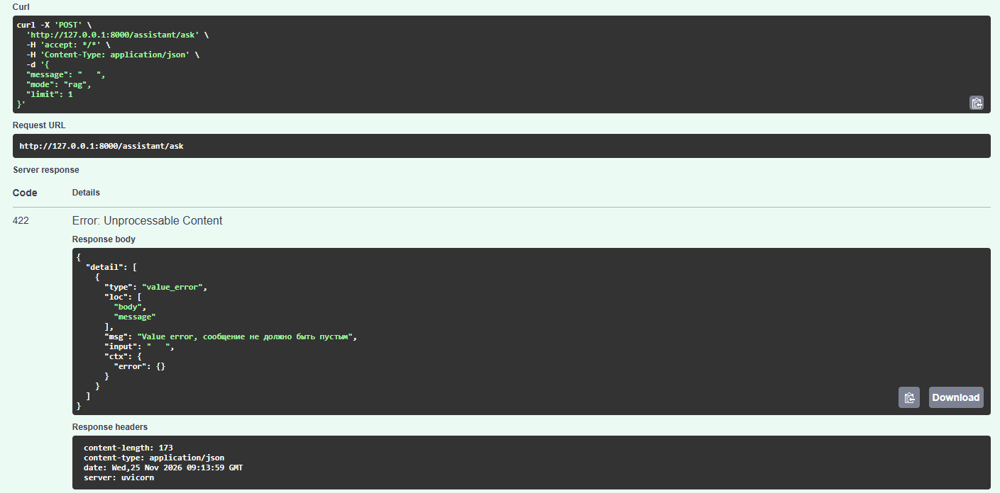

При выключенном сервере LM Studio получен следующий ответ:

```json
{
  "detail": {
    "code": "model_unavailable",
    "message": "не удалось подключиться к серверу моделей"
  }
}
```

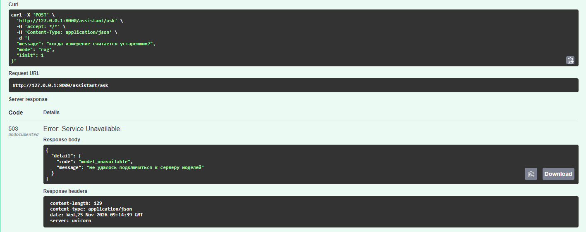

В обработчике также предусмотрены ответы `504` при тайм-ауте, `502` при ошибке сервиса моделей или проверки результата и `500` при непредвиденной внутренней ошибке. Отдельные итоговые проверки этих трех HTTP-кодов в данной работе не зафиксированы. Надпись `Undocumented` рядом с `503` в Swagger означает, что дополнительный ответ не описан в схеме маршрута; фактический код сервера показан в разделе Server response.

Консольные скрипты использовались для ручного запуска реальных запросов. Они не являются набором автоматических тестов с проверкой всех ожидаемых ответов.

## 8. Вывод

Реализованы чтение Word-документов, разбиение по токенам, получение эмбеддингов, сохранение и поиск в Qdrant, генерация ответов классическим RAG и локальный вариант CRAG. Работа с базой данных, логика обработки и API разделены по файлам и каталогам.

Проверки подтвердили индексацию пяти фрагментов, нахождение нужного документа, работу обоих режимов через API, отклонение пустого сообщения и обработку недоступности сервера моделей. В проверенном случае отсутствия результатов эксперимента CRAG вернул сообщение о недостатке подтвержденных сведений.

Выявлены ограничения небольшой языковой модели: ошибки понимания границ условий, неточные оценки пригодности, опечатки и противоречивые формулировки. Строгая JSON-схема, проверка цитат и отбор ограничивают использование некорректных результатов, но не гарантируют смысловую точность. Численное сравнение качества RAG и CRAG на отдельной размеченной выборке не проводилось.
