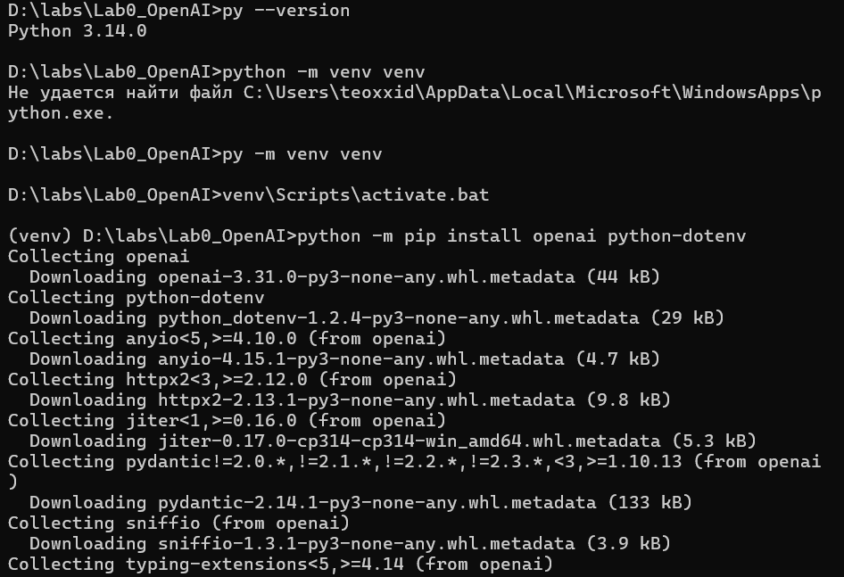
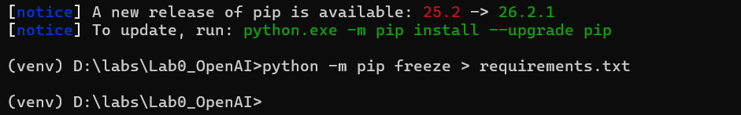
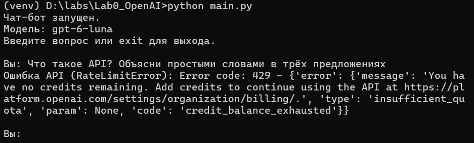
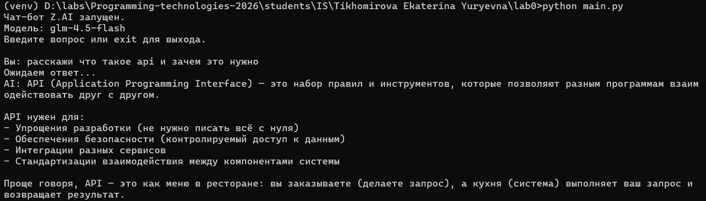
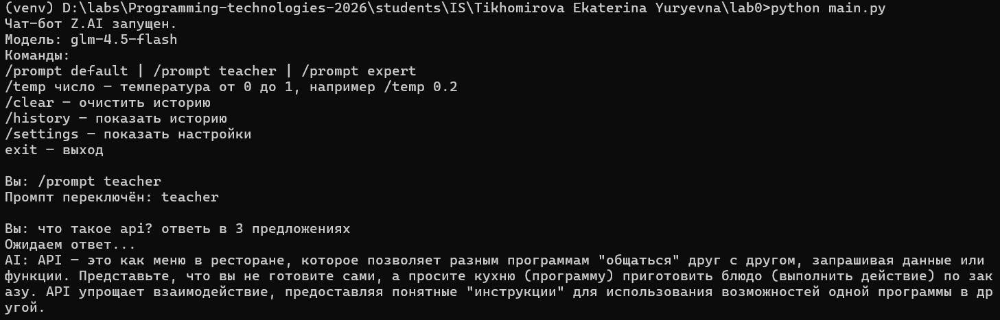
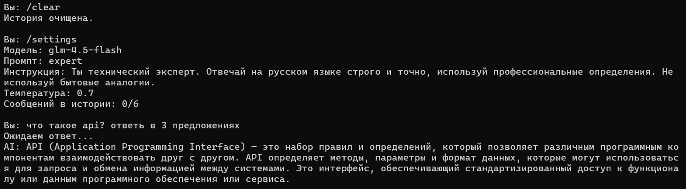
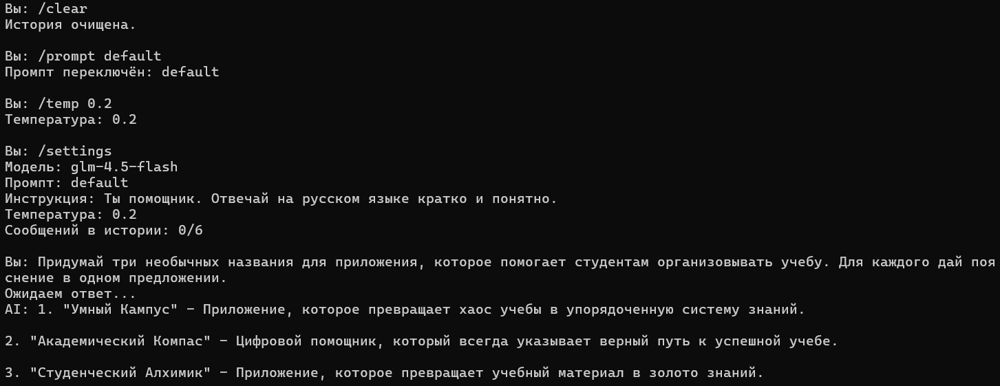
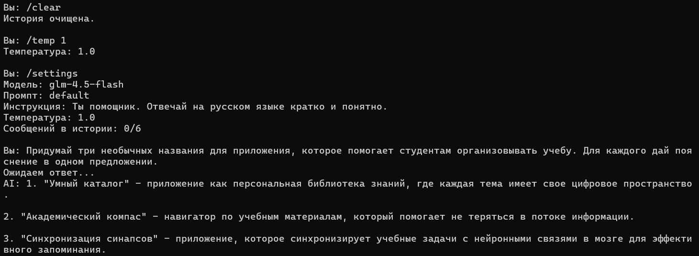
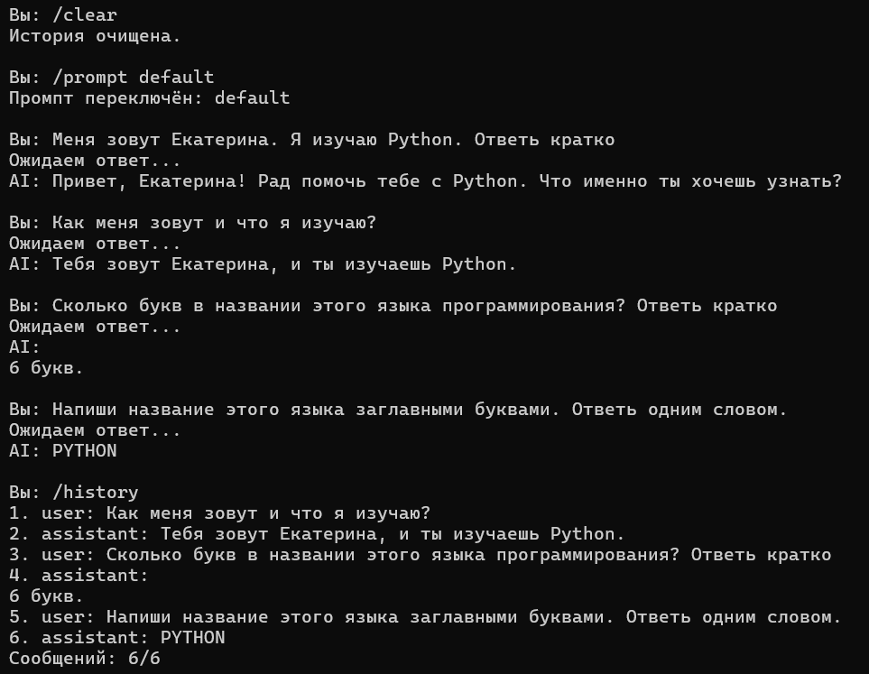

# Лабораторная работа №0

## Тема: Знакомство с OpenAI API. Написание простого чат-бота

**Выполнила:** Тихомирова Екатерина Юрьевна.

**Цель:** освоить обращение к API языковой модели из Python и создать консольного чат-бота, который отвечает на вопросы, поддерживает системные инструкции и учитывает историю диалога.

В начале работы использовался OpenAI Responses API. После получения ошибки об отсутствии средств работа была продолжена с Z.AI и моделью `glm-4.5-flash`.

## План

1. Настройка окружения.
2. Подключение к API и запуск чат-бота.
3. Системные промпты и переключение между ними.
4. Эксперимент с параметром temperature.
5. История диалога.
6. Вывод.

## 1. Настройка окружения

Работа выполнялась в Windows с Python 3.14.0. Версия была проверена командой `py --version`. При попытке вызвать системную команду `python` возникла ошибка поиска файла, поэтому виртуальное окружение было создано через Python Launcher:

```bat
py -m venv venv
venv\Scripts\activate.bat
python -m pip install openai python-dotenv
```

После активации окружения в терминале появился префикс `(venv)`, а команда `python` стала обращаться к интерпретатору окружения. Библиотека `openai` используется для запросов к API, а `python-dotenv` — для загрузки настроек из файла `.env`.



*Рисунок 1 Создание окружения и начало установки зависимостей.*

Список установленных библиотек и их версий был сохранён в `requirements.txt`:

```bat
python -m pip freeze > requirements.txt
```



*Рисунок 2 Формирование файла requirements.txt.*

Настройки подключения и системные инструкции хранятся в `.env`. Ключ не размещается в исходном коде. Для исключения секретов и служебных файлов в `.gitignore` добавлены строки:

```gitignore
.env
venv/
__pycache__/
```

## 2. Подключение к API и запуск чат-бота

В первоначальной версии запрос отправлялся в OpenAI Responses API с моделью `gpt-6-luna`. При проверке был получен HTTP-код `429` и код ошибки `credit_balance_exhausted`. Сообщение указывало на отсутствие средств на API-аккаунте. В данном случае причина ошибки исчерпание баланса, а не слишком частые запросы.



*Рисунок 3 Ошибка при обращении к OpenAI API.*

Для продолжения работы был выбран Z.AI. При обращении к `glm-4.7-flash` сервис вернул ошибку `1305` с сообщением о возможной временной перегрузке. После переключения на `glm-4.5-flash` был получен успешный ответ.

В `.env` используются переменные `ZAI_API_KEY`, `ZAI_MODEL`, `SYSTEM_PROMPT`, `PROMPT_TEACHER` и `PROMPT_EXPERT`. Файл загружается из каталога, в котором находится `main.py`:

```python
env_path = Path(__file__).resolve().parent / ".env"
load_dotenv(env_path, override=True)
```

Подключение к Z.AI выполняется через клиент `OpenAI` с другим адресом сервера:

```python
client = OpenAI(
    api_key=api_key,
    base_url="https://api.z.ai/api/paas/v4/",
    timeout=90.0,
    max_retries=0,
)
```

Для получения ответа используется `client.chat.completions.create(...)`. Текст извлекается из `response.choices[0].message.content`. В запросе установлено ограничение `max_tokens=700` и отключён режим thinking через `extra_body={"thinking": {"type": "disabled"}}`.

Главный цикл читает ввод пользователя, обрабатывает команды и отправляет вопросы модели. Команда `exit` завершает работу. Пустой ввод пропускается. Исключения API перехватываются через `OpenAIError`, поэтому после ошибки программа продолжает принимать ввод.



*Рисунок 4 Запуск чат-бота и успешный ответ модели glm-4.5-flash.*

## 3. Системные промпты и переключение между ними

Для первого задания выбран вариант хранения системных промптов в переменных окружения. Ручное сохранение промптов в базу данных в этой реализации не используется.

Подготовлены три режима:

| Режим | Системная инструкция |
| --- | --- |
| `default` | Ты помощник. Отвечай на русском языке кратко и понятно. |
| `teacher` | Ты преподаватель программирования. Объясняй на русском языке для начинающего, используй простые аналогии и примеры. |
| `expert` | Ты технический эксперт. Отвечай на русском языке строго и точно, используй профессиональные определения. Не используй бытовые аналогии. |

В Chat Completions активная инструкция передаётся отдельным сообщением с ролью `system`. Команда `/prompt teacher`, `/prompt expert` или `/prompt default` меняет инструкцию для следующих запросов без перезапуска программы. Это реализует хотсвап системных промптов. При переключении история сохраняется; очистить её можно отдельной командой `/clear`.

Для сравнения был задан одинаковый вопрос: «Что такое API? Ответь в 3 предложениях». В режиме `teacher` модель объяснила API через аналогию с меню ресторана и обращением к кухне. Ответ был ориентирован на начинающего пользователя.



*Рисунок 5 Переключение на teacher и ответ с бытовой аналогией.*

В режиме `expert` после очистки истории модель дала техническое определение API. В ответе упоминались программные компоненты, методы, параметры, формат данных и стандартизированный доступ к функциям сервиса. Бытовые аналогии отсутствовали. Температура при сравнении составляла `0.7`.



*Рисунок 6 Настройки режима expert, пустая история и техническое объяснение API.*

Таким образом, изменение системной инструкции повлияло на стиль и способ объяснения: один и тот же вопрос получил учебный и технический варианты ответа.

## 4. Эксперимент с параметром temperature

Для второго задания были сравнены значения `temperature=0.2` и `temperature=1.0`. Использовались одна модель, промпт `default` и одинаковый вопрос. Перед каждым запросом история очищалась командой `/clear`, после чего значение задавалось командой `/temp`. Текущие настройки проверялись через `/settings`.

Вопрос для эксперимента:

> Придумай три необычных названия для приложения, которое помогает студентам организовывать учебу. Для каждого дай пояснение в одном предложении.

При температуре `0.2` были предложены названия «Умный Кампус», «Академический Компас» и «Студенческий Алхимик». Пояснения связывали приложение с упорядочиванием учёбы, направлением к успешному обучению и превращением материала в знания.



*Рисунок 7 Настройки и результат при temperature = 0.2.*

При температуре `1.0` модель предложила «Умный Каталог», «Академический компас» и «Синхронизация синапсов». В пояснениях появились образы персональной библиотеки знаний, навигатора по материалам и нейронных связей мозга.



*Рисунок 8 Настройки и результат при temperature = 1.0.*

| Параметр | temperature = 0.2 | temperature = 1.0 |
| --- | --- | --- |
| Названия | Умный Кампус; Академический Компас; Студенческий Алхимик | Умный Каталог; Академический компас; Синхронизация синапсов |
| Формат | Три названия с пояснениями | Три названия с пояснениями |
| Связность | Ответ понятен и соответствует вопросу | Ответ также понятен и соответствует вопросу |
| Особенности | Есть метафоры компаса и алхимии | Появилась более необычная ассоциация с синапсами |

В проведённом опыте изменились названия и формулировки пояснений, но структура и связность сохранились. Одно название повторилось при обоих значениях. Низкая температура не исключила образные ответы, а высокая не привела к бессвязному тексту. Поскольку выполнено по одному запросу на каждое значение, этого недостаточно для общего вывода о качестве или оригинальности ответов. Эксперимент показывает отдельные примеры изменения генерации.

В связи с использованием альтернативного API Z.AI второе задание выполнено в адаптированном виде: на модели `glm-4.5-flash` с отключённым режимом thinking исследовано влияние параметра temperature. Уровни `reasoning.effort`, приведённые в задании для моделей OpenAI, не проверялись.

## 5. История диалога

Для третьего задания реализован список `history`. В нём сообщения пользователя имеют роль `user`, а ответы модели `assistant`. История хранится в оперативной памяти программы и не сохраняется между запусками.

Перед запросом выбираются две последние завершённые пары сообщений и добавляется новый вопрос:

```python
recent_messages = history[-4:] + [
    {"role": "user", "content": question}
]
```

Системная инструкция передаётся отдельно:

```python
messages=[
    {"role": "system", "content": prompts[active_prompt]},
    *recent_messages,
]
```

После успешного ответа формируется новая история:

```python
history = recent_messages + [
    {"role": "assistant", "content": answer}
]
```

Таким образом, перед запросом в диалоге находится до пяти сообщений: два предыдущих вопроса с ответами и текущий вопрос. После ответа сохраняются не более шести сообщений: три вопроса и три ответа. Системная инструкция в это ограничение не входит. При ошибке API или пустом ответе история не изменяется.

Для проверки сначала было передано сообщение: «Меня зовут Екатерина. Я изучаю Python. Ответь кратко». Затем на вопрос «Как меня зовут и что я изучаю?» бот правильно назвал имя и язык. На следующие вопросы о количестве букв и записи названия заглавными буквами модель ответила «6 букв» и «PYTHON».

После четырёх успешных вопросов команда `/history` показала шесть сообщений. Первая пара с представлением пользователя была удалена, а три последние пары сохранились. Это подтверждает как использование контекста, так и ограничение длины истории. При этом сведения из удалённых сообщений могут оставаться в более поздних ответах: ограничение списка не означает гарантированное удаление всех упоминаний факта.



*Рисунок 9 Последовательный диалог и вывод последних шести сообщений.*

Команды программы:

| Команда | Назначение |
| --- | --- |
| `/prompt default`, `/prompt teacher`, `/prompt expert` | Переключить системную инструкцию |
| `/temp число` | Изменить температуру в диапазоне от 0 до 1 |
| `/settings` | Показать модель, промпт, температуру и размер истории |
| `/history` | Вывести сохранённые сообщения |
| `/clear` | Очистить историю |
| `exit` | Завершить программу |

## 6. Вывод

В ходе лабораторной работы было настроено виртуальное окружение Python, установлены зависимости и создан консольный чат-бот. Первоначальный запрос к OpenAI API завершился ошибкой отсутствия средств, поэтому итоговая реализация использует Z.AI с моделью `glm-4.5-flash` через совместимый интерфейс библиотеки `openai`.

Реализованы загрузка системных промптов из `.env`, их переключение без перезапуска, изменение температуры и ведение истории из трёх последних пар сообщений. Сравнение промптов показало изменение стиля объяснения, а эксперимент с температурой — изменение вариантов названий при сохранении связности ответа. Проверка диалога подтвердила использование предыдущих реплик и удаление самой старой пары при превышении ограничения истории.
