# Отчет по лабораторной работе №0

Знакомство с OpenAI API. Написание простого чат-бота

Выполнила: Якуш Елизавета, ИС-23


## Какой API использовала

OpenAI платный и туда нужна зарубежная карта, поэтому я взяла Groq из таблицы с бесплатными API. Он работает через ту же библиотеку openai и поддерживает Responses API, так что код из методички почти не поменялся. Поменяла только две вещи

- добавила base_url="https://api.groq.com/openai/v1" при создании клиента
- модель openai/gpt-oss-20b вместо gpt-6-luna

Ключ создала в консоли Groq в разделе API Keys, срок поставила 90 дней


## 1. Настройка окружения

Сделала себе папку students/IS/Yakush/L0, в ней создала виртуальное окружение и поставила библиотеки

```bash
python3 -m venv venv
source venv/bin/activate
pip install openai python-dotenv
pip freeze > requirements.txt
```

pip сам доустановил зависимости (httpx2, pydantic, anyio и тд), список сохранился в requirements.txt

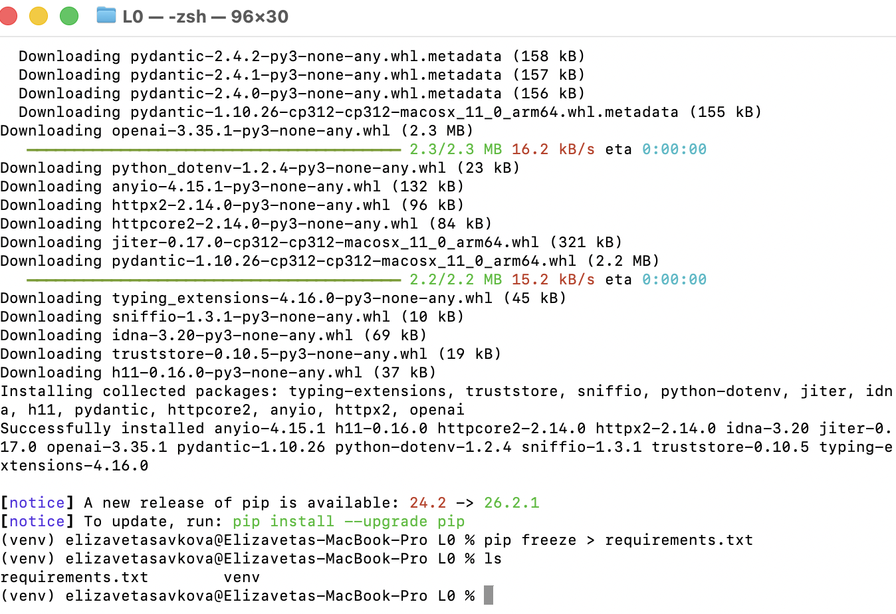

Ключ лежит в .env

```
OPENAI_API_KEY=<ключ Groq>
```

И сделала .gitignore чтобы ключ не попал на гитхаб

```
.env
venv/
prompts.db
```

venv тоже не загружаю, он тяжелый и у каждого свой. prompts.db это база с промптами, про нее ниже


## 2-3. Запрос к API и главный цикл

main.py написала по методичке, только base_url и модель другие

```python
from openai import OpenAI
from dotenv import load_dotenv
import os

load_dotenv()

api_key = os.getenv("OPENAI_API_KEY")

client = OpenAI(api_key=api_key, base_url="https://api.groq.com/openai/v1")

def get_response(text: str, client: OpenAI):
    response = client.responses.create(model="openai/gpt-oss-20b", input=text)
    return response

if __name__ == "__main__":
    print("Введите ваш вопрос (или 'exit' для выхода):")
    while True:
        question = input("Вы: ")
        if question.lower() == "exit":
            print("Завершение программы.")
            break
        answer = get_response(question, client)
        print("AI:", answer.output_text)
```

load_dotenv() читает .env, os.getenv достает оттуда ключ. Дальше в цикле вопрос отправляется модели и печатается output_text, это текст ответа. На exit программа выходит

Первый запуск, попросила ответить в два предложения и он так и ответил

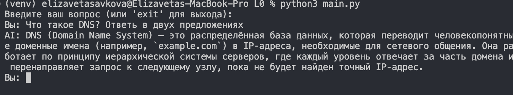


## 4. Troubleshooting

С авторизацией, сетью и лимитами проблем не было, ключ сразу заработал. В задании 2 я меняю effort и temperature, а в методичке написано что на неподдерживаемые параметры будет BadRequestError, поэтому обернула запрос в try/except. Это пригодилось два раза, на effort none и на temperature 5, программа не упала а просто вывела ошибку и работала дальше


## 5. Задания

### Задание 1. Системный промпт и хотсвап

Сначала сделала промпт через .env. Добавила туда SYSTEM_PROMPT и передаю его в instructions

```python
system_prompt = os.getenv("SYSTEM_PROMPT", "Ты полезный ассистент.")

def get_response(text, client: OpenAI, instructions: str):
    response = client.responses.create(
        model="openai/gpt-oss-20b",
        instructions=instructions,
        input=text,
    )
    return response
```

Проверила на промпте "Ты пират. Отвечай как Джек Воробей", ответ про DNS стал пиратский, значит промпт доходит до модели

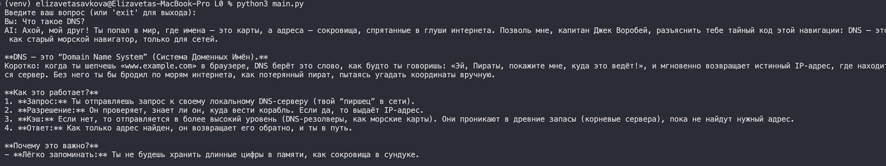

Потом сделала ручной ввод с сохранением в базу. Взяла SQLite, он есть в питоне по умолчанию. Таблица prompts, в ней id, название и текст

```python
def init_db():
    with sqlite3.connect(DB_PATH) as conn:
        conn.execute(
            "CREATE TABLE IF NOT EXISTS prompts ("
            "id INTEGER PRIMARY KEY AUTOINCREMENT, "
            "name TEXT NOT NULL, "
            "text TEXT NOT NULL)"
        )

def add_prompt(name: str, text: str):
    with sqlite3.connect(DB_PATH) as conn:
        conn.execute("INSERT INTO prompts (name, text) VALUES (?, ?)", (name, text))
```

Значения подставляю через ? а не склеиваю строки, так нет sql инъекций

Команды в боте

- /add добавить промпт в базу
- /prompts список промптов
- /use N переключиться на промпт N
- /env вернуть промпт из .env

Хотсвап работает через переменную current_prompt, /use просто меняет ее и следующий вопрос уже идет с новым промптом, перезапускать ничего не надо

Добавила два промпта, пират и сисадмин

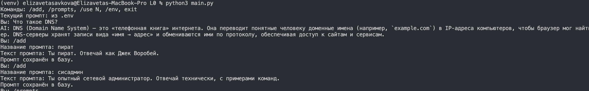

И задала один и тот же вопрос "Что такое DNS?" с разными промптами

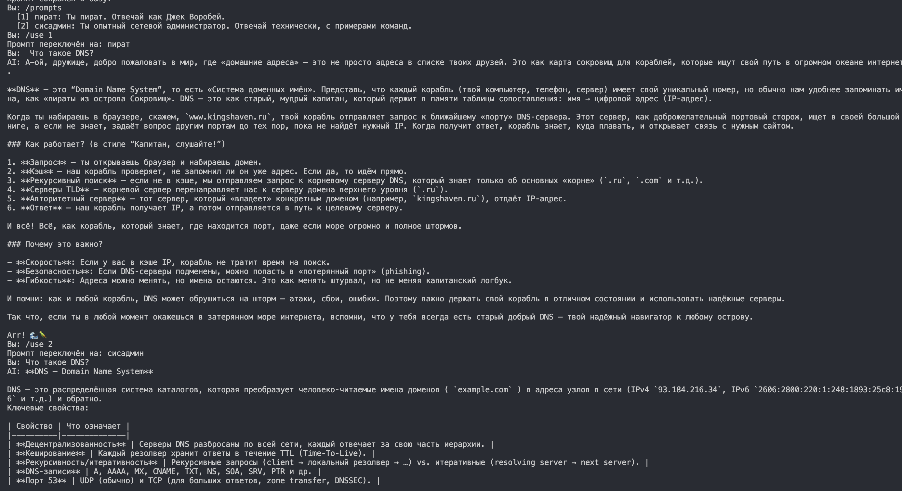

С промптом из .env ответ короткий, три предложения. Пират объясняет то же самое но через корабли и порты, в конце "Arr!". Сисадмин отвечает технически, с таблицей, портом 53, типами записей и командой dig +trace. Получается промпт сильно меняет стиль и подробность ответа, а смысл остается тот же


### Задание 2. reasoning.effort и temperature

Добавила команды /effort и /temp. Параметры передаются только если я их задала, иначе модель берет свои по умолчанию

```python
def get_response(messages, client, instructions, effort=None, temperature=None):
    params = {"model": "openai/gpt-oss-20b", "instructions": instructions, "input": messages}
    if effort is not None:
        params["reasoning"] = {"effort": effort}
    if temperature is not None:
        params["temperature"] = temperature
    return client.responses.create(**params)
```

Еще вывожу время ответа и сколько токенов (answer.usage.output_tokens), чтобы было с чем сравнивать

**reasoning.effort**

У gpt-oss-20b есть low, medium (по умолчанию) и high. Проверяла на задачке "У Маши 3 брата. У каждого брата 2 сестры. Сколько сестёр у Маши?", правильный ответ одна

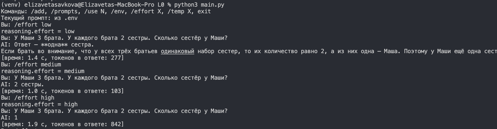

medium ошибся, поэтому я его прогнала еще пару раз

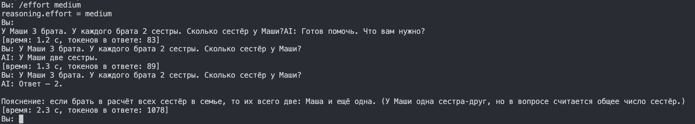

(первый ответ "Готов помочь" не считаю, там случайно ушла пустая строка, потом добавила в код чтобы пустой ввод пропускался)

| effort | ответ | верно | время | токены |
|---|---|---|---|---|
| low | одна | да | 1,4 с | 277 |
| medium | 2 | нет | 1,0 с | 103 |
| medium | две | нет | 1,3 с | 89 |
| medium | 2 | нет | 2,3 с | 1078 |
| high | 1 | да | 1,9 с | 842 |
| none | ошибка | - | - | - |

На high модель думает дольше всех и тратит больше токенов, но отвечает правильно. medium ошибся все три раза, причем в последнем он вроде правильно рассуждал что девочек две, Маша и еще одна, но в ответ написал 2. low ответил верно но это один раз, впринципе могло просто повезти

none groq для этой модели не принимает

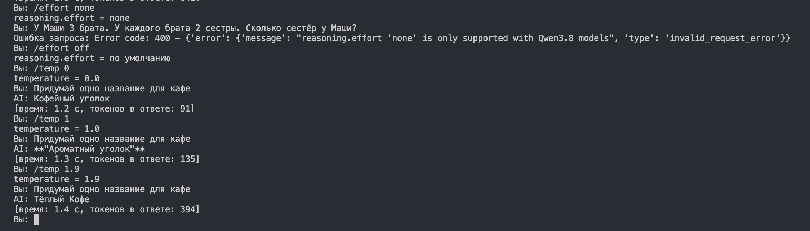

```
Error code: 400 - reasoning.effort 'none' is only supported with Qwen3.8 models
```

**temperature**

В методичке написано что у openai temperature на reasoning моделях работает только с effort none, а в groq ошибки не было, работает и так

Спрашивала "Придумай одно название для кафе" по три раза

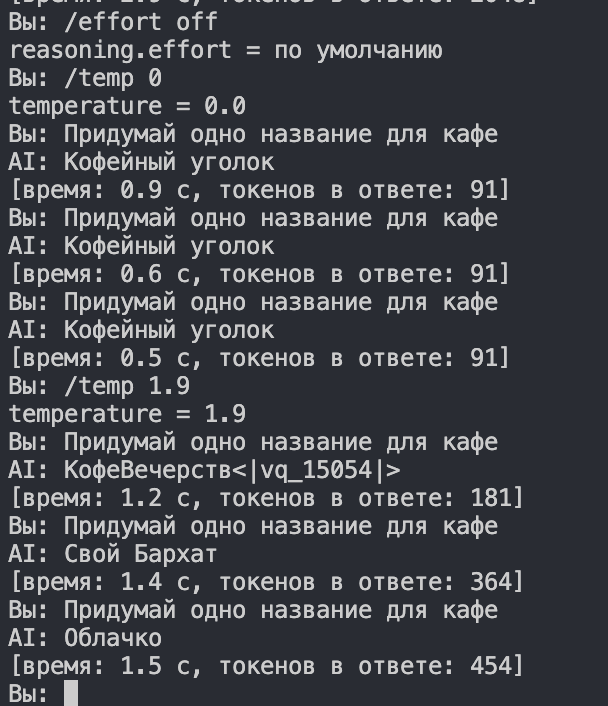

| temperature | 1 | 2 | 3 |
|---|---|---|---|
| 0 | Кофейный уголок | Кофейный уголок | Кофейный уголок |
| 1.9 | КофеВечерств<\|vq_15054\|> | Свой Бархат | Облачко |
| 2 | Кафе «Вкусный Уголок» | “Мгновение” | Кафе «Тепло Вкуса» |

На 0 все три ответа одинаковые, даже токенов одинаково (91). На 1.9 все разные, а в первом вылез какой то служебный токен <|vq_15054|>, видимо на высокой температуре модель может выбрать что угодно даже такое

Потом решила проверить максимум. Поставила 2, ответы опять все разные, но в этот раз без мусора. Еще спросила про DNS в два предложения, смысл верный, но формулировки уже немного странные: "обращаться по имённой формату", "изменять в ручном виде ссылки". То есть на 2 модель еще отвечает, но текст начинает разваливаться. А мусорный токен на 1.9 получается был случайностью, при высокой температуре каждый раз по разному

Попробовала поставить 5 и получила ошибку, больше 2 сервер не принимает

```
Error code: 400 - `temperature`: must be between 0 and 2
```

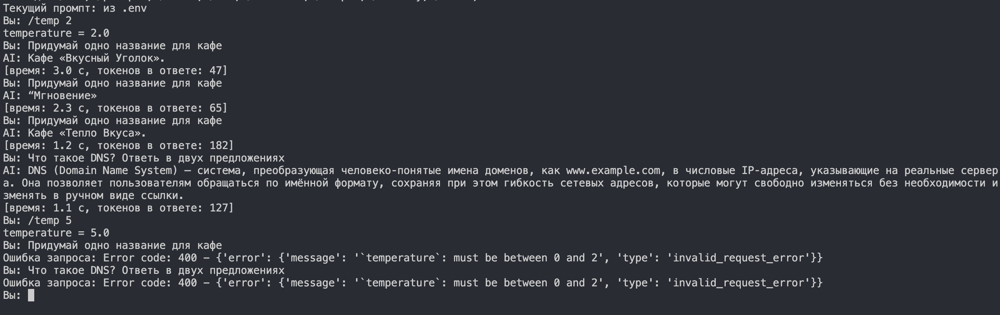
Еще случайно задала задачу про Машу когда стояла temperature 1.9, там ответ вообще оборвался на середине и токенов было 2048, то есть он уперся в лимит. Так что высокая температура для логики плохо

Итого effort это сколько модель думает, больше думает - точнее но дольше. temperature это насколько ответы случайные, на 0 одно и то же, на высокой разные и иногда ломаются. Значения temperature можно ставить только от 0 до 2


### Задание 3. История диалога

Модель сама ничего не помнит, каждый запрос для нее новый. Поэтому я храню переписку в списке history и каждый раз отправляю ее целиком вместе с новым вопросом

```python
history = []
MAX_HISTORY = 6  # 3 от пользователя + 3 от ассистента

messages = history + [{"role": "user", "content": question}]
answer = get_response(messages, client, current_prompt, effort, temperature)

history.append({"role": "user", "content": question})
history.append({"role": "assistant", "content": answer.output_text})
history = history[-MAX_HISTORY:]
```

history[-6:] оставляет последние 6 сообщений, старые выкидываются. В историю добавляю только после того как пришел ответ, чтобы при ошибке вопрос не сохранялся. Еще сделала /history посмотреть что в памяти и /clear очистить

Проверка, сказала как меня зовут и спросила, он помнит

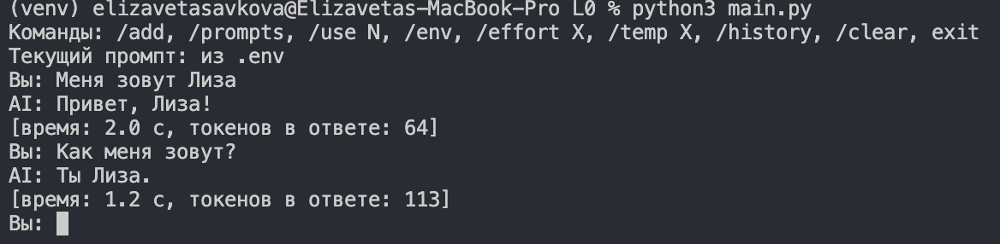

Потом еще три вопроса и опять спросила имя, уже незнает

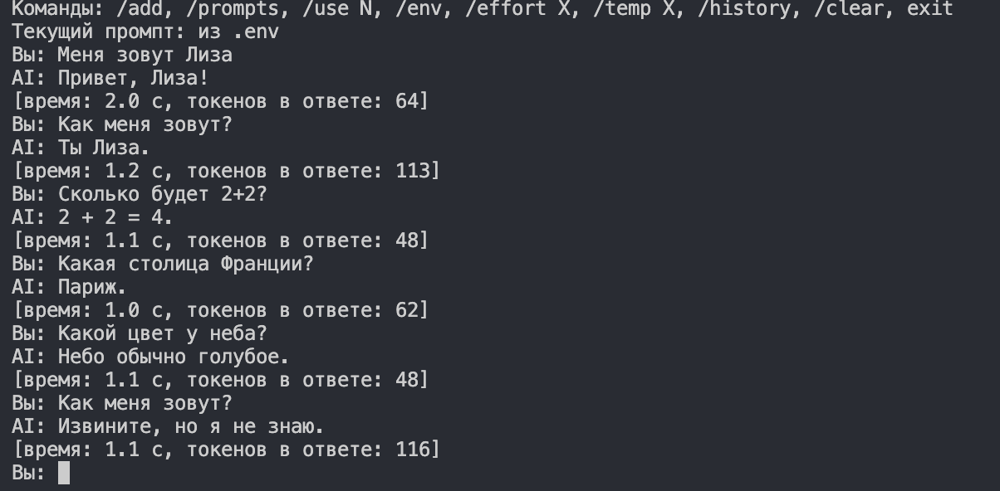

В /history видно что там 6 сообщений и "Меня зовут Лиза" там уже нет

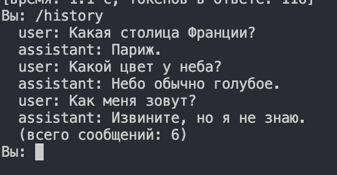

Ограничение нужно потому что история отправляется с каждым запросом, без него запросы бы росли и в какой то момент уперлись бы в лимит модели


## Вывод

Разобралась как работать с Responses API через библиотеку openai, подключила бесплатный Groq. Сделала чат-бота в котором

- промпт берется из .env или вводится вручную и сохраняется в SQLite, переключать можно прямо во время диалога
- можно менять effort и temperature, effort влияет на точность и время, temperature на разнообразие ответов
- бот помнит последние 6 сообщений

Еще поняла что память у бота на самом деле в программе, а не в модели, модель просто каждый раз читает всю историю заново
