# Отчет по лабораторной работе №1

Эксплуатация локальной языковой модели

Выполнила: Якуш Елизавета, ИС-23


## Мой компьютер

| | |
|---|---|
| Модель | MacBook Pro, Apple M1 Pro |
| Память | 16 ГБ, общая для CPU и GPU (unified memory) |
| Видеокарта | встроенная в M1 Pro, отдельной VRAM нет |
| ОС | macOS |
| Программа | LM Studio, локальный сервер на порту 7000 |

У Mac нет отдельной видеопамяти, GPU берет память из тех же 16 ГБ. Часть занимает система и другие программы, поэтому реально под модель остается примерно 10-11 ГБ. По таблице лабораторной для 16 ГБ без дискретной GPU советуют начинать с 1.5-3B Q4, но на Apple Silicon модель целиком уходит на GPU, поэтому я решила взять одну модель поменьше и одну побольше


## 1. Выбор моделей на Hugging Face

Взяла две модели из одного семейства Qwen3.5 от unsloth, но разного размера, 4B и 9B. Так в сравнении меняется только размер (и квант), а семейство и обучение одинаковые, и проще понять от чего зависит результат. 4B это та же модель, на которой сделаны примеры в методичке

Модель 4B, страница Files and versions со всеми квантами

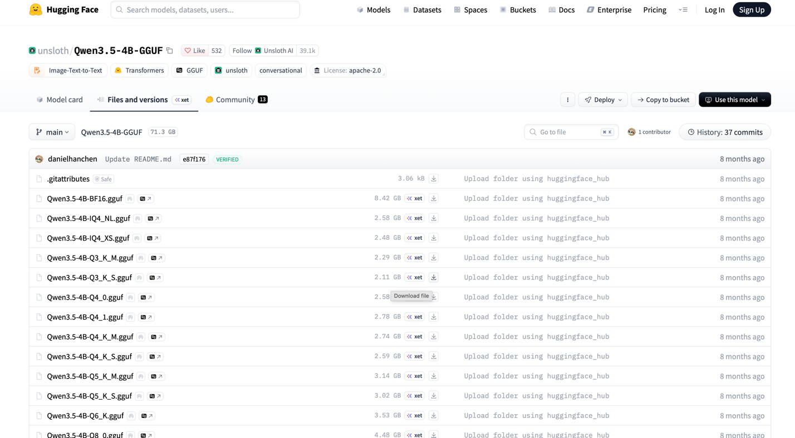

Модель 9B

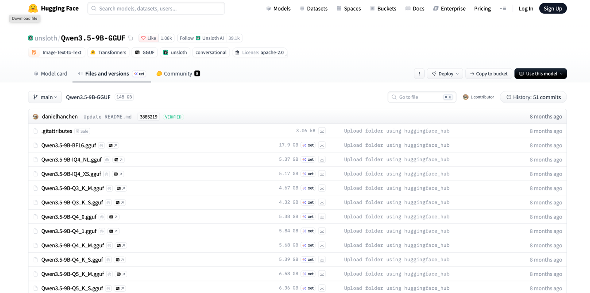

### Как выбирала квант

Чем меньше бит на параметр, тем модель меньше, но тем сильнее сжаты веса и тем чаще она несет бред (растет перплексия). Маленькой модели сжатие вредит сильнее, у нее меньше запаса параметров, поэтому для 4B я взяла квант повыше, а для 9B пониже

| | Qwen3.5-4B | Qwen3.5-9B |
|---|---|---|
| Репозиторий | unsloth/Qwen3.5-4B-GGUF | unsloth/Qwen3.5-9B-GGUF |
| Параметров | ~4 млрд | ~9 млрд |
| Квант | Q6_K | Q4_K_M |
| Размер файла | 3,53 ГБ | 5,68 ГБ |
| Оценка по формуле N·b/8 | 4·10⁹·6/8 = 3 ГБ | 9·10⁹·4/8 = 4,5 ГБ |
| Почему этот квант | качество почти как у оригинала, а по памяти большой запас. Q4_K_M (2,74 ГБ) для 4B уже заметнее портит ответы, а Q8_0 (4,48 ГБ) почти ничего не добавляет | компромисс. Q5_K_M (6,58 ГБ) и выше вместе с системой и контекстом уже впритык к 16 ГБ, а Q3 и ниже сильно портят модель |

Реальные файлы больше, чем по формуле. В K-квантах часть тензоров хранится с большей точностью (Q4_K_M в среднем около 4,8 бит на параметр, а не 4), плюс в файле есть служебные данные

### Куда положила модели

Скачала файлы .gguf с Hugging Face и положила в Models Directory (у меня это ~/.lmstudio/models) по структуре из лабы: организация, потом модель, потом файл

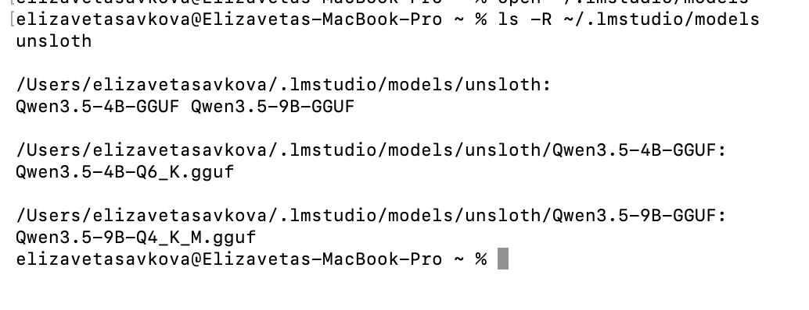

LM Studio увидел обе модели во вкладке Library (в новой версии так называется My Models). Тут видно архитектуру, число параметров, квант и размер

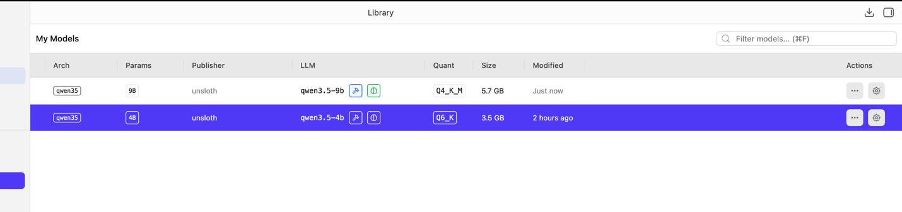

Сначала у 9B в Library был размер 32 байта и Arch N/A, это я перенесла файл в папку пока он еще скачивался. Перекачала и все стало нормально


## 2. Запуск на локальном сервере

### Настройки запуска

Контекст по умолчанию в LM Studio стоял 8192, а по заданию для первого запуска нужно 2048. Поменяла чтобы обе модели загружались одинаково

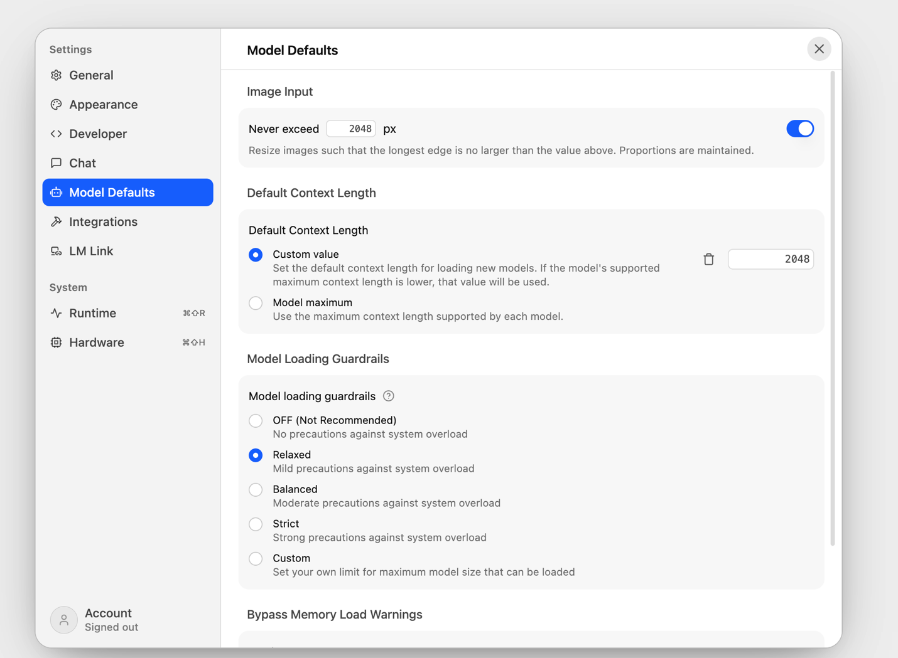

Включила Require Authentication, создала токен в Manage Tokens и запустила сервер. Модель 4B загрузила вручную, справа видно Context Length 2048 и GPU Offload 32 (все слои на GPU, на Mac это выгодно, потому что память общая). В логах после перезагрузки модели строка `n_ctx_slot = 2048`, значит контекст применился. Еще в логах видно какой файл загружен, `unsloth/Qwen3.5-4B-GGUF/Qwen3.5-4B-Q6_K.gguf`

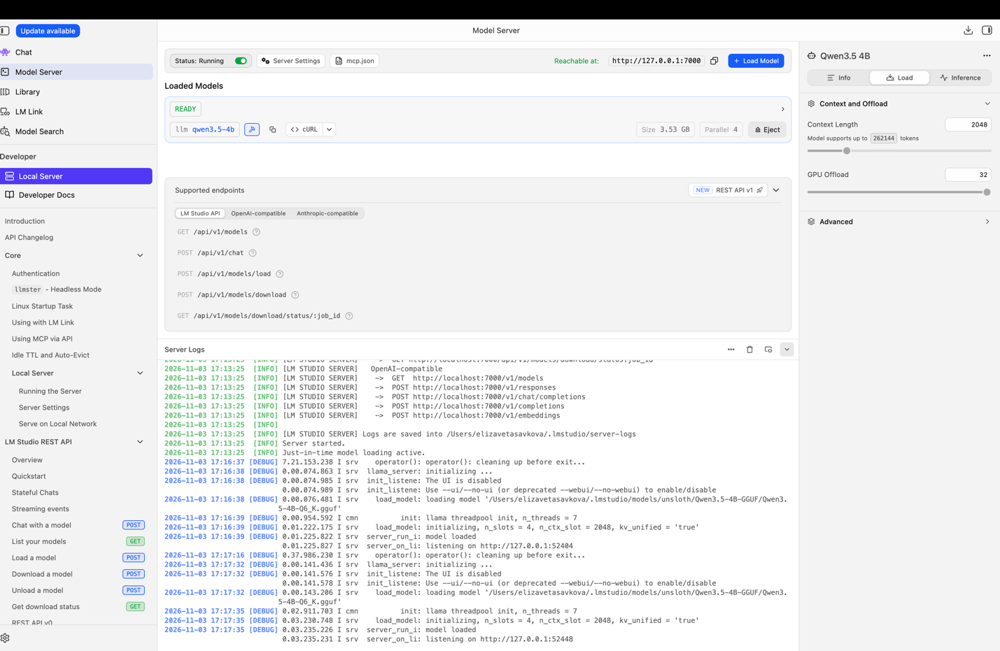

| Настройка | 4B | 9B |
|---|---|---|
| Context Length | 2048 | 2048 |
| GPU Offload | 32 из 32 слоев | 32 из 32 слоев |
| Parallel | 4 (запросы шли по очереди, на замеры не влияет) | 4 |
| Как загружена | вручную | сама по первому запросу (Just-in-Time loading) |
| Thinking | включен (по умолчанию) | включен |
| temperature | 0.7, в эксперименте с температурой 0.2 и 1.0 | 0.7 |
| max_tokens | 1500 | 1500 |
| Системная инструкция | одинаковая, см. ниже | |

Настройки 9B проверила отдельно, загрузив ее в Model Server: те же контекст 2048 и GPU Offload 32, размер 5,68 ГБ

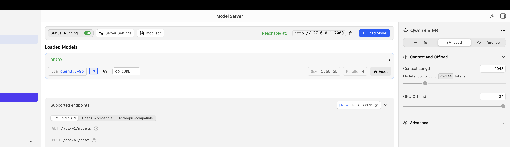

### Проверка что сервер работает

Сделала виртуальное окружение и поставила библиотеку openai, LM Studio понимает тот же формат запросов что и OpenAI

```bash
python3 -m venv venv
source venv/bin/activate
pip install openai
pip freeze > requirements.txt
export LMSTUDIO_API_KEY="<токен>"
```

Токен не пишу в код, он лежит в переменной окружения, а в скрипте читается через os.environ. Так он не попадет на гитхаб. venv добавила в .gitignore

check.py просто выводит список моделей на сервере

```python
import os
from openai import OpenAI

client = OpenAI(
    base_url="http://127.0.0.1:7000/v1",
    api_key=os.environ["LMSTUDIO_API_KEY"],
)

for m in client.models.list().data:
    print(m.id)
```

```
qwen3.5-4b
qwen3.5-9b
text-embedding-nomic-embed-text-v1.5
```

Третья модель это встроенная модель LM Studio для эмбеддингов, ее не использую

### Проблема: 403 на localhost:7000

Сначала в base_url было `http://localhost:7000/v1` как в лабораторной работе, и на любой запрос приходила ошибка 403. Сначала думала что дело в токене и пересоздала его, но у токена в поле Last used было Never, то есть до LM Studio запрос вообще не доходил. Проверила через curl

```
$ curl -i http://localhost:7000/v1/models
HTTP/1.1 403 Forbidden
Server: AirTunes/960.13.1
```

AirTunes это AirPlay Receiver. На macOS порт 7000 по умолчанию занят этой системной службой (прием трансляций с iPhone), и localhost вел к ней, а не к LM Studio. По адресу 127.0.0.1, который LM Studio пишет в Reachable at, сервер ответил 200 OK. Поэтому в обоих скриптах поменяла localhost на 127.0.0.1. 

## 3. Набор запросов

Системная инструкция одна на все запросы

```
Отвечай по-русски. Если информации недостаточно, сообщи об этом.
```

| № | Тип | Запрос |
|---|---|---|
| 1 | concept, объяснение понятия | Объясни, что такое рекурсия в программировании, коротко и с примером. |
| 2 | function, функция на Python | Напиши на Python функцию, которая проверяет, является ли строка палиндромом (без учёта регистра и пробелов). |
| 3 | bug, поиск ошибки | Найди ошибку в коде и исправь: (код ниже) |
| 4 | json, извлечение в JSON | Из текста извлеки данные и верни ТОЛЬКО JSON с полями name, city, age: 'Иван Петров, 34 года, живёт в Томске и работает инженером.' |
| 5 | no_answer, ответа нет в тексте | Текст: 'Кошка спит на подоконнике.' Вопрос: какого цвета у кошки глаза? |

Код для запроса 3. В нем две ошибки: деление на ноль при пустом списке и лишнее `+ 1`

```python
def avg(nums):
    total = 0
    for n in nums:
        total += n
    return total / len(nums) + 1

print(avg([]))
```


## 4. Прогон запросов через API

Скрипт lab1.py отправляет пять запросов, засекает время и сохраняет все в results_<модель>.json. Модель передается аргументом, так один и тот же скрипт работает для обеих моделей с одинаковыми настройками

```python
def ask(model, prompt, temperature=0.7):
    t0 = time.perf_counter()
    r = client.chat.completions.create(
        model=model,
        messages=[
            {"role": "system", "content": SYSTEM},
            {"role": "user", "content": prompt},
        ],
        temperature=temperature,
        max_tokens=1500,
    )
    dt = time.perf_counter() - t0
    msg = r.choices[0].message
    return {
        "temperature": temperature,
        "time_s": round(dt, 2),
        "tokens": r.usage.completion_tokens,
        "finish_reason": r.choices[0].finish_reason,
        "answer": msg.content,
        "reasoning": getattr(msg, "reasoning_content", None),
    }
```

- time.perf_counter() засекает время получения полного ответа
- completion_tokens сколько токенов сгенерировала модель, вместе с рассуждениями
- finish_reason показывает, закончила модель сама (stop) или оборвалась по лимиту (length)
- Qwen3.5 сначала думает, и LM Studio отдает эти размышления отдельно в reasoning_content, а сам ответ в content. Сохраняю оба, чтобы видеть что модель думала

```bash
python lab1.py qwen3.5-4b
python lab1.py qwen3.5-9b
```

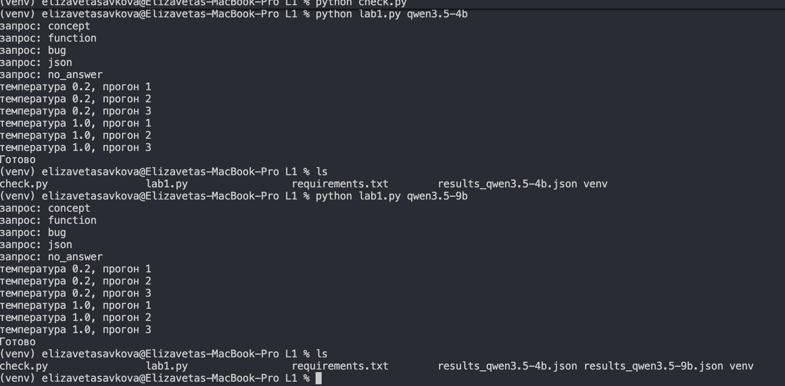

Во время работы смотрела Мониторинг системы. Модель работает как процесс llama-server, он грузит GPU на 75-80% и CPU больше чем на 100% (то есть несколько ядер)

Во время 4B

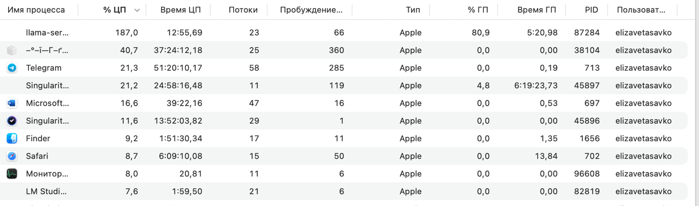

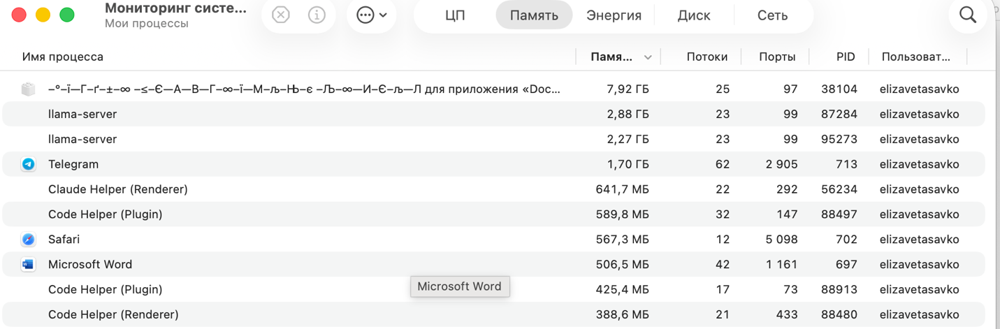

Во время 9B

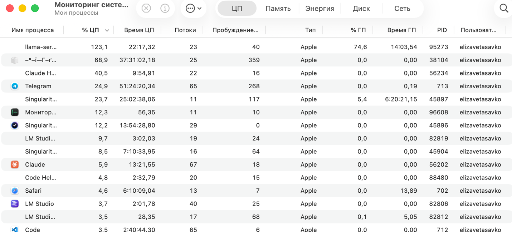

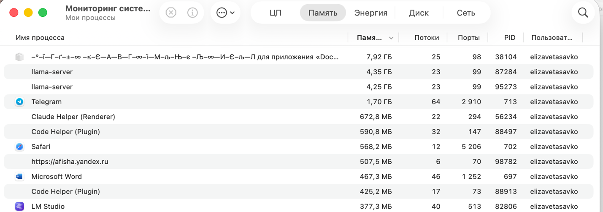

В памяти видно два процесса llama-server по ~4,3 ГБ, то есть пока шла 9B, 4B из памяти не выгрузилась. Похоже, JIT выгружает только модели, которые сам загрузил, а 4B я загружала вручную. Вместе это ~8,6 ГБ из 16, плюс в фоне висел еще процесс на 7,9 ГБ, так что память была почти вся занята. Mac во время прогонов сильно грелся


## 5. Результаты

### Qwen3.5-4B (Q6_K)

| Запрос | Время, с | Токены | finish_reason | Оценка |
|---|---:|---:|---|---|
| concept | 42,1 | 1329 | stop | верно |
| function | 43,2 | 1374 | stop | верно |
| bug | 43,5 | 1500 | length | частично, нашла обе ошибки, но оборвалась перед исправленным кодом |
| json | 43,5 | 1500 | length | нет ответа, пустой content |
| no_answer | 19,3 | 647 | stop | верно, сказала что информации нет |
| **Итого** | **191,6** | **6350** | | 3 верно, 1 частично, 1 нет ответа |

### Qwen3.5-9B (Q4_K_M)

| Запрос | Время, с | Токены | finish_reason | Оценка |
|---|---:|---:|---|---|
| concept | 42,9 | 845 | stop | верно |
| function | 36,9 | 723 | stop | верно, но с лишним (два варианта и таблица) |
| bug | 73,7 | 1500 | length | нет ответа, пустой content |
| json | 72,8 | 1500 | length | нет ответа, пустой content |
| no_answer | 39,8 | 805 | stop | верно, сказала что информации нет |
| **Итого** | **266,0** | **5373** | | 3 верно, 2 нет ответа |

### Разбор по запросам

**concept.** Обе объяснили рекурсию через факториал, упомянули базовый случай и рекурсивный вызов. 4B вставила в ответ формулы в LaTeX (`$n!$`, `$5 \times 4!$`), в терминале и в обычном тексте это выглядит как мусор. 9B ответила короче и показала цепочку вызовов `3 * factorial(2) → ... = 6`

**function.** Обе функции правильные. 4B сделала ровно то, что просили

```python
def is_palindrome(text):
    cleaned_text = text.replace(" ", "").lower()
    return cleaned_text == cleaned_text[::-1]
```

9B сделала через `isalnum()`, то есть убирает не только пробелы, но и знаки препинания. Это больше чем просили, хотя в комментарии написано только про пробелы. Еще добавила второй вариант с двумя указателями и таблицу, и опечатки вроде «неалфанимические». Ответ правильный, но для «небольшой функции» слишком длинный (2073 символа против 902 у 4B)

**bug.** Обе модели в размышлениях нашли обе ошибки: ZeroDivisionError на пустом списке и лишнее `+ 1`. Но 4B успела выдать только начало ответа

> В коде есть **две ошибки**: 1. Runtime Error (Ошибка деления на ноль) ... 2. Логическая ошибка: ... прибавляет к нему 1 ... Вот исправленный вариант кода, который обрабатывает пустой список корректно и считает среднее

и тут закончились 1500 токенов. У 9B ответ вообще пустой, весь лимит ушел на размышления. Полные ответы получила в повторном прогоне ниже

**json.** В основном прогоне у обеих content пустой, формат проверила в повторном прогоне ниже. При этом в размышлениях у обеих есть правильный JSON

```json
{"name": "Иван Петров", "city": "Томск", "age": 34}
```

Модели правильно поставили город в именительный падеж (Томск, а не Томске) и возраст числом. Но дальше они долго спорили сами с собой, можно ли оборачивать JSON в markdown ```json или это нарушит «ТОЛЬКО JSON», и на этом кончился лимит. То есть строгая инструкция про формат заставила их думать дольше всего

**no_answer.** Обе не выдумали цвет глаз и выполнили инструкцию

- 4B: «На основании предоставленного текста ответить на этот вопрос невозможно, так как в нем не содержится информации о цвете глаз кошки»
- 9B: «В предоставленном тексте нет информации о цвете глаз кошки, поэтому ответить на этот вопрос невозможно»


### Повторный прогон bug и json

В основном прогоне bug и json оборвались по лимиту, и проверить формат JSON было нечем. Поэтому я прогнала эти два запроса еще раз отдельным скриптом rerun.py. Запросы, системная инструкция и temperature 0.7 те же, они импортируются из lab1.py, поменялось только два параметра

| | Основной прогон | Повторный прогон |
|---|---|---|
| max_tokens | 1500 | 4000 |
| Context Length | 2048 | 8192 |

Контекст пришлось поднять, потому что в него должно влезть все сразу: инструкция, запрос (~100 токенов), размышления и ответ. 100 + 4000 в 2048 не помещается, и даже 4096 было бы впритык

```python
from lab1 import client, SYSTEM, PROMPTS  # те же запросы, что в lab1.py

for name in ("bug", "json"):
    results[name] = ask(model, PROMPTS[name])  # внутри ask max_tokens=4000
```

В этот раз модели запускала строго по очереди: Eject одной, Load другой. Настройки 4B

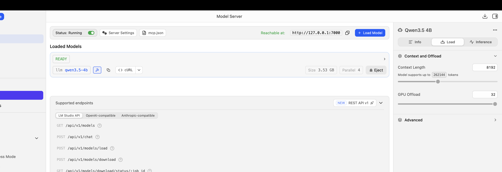

Настройки 9B

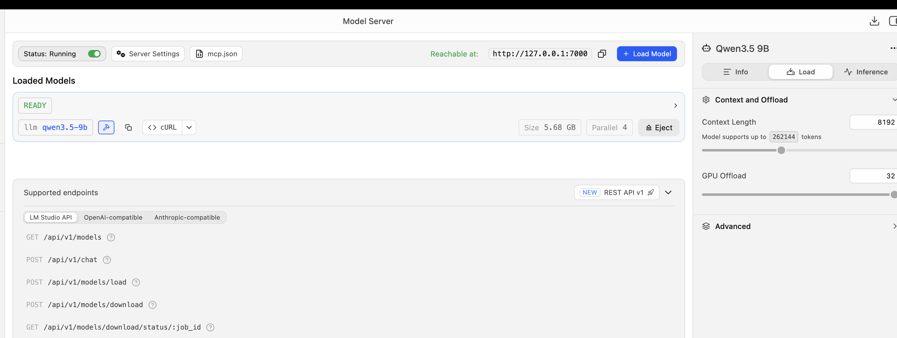

Во время работы 9B в Мониторинге системы только один процесс llama-server, значит в памяти одна модель. Число у него маленькое (716 МБ), видимо Мониторинг не относит к процессу веса, которые отданы GPU

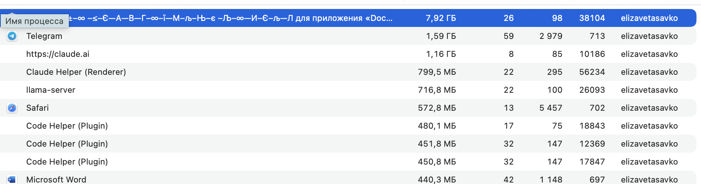

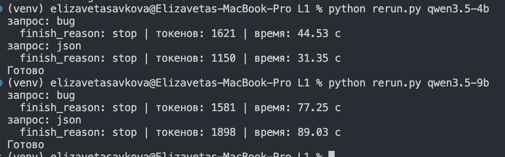

| Модель | Запрос | Время, с | Токены | finish_reason | Оценка |
|---|---|---:|---:|---|---|
| 4B | bug | 44,5 | 1621 | stop | верно |
| 4B | json | 31,4 | 1150 | stop | верно, валидный JSON |
| 9B | bug | 77,3 | 1581 | stop | верно |
| 9B | json | 89,0 | 1898 | stop | верно, валидный JSON |

Все четыре ответа закончились сами (stop). Трем из четырех понадобилось больше 1500 токенов, так что старого лимита правда не хватало

**bug.** Обе модели нашли обе ошибки и дали исправленный код. 4B возвращает 0 для пустого списка и еще предлагает второй вариант с `raise ValueError`, 9B возвращает None

```python
# ответ 9B
def avg(nums):
    if not nums:  
        return None
    total = sum(nums)
    return total / len(nums)
```

**json.** У обеих одинаковый ответ, ровно такой

```json
{
  "name": "Иван Петров",
  "city": "Томск",
  "age": 34
}
```

Проверила его через `json.loads` в питоне, он разбирается без ошибок. Формат соблюден полностью: нет текста до и после, нет обертки ```json, все три поля на месте, город в именительном падеже, возраст числом. Интересно что в основном прогоне 4B на этом же запросе потратила все 1500 токенов и не ответила, а сейчас уложилась в 1150. Длина размышлений каждый раз разная, поэтому с маленьким лимитом результат получается как повезет

Скорость в повторном прогоне: 4B около 36,5 токена/с (в основном было 33), 9B около 21 (было 20). 4B ускорилась заметнее, возможно потому что теперь в памяти не висела вторая модель


## 6. Влияние температуры

Для модели 4B выполнила запрос concept по три раза при temperature 0.2 и 1.0, остальное не меняла

| | Время, с | Токены | Длина ответа, символов | Пример | Базовый случай | Ошибки |
|---|---:|---:|---:|---|---|---|
| 0.2, прогон 1 | 25,6 | 893 | 708 | factorial(5) | `n <= 1` | нет |
| 0.2, прогон 2 | 36,0 | 1272 | 1039 | factorial(5) | `n <= 1` | нет |
| 0.2, прогон 3 | 31,5 | 1092 | 930 | factorial(5) | `n <= 1` | нет |
| 1.0, прогон 1 | 31,6 | 1130 | 794 | factorial(3) | `n == 0 or n == 1` | нет |
| 1.0, прогон 2 | 31,2 | 1067 | 1067 | factorial(5) | `n == 1` | factorial(0) уйдет в бесконечную рекурсию |
| 1.0, прогон 3 | 38,2 | 1329 | 1155 | factorial(5) | `n == 0 or n == 1` | написала что рекурсия подходит задачам с «итеративным характером», это неверно, и есть ошибки в тексте |

**Разнообразие.** На 0.2 ответы не одинаковые слово в слово, но суть одна и та же: везде один пример, одинаковый код с `n <= 1` и одинаковые подзаголовки «Базовый случай» и «Рекурсивный шаг». Отличаются только дополнения (в одном пояснение как работает, в другом аналогия с матрешкой). На 1.0 меняется уже содержание: разные условия выхода, разные числа в примере, разные формулировки и структура

То что на 0.2 ответы все равно немного разные, думаю из за размышлений: модель сначала генерирует сотни токенов рассуждений, и маленькие различия в них накапливаются и меняют ответ. 0.2 это не 0, случайность все равно есть

**Соблюдение инструкции.** Во всех шести ответах русский язык и есть пример. Ответы на 1.0 в среднем длиннее (1005 символов против 892), то есть «коротко» соблюдается чуть хуже

**Ошибки.** На 0.2 ошибок нет. На 1.0 в двух ответах из трех мелкие ошибки: в одном код ломается на 0, в другом неверное утверждение. Значит для задач, где нужна точность (код, факты), лучше низкая температура, а высокая подходит когда нужно разнообразие

Для интереса посмотрела то же самое в файле 9B, там эксперимент тоже был в скрипте. Картина похожая, но у 9B даже на 0.2 в двух ответах из трех условие `n == 1`, так что эта ошибка не только от температуры


## 7. Сравнение моделей

| Критерий | Qwen3.5-4B Q6_K | Qwen3.5-9B Q4_K_M |
|---|---|---|
| Размер файла | 3,53 ГБ | 5,68 ГБ |
| Скорость генерации | ~33 токена/с | ~20 токенов/с |
| Время на 5 запросов | 191,6 с | 266,0 с |
| Токенов на завершенный ответ, в среднем | 1117 | 791 |
| Верных ответов, лимит 1500 | 3 + 1 частично | 3 |
| Верных ответов, лимит 4000 | 5 из 5 | 5 из 5 |
| Оборвались при лимите 1500 | 2 (bug, json) | 2 (bug, json) |
| Время bug + json при лимите 4000 | 75,9 с | 166,3 с |
| JSON | валидный, без лишнего текста | валидный, без лишнего текста |
| Прочее по формату | лишний LaTeX в ответе | лишнее в функции, ответы длиннее нужного |
| Выдумывание (no_answer) | нет | нет |

Что получилось

- **Скорость.** 4B быстрее примерно в 1,6 раза (33,1 против 20,2 токена/с), и файл у нее меньше тоже в 1,6 раза. То есть скорость почти ровно обратно пропорциональна размеру файла. Это логично: на каждый токен модель читает из памяти все веса, поэтому чем больше файл, тем медленнее
- **Время ответа** зависит не только от скорости, но и от того сколько модель думает. 9B думает примерно на 30% меньше, поэтому на concept время почти одинаковое (42,9 и 42,1 с), а function 9B сделала даже быстрее (36,9 против 43,2 с). А там где обе дошли до лимита 1500 токенов, разница в чистом виде: 43,5 против 73,7 с
- **Корректность.** На тех запросах где модели успели ответить, ответы правильные у обеих. В размышлениях на bug и json обе тоже пришли к правильному решению, то есть проблема не в знаниях, а в лимите
- **Формат.** С лимитом 4000 обе модели вернули ровно JSON, валидный и без лишнего текста, хотя обе долго сомневались насчет markdown. На вопросе без ответа обе выполнили инструкцию и не стали выдумывать. Мелкие проблемы: у 4B LaTeX в объяснении, у 9B функция сделана шире, чем просили


## Вывод

Для моего MacBook на M1 Pro 16 ГБ и этих задач лучше подходит **Qwen3.5-4B Q6_K**. Она примерно в 1,6 раза быстрее, занимает меньше памяти, а по качеству на этих задачах не хуже 9B: когда лимит токенов достаточный, обе решили все 5 запросов правильно, и JSON у обеих одинаковый. Например bug и json вместе у 4B заняли 76 секунд, а у 9B 166. 9B на Mac тоже работает, но 20 токенов в секунду с длинными размышлениями это минута-полторы на ответ, и памяти остается мало

Какие ограничения нашла

- **Режим размышлений (thinking) и лимит токенов.** Главная проблема. Qwen3.5 сначала думает, и на сложных запросах (bug, json) размышления съели весь max_tokens = 1500, до ответа модель не дошла. С контекстом 2048 сильно поднять лимит нельзя, потому что в контекст входят и запрос, и рассуждения, и ответ. Когда подняла контекст до 8192 и max_tokens до 4000, обе модели ответили правильно. То есть для думающих моделей контекст 2048 из методички маловат, нужно хотя бы 4096-8192
- **Строгие инструкции про формат** («ТОЛЬКО JSON») заставляют модель думать дольше всего, она сомневается в мелочах вроде markdown
- **Порт 7000 на macOS** занят AirPlay Receiver, по localhost запросы уходили не туда. Помогло 127.0.0.1
- **Память.** 16 ГБ общие на все. В основном прогоне две модели оказались в памяти одновременно (JIT не выгрузил вручную загруженную), плюс фоновые программы заняли почти всю память. В повторном прогоне выгружала модели вручную через Eject. 9B в Q5 и выше уже было бы впритык
- **Нагрев.** Mac сильно грелся под нагрузкой, а при перегреве процессор сам замедляется. Поэтому замеры времени примерные, на холодном ноутбуке без фоновых программ они могли быть лучше
- **Сравнение не совсем чистое.** У моделей разный и размер, и квант (Q6_K и Q4_K_M), поэтому нельзя точно сказать, что 9B отвечает так из за размера, а не из за более сильного сжатия
- **Температура.** На 1.0 появляются ошибки в коде и фактах, для точных задач лучше ставить низкую
