# Отчет по лабораторной работе №2

Разработка API-сервиса структурирования текстовых данных с использованием локальных LLM

Выполнила: Якуш Елизавета, ИС-23


## Вариант

У меня вариант 4, регистрация на мероприятия. Сервис принимает сообщение типа "хочу выступить на такой то конференции", модель достает из него кто, куда и как хочет участвовать, а сервис ищет мероприятие в справочнике и все сохраняет в базу

- ресурс `/registrations`
- справочник мероприятия
- категории attendee (слушатель), speaker (докладчик), volunteer (волонтер), other
- поле кода event_code
- доп поля participant_name и participation_format


## 1. Сервис и БД

Делала как в примере к лабе, на Python, FastAPI и PostgreSQL. Для работы с базой взяла SQLAlchemy, для проверки ответа модели Pydantic. Модель та же что в ЛР1, qwen3.5-4b в LM Studio. Взяла 4B а не 9B, потому что в первой лабе она была в 1,6 раза быстрее и отвечала не хуже

Сделала папку L2, окружение и поставила библиотеки

```bash
python3 -m venv venv
source venv/bin/activate
pip install fastapi "uvicorn[standard]" sqlalchemy openai python-dotenv pytest httpx "psycopg[binary]"
pip freeze > requirements.txt
```

psycopg это драйвер через который SQLAlchemy подключается к PostgreSQL

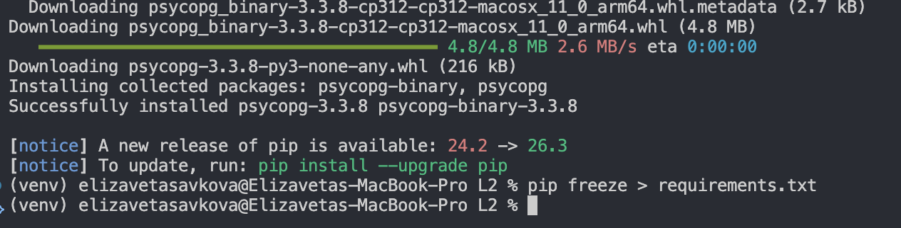

Структура получилась такая

```
L2/
├── app/
│   ├── config.py     настройки из .env
│   ├── db.py         подключение к базе и таблицы
│   ├── schemas.py    pydantic схемы
│   ├── llm.py        инструкция для модели и ее вызов
│   └── main.py       эндпоинты и ошибки
├── tests/            тесты
├── seed.py           заполнение справочника
├── docker-compose.yml
└── .env.example
```

### PostgreSQL в Docker

Базу подняла в докере, описала ее в docker-compose.yml

```yaml
services:
  db:
    image: postgres:16
    container_name: lab2-postgres
    environment:
      POSTGRES_USER: lab2
      POSTGRES_PASSWORD: lab2
      POSTGRES_DB: registrations
    ports:
      - "5432:5432"
    volumes:
      - pgdata:/var/lib/postgresql/data
```

Запуск `docker compose up -d`. volumes нужен чтобы данные не пропадали если перезапустить контейнер

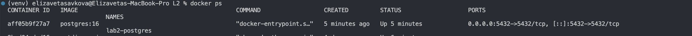

### Настройки

Адрес LM Studio, токен, модель, тайм-аут и адрес базы вынесла в .env, а сам .env добавила в .gitignore чтобы токен не попал на гитхаб. В репозиторий кладу только .env.example где вместо токена заглушка

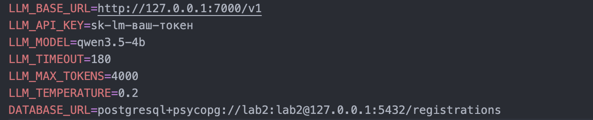

LLM_BASE_URL оставила 127.0.0.1, а не localhost, потому что как выяснилось еще в ЛР1 на маке порт 7000 занят AirPlay. Контекст в LM Studio поставила 8192 и max_tokens 4000, в первой лабе с 2048 модель не успевала ответить потому что все токены уходили на размышления. temperature 0.2, тут нужна точность а не разнообразие

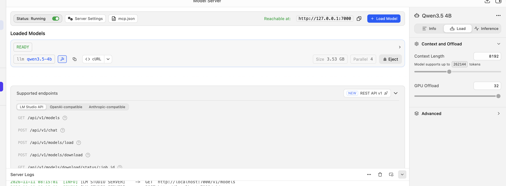

### Таблицы

В db.py две таблицы

- events справочник. id, code (уникальный), title и еще дата и место
- registrations обработанные сообщения. id, created_at, исходный текст, шесть полей от модели, event_id это связь со справочником (может быть null) и match_status

```python
class Event(Base):
    __tablename__ = "events"

    id: Mapped[int] = mapped_column(primary_key=True)
    code: Mapped[str] = mapped_column(String(50), unique=True)
    title: Mapped[str] = mapped_column(String(200))
    event_date: Mapped[str | None] = mapped_column(String(50))
    location: Mapped[str | None] = mapped_column(String(200))
```

id и code это разные вещи, id выдает сама база, а код из сообщения просто хранится отдельным полем

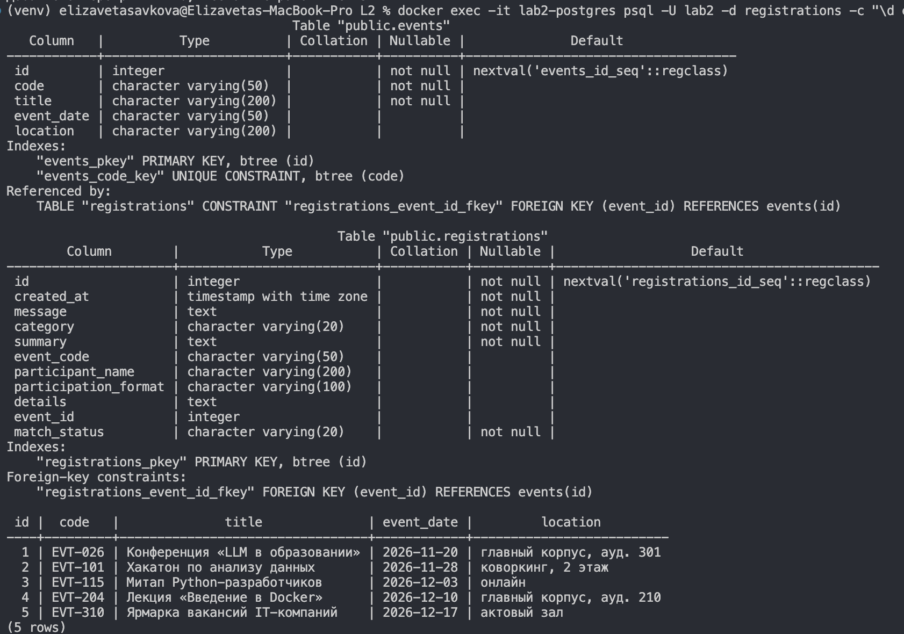

### Справочник

seed.py добавляет 5 мероприятий, EVT-026, EVT-101, EVT-115, EVT-204 и EVT-310. Перед добавлением проверяет есть ли уже такой код, поэтому если запустить второй раз ничего не задвоится

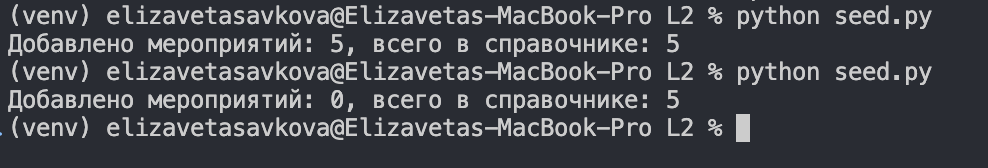

Коды храню в одном виде, без пробелов по краям и большими буквами, и при поиске код из сообщения привожу к такому же виду. Так EVT-026 и " evt-026" считаются одним кодом


## 2. Схема и инструкция для модели

Модель должна вернуть JSON ровно с шестью полями: category, summary, event_code, participant_name, participation_format и details. Инструкцию написала в llm.py, там описание полей, категории и правила

```
Ты извлекаешь сведения из сообщений о предполагаемом участии в мероприятиях.
Сообщение пользователя придёт отдельно. Верни ТОЛЬКО один JSON-объект, без пояснений и без markdown.

В объекте ровно шесть ключей, все обязательны:
- "category": одна из категорий:
    "attendee"  - участие как слушатель или посетитель;
    "speaker"   - участие как докладчик, выступление с докладом;
    "volunteer" - участие как волонтёр, помощь в проведении;
    "other"     - всё остальное или если категория неоднозначна (например, вопрос о мероприятии).
- "summary": краткое содержание сообщения одним предложением на русском, непустая строка.
- "event_code": код мероприятия ровно так, как он написан в сообщении (например "EVT-026"), иначе null.
- "participant_name": имя участника, если оно указано в сообщении, иначе null.
- "participation_format": формат участия, только если он явно указан (например "очно", "дистанционно", "онлайн"), иначе null.
- "details": другие существенные сведения из сообщения, которые не вошли в остальные поля (например тема доклада), иначе null.

Правила:
- Ничего не придумывай. Если сведений нет в сообщении, ставь null.
- Если указано только название мероприятия без кода, event_code = null, а название можно упомянуть в summary или details.
- Значения полей - строки или null. Числа и даты пиши как текст из сообщения.
```

В конце еще добавила пример из задания (Анна Смирнова и EVT-026), чтобы модель видела какой именно ответ нужен. Сообщение пользователя передается отдельно, с ролью user, а справочник модели вообще не передаю


## 3. Проверка ответа

Ответ модели нельзя сразу сохранять, она может вернуть что угодно. Поэтому сначала json.loads, а потом проверка через pydantic

```python
class Extraction(BaseModel):
    model_config = ConfigDict(extra="forbid", strict=True)

    category: Literal["attendee", "speaker", "volunteer", "other"]
    summary: str
    event_code: str | None
    participant_name: str | None
    participation_format: str | None
    details: str | None
```

- extra="forbid" значит лишние поля нельзя
- у полей нет значений по умолчанию, поэтому все 6 ключей обязательны
- strict=True чтобы типы не подгонялись, если модель вернет список или число вместо строки это ошибка, а не тихое превращение в строку
- Literal пропускает только 4 категории

Еще два валидатора: summary не может быть пустым, а пустую строку в остальных полях превращаю в null. Если модель обернула JSON в ```json, эту обертку снимаю, сам текст не трогаю

Если что то не прошло, сервис возвращает 502 и ничего не сохраняет

Потом сопоставление. Если кода нет то not_provided, если код есть и нашелся то matched и сохраняется event_id, если не нашелся то not_found, а сам код все равно сохраняется. Справочник при этом только читается, ничего туда не добавляется. И модель не пишет SQL, она только возвращает JSON, а в базу пишет код через SQLAlchemy


## 4. API

Три эндпоинта

- POST /registrations принять сообщение, вызвать модель, проверить и сохранить, ответ 201
- GET /registrations список записей
- GET /registrations/{id} одна запись или 404

При GET модель второй раз не вызывается, все берется из базы

Запускаю `uvicorn app.main:app --reload` и открываю Swagger на http://127.0.0.1:8000/docs, он строится сам

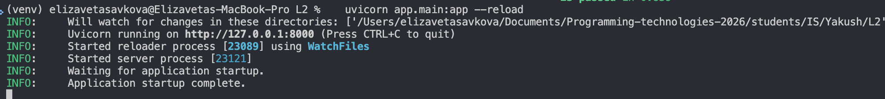

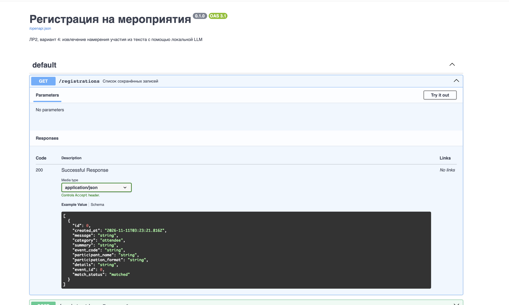

Структура ответа видна в Schemas. RegistrationOut это запись, id, created_at, event_id и match_status там заполняет сервис, а не модель. ErrorOut это формат ошибки, он у всех ошибок одинаковый `{"error": {"code": ..., "message": ...}}`, без трассировок

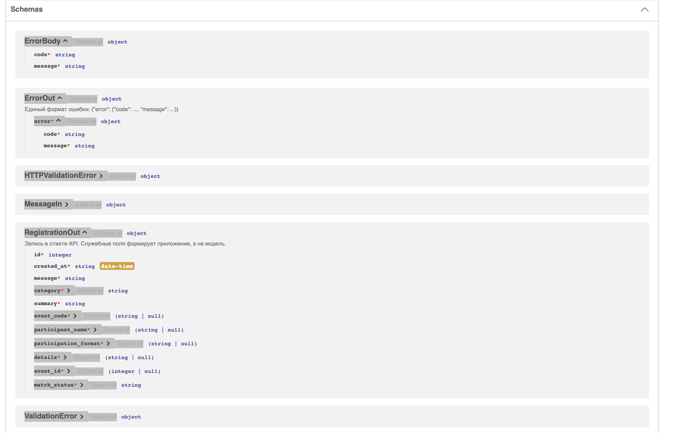

Коды ошибок

| ситуация | код |
|---|---|
| нет message, не строка или одни пробелы | 422 |
| нет записи с таким id | 404 |
| модель вернула не JSON или не по схеме | 502 |
| сервер модели недоступен | 503 |
| модель не успела за тайм-аут | 504 |

Тайм-аут сделала 180 секунд, повторных попыток нет. Тут был момент, в библиотеке openai ошибка тайм-аута это наследник ошибки соединения, поэтому ее надо ловить первой, иначе тайм-аут превращался бы в 503


## 5. Проверка

### Пять сценариев

Все запросы отправляла через Swagger на настоящую модель

Сценарий 1, полное сообщение с кодом из справочника

"Я Анна Смирнова, хочу выступить на EVT-026 дистанционно с докладом о применении LLM в образовании"

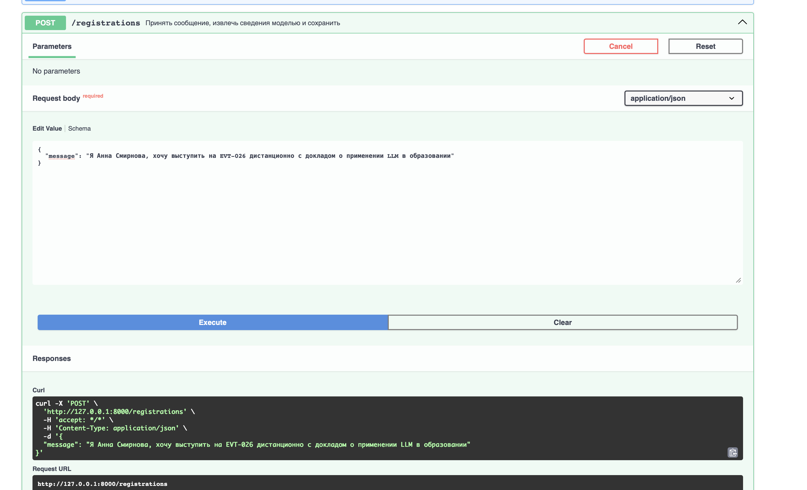

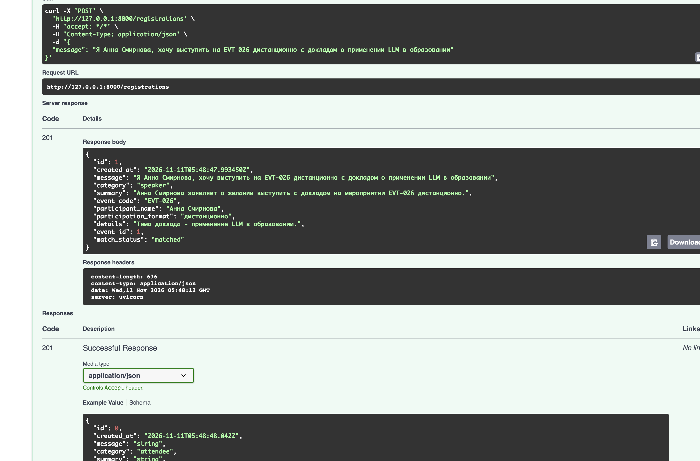

Все правильно, speaker, имя, формат, и matched с event_id 1. Тему доклада модель сама положила в details, потому что для нее нет поля

Сценарий 2, нет кода и формата

"Хочу прийти послушать конференцию про Python, меня зовут Олег"

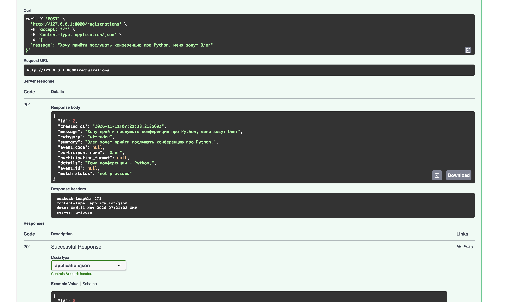

attendee, event_code и participation_format null, статус not_provided. То есть модель не стала ничего придумывать

Сценарий 3, неизвестный код

"Запишите меня волонтёром на EVT-999, Мария Ким, буду очно"

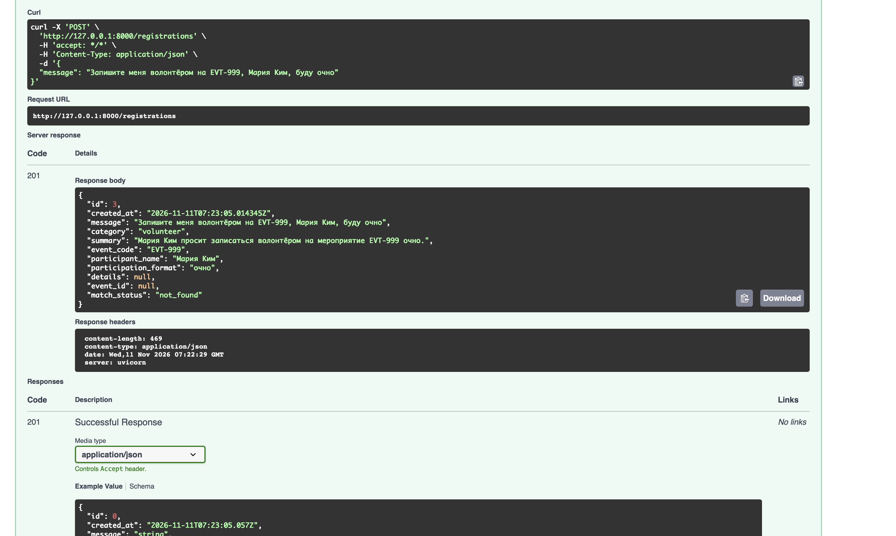

volunteer, код EVT-999 сохранился, статус not_found, event_id null

Сценарий 4, другая категория

"Готов помогать на регистрации гостей на EVT-101, Илья Петров"

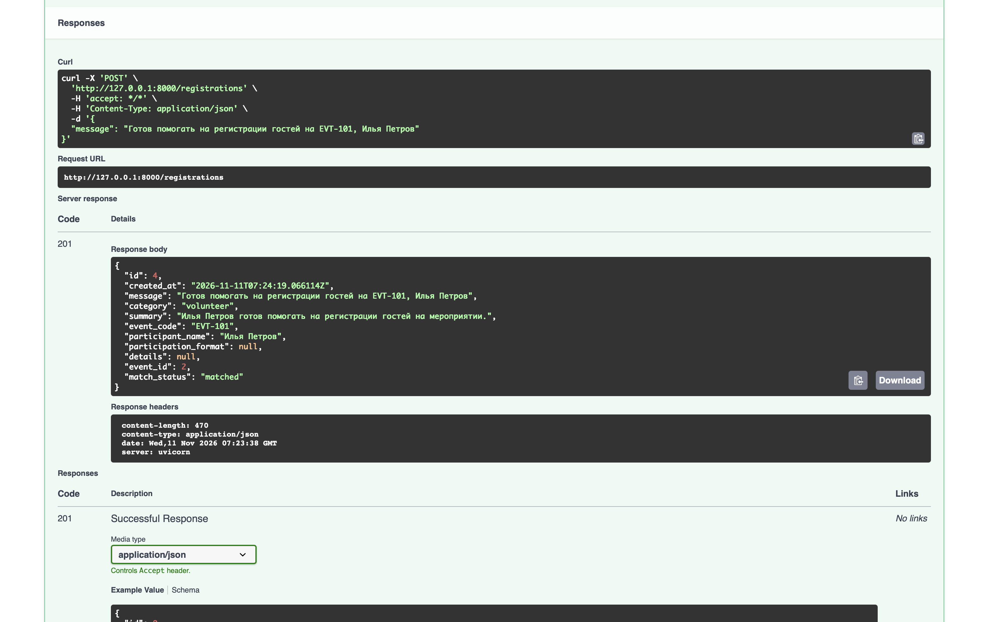

Тут слова волонтер вообще нет, но модель поставила volunteer по смыслу. Связалось с EVT-101

Сценарий 5, подходит только other

"Подскажите, будет ли на EVT-026 парковка?"

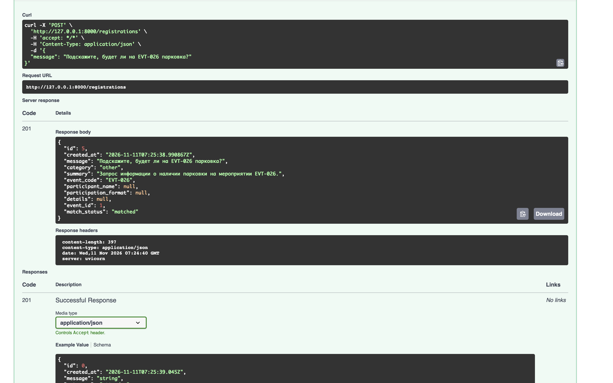

Это просто вопрос, модель поставила other. Код она все равно вытащила, поэтому запись связалась с EVT-026

| | category | event_code | match_status | время |
|---|---|---|---|---|
| 1 | speaker | EVT-026 | matched | ~35 с |
| 2 | attendee | null | not_provided | ~36 с |
| 3 | volunteer | EVT-999 | not_found | ~36 с |
| 4 | volunteer | EVT-101 | matched | ~41 с |
| 5 | other | EVT-026 | matched | ~58 с |

Время смотрела по разнице между заголовком date и created_at. Каждый ответ сравнила с исходным текстом, ошибок и выдуманных данных нет. Это важно, потому что pydantic проверяет только форму ответа, а не то правильно ли модель все поняла

### Чтение

Список и одна запись

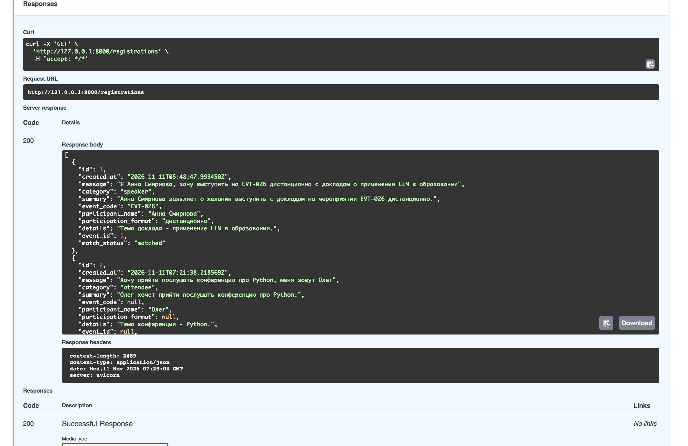

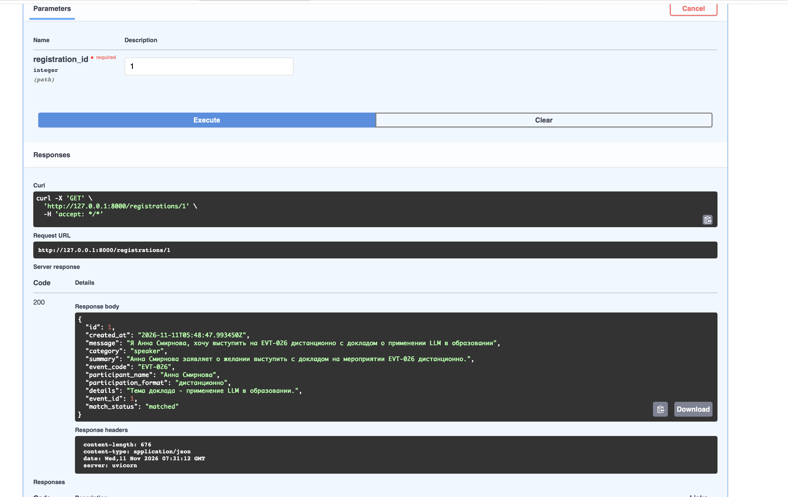

Запись 999, 404

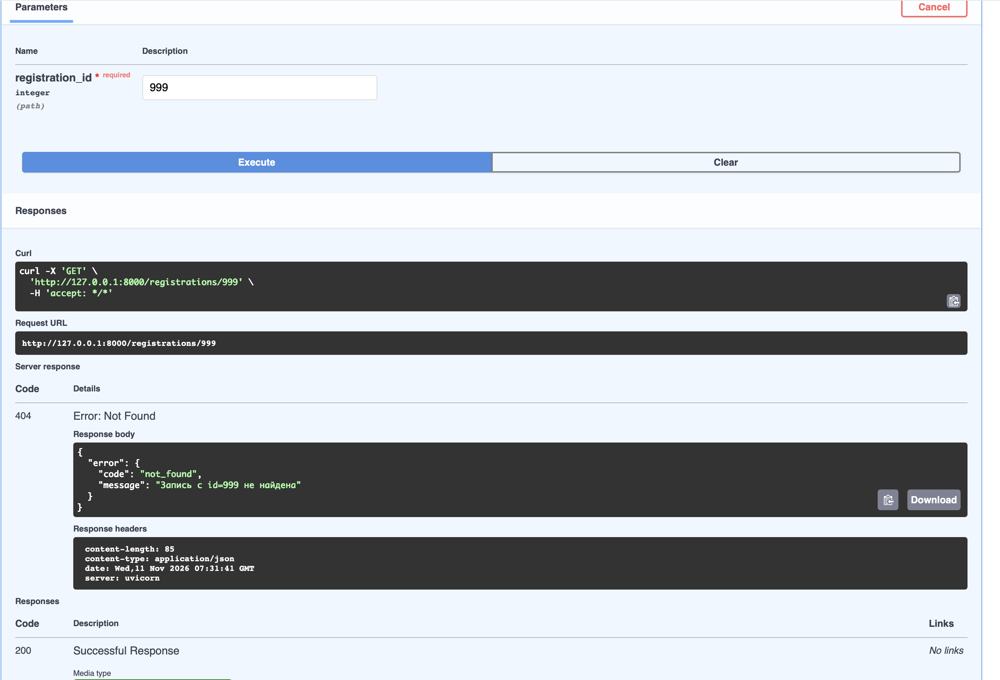

### Ошибки

Сообщение из одних пробелов, 422. Ответ пришел сразу, модель даже не вызывалась

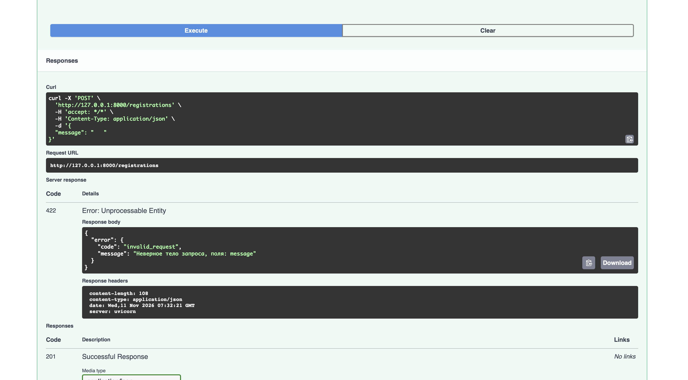

Тайм-аут, временно поставила LLM_TIMEOUT=2, модель не успела и пришел 504

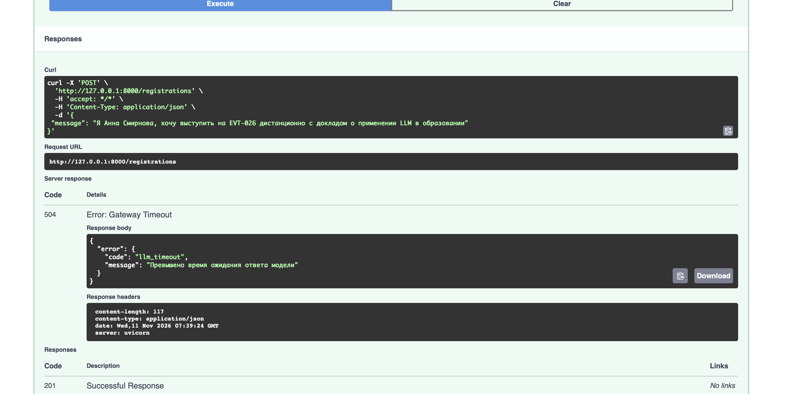

С 503 вышло интересно. Сначала я просто выключила сервер в LM Studio и ждала 503, а пришел 502 "Сервер модели вернул ошибку 403"

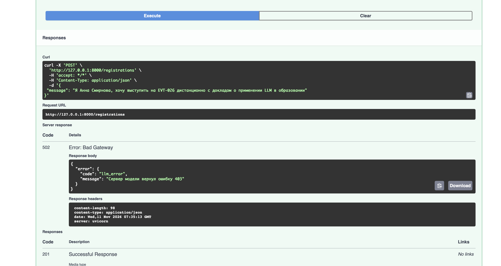

Оказалось это опять AirPlay. LM Studio выключен, а на порту 7000 все равно слушает AirPlay Receiver и отвечает 403. То есть сервер не недоступен, он ответил, просто ошибкой, и сервис это правильно отличил. Чтобы проверить именно 503, поменяла в .env порт на 7001 где вообще ничего нет

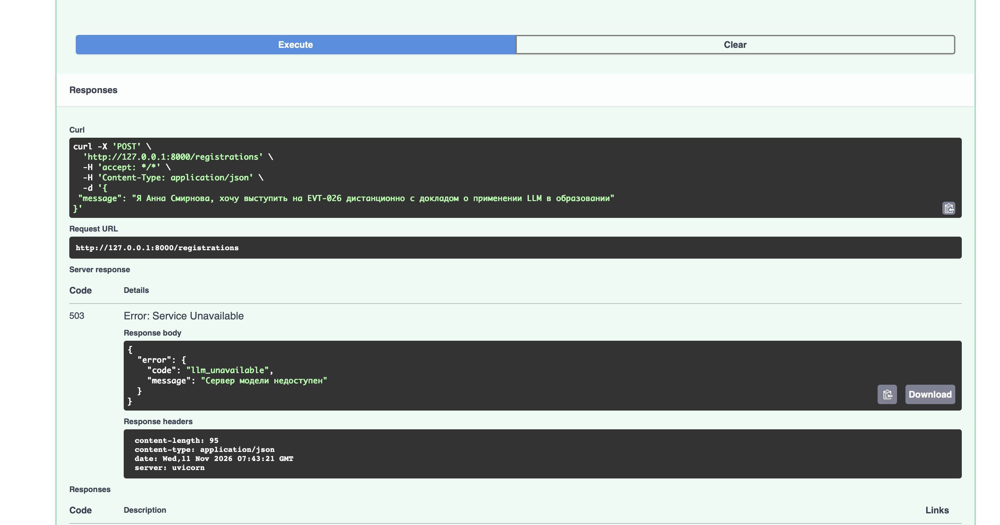

502 на кривой ответ модели проверила тестами, настоящую модель заставить вернуть сломанный JSON сложно, а в задании разрешены заглушки

### Тесты

В tests/test_api.py 23 теста. Вместо модели там заглушка, а вместо PostgreSQL SQLite в памяти, поэтому тестам не нужны ни LM Studio ни докер. Проверяются matched, not_found и not_provided, 422 на разные неправильные запросы, 502 на 9 видов плохого ответа модели (не JSON, нет ключа, лишний ключ, не та категория, список вместо строки и тд), 503 и 504. Во всех случаях с ошибкой проверяется что в базу ничего не записалось

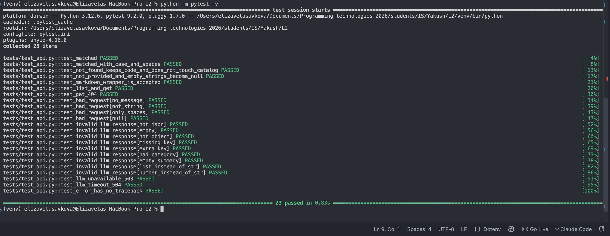

### Что в базе в конце

В справочнике так же 5 мероприятий, EVT-999 туда не добавился. В registrations 5 записей, только успешные, все запросы с ошибками в базу не попали

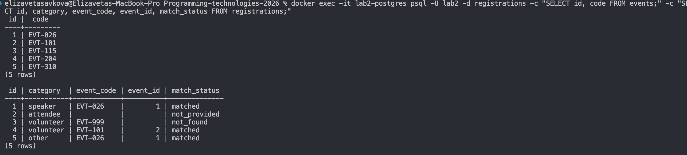


## Вывод

Сделала сервис на FastAPI, который через локальную модель достает из сообщения шесть полей, проверяет ответ pydantic, ищет код в справочнике и сохраняет все в PostgreSQL в докере. На всех пяти сценариях модель ответила правильно и ничего не придумала, а категорию определяла по смыслу а не по словам

Что заметила

- один запрос идет 35-60 секунд, почти все время модель думает. Для настоящего сервиса это долго
- проверка схемы не значит что ответ правильный, если бы модель перепутала категорию, pydantic бы это не заметил. Поэтому ответы все равно нужно сравнивать с текстом
- ошибки сервера модели бывают разные, выключенный LM Studio дал 502 из за AirPlay, а не 503
- модель только возвращает JSON, а с базой работает код, поэтому модель не может ничего сломать в справочнике
