# Отчет по лабораторной работе №3

Интеграция RAG в рабочий процесс языковой модели

Выполнила: Якуш Елизавета, ИС-23


## Что делала

Нужно было сделать классический RAG и еще один метод на выбор. Вторым методом взяла Text-to-SQL, потому что у меня диплом про диагностику сетевой инфраструктуры и там как раз будут вопросы вида "сколько аварий было на коммутаторе за месяц", а такое лучше считать запросом к таблице, чем искать по кускам текста

Получился ассистент для отдела эксплуатации сети вымышленного предприятия ООО «Северный контур». Модель сама решает, искать ответ в документах, лезть в базу или отвечать сразу


## База знаний

Документы сгенерировала под тему диплома, 5 файлов Word в `docs/source`

- руководство по коммутаторам, там коды аварий (L101, P301, T401 и тд) и что делать инженеру
- регламент обработки инцидентов, приоритеты P1-P4, сроки, эскалация, внутренние номера
- реестр оборудования, коды устройств, где стоят, IP, ответственные, ЗИП
- инструкция по мониторингу, метрики и пороги
- журнал выполненных работ с причинами отказа

Для Text-to-SQL сделала SQLite базу `data/network.db` с тремя таблицами: devices (устройства), events (события мониторинга) и tickets (заявки). Заполняется скриптом `seed_db.py`, там 9 устройств, 25 событий и 15 заявок


## Стек и структура

Python, FastAPI, векторная БД Qdrant в локальном режиме (хранится файлами в папке `qdrant`, отдельный сервер не нужен), эмбеддинги bge-m3 через sentence-transformers, модель qwen3.5-4b в LM Studio как в прошлых лабах

По заданию нужно было разбить на уровни DB -> Logic -> API, так и сделала

```
L3/
├── app/
│   ├── db/
│   │   ├── vector_store.py   Qdrant: запись и поиск точек
│   │   └── sql_store.py      SQLite: схема и выполнение SELECT только на чтение
│   ├── logic/
│   │   ├── documents.py      чтение docx
│   │   ├── chunking.py       нарезка на фрагменты
│   │   ├── embeddings.py     векторы bge-m3
│   │   ├── indexing.py       индексация и поиск
│   │   ├── llm.py            вызов модели
│   │   ├── text_to_sql.py    перевод вопроса в SQL
│   │   └── assistant.py      ассистент с инструментами
│   ├── api/
│   │   ├── schemas.py        pydantic схемы
│   │   └── main.py           эндпоинты и ошибки
│   ├── config.py
│   └── errors.py
├── docs/source/              документы
├── docs/temp/                нарезанные фрагменты
├── tests/
└── seed_db.py
```

API знает только про logic, logic про db, а db ничего не знает про модели


## Настройка

Сделала окружение и поставила зависимости, ставилось долго потому что тянет torch

```bash
python3.12 -m venv venv
source venv/bin/activate
pip install -r requirements.txt
```

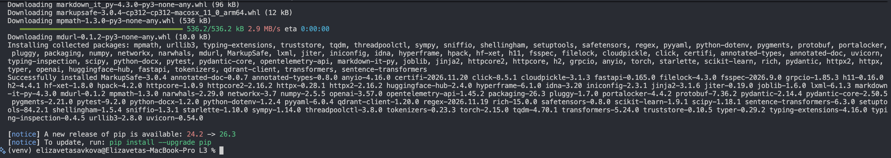

Токен LM Studio опять в .env, который в .gitignore, в репозитории только .env.example

Тесты и база событий

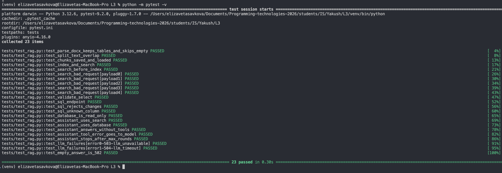


В LM Studio загрузила qwen3.5-4b с контекстом 16384. Во второй лабе было 8192, но тут в запрос попадают еще найденные фрагменты, а модель думающая и тратит много токенов на рассуждения

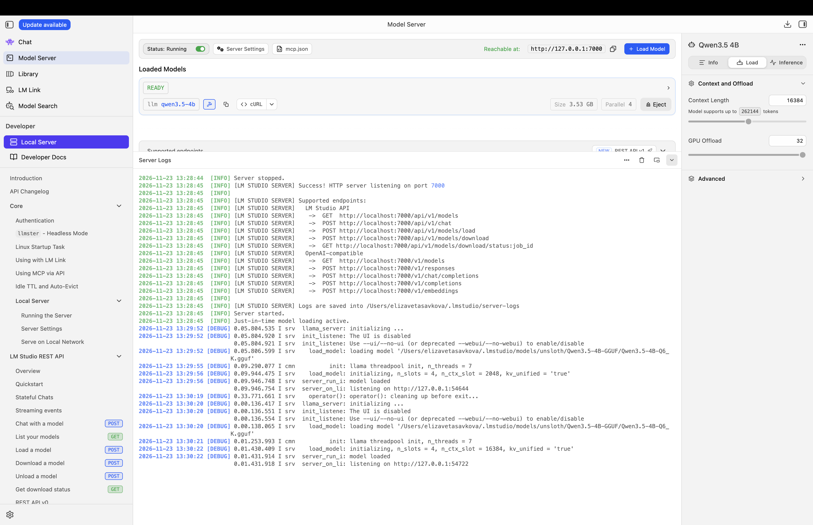

Запуск `uvicorn app.api.main:app --reload`

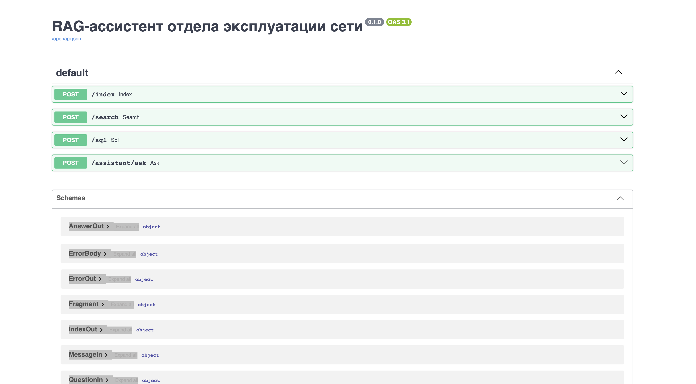


## 3.1 Чтение и нарезка на чанки

Из docx забираю абзацы и таблицы по порядку, пустые абзацы пропускаю. Ячейки строки таблицы склеиваю через `|`, чтобы код аварии и действие остались рядом

Длину фрагмента считаю токенами bge-m3, а не символами, токенайзер беру от той же модели. Размер 600 токенов, перекрытие 60, как в примере. Шаг получается 540, поэтому конец одного фрагмента повторяется в начале следующего и фраза на стыке не теряется

Фрагменты сохраняются в `docs/temp`, их можно открыть и посмотреть

## 3.2 Запись в Qdrant

Векторы считает bge-m3, они нормализуются, расстояние косинусное. При каждой индексации коллекция `docs` пересоздается, чтобы старые фрагменты не смешались с новыми. В точку кроме вектора пишу имя документа, номер фрагмента и текст

Все это делает `POST /index`. В первый раз долго, скачивается bge-m3 примерно 2,3 ГБ. Получилось 5 документов и 9 фрагментов

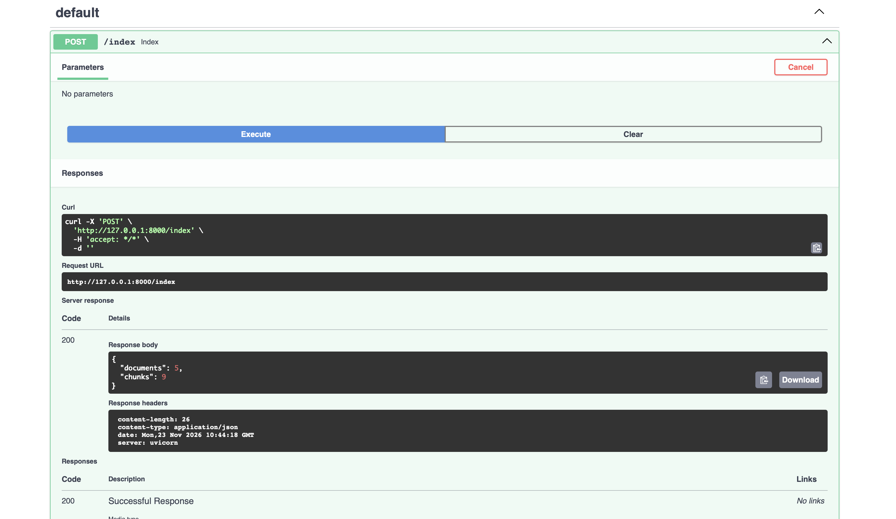

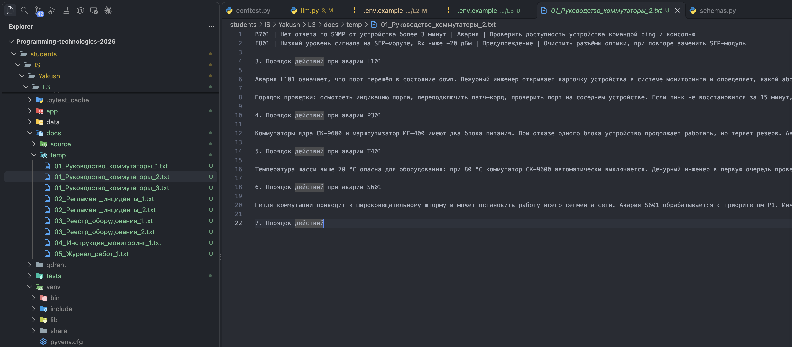

## 3.3 Поиск

`POST /search` превращает запрос в вектор и ищет ближайшие фрагменты, по умолчанию 3. На запрос "что делать при перегреве коммутатора" первым нашелся фрагмент руководства где описан порядок действий при T401

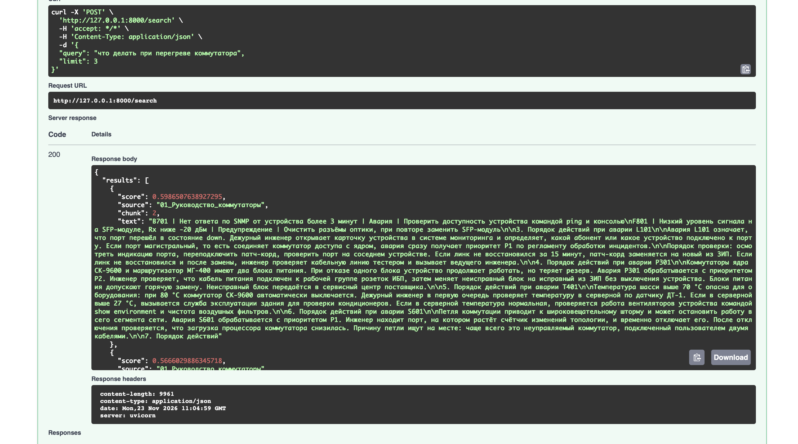

## 3.4 Генерация ответа

Ответ пишет qwen3.5-4b через `POST /assistant/ask`. Я передаю модели описание двух инструментов (tool calling) и она сама выбирает

- `search_knowledge_base` поиск по документам
- `query_database` запрос к базе событий и заявок

Если модель вызвала инструмент, сервис выполняет его, результат возвращается в диалог с тем же `tool_call_id` и модель вызывается еще раз, уже чтобы написать ответ. В системной инструкции написано брать коды, номера и числа только из результатов и ничего не придумывать. Больше 3 кругов с инструментами не даю, чтобы модель не зациклилась

В ответе API кроме `answer` есть `tool_calls`, там видно какой инструмент вызвался, с какими аргументами и что вернул


## 4. Text-to-SQL

Для перевода вопроса в SQL отдельный вызов модели со своим промптом, где описана схема таблиц, допустимые статусы, причины отказа и формат дат. Модели передается и исходная реплика пользователя

Модель может написать что угодно, поэтому запрос проверяется

- должен начинаться с SELECT
- внутри не должно быть `;`, чтобы нельзя было дописать второй запрос
- база открывается только на чтение (`mode=ro`), так что даже если что то пролезет, изменить данные не получится
- строк отдаю не больше 50

Отдельно его можно проверить через `POST /sql`. На вопрос "Какие заявки ещё не закрыты?" модель написала `SELECT * FROM tickets WHERE status != 'Закрыто'` и вернулось 6 заявок, это правильно

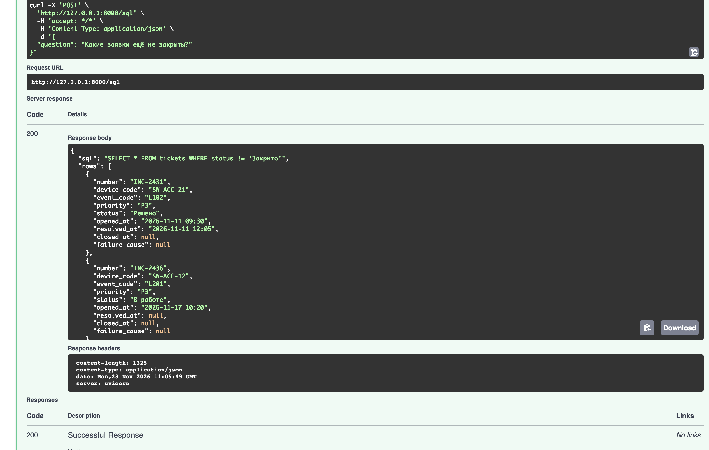


## Проверка ассистента

| Вопрос | Инструмент | Результат |
|---|---|---|
| Какой код аварии при потере линка на порту и что делать? | поиск | L101, проверить патч-корд и порт, верно |
| Кто ведущий инженер и какой у неё внутренний номер? | поиск | Сергеева Марина Олеговна, 4402, верно |
| Сколько событий было на SW-ACC-21 в ноябре 2026? | SQL | 3, верно |
| Какие заявки сейчас в работе и по какому оборудованию? | SQL | INC-2436 SW-ACC-12 и INC-2437 SW-CORE-02, верно |
| Что такое коммутатор? | без инструментов | общий ответ |
| Какая зарплата у Сергеевой? | без инструментов | ответила что такой информации нет |

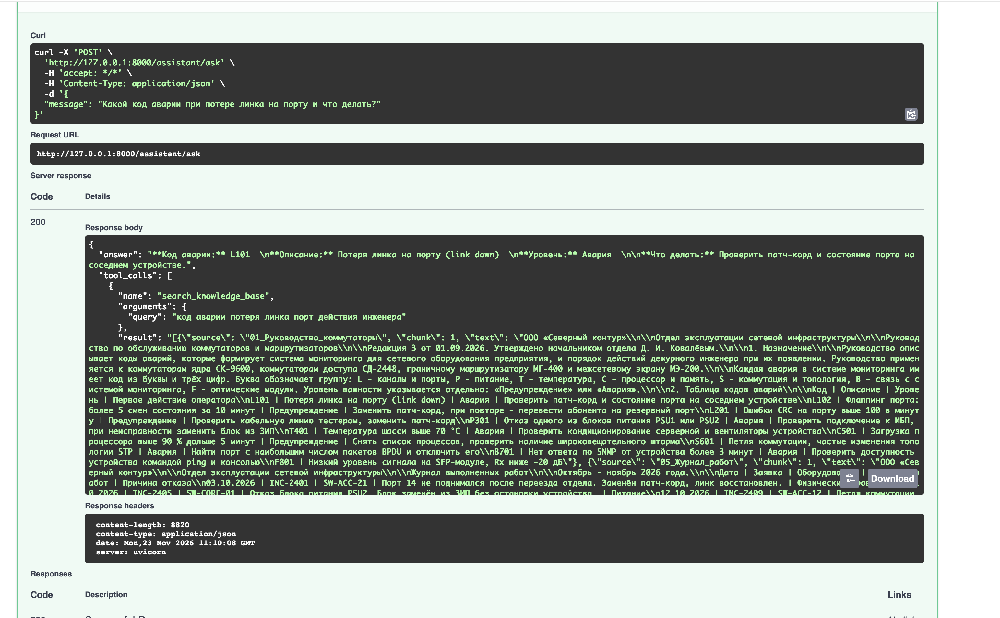

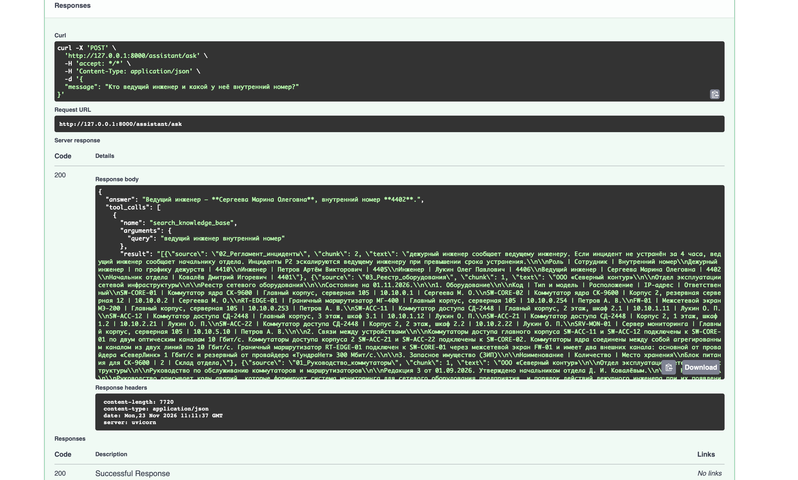

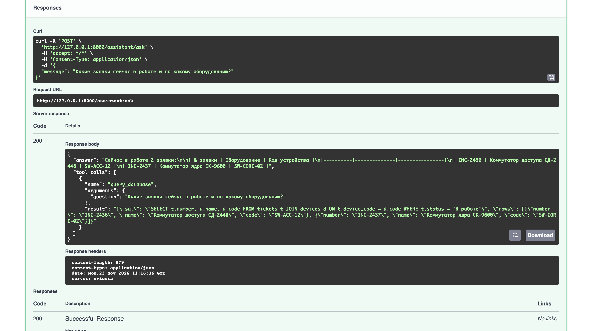

Тут модель сама сделала JOIN с таблицей устройств, чтобы показать название оборудования

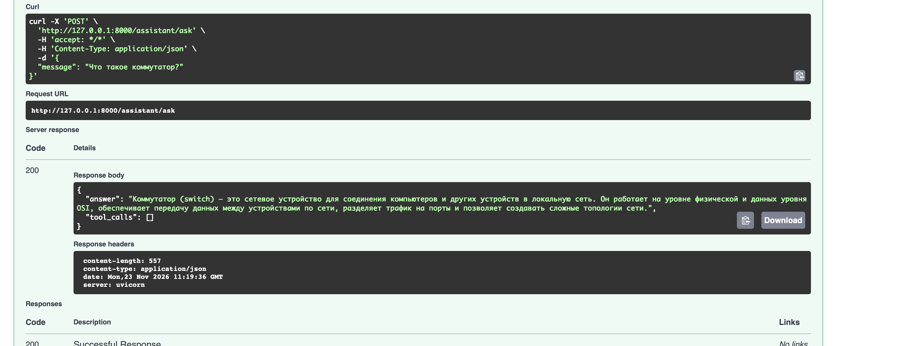

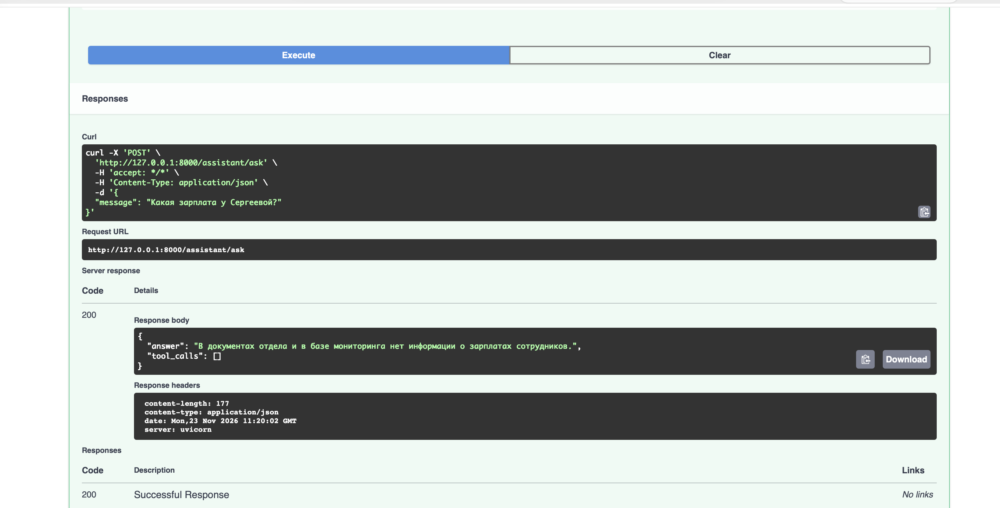

### Проблема с max_tokens

Вопрос про события в ноябре сначала не прошел. Модель думающая, и при генерации SQL она так долго рассуждала про даты, что потратила все 4000 токенов и до самого запроса не дошла. Сервис это поймал (`finish_reason = length`), вернул в диалог ошибку инструмента, и ассистент честно ответил что не смог получить данные, а не выдумал число

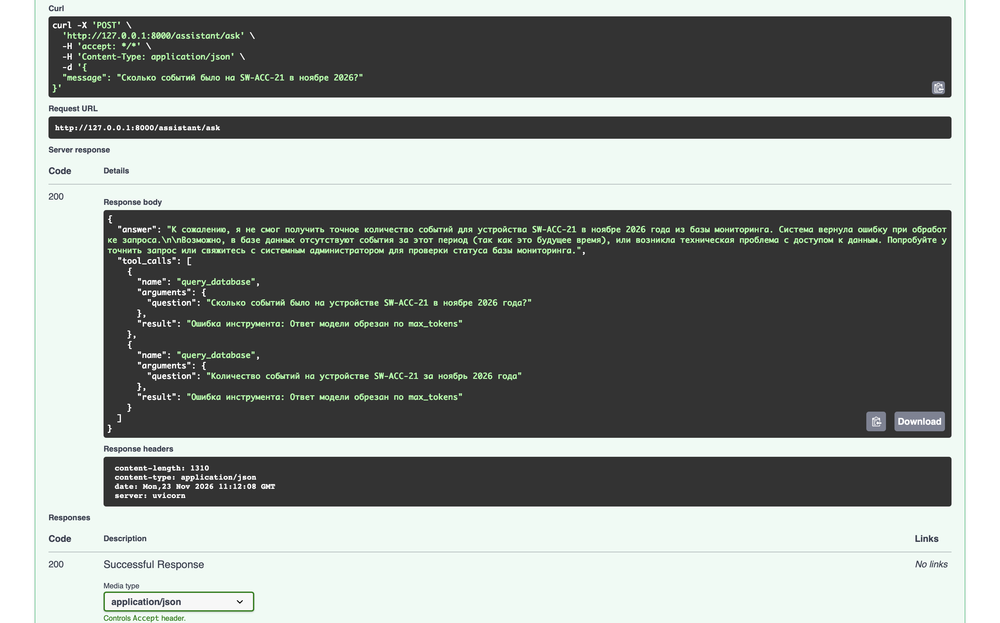

Исправила двумя вещами: подняла max_tokens до 8000 (контекст 16384 это позволяет) и добавила в промпт пример как отбирать за месяц, `occurred_at LIKE '2026-11-%'`. После этого модель сразу написала правильный запрос

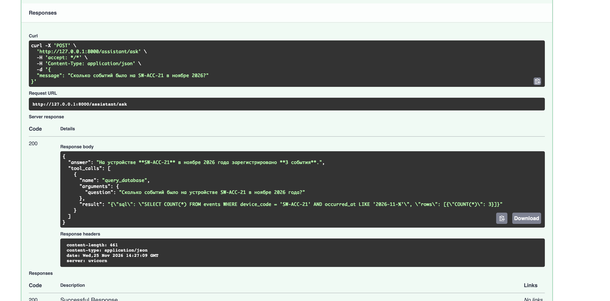


## Ошибки и тесты

Ошибки в одном формате как во второй лабе: 422 неверный запрос, 409 если искать до индексации, 502 плохой ответ модели или неправильный SQL, 503 модель недоступна, 504 тайм-аут

23 теста на pytest, вместо bge-m3, Qdrant и модели заглушки. Проверяют разбор docx, нарезку с перекрытием, индексацию и поиск, проверку SELECT, что база не дает изменять данные, вызовы инструментов ассистентом и ошибки


## Выводы

- RAG реально помогает: про коды аварий, номера телефонов и заявки модель сама ничего знать не может, а с поиском отвечает правильно
- модель нормально сама выбирает инструмент, на документы идет в поиск, на подсчеты в базу, на общие вопросы отвечает сразу
- Text-to-SQL для подсчетов и списков лучше векторного поиска, по кускам журнала модель бы не посчитала точно, а запрос возвращает ровно нужные строки
- SQL от модели нельзя выполнять как есть, нужна проверка и доступ только на чтение
- думающая модель может съесть весь лимит токенов на рассуждения, это надо учитывать в max_tokens и контексте, а подсказки в промпте сокращают рассуждения
- найденные фрагменты по 600 токенов довольно большие, в ответ попадает много лишнего текста. В CRAG такие фрагменты модель отсеивала бы отдельным шагом
