# Лабораторная работа № 0. Знакомство с OpenAI API. Написание простого чат-бота

## 1. Цель работы

Познакомиться с принципами взаимодействия с языковыми моделями через API, разработать консольного чат-бота на языке Python, реализовать управление системным промптом, настройками генерации и историей диалога.

## 2. Задачи работы

В ходе выполнения лабораторной работы необходимо:

1. Создать виртуальное окружение Python и установить необходимые библиотеки.
2. Настроить подключение к API языковой модели.
3. Вынести параметры программы и системный промпт в отдельный файл `.env`.
4. Реализовать отправку сообщений модели и получение ответов.
5. Организовать хранение истории диалога с ограничением количества сообщений.
6. Добавить возможность изменения системного промпта и параметров генерации.
7. Проверить работу основных команд чат-бота.
8. Подготовить отчёт о проделанной работе.

## 3. Используемые технологии

В ходе выполнения работы использовались следующие инструменты и библиотеки:

- **Python** — язык программирования, на котором реализован чат-бот.
- **OpenAI Python SDK** — библиотека для взаимодействия с API через совместимый интерфейс.
- **OpenRouter API** — сервис для обращения к языковым моделям.
- **python-dotenv** — библиотека для загрузки настроек из файла `.env`.
- **Виртуальное окружение Python** — средство изоляции зависимостей проекта.

Для взаимодействия с моделью используется интерфейс Chat Completions API, совместимый с клиентом библиотеки `openai`.

## 4. Структура проекта

Проект состоит из четырёх файлов:

```text
lab_chatbot/
├── .env
├── main.py
├── requirements.txt
└── .gitignore
```

Назначение файлов:

| Файл | Назначение |
|---|---|
| `.env` | Хранение API-ключа, адреса API, названия модели, системного промпта и параметров генерации |
| `main.py` | Основной код чат-бота |
| `requirements.txt` | Перечень зависимостей Python |
| `.gitignore` | Исключение конфиденциальных данных и служебных файлов из системы контроля версий |

Такое разделение позволяет отделить программную логику от настроек и упростить изменение параметров без редактирования основного кода.

## 5. Ход выполнения работы

### 5.1. Подготовка окружения

Для проекта было создано виртуальное окружение Python:

```bash
python -m venv .venv
```

После создания окружение активируется командой для используемой оболочки Windows.

Для установки библиотек используется команда:

```bash
python -m pip install -r requirements.txt
```

В файл `requirements.txt` внесены следующие зависимости:

```text
openai>=2.0.0,<3.0.0
python-dotenv>=1.0.1,<2.0.0
```

Использование виртуального окружения позволяет изолировать зависимости проекта от других Python-приложений.

### 5.2. Настройка подключения к API

Для доступа к языковой модели используется API-ключ, созданный в сервисе OpenRouter.

Настройки подключения вынесены в файл `.env`:

```dotenv
OPENROUTER_API_KEY=ваш_api_ключ
BASE_URL=https://openrouter.ai/api/v1
MODEL=openrouter/free
SYSTEM_PROMPT=Ты полезный русскоязычный ассистент. Отвечай понятно и по существу.
REASONING_EFFORT=medium
TEMPERATURE=1.0
```

API-ключ считывается из переменной окружения с помощью библиотеки `python-dotenv`. Это позволяет не хранить секретный ключ непосредственно в исходном коде программы.

В качестве модели указан `openrouter/free`, представляющий бесплатный маршрутизатор моделей OpenRouter. 

Для создания клиента используется следующий фрагмент кода:

```python
client = OpenAI(
    api_key=API_KEY,
    base_url=BASE_URL
)
```

Параметр `api_key` отвечает за авторизацию, а `base_url` указывает адрес API, к которому направляются запросы.

### 5.3. Реализация чат-бота

Основная логика программы находится в файле `main.py`.

Программа загружает настройки, создаёт клиент API, инициализирует историю диалога и переходит в цикл обработки сообщений пользователя.

При получении сообщения программа формирует список сообщений, содержащий системный промпт, предыдущие реплики и новый запрос пользователя. Затем сформированный запрос отправляется языковой модели.

Ответ извлекается из результата API и выводится в консоль. После успешного получения ответа сообщение пользователя и ответ ассистента добавляются в историю диалога.

Если при обращении к API возникает ошибка, программа выводит сообщение об ошибке, не завершая работу всего чат-бота.

### 5.4. Работа с системным промптом

Системный промпт определяет общие инструкции для языковой модели: роль ассистента, стиль общения и требования к ответам.

В разработанной программе системный промпт хранится в переменной `SYSTEM_PROMPT` файла `.env`.

Для повторной загрузки системного промпта реализована функция `load_system_prompt()`. Она позволяет изменять инструкции во время работы программы без перезапуска чат-бота.

Для применения новых инструкций используется команда:

```text
/prompt
```

После её ввода программа повторно считывает системный промпт из `.env`.

Таким образом, можно изменять поведение чат-бота, редактируя настройки, а не исходный код.

### 5.5. Ограничение истории диалога

Для сохранения контекста общения в программе реализован список `history`.

История содержит сообщения двух типов:

- `user` — сообщения пользователя;
- `assistant` — ответы языковой модели.

Для ограничения объёма передаваемого контекста сохраняются последние шесть сообщений. При наличии полной истории это соответствует трём сообщениям пользователя и трём ответам ассистента.

После добавления очередной пары сообщений выполняется удаление устаревших записей:

```python
del history[:-6]
```

Перед отправкой запроса модели в список сообщений добавляется системный промпт. Он передаётся отдельно и не учитывается в лимите шести сообщений истории.

Для очистки истории предусмотрена команда:

```text
/clear
```

После её выполнения предыдущие сообщения удаляются из текущей истории, и дальнейшее общение начинается без сохранённого контекста.

### 5.6. Управление параметрами генерации

В программе предусмотрены два параметра, позволяющих экспериментировать с формированием ответов.

**Temperature** — параметр, влияющий на вариативность генерации. При меньших значениях ответы обычно более предсказуемы, а при больших может увеличиваться разнообразие формулировок.

В программе температура задаётся переменной `TEMPERATURE` в файле `.env`. Дополнительно её можно изменить во время работы командой:

```text
/temperature
```

Для температуры установлен допустимый диапазон от 0 до 2.

**Reasoning effort** — параметр, управляющий уровнем рассуждения модели, если выбранная модель поддерживает такую возможность.

В программе предусмотрены уровни:

- `none` — без дополнительной настройки уровня рассуждения;
- `low` — низкий уровень;
- `medium` — средний уровень;
- `high` — высокий уровень.

Для изменения уровня во время работы используется команда:

```text
/reasoning
```

Поддержка параметров зависит от конкретной модели, выбранной через OpenRouter. Поэтому результаты экспериментов необходимо оценивать с учётом возможностей используемой модели.

### 5.7. Реализованные команды

Для управления чат-ботом предусмотрены следующие команды:

| Команда | Назначение |
|---|---|
| `/help` | Вывод списка доступных команд |
| `/clear` | Очистка истории диалога |
| `/prompt` | Повторная загрузка системного промпта |
| `/reasoning` | Изменение уровня рассуждения |
| `/temperature` | Изменение температуры |
| `/exit` | Завершение работы программы |

Команды позволяют управлять настройками и состоянием диалога без изменения исходного кода.

## 6. Проведение экспериментов и анализ результатов

В ходе тестирования чат-бота были проведены эксперименты с системным промптом, контекстом диалога, температурой генерации и уровнем рассуждения. Ниже приведены фактические результаты, зафиксированные на скриншотах работы программы. В экспериментальных запросах использовался интерфейс OpenRouter; при маршрутизации `openrouter/free` конкретная обслуживающая модель может меняться.

### 6.1. Эксперимент № 1. Изменение системного промпта

**Цель:** проверить, как системные инструкции влияют на стиль и подробность ответа.

**Первый вариант.** В `.env` установлен промпт: «Ты полезный русскоязычный ассистент. Отвечай понятно и по существу». Параметры: `REASONING_EFFORT=medium`, `TEMPERATURE=1.0`.

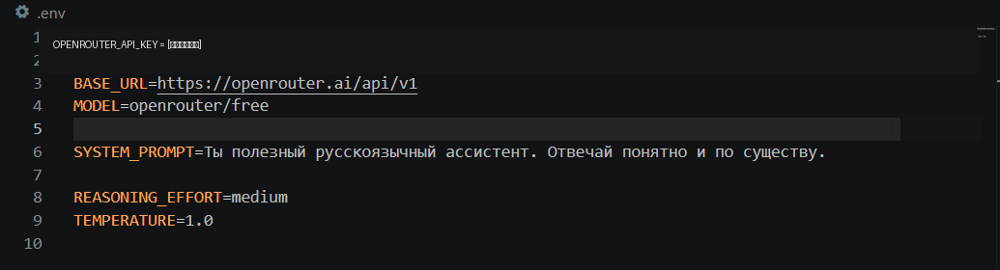

*Рисунок 1 — Исходный системный промпт (API-ключ скрыт).*

Пользователь задал вопрос: **«Объясни, что такое API, простыми словами.»** Ассистент ответил в разговорном стиле, использовал аналогию с официантом в ресторане и привёл бытовой пример.

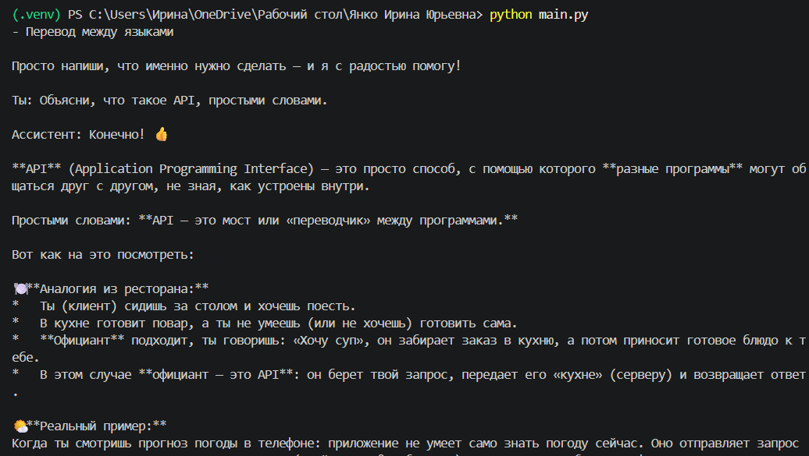

*Рисунок 2 — Ответ ассистента при исходном системном промпте.*

**Второй вариант.** Системный промпт заменён на: «Ты преподаватель информатики. Объясняй сложные понятия простым языком, используй короткие предложения и обязательно приводи один пример».

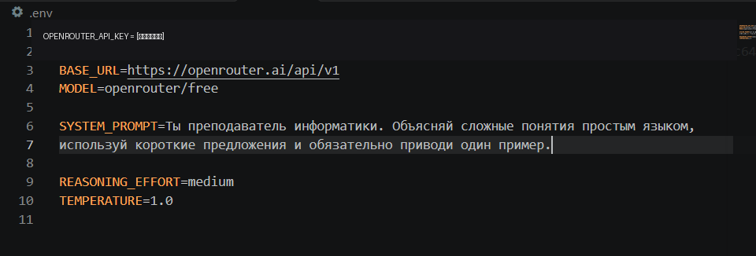

*Рисунок 3 — Промпт с ролью преподавателя информатики (API-ключ скрыт).*

Для проверки введён вопрос: **«Что такое нейронная сеть?»** Модель представила материал как учебное объяснение: дала определение, описала нейроны, слои, веса, активацию и обучение, а также привела пример распознавания кошки.

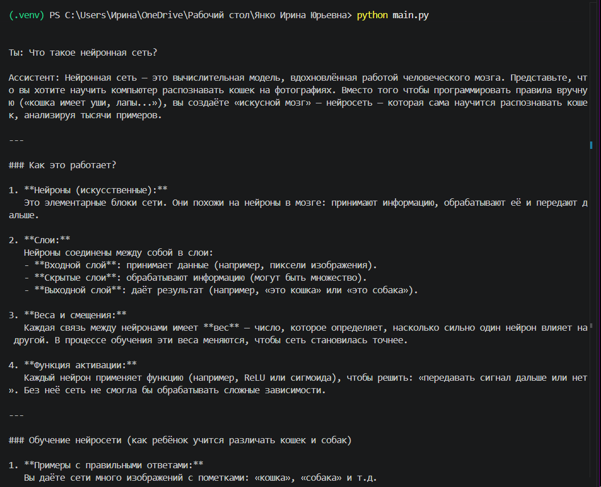

*Рисунок 4 — Структурированное объяснение принципов работы нейронной сети.*

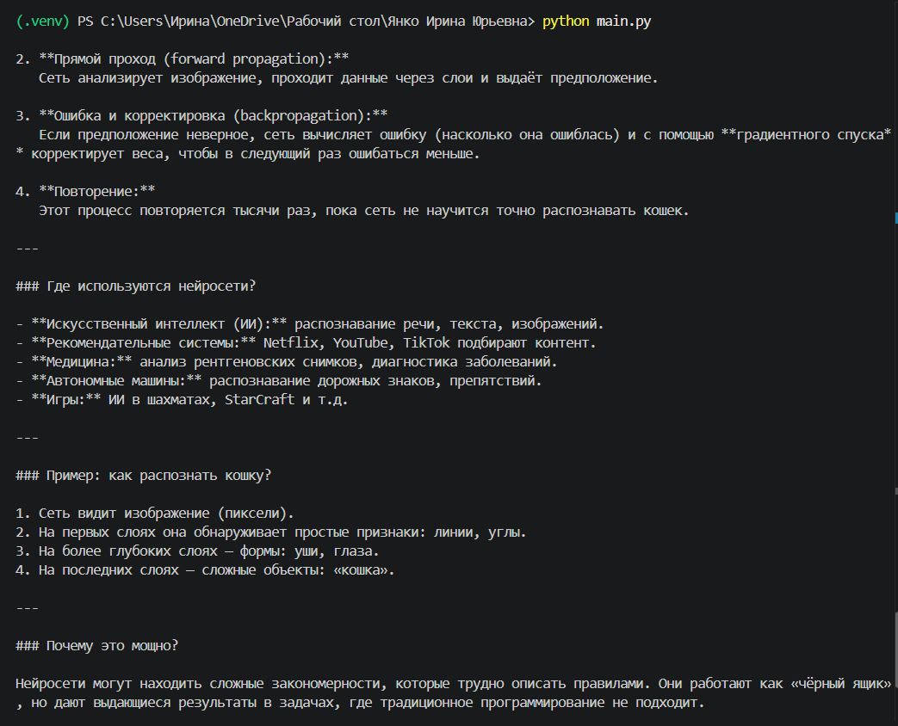

*Рисунок 5 — Продолжение объяснения с примерами применения.*

**Анализ:** при роли преподавателя ответ стал более учебным и структурированным, с подзаголовками и поэтапным объяснением. При этом в двух случаях использовались разные вопросы, поэтому скриншоты демонстрируют соответствие ответа инструкции, но не являются строго контролируемым сравнением одного запроса.

### 6.2. Эксперимент № 2. Сохранение контекста и очистка истории

**Цель:** проверить, сохраняет ли программа сведения из предыдущих сообщений и можно ли сбросить контекст.

Пользователь сообщил: **«Запомни для этого разговора: мой любимый язык программирования — Python.»** Затем спросил: **«Какой язык программирования я назвал любимым?»** Ассистент правильно назвал Python.

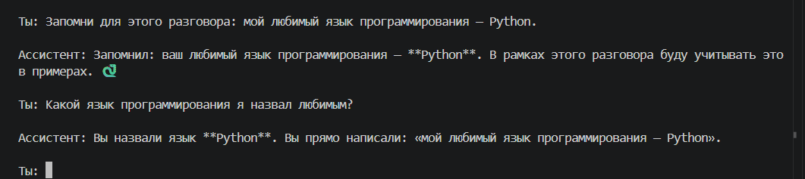

*Рисунок 6 — Успешное использование сохранённого контекста.*

Затем была введена команда `/clear`. Программа вывела сообщение «История диалога очищена». При повторном вопросе ассистент уже не назвал Python; вместо этого на скриншоте появился ответ `User Safety: safe`, который не является содержательным ответом на вопрос.

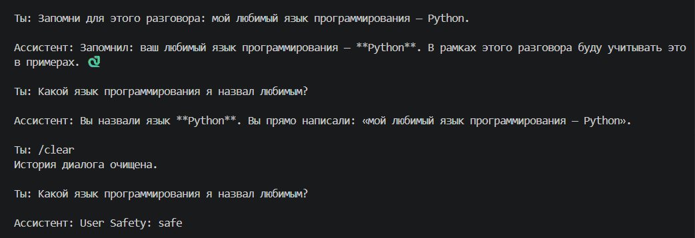

*Рисунок 7 — Очистка истории и ответ после сброса контекста.*

**Анализ:** до очистки ассистент использовал сведения из предыдущих реплик. После `/clear` программа сбросила историю, и прежний факт не был воспроизведён. Однако последний ответ оказался некорректным по содержанию; это ограничение конкретного результата генерации, а не подтверждение качественного ответа модели после очистки. Реализованный предел хранения — шесть сообщений — следует из кода, а на данных снимках отдельно не проверялось вытеснение более старых реплик.

### 6.3. Эксперимент № 3. Изменение температуры генерации

**Цель:** сравнить ответы на творческий запрос при разных значениях `TEMPERATURE`.

Использован запрос: **«Придумай три необычных названия для приложения, которое помогает изучать программирование.»**

При `TEMPERATURE=0.2` модель предложила названия «Кодовая бабочка», «Синтезатор» и «Алгоритмичество», снабдив их пояснениями.

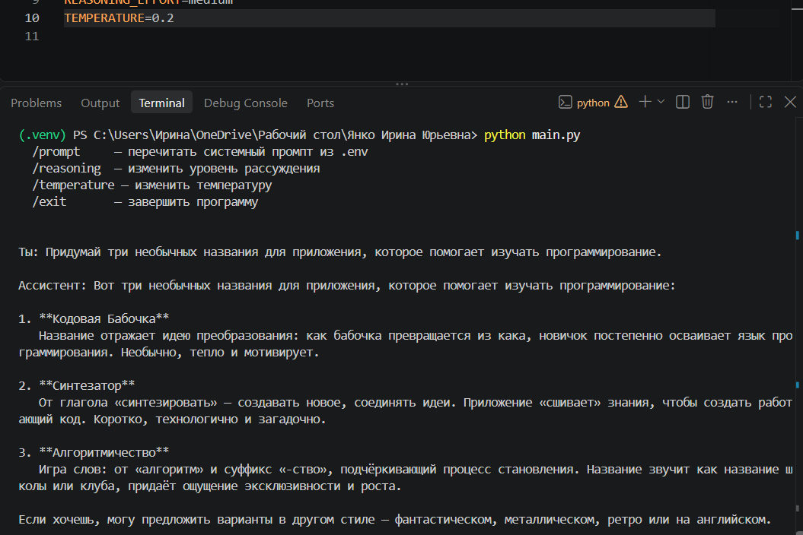

*Рисунок 8 — Результат при `TEMPERATURE=0.2`.*

При `TEMPERATURE=1.2` были получены варианты «SemiColon (; )», «Rubber Duck (Резиновая уточка)» и «Git Gud (Гит Гуд)» с более развёрнутыми объяснениями и слоганами.

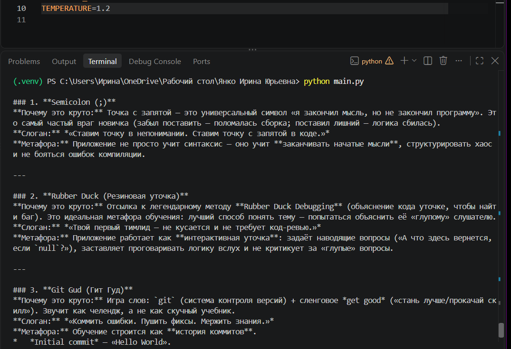

*Рисунок 9 — Результат при `TEMPERATURE=1.2`.*

**Анализ:** в представленных ответах при температуре 1.2 названия больше опираются на программистские термины и сопровождаются подробными ассоциациями. Однако одного запуска при каждом значении недостаточно, чтобы доказать устойчивую зависимость: различия могут быть связаны со случайностью генерации и маршрутизацией разных моделей. Кроме того, в реализованном коде `temperature` передаётся в запрос **только при `reasoning_effort=none`**. Поэтому если на снимках сохранялся `REASONING_EFFORT=medium`, изменение значения в `.env` само по себе не подтверждает, что API применил новую температуру. Скриншоты показывают разные ответы при разных настройках файла, но не изолированное действие температуры.

### 6.4. Эксперимент № 4. Изменение уровня рассуждения

**Цель:** сравнить ответы на арифметическую задачу при разных значениях `REASONING_EFFORT`.

Во всех трёх случаях использована задача: **«В магазине было 120 товаров. Утром продали 25% всех товаров, а после обеда продали ещё 18 товаров. Сколько товаров осталось? Объясни решение.»**

При `reasoning=none` модель выполнила вычисления и получила **72 товара**. На скриншоте виден выбор уровня `none` и пошаговый ответ.

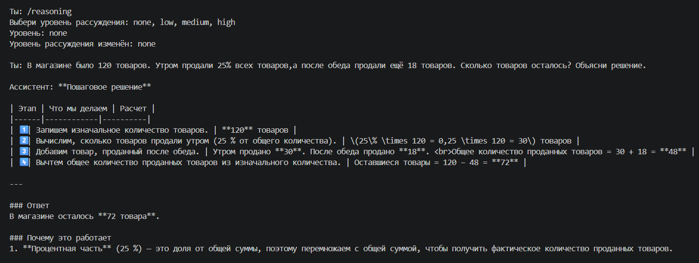

*Рисунок 10 — Решение при `REASONING_EFFORT=none`.*

При `reasoning=high` модель также получила **72 товара**, но оформила решение более подробно.

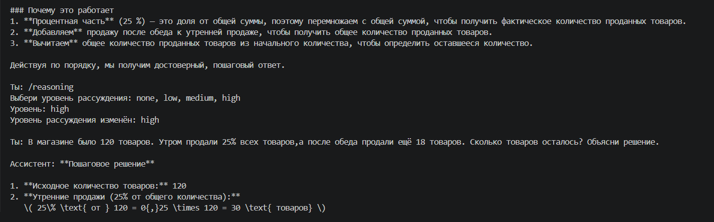

*Рисунок 11 — Выбор уровня `high` и начало решения.*

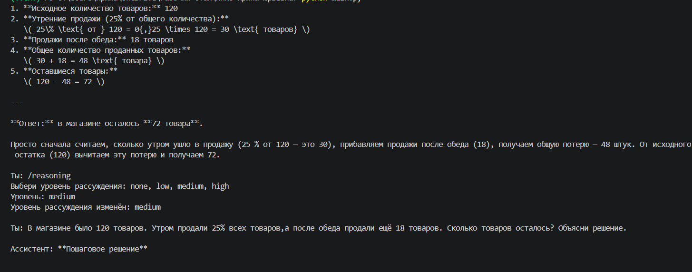

*Рисунок 12 — Продолжение подробного решения при `high`.*

При `reasoning=medium` результат снова составил **72 товара**.

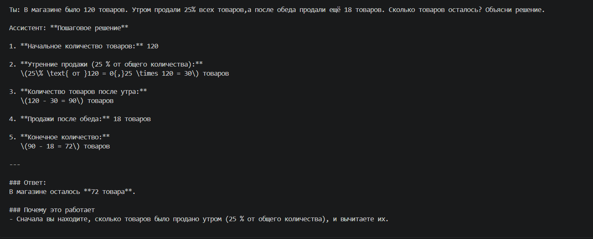

*Рисунок 13 — Решение при `REASONING_EFFORT=medium`.*

Проверка арифметики: `120 × 0,25 = 30`; `120 − 30 − 18 = 72`. Все три ответа совпали с правильным результатом.

| Уровень | Результат | Наблюдение по снимкам |
|---|---:|---|
| `none` | 72 | Приведено пошаговое решение |
| `high` | 72 | Решение более развёрнуто |
| `medium` | 72 | Приведено объяснение и вычисления |

**Анализ:** для простой задачи все уровни дали правильный результат. Наблюдались различия в оформлении и подробности ответа, однако скриншоты не позволяют проверить, как именно API обработал параметр `reasoning`, и не доказывают различия во внутренних вычислительных затратах.

### 6.5. Эксперимент № 5. Завершение работы программы

**Цель:** проверить корректное завершение программы по команде пользователя.

После ввода `/exit` чат-бот вывел сообщение «Работа чат-бота завершена», после чего управление вернулось в терминал PowerShell.


*Рисунок 14 — Корректное завершение программы.*

**Анализ:** команда `/exit` обработана успешно, программа завершила цикл ввода сообщений.

## 7. Результаты работы

В ходе выполнения лабораторной работы разработан консольный чат-бот на Python с подключением к OpenRouter API. Реализованы чтение конфигурации из `.env`, отправка сообщений, получение ответов, сохранение ограниченной истории, команда очистки контекста и настройка параметров генерации.

По представленным скриншотам подтверждены: получение ответов от модели, изменение системных инструкций, использование контекста диалога, очистка истории, получение решений при разных уровнях рассуждения и корректное завершение работы. Сравнение температуры носит иллюстративный характер и требует дополнительного контролируемого тестирования с передачей параметра в API.

## 8. Вывод

В результате лабораторной работы изучен способ обращения к языковым моделям через совместимый API с использованием Python. Разработана программа чат-бота, позволяющая вести диалог, задавать системные инструкции и управлять историей сообщений.

Проведённые эксперименты показали, что системные инструкции влияют на форму объяснений, а история позволяет модели учитывать ранее сообщённые факты. Команда `/clear` сбрасывает сохранённый контекст. При решении арифметической задачи на разных уровнях рассуждения модель получила одинаковый правильный ответ.

Также выявлено, что для корректной оценки влияния температуры необходимо убедиться в передаче соответствующего параметра в API и повторить одинаковые запросы несколько раз. Это подчёркивает важность контролируемых условий при сравнении поведения языковых моделей.
