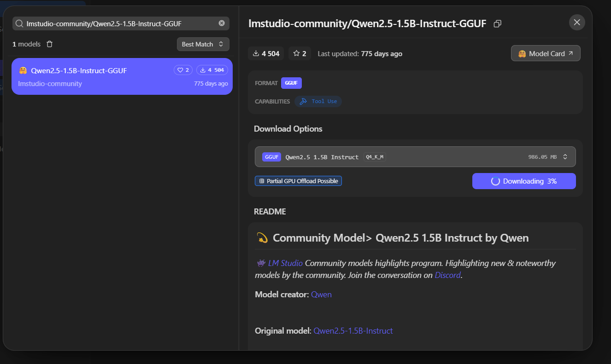
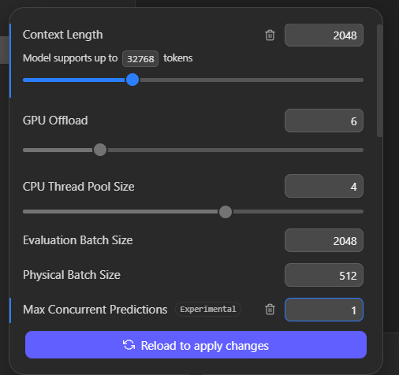
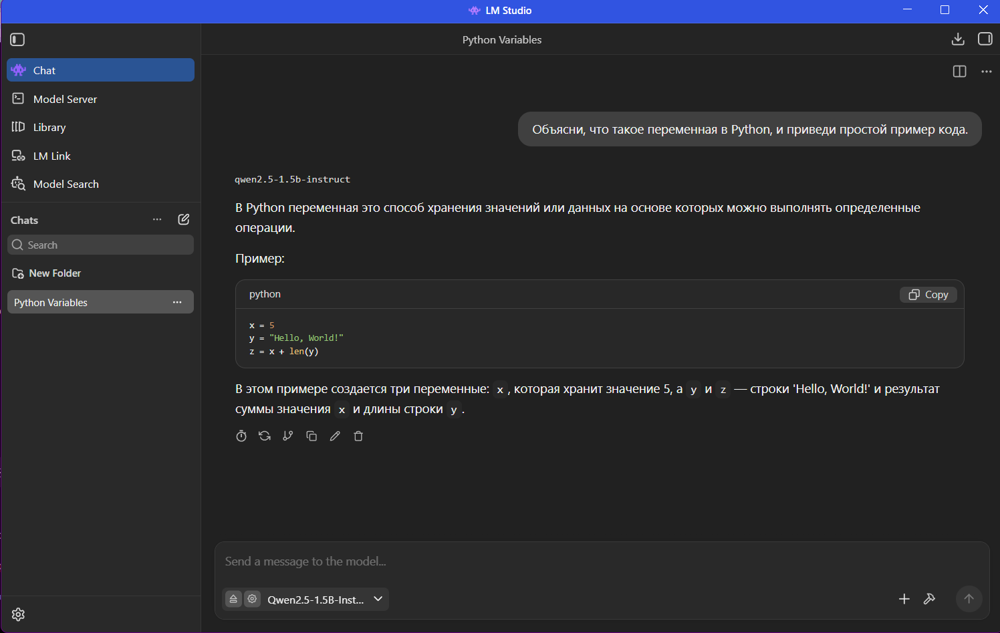
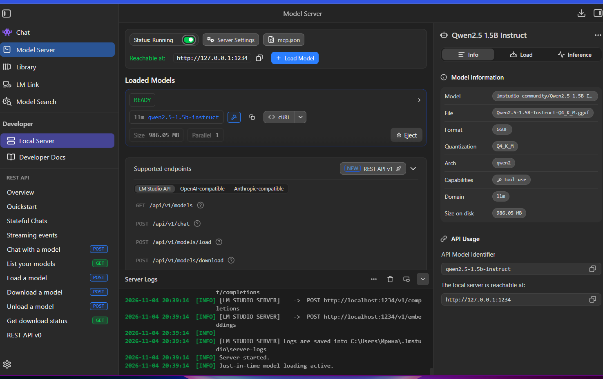
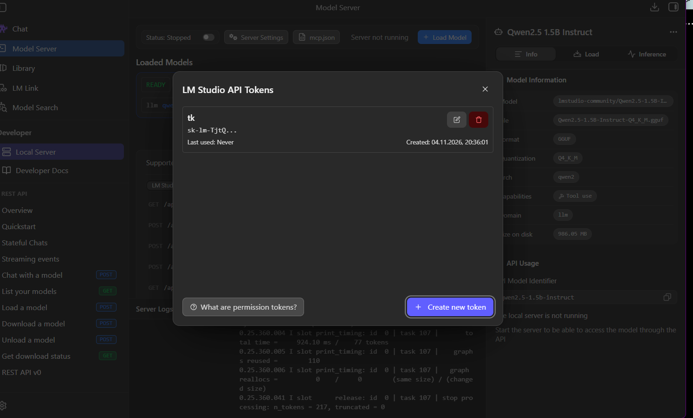
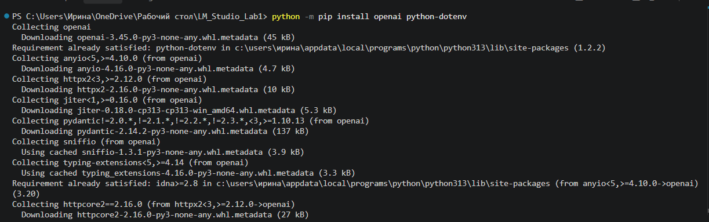
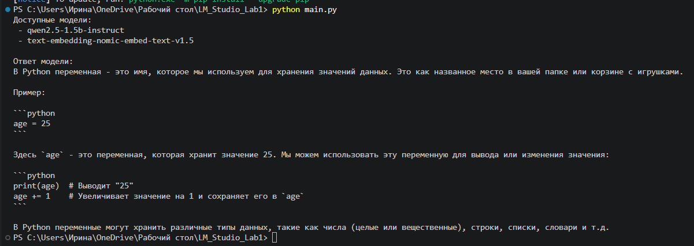
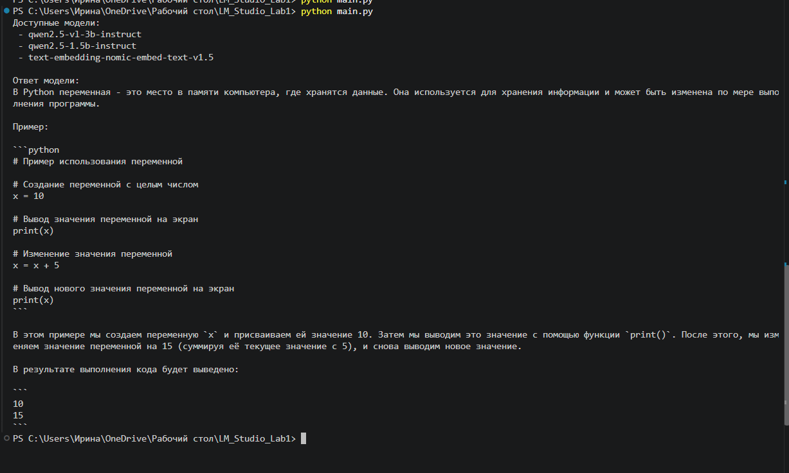

# Лабораторная работа №1
## Работа с локальными языковыми моделями в LM Studio

**Цель:** научиться запускать языковые модели на компьютере, отправлять им запросы через Python и сравнивать ответы.

### 1. Выбор моделей

Для работы я скачала в LM Studio две модели:

| Модель | Параметры | Квантование |
|---|---:|---|
| Qwen2.5-1.5B-Instruct | 1,5 млрд | Q4_K_M |
| Qwen2.5-VL-3B-Instruct | 3 млрд | Q4_K_M|

Первая модель работает с текстом, а вторая также поддерживает изображения. Обе использовались только для текстовых заданий.



*Рисунок 1 — Поиск и скачивание модели в LM Studio.*

### 2. Настройка и первый запуск

После загрузки модели я выставила контекст **2048 токенов** и разрешила обрабатывать **один запрос за раз**. Остальные показанные настройки: GPU Offload — 6, CPU Thread Pool Size — 4.



*Рисунок 2 — Настройки модели перед тестированием.*

Сначала я проверила модель в обычном чате LM Studio: попросила объяснить переменную в Python. Модель ответила и привела пример кода.



*Рисунок 3 — Первый ответ модели в чате.*

### 3. Подключение через Python

Далее я включила **Model Server** в LM Studio. Сервер работал по адресу `http://127.0.0.1:1234`. Для доступа был создан API-токен.



*Рисунок 4 — Запущенный сервер и загруженная модель.*



*Рисунок 5 — Управление API-токеном.*

В VS Code я установила библиотеки `openai` и `python-dotenv`, а затем написала `main.py` для отправки запроса. Адрес сервера, токен и название модели указала в `.env`.



*Рисунок 6 — Установка библиотек для Python.*



*Рисунок 7 — Ответ первой модели через локальный API.*



*Рисунок 8 — Проверка второй модели через Python.*

Обе модели успешно отвечали через локальный API. Запросы отправлялись по очереди, поэтому ограничение на один одновременный запрос не мешало работе.

### 4. Проверка пяти заданий

В `experiment.py` я проверила, как модели объясняют список Python, пишут функцию суммы чётных чисел, исправляют ошибку в коде, извлекают данные в JSON и отвечают на вопрос, для которого в тексте не хватает информации.

| Задание | Qwen 1.5B | Qwen VL 3B |
|---|---:|---:|
| Объяснение списка | 9,83 с | 14,33 с |
| Написание функции | 12,23 с | 15,60 с |
| Исправление ошибки | 22,38 с | 16,79 с |
| Ответ в JSON | 2,82 с | 4,63 с |
| Недостаточно информации | 5,34 с | 5,85 с |
| **Среднее время** | **10,52 с** | **11,44 с** |

Обе модели написали правильную функцию и смогли исправить ошибку в примере. Но в задании с JSON обе добавили оформление ```json, хотя требовался только сам JSON. Первая модель также неточно объяснила одну из ошибок и в последнем задании ошибочно написала, что текст не был предоставлен. Вторая модель в целом объясняла эти задания точнее.

*Примечание:* пятый запрос во второй серии был сформулирован немного иначе, поэтому сравнение не полностью одинаковое.

### 5. Проверка температуры

В файле `temperature_test.py` я шесть раз отправила первой модели один вопрос: написать функцию проверки простого числа. Три запуска были при температуре **0.2**, ещё три — при **1.0**.

| Температура | Время трёх запусков | Среднее |
|---|---|---:|
| 0.2 | 16,00; 16,11; 12,36 с | **14,82 с** |
| 1.0 | 17,30; 15,01; 11,83 с | **14,71 с** |

Код получился рабочим во всех шести случаях, но в объяснениях были ошибки. Например, при температуре 1.0 модель назвала число 7 составным, а в другом ответе утверждала, что 2 не является простым числом. При 0.2 объяснения тоже иногда были неточными.

Ответы отличались при обеих температурах, а среднее время почти не изменилось. Поэтому по этим шести запускам нельзя сказать, что высокая температура обязательно даёт больше ошибок.

### 6. Вывод

В ходе работы я научилась запускать модели в LM Studio, подключаться к ним из Python и сохранять ответы для сравнения. Обе модели справились с основными заданиями, но иногда ошибались в объяснениях и нарушали формат ответа.

**Для моих текстовых тестов удобнее Qwen2.5-1.5B-Instruct:** она занимает меньше памяти и в среднем отвечала немного быстрее. Вторая модель тоже работает хорошо и дополнительно умеет обрабатывать изображения, но эту возможность я не проверяла. Главный вывод — ответы локальных моделей, особенно код и объяснения, нужно проверять.
